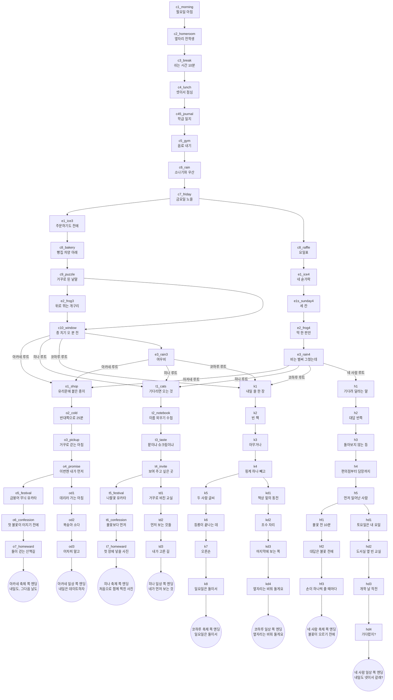

# 《내일도 같이 갈래?》 대본 — 검토용

> 이 문서는 `npm run export-script` 로 스토리 데이터(`src/story/scenes/*.ts`)에서 자동 생성된다. 직접 고치지 말고 장면 파일을 고친 뒤 다시 생성할 것.
> 이름·학교·날짜는 임시값(`src/story/config.ts`). 줄 끝의 `c1.010` 같은 값은 문장 고유 id(저장·읽음 기록용).
> 🖼 **[이벤트 CG]** 줄부터 그 CG 가 화면 가득 떠 있다. `〔이벤트 CG 걷기〕` 또는 배경 전환(자동으로 걷힘)에서 사라진다. CG 파일·표시 구간 목록은 `docs/ASSETS.md`.

## 등장인물(임시 이름)

- 주인공: 아오야마 소우타 — 2학년, 1인칭 화자(그림 없음)
- 소꿉친구: 미즈하라 아카네 — 츤데레, 유치원 때부터의 이웃
- 전학생: 사쿠라이 히나 — 세 번째 전학, 솔직하게 다가가는 성격
- 숨은 후배: 나루세 코하루 — 1학년, 상점가 문구점 집 딸. 금요일 하교 때 두 히로인 점수 차가 1 이하인 플레이에서만 등장
- 무대: 아사히가오카 고등학교 2학년 3반, 아사히가오카 동네 / 공통 7월 6일 월요일 ~ 7월 13일 월요일 방과 후, 루트 본편 7월 13일 월요일 ~ 7월 17일 금요일 → 결말 갈래 선택. 축제 쪽 8월 8일 토요일 아사히 강 여름 축제(코하루 루트는 8월 4일 화요일 ~ 8월 9일 일요일), 일상 쪽 7월 20일 월요일 ~ 7월 24일 금요일(네 사람 루트는 여름방학 중 ~ 9월 1일 화요일)

## 분기 구조

### 공통 선택지와 루트 결정

| 선택지 | 상황(대사창) | 옵션 | 보이는 조건 | 점수 |
|---|---|---|---|---|
| `c3.ch` | 쉬는 시간은 10분. 누구에게 먼저 말을 걸까? | a: 뒤돌아본 아카네에게 먼저 대답한다 | 항상 | 아카네 +2 |
|  |  | b: 둘러싸인 사쿠라이에게 먼저 다가간다 | 항상 | 히나 +2 |
|  |  | c: 두 사람에게 같이 음악실에 가자고 한다 | 항상 | 아카네 +1, 히나 +1 (함께 · 동점 처리에서 건너뜀) |
| `c4.ch` | 히나에게 동네를 소개한다면? | a: 아카네와 다니던 막과자 가게를 추천한다 | 항상 | 아카네 +2 |
|  |  | b: 추천보다 먼저 히나의 취향을 묻는다 | 항상 | 히나 +2 |
|  |  | c: 셋이서 지도에 가 보고 싶은 곳을 하나씩 짚는다 | 항상 | 아카네 +1, 히나 +1 (함께 · 동점 처리에서 건너뜀) |
| `c6.ch` | 우산은 두 개, 사람은 셋. | a: 히나에게 우산을 빌려주고 아카네의 우산에 들어간다 | 항상 | 아카네 +2 |
|  |  | b: 같은 방향인 히나에게 같이 쓰자고 한다 | 항상 | 히나 +2 |
|  |  | c: 두 우산을 붙여 셋이 나란히 걷는다 | 항상 | 아카네 +1, 히나 +1 (함께 · 동점 처리에서 건너뜀) |
| `c7.ch` | 신경 쓰이는 건… | a: 평소와 다른 아카네의 표정 | 항상 | 아카네 +3 |
|  |  | b: 히나의 주말 탐험 계획 | 항상 | 히나 +3 |
|  |  | c: 두 사람과 함께 칠판을 지우며 잠깐 더 남는다 | 항상 | 아카네 +1, 히나 +1 (함께 · 동점 처리에서 건너뜀) |
| `e1f.ch1` | 말차팥 첫 숟가락은 남의 몫이다. | a: 아카네의 딸기 그릇에 덜어 준다 | 항상 | 아카네 +0.5 |
|  |  | b: 히나에게 먼저 맛보라고 그릇째 민다 | 항상 | 히나 +0.5 |
|  |  | k: 나루세의 레몬 위에 한 숟가락 얹는다 | 항상 | 코하루 +0.5 |
| `e1f.ch2` | 누구 편에 설까. | a: 아카네와 짜고 나루세에게 레몬 끝을 권한다 | 항상 | 아카네 +0.5 |
|  |  | b: 히나와 같이 아카네 앞에서 볼을 부풀린다 | 항상 | 히나 +0.5 |
|  |  | k: 나루세와 같은 힌트로 히나에게 되갚는다 | 항상 | 코하루 +0.5 |
| `c8.ch` |  | a: 아카네에게 힌트를 하나 달라고 한다 | 항상 | 아카네 +3 |
|  |  | b: 힌트를 찍어서 히나에게 퀴즈를 낸다 | 항상 | 히나 +3 |
|  |  | k: 나루세에게 상품 없는 퀴즈를 보낸다 | 코하루 등장 시 | 코하루 +3 |
|  |  | c: 단체 대화방에 같은 문제를 낸다 | 코하루 미등장 시 | 아카네 +1, 히나 +1 (함께 · 동점 처리에서 건너뜀) |
| `c9.ch` |  | a: 아카네에게 다 풀면 뭐가 좋은지 묻는다 | 항상 | 아카네 +3 |
|  |  | b: 히나에게 마음에 드는 답을 부탁한다 | 항상 | 히나 +3 |
|  |  | k: 나루세에게 한 칸씩 번갈아 풀자고 한다 | 코하루 등장 시 | 코하루 +3 |
|  |  | c: 셋이 한 글자씩 이어 붙인다 | 코하루 미등장 시 | 아카네 +1, 히나 +1 (함께 · 동점 처리에서 건너뜀) |
| `e2f.ch1` | 첫 판은 2학년 대표, 내 차례다. | a: 아카네에게 어릴 때 접던 법을 묻는다 | 항상 | 아카네 +0.5 |
|  |  | b: 심판 히나와 반칙 규정부터 정한다 | 항상 | 히나 +0.5 |
|  |  | k: 나루세에게 잘 뛰는 비법을 묻는다 | 항상 | 코하루 +0.5 |
| `e2f.ch2` | 오 분. 누구 곁으로 갈까. | a: 창가 자리 아카네 옆 창틀에 기댄다 | 항상 | 아카네 +0.5 |
|  |  | b: 커튼 끝을 보는 히나 곁으로 간다 | 항상 | 히나 +0.5 |
|  |  | k: 돌아가는 나루세를 교실 문까지 배웅한다 | 항상 | 코하루 +0.5 |
| `c10.ch` |  | a: 아카네 옆에서 잠깐 바람을 쐰다 | 항상 | 아카네 +3 |
|  |  | b: 히나가 짚은 그늘로 건너간다 | 항상 | 히나 +3 |
|  |  | k: 창 너머의 나루세 쪽으로 간다 | 코하루 등장 시 | 코하루 +3 |
|  |  | c: 창가에 세 사람이 설 자리를 만든다 | 코하루 미등장 시 | 아카네 +1, 히나 +1 (함께 · 동점 처리에서 건너뜀) |
| `e3f.ch1` | 누구의 농담을 받아 줄까. | a: 아카네의 소나기 내기에 음료를 건다 | 항상 | 아카네 +0.5 |
|  |  | b: 히나의 여름 목록에 3번을 불러 준다 | 항상 | 히나 +0.5 |
|  |  | k: 나루세의 없는 맛에 이름을 지어 준다 | 항상 | 코하루 +0.5 |
| `e3f.ch2` | 마지막 세 칸, 누구에게 물을까. | a: 아카네에게 신문과 연필을 건넨다 | 항상 | 아카네 +0.5 |
|  |  | b: 히나에게 단서를 한 번 더 읽어 준다 | 항상 | 히나 +0.5 |
|  |  | k: 나루세에게 힌트만 달라고 한다 | 항상 | 코하루 +0.5 |

숨은 등장 판정(`src/engine/runner.ts` applyUnlock, `c7.join` 종소리 직후 1회):
- 아카네·히나 점수 차가 1 이하면 플래그 `kh.met` = true, 코하루 시작 점수 = 두 점수의 평균(0.5 단위 그대로). 아니면 false.
- 플래그에 이미 값이 있으면(불러오기·다시 실행) 다시 판정하지 않는다. '함께' 횟수는 조건에 넣지 않는다.
- 해금되면 복도 첫 만남 → 노을길 → 토요일 오전 `c8_raffle`(통성명·추첨) → 에피소드 넷 판(`e1_ice4` → `e1s_sunday4` → `e2_frog4` → `e3_rain4`). 후반 선택 6회(`e1f.ch1` ~ `e3f.ch2`)는 아카네(a)·히나(b)·코하루(k) 중 고른 한 사람에게만 +0.5, '함께'는 없다.
- 미해금이면 에피소드 셋 판(`e1_ice3` → `c8_bakery` → `c9_puzzle` → `e2_frog3` → `c10_window` → `e3_rain3`). 옛 후반 선택 3회(c8·c9·c10)에서 코하루 옵션(k)은 숨고 '함께'(c)가 보인다(+3 또는 함께).
- 해금 뒤 옛 후반 선택을 이미 한 구저장은 `c8_bakery` → `c9_puzzle` → `c10_window` 의 옛 판정(+3, 히든 루트 없음)으로 끝까지 간다.

루트 결정 규칙(`src/engine/runner.ts` routeFor·pickRoute, docs/EIGHT_ENDINGS_DESIGN.md 5절):
1. 후보 = 아카네, 히나 (+ `kh.met` = true 면 코하루). 누적 점수가 가장 높은 후보의 루트
2. 공동 최고점이면 그 판정의 선택 순서를 뒤에서부터 훑어, '함께'와 공동 최고점이 아닌 인물을 건너뛰고 처음 만나는 공동 최고점 인물
3. 발견 경로의 새 흐름(`e3_rain4` 끝)에서만: 후보가 세 사람 전원이고 세 점수가 완전히 같으면 네 사람(히든) 루트(`tieRoute`). 구버전 후반 선택(+3)을 이미 한 저장(`kh.late3`)에는 쓰지 않는다
4. 루트 확정 후에는 점수가 바뀌지 않고 다른 루트 장면으로 넘어가지 않는다(검증기·테스트로 확인)

판정 지점(경로마다 하나만 실행된다):

| 장면 | 쓰는 경로 | 선택 순서(동점 처리에 뒤에서부터) | 히든 루트 |
|---|---|---|---|
| `c10_window` | 코하루 등장 후 옛 후반 선택을 이미 한 구저장 전용(옛 규칙) | `c3.ch` → `c4.ch` → `c6.ch` → `c7.ch` → `c8.ch` → `c9.ch` → `c10.ch` | 없음 |
| `e3_rain4` | 코하루 등장(새 흐름): 후반 선택 6회, 고른 한 사람만 +0.5 | `c3.ch` → `c4.ch` → `c6.ch` → `c7.ch` → `e1f.ch1` → `e1f.ch2` → `e2f.ch1` → `e2f.ch2` → `e3f.ch1` → `e3f.ch2` | 세 명 완전 동점 → 네 사람 |
| `e3_rain3` | 코하루 미등장(새 흐름): 옛 후반 3회(c8·c9·c10, +3 또는 함께) | `c3.ch` → `c4.ch` → `c6.ch` → `c7.ch` → `c8.ch` → `c9.ch` → `c10.ch` | 없음 |

결말 갈래(루트 본편 끝, 점수·루트에 영향 없음): 옵션 `f` 축제 쪽 / `d` 일상 쪽. 축제 쪽이 기존 결말이다.

| 루트 | 선택 | 축제 쪽 | 일상 쪽 |
|---|---|---|---|
| 아카네(소꿉친구) 루트 | `o4.fork` | `osana` 「내일도, 그다음 날도」 | `osana_daily` 「내일은 데이트하자」 |
| 히나(전학생) 루트 | `t4.fork` | `tenko` 「처음으로 함께 찍힌 사진」 | `tenko_daily` 「네가 먼저 보는 것」 |
| 코하루(숨은 후배) 루트 | `k4.fork` | `koharu` 「일요일은 둘이서」 | `koharu_daily` 「옆자리는 비워 둘게요」 |
| 네 사람(히든) 루트 | `h.fork` | `group_festival` 「불꽃이 오르기 전에」 | `group_daily` 「내일도 넷이서 갈래?」 |

선택 조합 39,474개(보이는 옵션만, 결말 갈래 선택 포함) → 엔딩 아카네 축제 쪽 엔딩 6,567 / 아카네 일상 쪽 엔딩 6,567 / 히나 축제 쪽 엔딩 6,567 / 히나 일상 쪽 엔딩 6,567 / 코하루 축제 쪽 엔딩 4,893 / 코하루 일상 쪽 엔딩 4,893 / 네 사람 축제 쪽 엔딩 1,710 / 네 사람 일상 쪽 엔딩 1,710. 초반 조합 81개 중 해금 25개 (해금 경로 36,450 / 미해금 경로 3,024).

루트 판정 19,737회(결말 갈래 선택 전 조합, 해금 18,225 / 미해금 1,512) → 아카네 6,567 / 히나 6,567 / 코하루 4,893 / 네 사람 1,710. 그중 히든 루트(네 사람, 세 사람 완전 동점) 1,710회, 두 사람 동점 처리 1,874회(해금 1,770 / 미해금 104).

구저장 발견 경로(옛 `c8_bakery`·`c9_puzzle`·`c10_window` 에 해금 상태로 들어온 진행 중 저장, 옛 +3·옛 판정): 판정 675회 → 아카네 243 / 히나 243 / 코하루 189. 히든 루트 0회, 동점 처리 42회(그중 세 명 동점 42회는 옛 규칙대로 최근 선택).

초반 조합별 결과 (c3.ch / c4.ch / c6.ch / c7.ch → 판정 직전 점수 → 후반 조합의 엔딩 수):

| 초반 선택 | 아카네 : 히나 | 숨은 등장 | 코하루 시작 | 후반 조합(결말 갈래 포함) | 아카네 | 히나 | 코하루 | 네 사람 |
|---|---|---|---|---|---|---|---|---|
| a a a a | 9 : 0 | - | - | 54 | 52 | 2 | - | - |
| a a a b | 6 : 3 | - | - | 54 | 36 | 18 | - | - |
| a a a c | 7 : 1 | - | - | 54 | 46 | 8 | - | - |
| a a b a | 7 : 2 | - | - | 54 | 46 | 8 | - | - |
| a a b b | 4 : 5 | 등장 | 4.5 | 1458 | 136 | 824 | 378 | 120 |
| a a b c | 5 : 3 | - | - | 54 | 34 | 20 | - | - |
| a a c a | 8 : 1 | - | - | 54 | 52 | 2 | - | - |
| a a c b | 5 : 4 | 등장 | 4.5 | 1458 | 824 | 136 | 378 | 120 |
| a a c c | 6 : 2 | - | - | 54 | 46 | 8 | - | - |
| a b a a | 7 : 2 | - | - | 54 | 46 | 8 | - | - |
| a b a b | 4 : 5 | 등장 | 4.5 | 1458 | 136 | 824 | 378 | 120 |
| a b a c | 5 : 3 | - | - | 54 | 34 | 20 | - | - |
| a b b a | 5 : 4 | 등장 | 4.5 | 1458 | 824 | 136 | 378 | 120 |
| a b b b | 2 : 7 | - | - | 54 | 8 | 46 | - | - |
| a b b c | 3 : 5 | - | - | 54 | 20 | 34 | - | - |
| a b c a | 6 : 3 | - | - | 54 | 36 | 18 | - | - |
| a b c b | 3 : 6 | - | - | 54 | 18 | 36 | - | - |
| a b c c | 4 : 4 | 등장 | 4 | 1458 | 426 | 426 | 426 | 180 |
| a c a a | 8 : 1 | - | - | 54 | 52 | 2 | - | - |
| a c a b | 5 : 4 | 등장 | 4.5 | 1458 | 824 | 136 | 378 | 120 |
| a c a c | 6 : 2 | - | - | 54 | 46 | 8 | - | - |
| a c b a | 6 : 3 | - | - | 54 | 36 | 18 | - | - |
| a c b b | 3 : 6 | - | - | 54 | 18 | 36 | - | - |
| a c b c | 4 : 4 | 등장 | 4 | 1458 | 426 | 426 | 426 | 180 |
| a c c a | 7 : 2 | - | - | 54 | 46 | 8 | - | - |
| a c c b | 4 : 5 | 등장 | 4.5 | 1458 | 136 | 824 | 378 | 120 |
| a c c c | 5 : 3 | - | - | 54 | 34 | 20 | - | - |
| b a a a | 7 : 2 | - | - | 54 | 46 | 8 | - | - |
| b a a b | 4 : 5 | 등장 | 4.5 | 1458 | 136 | 824 | 378 | 120 |
| b a a c | 5 : 3 | - | - | 54 | 34 | 20 | - | - |
| b a b a | 5 : 4 | 등장 | 4.5 | 1458 | 824 | 136 | 378 | 120 |
| b a b b | 2 : 7 | - | - | 54 | 8 | 46 | - | - |
| b a b c | 3 : 5 | - | - | 54 | 20 | 34 | - | - |
| b a c a | 6 : 3 | - | - | 54 | 36 | 18 | - | - |
| b a c b | 3 : 6 | - | - | 54 | 18 | 36 | - | - |
| b a c c | 4 : 4 | 등장 | 4 | 1458 | 426 | 426 | 426 | 180 |
| b b a a | 5 : 4 | 등장 | 4.5 | 1458 | 824 | 136 | 378 | 120 |
| b b a b | 2 : 7 | - | - | 54 | 8 | 46 | - | - |
| b b a c | 3 : 5 | - | - | 54 | 20 | 34 | - | - |
| b b b a | 3 : 6 | - | - | 54 | 18 | 36 | - | - |
| b b b b | 0 : 9 | - | - | 54 | 2 | 52 | - | - |
| b b b c | 1 : 7 | - | - | 54 | 8 | 46 | - | - |
| b b c a | 4 : 5 | 등장 | 4.5 | 1458 | 136 | 824 | 378 | 120 |
| b b c b | 1 : 8 | - | - | 54 | 2 | 52 | - | - |
| b b c c | 2 : 6 | - | - | 54 | 8 | 46 | - | - |
| b c a a | 6 : 3 | - | - | 54 | 36 | 18 | - | - |
| b c a b | 3 : 6 | - | - | 54 | 18 | 36 | - | - |
| b c a c | 4 : 4 | 등장 | 4 | 1458 | 426 | 426 | 426 | 180 |
| b c b a | 4 : 5 | 등장 | 4.5 | 1458 | 136 | 824 | 378 | 120 |
| b c b b | 1 : 8 | - | - | 54 | 2 | 52 | - | - |
| b c b c | 2 : 6 | - | - | 54 | 8 | 46 | - | - |
| b c c a | 5 : 4 | 등장 | 4.5 | 1458 | 824 | 136 | 378 | 120 |
| b c c b | 2 : 7 | - | - | 54 | 8 | 46 | - | - |
| b c c c | 3 : 5 | - | - | 54 | 20 | 34 | - | - |
| c a a a | 8 : 1 | - | - | 54 | 52 | 2 | - | - |
| c a a b | 5 : 4 | 등장 | 4.5 | 1458 | 824 | 136 | 378 | 120 |
| c a a c | 6 : 2 | - | - | 54 | 46 | 8 | - | - |
| c a b a | 6 : 3 | - | - | 54 | 36 | 18 | - | - |
| c a b b | 3 : 6 | - | - | 54 | 18 | 36 | - | - |
| c a b c | 4 : 4 | 등장 | 4 | 1458 | 426 | 426 | 426 | 180 |
| c a c a | 7 : 2 | - | - | 54 | 46 | 8 | - | - |
| c a c b | 4 : 5 | 등장 | 4.5 | 1458 | 136 | 824 | 378 | 120 |
| c a c c | 5 : 3 | - | - | 54 | 34 | 20 | - | - |
| c b a a | 6 : 3 | - | - | 54 | 36 | 18 | - | - |
| c b a b | 3 : 6 | - | - | 54 | 18 | 36 | - | - |
| c b a c | 4 : 4 | 등장 | 4 | 1458 | 426 | 426 | 426 | 180 |
| c b b a | 4 : 5 | 등장 | 4.5 | 1458 | 136 | 824 | 378 | 120 |
| c b b b | 1 : 8 | - | - | 54 | 2 | 52 | - | - |
| c b b c | 2 : 6 | - | - | 54 | 8 | 46 | - | - |
| c b c a | 5 : 4 | 등장 | 4.5 | 1458 | 824 | 136 | 378 | 120 |
| c b c b | 2 : 7 | - | - | 54 | 8 | 46 | - | - |
| c b c c | 3 : 5 | - | - | 54 | 20 | 34 | - | - |
| c c a a | 7 : 2 | - | - | 54 | 46 | 8 | - | - |
| c c a b | 4 : 5 | 등장 | 4.5 | 1458 | 136 | 824 | 378 | 120 |
| c c a c | 5 : 3 | - | - | 54 | 34 | 20 | - | - |
| c c b a | 5 : 4 | 등장 | 4.5 | 1458 | 824 | 136 | 378 | 120 |
| c c b b | 2 : 7 | - | - | 54 | 8 | 46 | - | - |
| c c b c | 3 : 5 | - | - | 54 | 20 | 34 | - | - |
| c c c a | 6 : 3 | - | - | 54 | 36 | 18 | - | - |
| c c c b | 3 : 6 | - | - | 54 | 18 | 36 | - | - |
| c c c c | 4 : 4 | 등장 | 4 | 1458 | 426 | 426 | 426 | 180 |

- 아카네 축제 쪽 엔딩: 본편 약 427문장·13799자(≈25.1~36.3분), 후일담 약 55문장·1711자(≈3.1~4.5분)
- 아카네 일상 쪽 엔딩: 본편 약 426문장·13894자(≈25.3~36.6분), 후일담 약 82문장·2444자(≈4.4~6.4분)
- 히나 축제 쪽 엔딩: 본편 약 424문장·13858자(≈25.2~36.5분), 후일담 약 54문장·1908자(≈3.5~5.0분)
- 히나 일상 쪽 엔딩: 본편 약 427문장·13969자(≈25.4~36.8분), 후일담 약 98문장·2749자(≈5.0~7.2분)
- 코하루 축제 쪽 엔딩: 본편 약 424문장·13978자(≈25.4~36.8분), 후일담 약 102문장·3582자(≈6.5~9.4분)
- 코하루 일상 쪽 엔딩: 본편 약 430문장·14197자(≈25.8~37.4분), 후일담 약 94문장·3237자(≈5.9~8.5분)
- 네 사람 축제 쪽 엔딩: 본편 약 593문장·18745자(≈34.1~49.3분), 후일담 약 93문장·2712자(≈4.9~7.1분)
- 네 사람 일상 쪽 엔딩: 본편 약 593문장·18717자(≈34.0~49.3분), 후일담 약 124문장·3324자(≈6.0~8.7분)
- 추정 시간은 1분당 380~550자 읽기 기준(클릭·글자 표시 포함 대략치). 본편은 공통 구간 포함.

## 대본

---

## 공통

### `c1_morning` 월요일 아침

- 〔배경: 등굣길 주택가(아침) / 전환: black〕
- 〔음악: 일상: 경쾌하고 가벼운 학교생활〕
- 📍 7월 6일 월요일 · 등굣길
- *(독백)* 장마가 끝나고 매미가 울기 시작했다. 현관문을 열자 담장에 기대 선 익숙한 얼굴이 고개를 들었다. `c1.010`
- 〔아카네: 가운데, 교복, 기본 머리, 삐짐〕
- **아카네** (삐짐): 3분 늦었어. `c1.020`
- **소우타**: 약속한 적도 없는데 지각이 성립해? `c1.030`
- **아카네** (웃음): 약속은 안 했어도 지각은 지각이거든. 벌칙은 음료 하나. `c1.040`
- *(독백)* 유치원 때부터 옆집이던 미즈하라 아카네. 역 앞으로 이사 간 지 3년째, 오늘도 “어차피 가는 길”이라며 저기 서 있다. `c1.050`
- **아카네** (기본): 그보다 들었어? 오늘 우리 반에 전학생 온대. 여자래. `c1.060`
- **소우타**: 방학 직전에? 힘들겠다. 반에 금방 적응하면 좋을 텐데. `c1.070`
- *(독백)* 아카네는 잠깐 내 얼굴을 빤히 들여다보더니, 작게 웃었다. `c1.080`
- **아카네** (웃음): 너답네. 보통은 예쁘냐부터 물어보는데. `c1.090`
- **소우타**: 예쁜지 아닌지는 내가 도와줄 수 있는 게 아니잖아. `c1.100`
- *(독백)* 전학생이 와도 이 아침은 똑같을 거다. 10년 된 습관이고, 아카네가 옆에 있는 건 공기처럼 당연하니까. `c1.110`
- ⏭ 다음 장면: `c2_homeroom`

### `c2_homeroom` 옆자리 전학생

- 〔퇴장: 모두〕
- 〔배경: 2학년 3반 교실(낮, 창가)〕
- 〔효과음: 학교 차임벨〕
- 📍 7월 6일 월요일 · 2학년 3반 조례
- **오카다 선생님**: 소문은 다들 들었겠지. 길게 끌지 않겠다. 들어와라. `c2.010`
- 〔효과음: 교실 미닫이문〕
- 〔히나: 가운데, 교복, 기본 머리, 웃음〕
- *(독백)* 분홍빛 긴 웨이브 머리가 문턱을 넘자, 교실이 한 박자 늦게 술렁였다. `c2.020`
- **히나** (웃음): 사쿠라이 히나입니다. 아버지 일로 세 번째 전학인데, 이번엔 오래 있을 것 같아요. 잘 부탁드립니다! `c2.030`
- **오카다 선생님**: 자리는 창가 맨 뒤, 아오야마 옆이다. 아오야마, 교과서 좀 같이 보여 줘라. `c2.050`
- **히나** (웃음): 옆자리네. 이름 물어봐도 돼? `c2.060`
- **소우타**: 아오야마 소우타. 교과서는 반씩 보자. `c2.070`
- **히나** (기본): 아오야마 군. 아, 소우타 군이라고 불러도 돼? 이름으로 부르면 더 빨리 친해지잖아. `c2.080`
- **소우타**: 편한 대로 불러. `c2.090`
- **히나** (웃음): 그럼 소우타 군. 잘 부탁해, 옆자리 씨. `c2.100`
- *(독백)* 그 순간 앞자리 아카네의 어깨가 딱 굳었다. 에어컨 바로 앞자리라 추운가 보다. `c2.110`
- ⏭ 다음 장면: `c3_break`

### `c3_break` 쉬는 시간 10분

- 〔효과음: 학교 차임벨〕
- 📍 1교시 후 쉬는 시간
- 〔히나: 오른쪽, 웃음〕
- **반 아이들**: 전엔 어디 살았어? 동아리는? 그 머리, 매일 직접 하는 거야? `c3.010`
- *(독백)* 사쿠라이는 웃으며 받아넘겼다. 그런데 말이 끊길 때마다 짧게 숨을 고른다. 조금 지친 거다. `c3.020`
- 〔아카네: 왼쪽, 교복, 기본 머리, 기본〕
- **아카네** (기본): 소우타, 다음 시간 음악실이잖아. 사쿠라이는 별관 가는 길 모를 텐데. `c3.030`
- ❓ **선택지** `c3.ch` — 쉬는 시간은 10분. 누구에게 먼저 말을 걸까?
  - **a**: 뒤돌아본 아카네에게 먼저 대답한다 〔아카네 +2〕 → `c3.a`
  - **b**: 둘러싸인 사쿠라이에게 먼저 다가간다 〔히나 +2〕 → `c3.b`
  - **c**: 두 사람에게 같이 음악실에 가자고 한다 〔아카네 +1, 히나 +1 (함께 · 동점 처리에서 건너뜀)〕 → `c3.c`
- ⚑ `c3.a`
- **소우타**: 맞다, 음악실. 같이 데려가자. 너 길 설명 잘하잖아. `c3.a10`
- **아카네** (삐짐): 딱히 친절해서 그러는 거 아니야. 첫날부터 지각하면 불쌍하잖아. `c3.a20`
- **아카네** (기본): 사쿠라이, 음악실 같이 가자. 다들 질문은 점심때 마저 해. `c3.a30`
- **히나** (웃음): 살았다. 고마워, 둘 다! `c3.a40`
- ↪ `c3.join` 로 이동
- ⚑ `c3.b`
- **소우타**: 얘들아, 다음 시간 음악실이야. 질문은 점심때 마저 하자. `c3.b10`
- **히나** (웃음): 고마워. 누가 뭘 물어봤는지 슬슬 헷갈리던 참이었어. `c3.b20`
- **소우타**: 질문 서른 개면 누구라도 그래. 길은 아카네가 알려 줄 거야. `c3.b30`
- **아카네** (삐짐): 왜 내가. 뭐, 어차피 가는 길이니까. `c3.b40`
- ↪ `c3.join` 로 이동
- ⚑ `c3.c`
- **소우타**: 사쿠라이, 질문 하나만 더. 음악실이 어느 쪽인지는 알아? `c3.c10`
- **히나** (웃음): 전혀. 자신 있게 반대로 갈 수 있어. `c3.c20`
- **소우타**: 그럼 셋이 가자. 아카네가 앞장서고, 난 뒤에서 반대로 가는 사람 잡을게. `c3.c30`
- **아카네** (삐짐): 너부터 잡아. 음악책 두고 가잖아. `c3.c40`
- **소우타**: …출발하기도 전에 잡혔네. `c3.c50`
- **히나** (웃음): 아, 이런 반 좋다. 잠깐만, 내 것도 챙길게! `c3.c60`
- ⚑ `c3.join`
- 〔퇴장: 모두〕
- 〔배경: 복도와 자판기(낮)〕
- 〔아카네: 왼쪽, 기본〕
- 〔히나: 오른쪽, 기본 머리, 기본〕
- **히나** (기본): 저기, 두 사람 혹시 사귀어? `c3.j10`
- 〔효과음: 반짝(놀람·깨달음 강조)〕
- **아카네** (당황): 아, 아니거든! `c3.j20`
- **소우타**: 소꿉친구야. 가족 같은 거지. `c3.j30`
- **아카네** (쓸쓸): …가족 같은 거, 래. `c3.j40`
- 〔히나: 기본〕
- *(독백)* 작게 중얼거리는 걸 보니 남매 취급은 싫은가 보다. 사쿠라이는 알겠다는 듯 빙긋 웃었다. `c3.j50`
- **히나** (웃음): 그럼 나도 끼워 줘. 이 학교 첫 친구 두 명 확보! 이제 이름으로 불러 줘. `c3.j60`
- **아카네** (부끄러움): 내일부터. 갑자기는 입에 안 붙어. `c3.j70`
- ⏭ 다음 장면: `c4_lunch`

### `c4_lunch` 셋이서 점심

- 〔퇴장: 모두〕
- 〔배경: 중정 벤치(점심시간)〕
- 📍 7월 7일 화요일 · 점심시간 중정
- 〔아카네: 왼쪽, 교복, 기본 머리, 기본〕
- 〔히나: 오른쪽, 교복, 기본 머리, 웃음〕
- **소우타**: 히나, 이쪽 벤치가 그늘이야. `c4.010`
- **히나** (웃음): 앗, 이름. 진짜 불러 줬네! `c4.020`
- **아카네** (부끄러움): 어제 약속했잖아. …히나. `c4.025`
- **히나** (웃음): 두 배로 좋다! 아카네짱 도시락 예쁘다. 계란말이 반짝반짝해. 직접 싼 거야? `c4.030`
- **아카네** (당황): …대충. `c4.040`
- **소우타**: 아카네네 어머니가 요리를 잘하시거든. 옛날부터. `c4.050`
- **아카네** (당황): …그렇지 뭐. 자, 이거. 많이 만들어서… 아니, 엄마가 많이 싸 줘서. `c4.060`
- *(독백)* 뚜껑 위에 올라온 계란말이는 달았다. 어릴 때부터 내가 좋아하던 맛이다. `c4.070`
- 〔효과음: 반짝(놀람·깨달음 강조)〕
- *(독백)* 히나는 눈을 반짝이며 아카네와 계란말이를 번갈아 봤다. 그렇게 맛있어 보이나. `c4.080`
- **히나** (기본): 이 동네에 가 볼 만한 데 있어? 이사 가면 처음 간 곳을 사진으로 남기거든. `c4.090`
- ❓ **선택지** `c4.ch` — 히나에게 동네를 소개한다면?
  - **a**: 아카네와 다니던 막과자 가게를 추천한다 〔아카네 +2〕 → `c4.a`
  - **b**: 추천보다 먼저 히나의 취향을 묻는다 〔히나 +2〕 → `c4.b`
  - **c**: 셋이서 지도에 가 보고 싶은 곳을 하나씩 짚는다 〔아카네 +1, 히나 +1 (함께 · 동점 처리에서 건너뜀)〕 → `c4.c`
- ⚑ `c4.a`
- **소우타**: 상점가 끝 막과자 가게, 후루카와 상점. 아카네랑 초등학생 때부터 다닌 데야. `c4.a10`
- **아카네** (웃음): 할머니가 아직도 우리 이름을 기억하셔. 제일 싼 과자만 사도 덤을 주시고. `c4.a20`
- **히나** (웃음): 막과자 가게! 드라마에서만 봤어. 꼭 가 볼래. `c4.a30`
- **아카네** (웃음): 가게 앞 평상엔 삼색 고양이도 와. 모찌라고, 얘가 붙인 이름이야. `c4.a40`
- ↪ `c4.join` 로 이동
- ⚑ `c4.b`
- **소우타**: 추천하기 전에, 히나는 뭘 좋아해? 그걸 알아야 고르지. `c4.b10`
- **히나** (부끄러움): 어, 나? 음, 고양이! 그리고 동네가 한눈에 내려다보이는 높은 데. `c4.b20`
- **소우타**: 그럼 언덕 위 히다마리 신사. 돌계단에 고양이들이 모여. 대장은 통통한 흰 고양이 다이후쿠. `c4.b30`
- **아카네** (기본): 이 동네 고양이 이름은 거의 다 얘가 지었어. 반에서도 고양이 박사라고 불려. `c4.b40`
- ↪ `c4.join` 로 이동
- ⚑ `c4.c`
- **소우타**: 내가 정하면 맨날 가던 데만 나올걸. 하나씩 골라 볼래? `c4.c10`
- *(독백)* 내 휴대폰으로 동네 지도를 띄워서 빈 도시락 뚜껑 옆에 놓았다. `c4.c20`
- **아카네** (웃음): 그럼 난 여기. 저녁에 가면 갓 구운 전병 냄새가 골목 끝까지 나. `c4.c30`
- **히나** (웃음): 난 파란 지붕! 아침마다 보이는데 뭘 파는지 아직도 모르겠어. `c4.c40`
- **소우타**: 거기 세탁소야. 그럼 나는…… 여기 있는 벤치. 두 군데 다 걸으면 쉴 데가 필요해. `c4.c50`
- **히나** (웃음): 냄새 맡고, 세탁하고, 쉬기. 첫 동네 여행치곤 알차네. `c4.c60`
- **아카네** (삐짐): 잠깐, 누가 세탁물을 들고 가는데. `c4.c70`
- ⚑ `c4.join`
- *(독백)* 히나는 늘 안고 다니던 분홍 수첩에 무언가를 적었다. 칸마다 글씨가 빽빽했다. `c4.j10`
- ⏭ 다음 장면: `c45_journal`

### `c45_journal` 학급 일지

- 〔퇴장: 모두〕
- 〔배경: 2학년 3반 교실(낮, 창가)〕
- 📍 7월 8일 수요일 · 2학년 3반 종례 후
- 〔아카네: 왼쪽, 교복, 기본 머리, 기본〕
- 〔히나: 오른쪽, 교복, 포니테일, 기본〕
- *(독백)* 학급 일지 제일 아래에 한 칸이 남았다. ‘오늘 우리 반에서 있었던 일.’ 특이 사항 없…… 거기까지 썼는데 옆에서 히나가 읽었다. `c45.010`
- **히나** (삐짐): 벌써 없어? 나한텐 여기 온 지 겨우 사흘째인데? `c45.020`
- *(독백)* 앞자리에서 하얀 지우개가 굴러왔다. 아카네가 내 연필 끝을 톡 쳤다. `c45.030`
- **아카네** (기본): 체육 때 긴 줄넘기 했잖아. 우리 반 연속 세 번. 그거 써. `c45.040`
- **소우타**: 네 번 아니야? 마지막에 나 분명히 뛰었는데. `c45.050`
- **히나** (웃음): 맞아. 줄은 멈췄고 소우타 군 혼자 한 번 더 뛰었어. `c45.060`
- *(독백)* 히나가 발뒤꿈치를 살짝 들었다 놓자 아카네가 책상에 이마를 묻었다. 어깨가 들썩였다. `c45.070`
- **아카네** (웃음): 그럼 ‘다 같이 세 번, 아오야마 혼자 한 번’. `c45.080`
- **히나** (웃음): 쉼표 뒤까지 꼭 써 줘. 내가 제일 좋아하는 데야. `c45.090`
- *(독백)* 일지에 그대로 적었다. 빈칸 하나 채웠을 뿐인데 내일 선생님이 읽을 때 슬쩍 뒤에 서 있고 싶어졌다. `c45.100`
- ⏭ 다음 장면: `c5_gym`

### `c5_gym` 음료 내기

- 🎬 **[암전 카드]** 7월 9일 목요일 — 체육이 있는 날 `c5.010`
- 〔퇴장: 모두〕
- 〔배경: 복도와 자판기(낮)〕
- 📍 체육 후 쉬는 시간 · 복도 자판기 앞
- 〔아카네: 왼쪽, 교복, 기본 머리, 웃음〕
- 〔히나: 오른쪽, 교복, 포니테일, 웃음〕
- **아카네** (웃음): 목마르다. 음료 내기 하자. 통산 412전 209승 203패, 내가 여섯 판 앞서. `c5.020`
- **히나** (웃음): 나도 낄래! 가위바위보라면 자신 있어. `c5.025`
- 〔아카네: 당황〕
- *(독백)* 첫 판도, 둘째 판도, 셋째 판도 히나 혼자 이겼다. 아카네는 허리에 손을 짚은 채 굳었다. `c5.030`
- **히나** (웃음): 전학 첫날 친구 만들기엔 이게 최고거든. 그리고 아카네짱, 지기 싫으면 꼭 주먹 내더라. `c5.040`
- **아카네** (삐짐): 한 판 더! 방금 건 몸풀기였어. `c5.050`
- *(독백)* 아카네는 정말로 주먹을 냈다. 히나는 보. 덩달아 주먹을 낸 나는, 그 뒤로도 꼬박꼬박 졌다. `c5.060`
- *(독백)* 동전은 진 내가 넣었다. 버튼은 아카네가 눌렀다. 늘 그렇듯 내 보리차부터. `c5.062`
- **히나** (기본): 어? 아카네짱, 방금 소우타 군 거부터 눌렀어? `c5.064`
- **아카네** (삐짐): 얘 고르는 거 기다리다간 쉬는 시간 다 가거든. `c5.066`
- *(독백)* 히나가 고르기를 기다렸다가, 아카네는 맨 아래 칸 분홍 캔을 눌렀다. 복숭아 소다. 그건 고민도 안 한다. `c5.068`
- **소우타**: 자, 패자의 공물이다. 그러고 보니 히나, 묶은 머리 잘 어울린다. 활발해 보여. `c5.070`
- **히나** (당황): 에? 소우타 군은 칭찬을 그냥 하는구나. `c5.080`
- **히나** (웃음): 고마워. 체육 있는 날만 묶거든. 덕분에 오늘 하루 기분 좋겠다. `c5.090`
- 〔아카네: 부끄러움〕
- **소우타**: 아카네, 방금 리본 만지던데. 풀렸어? 다시 묶어 줄까? `c5.100`
- **아카네** (삐짐): 안 풀렸거든. `c5.110`
- **히나** (웃음): 후훗. 소우타 군, 그건 좀 아닌 것 같아. `c5.120`
- ⏭ 다음 장면: `c6_rain`

### `c6_rain` 소나기와 우산

- 〔퇴장: 모두〕
- 〔배경: 현관 신발장(밖은 소나기)〕
- 〔음악: 정지〕
- 〔효과음: 소나기 소리(수 초)〕
- 📍 7월 9일 목요일 · 방과 후 신발장
- 〔아카네: 왼쪽, 교복, 기본 머리, 기본〕
- 〔히나: 오른쪽, 교복, 포니테일, 기본〕
- *(독백)* 신발을 갈아 신는 사이, 굵은 소나기가 쏟아졌다. `c6.010`
- **아카네** (삐짐): 아침에 네 가방에 접이식 우산 넣어 놨어. 너 일기예보 안 보지? `c6.020`
- **소우타**: 어, 진짜 있네. 고마워. 아카네는 옛날부터 이런 건 꼭 챙기더라. `c6.030`
- **아카네** (부끄러움): 네가 안 챙기니까 그렇지. `c6.040`
- **히나** (당황): 아하하, 난 우산이 없네. 집이 편의점 앞 갈림길 근처라 뛰면 금방이긴 한데. `c6.050`
- ❓ **선택지** `c6.ch` — 우산은 두 개, 사람은 셋.
  - **a**: 히나에게 우산을 빌려주고 아카네의 우산에 들어간다 〔아카네 +2〕 → `c6.a`
  - **b**: 같은 방향인 히나에게 같이 쓰자고 한다 〔히나 +2〕 → `c6.b`
  - **c**: 두 우산을 붙여 셋이 나란히 걷는다 〔아카네 +1, 히나 +1 (함께 · 동점 처리에서 건너뜀)〕 → `c6.c`
- ⚑ `c6.a`
- **소우타**: 히나, 이거 써. 나는 아카네 우산에 들어가면 돼. `c6.a10`
- 〔퇴장: 모두〕
- 〔배경: 하굣길 주택가(소나기)〕
- 〔음악: 설렘: 느리고 따뜻한 두근거림〕
- 〔아카네: 왼쪽, 교복, 기본 머리, 기본〕
- 〔히나: 오른쪽, 교복, 포니테일, 웃음〕
- 🖼 **[이벤트 CG `rain_osana`: 「작은 우산」]** 공통 c6 소나기 — 소꿉친구의 우산을 함께 쓴 하굣길
- *(독백)* 아카네의 우산은 둘이 쓰기엔 작았다. 우산대는 내가 들었는데, 아카네가 자꾸 그걸 슬그머니 내 쪽으로 밀었다. `c6.a20`
- **소우타**: 너 어깨 젖는다. 내 쪽으로 밀지 마. `c6.a30`
- **아카네** (부끄러움): …네가 감기 걸리면 아침에 기다리는 내가 곤란하거든. `c6.a40`
- ↪ `c6.join` 로 이동
- ⚑ `c6.b`
- **소우타**: 히나, 같은 방향이니까 내 우산 같이 쓰자. `c6.b10`
- **아카네** (기본): 응. 그게 제일 합리적이네. 난 내 거 쓰면 되고. `c6.b20`
- 〔퇴장: 모두〕
- 〔배경: 하굣길 주택가(소나기)〕
- 〔음악: 설렘: 느리고 따뜻한 두근거림〕
- 〔아카네: 왼쪽, 교복, 기본 머리, 기본〕
- 〔히나: 오른쪽, 교복, 포니테일, 기본〕
- 🖼 **[이벤트 CG `rain_tenko`: 「기울어진 우산」]** 공통 c6 소나기 — 전학생과 우산을 함께 쓴 하굣길
- **히나** (당황): 소우타 군, 어깨 다 젖었어. 우산이 너무 내 쪽이야. `c6.b30`
- **소우타**: 묶은 머리가 젖으면 말리기 번거로울 테니까. 나는 금방 말라. `c6.b40`
- **히나** (부끄러움): 그런 것까지 보고 있었어? `c6.b50`
- ↪ `c6.join` 로 이동
- ⚑ `c6.c`
- **소우타**: 갈림길까진 길 넓잖아. 아카네가 왼쪽, 내가 오른쪽. 히나는 가운데 서 봐. `c6.c10`
- 〔퇴장: 모두〕
- 〔배경: 하굣길 주택가(소나기)〕
- 〔음악: 일상: 경쾌하고 가벼운 학교생활〕
- 〔아카네: 왼쪽, 교복, 기본 머리, 기본〕
- 〔히나: 오른쪽, 교복, 포니테일, 웃음〕
- **히나** (당황): 우산이 이어진 긴 지붕이다. 잠깐, 내 머리. `c6.c20`
- *(독백)* 내가 우산을 손가락 두 마디쯤 들자 닿았던 머리끈이 쏙 빠졌다. `c6.c30`
- **아카네** (기본): 소우타, 보도블록 한 칸만 천천히. 긴 지붕 반쪽이 혼자 가고 있거든. `c6.c40`
- **소우타**: 이 속도? `c6.c50`
- **히나** (웃음): 응, 지금 셋이 딱 맞아. 비 그쳐도 이대로 좀 걷자. `c6.c60`
- ⚑ `c6.join`
- 〔이벤트 CG 걷기〕
- *(독백)* 편의점 앞 갈림길에 닿을 즈음, 빗줄기가 조금 가늘어졌다. `c6.j10`
- ↪ 선택지 c6.ch 에서 'b' 를 골랐다면 → `c6.jb`
- ↪ 선택지 c6.ch 에서 'c' 를 골랐다면 → `c6.jc`
- **히나** (웃음): 우산은 내일 아침에 돌려줄게. 아카네짱이 챙겨 준 거잖아. `c6.j20`
- ↪ `c6.ask` 로 이동
- ⚑ `c6.jb`
- *(독백)* 집 앞까지 씌워 주겠다고 했지만, 히나는 바로 저 골목이라며 웃었다. `c6.j25`
- ↪ `c6.ask` 로 이동
- ⚑ `c6.jc`
- **히나** (웃음): 우리 집은 저기 흰 처마 뒤야. 저기까진 뛰어가도 돼. `c6.c70`
- ⚑ `c6.ask`
- **히나** (웃음): 있잖아, 내일도 같이 가도 돼? `c6.j30`
- **소우타**: 물론. `c6.j40`
- *(독백)* 첫날 이름을 물을 때처럼 히나는 늘 먼저 묻는다. 전학을 세 번 다니면 저런 친화력이 생기나 보다. `c6.j45`
- **아카네** (삐짐): …방향 같으면 어쩔 수 없지. `c6.j50`
- 〔퇴장: 히나〕
- *(독백)* 히나가 뛰어간 뒤로 아카네는 한참 말이 없었다. 비 오는 날의 아카네는 늘 조금 조용하다. `c6.j60`
- ⏭ 다음 장면: `c7_friday`

### `c7_friday` 금요일 노을

- 〔퇴장: 모두〕
- 〔배경: 교실(방과 후 노을)〕
- 〔음악: 노을: 그리움이 섞인 하굣길〕
- 📍 7월 10일 금요일 · 방과 후 교실
- 〔아카네: 왼쪽, 교복, 기본 머리, 기본〕
- 〔히나: 오른쪽, 교복, 기본 머리, 웃음〕
- *(독백)* 오늘 아침엔 갈림길에서 히나가 손을 흔들었다. 아카네의 전적 수첩엔 히나의 칸도 생겼다. `c7.010`
- **히나** (웃음): 소우타 군, 주말에 카메라 들고 동네 돌아볼 건데 어디가 좋을까? 지도에 별표만 잔뜩 쳐 놨어. `c7.020`
- 〔효과음: 휴대폰 메시지 알림〕
- 〔아카네: 쓸쓸〕
- *(독백)* 대답하려는데 아카네의 휴대폰이 울렸다. 화면을 본 얼굴이 굳는다. 귀찮은 공지를 볼 때와는 달랐다. `c7.030`
- ❓ **선택지** `c7.ch` — 신경 쓰이는 건…
  - **a**: 평소와 다른 아카네의 표정 〔아카네 +3〕 → `c7.a`
  - **b**: 히나의 주말 탐험 계획 〔히나 +3〕 → `c7.b`
  - **c**: 두 사람과 함께 칠판을 지우며 잠깐 더 남는다 〔아카네 +1, 히나 +1 (함께 · 동점 처리에서 건너뜀)〕 → `c7.c`
- ⚑ `c7.a`
- **소우타**: 아카네, 무슨 일 있어? 표정이 안 좋은데. `c7.a10`
- **아카네** (당황): 어? 아, 아무것도 아니야. 그보다 너, 수학 숙제는 했어? 월요일까지잖아. `c7.a20`
- *(독백)* 아무것도 아닌 얼굴이 아니었다. 캐물으면 더 숨길 테니, 말해 줄 때까지 기다리기로 했다. `c7.a40`
- **히나** (웃음): 아카네짱, 고민 있으면 나한테도 말해 줘. 듣는 건 자신 있어. `c7.a50`
- **소우타**: 히나, 사진 찍기 좋은 데는 다음에 지도 펴 놓고 같이 고르자. `c7.a60`
- ↪ `c7.join` 로 이동
- ⚑ `c7.b`
- **소우타**: 사진이면 학교 뒤 언덕길 끝. 동네가 한눈에 보이고, 담장 위에서 고양이가 낮잠도 자. `c7.b10`
- **히나** (웃음): 반 애들이 고양이 박사라더니 진짜네. 별표 추가! 언젠가 안내해 줘. `c7.b20`
- **아카네** (기본): 그 언덕길, 여름엔 모기 엄청 많아. 갈 거면 모기약 챙겨. `c7.b30`
- *(독백)* 아카네는 휴대폰을 주머니에 넣었다. 그 뒤로는 평소와 다름없어 보였다. `c7.b40`
- ↪ `c7.join` 로 이동
- ⚑ `c7.c`
- **소우타**: 나 오늘 칠판 당번인데, 저 끝에 닿는 사람? `c7.c10`
- **히나** (당황): 발꿈치 들면…… 안 닿네. 열심히 들었는데. `c7.c20`
- **아카네** (기본): 너희 둘 다 지우개 긴 쪽을 위로 해 봐. `c7.c30`
- *(독백)* 나란히 남은 세 줄이 순서대로 지워졌다. 아카네는 휴대폰을 뒤집어 책상에 놓았다. `c7.c40`
- **소우타**: 이런, 다 지워 버렸다. 히나, 동네 지도 그릴 자리 필요했는데. `c7.c50`
- **히나** (웃음): 깨끗한 칠판 두고? 월요일에도 여기 있잖아. `c7.c60`
- **아카네** (웃음): 응. 월요일에 보자, 둘 다. `c7.c70`
- ⚑ `c7.join`
- 〔효과음: 학교 차임벨〕
- 🔑 **숨은 등장 판정** 아카네·히나 점수 차 ≤ 1 이면 `kh.met` = true, 코하루 시작 점수 = 두 점수의 평균 (이미 판정했으면 그대로)
- ↪ 다음이 아니면: 플래그 kh.met = true 이면 → `c7.road`
- 〔퇴장: 모두〕
- 〔배경: 복도와 자판기(낮)〕
- 〔아카네: 왼쪽, 교복, 기본 머리, 기본〕
- 〔히나: 오른쪽, 교복, 기본 머리, 기본〕
- *(독백)* 우리 셋이 계단 쪽으로 꺾는데, 맞은편에서 걷던 여학생이 옆의 친구를 돌아봤다. 두 볼이 바람을 넣은 것처럼 동그래졌다. `c7.m10`
- **여학생**: 아까 네 얼굴이 딱 이랬다니까. 이렇게, 음— `c7.m20`
- 🖼 **[이벤트 CG `kh_meet`: 「금요일의 모퉁이」]** 공통 c7 금요일 하교(해금 시) — 복도 모퉁이에서 어깨가 부딪친 직후
- *(독백)* 콩. 앞을 안 보고 한 발 더 온 여학생의 어깨가 내 어깨에 닿았다. `c7.m30`
- **여학생**: 앗. 죄송해요, 선배! 어디 안 부딪히셨어요? `c7.m40`
- **소우타**: 방금 어깨에. 난 괜찮아. 너는? `c7.m50`
- **여학생**: 저도요. 친구 얼굴 보여 주다가 앞을 못 봤어요. `c7.m60`
- **여학생의 친구**: 저 진짜 그런 표정 안 했어요. `c7.m70`
- **히나** (웃음): 응. 어느 쪽 말이 맞는지는 우리 셋 다 평생 모르겠다. `c7.m80`
- **아카네** (웃음): 그 와중에 그게 제일 억울했구나. `c7.m90`
- *(독백)* 친구가 자기 볼을 만져 보자 여학생이 먼저 웃었다. 나도, 옆에 선 두 사람도 따라 웃었다. `c7.m95`
- 〔이벤트 CG 걷기〕
- ⚑ `c7.road`
- 〔퇴장: 모두〕
- 〔배경: 하굣길 주택가(노을)〕
- 〔아카네: 왼쪽, 교복, 기본 머리, 기본〕
- 〔히나: 오른쪽, 교복, 기본 머리, 웃음〕
- **히나** (웃음): 다음 주도 잘 부탁해, 두 사람. `c7.j20`
- **아카네** (웃음): 새삼스럽게. `c7.j30`
- *(독백)* 낯설던 일주일이 어느새 익숙해져 있었다. 다음 주도 이렇게 흘러갈 거라고, 그때는 의심하지 않았다. `c7.j40`
- ↪ 플래그 kh.met = true 이면 → `c7.met`
- ⏭ 다음 장면: `e1_ice3`
- ⚑ `c7.met`
- ⏭ 다음 장면: `c8_raffle`

### `c8_raffle` 요일표

- 〔퇴장: 모두〕
- 〔배경: 동네 상점가와 오래된 막과자 가게(늦은 오후) / 전환: black〕
- 〔음악: 일상: 경쾌하고 가벼운 학교생활〕
- 📍 7월 11일 토요일 오전 · 상점가 문구점 앞
- *(독백)* 토요일 오전, 문구점에서 샤프심과 노트를 샀다. 잔돈 밑에 추첨 보조권 두 장이 딸려 나왔다. `c8r.010`
- *(독백)* 가게 앞 추첨대에는 ‘다섯 장에 한 번’이라고 쓰여 있었다. `c8r.015`
- 〔효과음: 달려오는 발소리〕
- 〔코하루: 가운데, 사복, 기본 머리, 웃음〕
- **여학생** (웃음): 아, 복도 선배! 오늘은 앞 보고 왔어요. `c8r.020`
- **소우타**: 다행이다. 어깨는 오늘 쉬는 날이라. `c8r.030`
- **여학생** (기본): 그거 두 장이에요? 저 세 장 있어요. `c8r.040`
- **소우타**: 합치면 딱 다섯 장이네. 한 번 같이 돌릴래? `c8r.050`
- **여학생** (웃음): 네! 근데 우리 순서 오기 전에 한 가지 정해야 해요. `c8r.060`
- *(독백)* 여학생이 일등 상품을 가리켰다. 앞바구니에 노란 리본을 단 자전거였다. `c8r.070`
- **여학생** (기본): 저거 뽑으면 선배는 무슨 요일에 타실래요? `c8r.080`
- **소우타**: 벌써 주인처럼 묻네. 음, 화·목·토. `c8r.090`
- **여학생** (웃음): 그럼 저는 월·수·금. 일요일은요? `c8r.100`
- **소우타**: 타고 싶은 사람이 먼저 말하기. `c8r.110`
- **여학생** (웃음): 좋아요. 일요일이라고 연락해도 모르는 사람이라고 하시면 안 돼요. 전 1학년 나루세 코하루예요. `c8r.120`
- **소우타**: 2학년 아오야마 소우타. 화·목·토 담당이야. `c8r.130`
- **코하루** (웃음): 잘 부탁해요, 아오야마 선배. `c8r.140`
- **상점회 추첨 담당**: 다섯 장 받았습니다. 한 분이 손잡이 잡고 한 바퀴요. `c8r.150`
- **소우타**: 나루세가 돌려. 내가 받을게. `c8r.160`
- *(독백)* 달각. 흰 구슬 하나가 굴러 나와 내 손바닥에 얌전히 멈췄다. `c8r.170`
- 🖼 **[이벤트 CG `kh_draw`: 「요일을 나눠 가진 자전거」]** 공통 c8 토요일 상점가 추첨(해금 시) — 결과를 듣고 휴지 한 팩을 받는 순간
- **상점회 추첨 담당**: 참가상! 휴대용 휴지 한 팩입니다. `c8r.180`
- **코하루**: ……선배. 이거 타고 학교 가기엔 좀 작아요. `c8r.190`
- **소우타**: 앞바구니도 없네. `c8r.200`
- *(독백)* 누가 먼저였는지 모르겠다. 둘이 동시에 웃는 바람에 뒤에 줄 선 아저씨가 당첨된 줄 알고 박수를 쳤다. `c8r.210`
- 〔이벤트 CG 걷기〕
- 〔코하루: 웃음〕
- **소우타**: 오늘 내 몫은 박수로 받았어. 휴지는 나루세가 가져. `c8r.220`
- **코하루** (웃음): 그럼 휴지도 요일제로 해요. 월요일까지는 제가 맡아 둘게요. `c8r.230`
- *(독백)* 조그만 휴지 한 팩이 조그만 가방 안에 쏙 들어갔다. `c8r.240`
- **코하루** (기본): 선배, 번호 바꿀래요? 일요일에 진짜 말 걸면 어떡해요. `c8r.250`
- **소우타**: 그럼 받지. 번호 찍어 줘. `c8r.260`
- **코하루** (웃음): ‘아오야마 선배’. 저장했어요. `c8r.270`
- **소우타**: 난 ‘나루세’. 이제 복도에서 만나면 이름 부를 수 있겠다. `c8r.280`
- **코하루** (웃음): 네. 뒤돌아봐도 되는지는 먼저 확인할게요. `c8r.290`
- ⏭ 다음 장면: `e1_ice4`

### `e1_ice4` 네 숟가락

- 〔퇴장: 모두〕
- 〔배경: 동네 상점가와 오래된 막과자 가게(늦은 오후)〕
- 〔음악: 일상: 경쾌하고 가벼운 학교생활〕
- 📍 7월 11일 토요일 이른 오후 · 상점가
- *(독백)* 추첨 줄이 길어서 문구점 앞을 떠났을 땐 정오가 지나 있었다. 나루세는 빵집 쪽에 볼일이 있다고 했다. `e1f.010`
- *(독백)* 가는 방향이 같으니 따로 걸을 이유도 없었다. 앞서 걷던 나루세가 갑자기 멈춰 섰다. `e1f.020`
- **히나**: 어? 소우타 군이다! 그리고…… 금요일 복도의! `e1f.030`
- *(독백)* 맞은편에서 히나가 휴대폰 지도를 든 채 손을 흔들었다. 한 걸음 뒤에서 아카네가 손으로 부채질을 하고 있었다. `e1f.040`
- **코하루**: 아, 볼 빵빵한 얼굴 보신 선배들이다! 그거 제 얼굴 아니고 친구 흉내였어요. `e1f.050`
- **히나**: 응, 기억나. 누구 말이 맞는지는 끝내 몰랐지만. 이름 먼저 물어봐도 돼? `e1f.060`
- **코하루**: 1학년 나루세 코하루예요. 아까 아오야마 선배랑 추첨에서 참가상 뽑았어요. `e1f.070`
- **히나**: 코하루짱! 난 히나. 2학년 3반이고, 소우타 군 옆자리야. `e1f.080`
- **아카네**: ……미즈하라 아카네. 같은 반. 얘 앞자리. `e1f.090`
- *(독백)* 옆자리, 앞자리. 자기소개가 왜 전부 내 자리 기준인지는 아무도 설명하지 않았다. `e1f.100`
- **코하루**: 옆자리 히나 선배, 앞자리 아카네 선배. 외웠어요. `e1f.110`
- **소우타**: 근데 둘은 어떻게 같이 있어? `e1f.115`
- **아카네**: 역 앞에서 마주쳤는데 얘가 지도를 거꾸로 들고 있길래. 어차피 나도 나온 김이었고. `e1f.120`
- ↪ 선택지 c4.ch 에서 'a' 를 골랐다면 → `e1f.c4a`
- **히나**: 다음 별표는 저쪽 끝! 지붕 낮은 가게들이 모여 있던데, 거긴 뭐가 있어? `e1f.130`
- **아카네**: 별거 없어. 빙수 먹을 거면 이쪽이야. `e1f.140`
- ↪ `e1f.c4j` 로 이동
- ⚑ `e1f.c4a`
- **히나**: 아카네짱, 막과자 가게는 저쪽 끝이지? 할머니가 덤 주신다던 데. `e1f.135`
- **아카네**: ……거긴 다음에. 오늘은 덥잖아. `e1f.145`
- ⚑ `e1f.c4j`
- *(독백)* 아카네는 상점가 끝 쪽을 한 번 보더니 반대편 골목으로 먼저 꺾었다. 그쪽이 그늘이긴 했다. `e1f.150`
- 〔퇴장: 모두〕
- 〔배경: 상점가 빙수집 가게 밖 야외 테이블(토요일 오후, 수국과 나뭇잎 그림자)〕
- 📍 상점가 골목 · 빙수집 앞
- *(독백)* 골목 안쪽 빙수집 앞, 빨갛고 하얀 줄무늬 차양 밑에 둥근 탁자가 하나 있었다. `e1f.160`
- *(독백)* 의자가 두 개뿐이라 가게 안에서 두 개를 더 빌려 왔다. 탁자 하나에 무릎 넷이 빠듯하게 모였다. `e1f.170`
- *(독백)* 벽에 붙은 메뉴는 딱 네 가지. 딸기, 레몬, 블루하와이, 말차팥. `e1f.180`
- **히나**: 넷이 넷 다 다른 거 시키자. 그래야 바꿔 먹지! 난 블루하와이. 고민할 것도 없어. `e1f.190`
- **아카네**: 딸기. `e1f.200`
- **코하루**: 저는 노랗고 차가운 거요. `e1f.210`
- **가게 아저씨**: 레몬 하나! 학생은? 남은 건 말차팥인데. `e1f.220`
- *(독백)* 고를 필요가 없었다. 골라도 어차피 그걸 골랐을 테니까. `e1f.230`
- *(독백)* 아카네가 메뉴판과 내 얼굴을 한 번씩 보더니 입꼬리를 슬쩍 올렸다. 다른 둘은 벌써 빙수 기계만 보고 있었다. `e1f.240`
- *(독백)* 이윽고 유리 그릇 넷이 놓였다. 팥 수북한 말차, 민트 얹은 레몬, 하늘색 하와이, 산처럼 쌓인 딸기. `e1f.250`
- **히나**: 바꿔 먹기 규칙. 첫 숟가락은 자기 거 말고 남한테 주기! `e1f.280`
- **아카네**: 그런 규칙이 언제 있었는데. `e1f.290`
- **히나**: 방금. 내가 만들었어. `e1f.300`
- ❓ **선택지** `e1f.ch1` — 말차팥 첫 숟가락은 남의 몫이다.
  - **a**: 아카네의 딸기 그릇에 덜어 준다 〔아카네 +0.5〕 → `e1f.1a`
  - **b**: 히나에게 먼저 맛보라고 그릇째 민다 〔히나 +0.5〕 → `e1f.1b`
  - **k**: 나루세의 레몬 위에 한 숟가락 얹는다 〔코하루 +0.5〕 → `e1f.1k`
- ⚑ `e1f.1a`
- *(독백)* 말차팥 한 숟가락을 아카네의 딸기 위에 얹었다. 빨간 산꼭대기에 초록 모자가 씌워졌다. `e1f.1a10`
- **아카네**: 딸기 위에 팥 올리는 사람이 어딨어. `e1f.1a20`
- *(독백)* 그러면서도 아카네는 그 숟가락부터 먹었다. 그러고는 딸기 중에 제일 큰 걸 골라 내 그릇에 툭 올렸다. `e1f.1a30`
- **아카네**: 대신. 받았으면 돌려줘야지. `e1f.1a40`
- **코하루**: 와, 제일 큰 거다. `e1f.1a50`
- **아카네**: ……작은 게 없어서 그래. `e1f.1a60`
- *(독백)* 아카네는 어릴 때부터 좋은 걸 남한테 먼저 줬다. 오래된 버릇이다. 히나가 숟가락을 문 채 빙긋 웃었다. `e1f.1a70`
- ↪ `e1f.1j` 로 이동
- ⚑ `e1f.1b`
- *(독백)* 아직 숟가락도 안 댄 말차팥을 히나 앞으로 밀었다. `e1f.1b10`
- **히나**: 에? 첫 입을 통째로 나한테? 반칙이야, 그거. 규칙 만든 사람이 제일 먼저 받으면 어떡해. `e1f.1b20`
- *(독백)* 말은 그렇게 해 놓고 히나는 제일 깊은 데를 떴다. 한참 오물거리더니 눈이 동그래졌다. `e1f.1b30`
- **히나**: 쌉싸름한데 끝에 팥이 달아. 어른 맛이다. 답례로 이거. 하와이 다녀온 맛! `e1f.1b40`
- *(독백)* 내 그릇 한쪽이 하늘색으로 물들었다. 말차와 하와이가 만난 경계선은 아무도 맛보려 하지 않았다. `e1f.1b50`
- **코하루**: 그 경계선은 제가 먹어 볼게요. 이런 건 원래 1학년 몫이에요. `e1f.1b60`
- ↪ `e1f.1j` 로 이동
- ⚑ `e1f.1k`
- *(독백)* 말차팥 한 숟가락을 나루세의 레몬 위에 얹었다. 노란 산에 초록 깃발이 꽂혔다. `e1f.1k10`
- **코하루**: 토요일이라서요? 화·목·토는 선배가 주는 날이니까. `e1f.1k20`
- **히나**: 화목토? 그게 뭐야? `e1f.1k30`
- **코하루**: 아까 추첨에서 자전거 타는 요일을 나눴거든요. 자전거는 못 뽑았지만요. `e1f.1k40`
- **아카네**: ……못 뽑은 자전거로 요일을 나눴다고? 둘 다 이상해. `e1f.1k50`
- **코하루**: 그럼 이 숟가락은 월요일에 갚을게요. 월·수·금은 제 요일이니까요. `e1f.1k60`
- *(독백)* 그렇게 말하는 나루세의 숟가락이 벌써 웃음으로 달달 떨리고 있었다. `e1f.1k70`
- ⚑ `e1f.1j`
- *(독백)* 그다음부터 규칙은 없었다. 남의 그릇을 한 입씩 맛보는 숟가락이 탁자 위에서 몇 번이고 엇갈렸다. `e1f.310`
- *(독백)* 아카네는 레몬을 먹고 한쪽 눈을 질끈 감았고, 나루세는 말차팥을 먹고 “시골 할머니 집 맛”이라고 했다. `e1f.320`
- **히나**: 코하루짱, 퀴즈 하나 낼게. 눈 감고 한 입 먹고 무슨 맛인지 맞히기. 상품은 없어. `e1f.330`
- **코하루**: 상품 없는 퀴즈, 제일 좋아해요. 감았어요. `e1f.340`
- **히나**: 힌트는…… 노랗고 차가워. `e1f.350`
- *(독백)* 히나가 뜬 숟가락은 하늘색이었다. 아카네가 웃음을 참느라 입술을 꾹 다물었다. `e1f.360`
- **코하루**: 음……. 노랗고 차가우니까, 레몬! `e1f.370`
- **히나**: 땡! 블루하와이였습니다! `e1f.380`
- **코하루**: 에— 노랗다면서요! `e1f.390`
- **아카네**: 힌트가 거짓말이잖아. `e1f.400`
- **히나**: 힌트는 원래 헷갈리라고 있는 거야. `e1f.410`
- *(독백)* 나루세가 눈을 뜨고 입맛을 다셨다. 그러고는 아주 태연하게 말했다. `e1f.420`
- **코하루**: 근데 사이다 맛 나는 레몬은 없죠. 레몬은 아까부터 제 그릇에 있었고요. `e1f.430`
- **히나**: 에? 알면서 레몬이라고 한 거야? `e1f.440`
- **코하루**: 눈 감고 있어도 히나 선배가 숨 참는 소리가 들렸거든요. 맞히면 미안할 것 같아서요. `e1f.450`
- *(독백)* 말해 놓고 나루세가 제일 먼저 웃음을 터뜨렸다. 속은 쪽이 제일 신나 보였다. `e1f.460`
- **히나**: 코하루짱, 착하다……. 아니, 무섭다. `e1f.470`
- *(독백)* 그 뒤로 탁자 공기가 달라졌다. 세 사람이 거의 동시에 내 쪽으로 몸을 기울였다. `e1f.480`
- **아카네**: 야. 이번엔 나루세를 진짜로 속여 보자. 레몬 끝이 제일 달다고 해 줘. `e1f.490`
- **히나**: 소우타 군, 금요일 그 볼 빵빵한 얼굴 기억나? 둘이 같이 하면 아카네짱 무조건 웃어. `e1f.500`
- **코하루**: 선배, 저 히나 선배한테 똑같은 힌트로 갚을 거예요. 이번엔 진짜 레몬으로요. `e1f.510`
- *(독백)* 귓속말 세 개가 한꺼번에 들어오니 하나도 비밀 같지 않았다. `e1f.520`
- ❓ **선택지** `e1f.ch2` — 누구 편에 설까.
  - **a**: 아카네와 짜고 나루세에게 레몬 끝을 권한다 〔아카네 +0.5〕 → `e1f.2a`
  - **b**: 히나와 같이 아카네 앞에서 볼을 부풀린다 〔히나 +0.5〕 → `e1f.2b`
  - **k**: 나루세와 같은 힌트로 히나에게 되갚는다 〔코하루 +0.5〕 → `e1f.2k`
- ⚑ `e1f.2a`
- **소우타**: 나루세, 레몬은 껍질 쪽 끝이 제일 달아. 우린 어릴 때부터 그렇게 먹었어. `e1f.2a10`
- **아카네**: 응. 거기만 꿀맛이거든. `e1f.2a20`
- *(독백)* 나루세는 우리 둘 얼굴을 번갈아 보더니 레몬 조각 끝을 통째로 깨물었다. `e1f.2a30`
- **코하루**: ……으읏. 선배들, 표정이 너무 똑같았어요. 10년쯤 연습한 얼굴이에요? `e1f.2a40`
- **아카네**: 이번 건 진짜로 속았지? `e1f.2a50`
- **코하루**: 네, 진짜로요. 분해요. 근데 이상하게 재밌어요. `e1f.2a60`
- *(독백)* 아카네가 웃으면서 물컵을 나루세 쪽으로 밀어 줬다. 처음 이름을 말할 때의 굳은 얼굴은 어디에도 없었다. `e1f.2a70`
- ↪ `e1f.2j` 로 이동
- ⚑ `e1f.2b`
- *(독백)* 아카네가 딸기를 입에 넣는 순간, 히나와 나는 동시에 볼에 바람을 넣었다. `e1f.2b10`
- *(독백)* 아카네는 숟가락을 문 채 굳었다. 그러다 고개를 탁자 쪽으로 푹 숙이고 어깨를 들썩였다. `e1f.2b20`
- **아카네**: 먹을 때 그러는 거 아니거든! 둘이 같이 하는 건 더 아니고! `e1f.2b30`
- **히나**: 성공! 코하루짱 친구 얼굴, 효과 만점이다. `e1f.2b40`
- **코하루**: 월요일에 친구한테 전할게요. 상점가에서 대유행이라고요. `e1f.2b50`
- *(독백)* 히나가 탁자 밑으로 내게 엄지를 세워 보였다. 공범이 된 기분이 나쁘지 않았다. `e1f.2b60`
- ↪ `e1f.2j` 로 이동
- ⚑ `e1f.2k`
- **코하루**: 히나 선배, 이번엔 제 차례예요. 눈 감아 주세요. 숟가락은 선배가 떠 주시고요. `e1f.2k10`
- **히나**: 좋아. 이번엔 절대 안 속아. `e1f.2k20`
- *(독백)* 나루세의 눈짓대로 레몬을 한 숟가락 떠서 눈 감은 히나의 손에 쥐여 주었다. 진짜로 노랗고 차가운 걸로. `e1f.2k30`
- **코하루**: 힌트. 노랗고 차가워요. `e1f.2k40`
- **히나**: 새콤해……. 근데 이건 함정이야. 코하루짱이 그대로 낼 리가 없어. 블루하와이! `e1f.2k50`
- **코하루**: 땡. 진짜 레몬이었어요. 진짜로 노랬어요. `e1f.2k60`
- **히나**: 에에? 정직한 게 제일 무서워! `e1f.2k70`
- **아카네**: 너희 둘, 똑같아. `e1f.2k80`
- ⚑ `e1f.2j`
- *(독백)* 다들 남의 그릇만 한 입씩 맛보느라 정작 자기 빙수는 아직 수북했다. 아카네의 딸기 산은 특히 거의 그대로였다. `e1f.530`
- **히나**: 아카네짱, 딸기 아직 거의 안 먹었지? `e1f.540`
- **아카네**: 아껴 먹는 거거든. `e1f.550`
- **히나**: 그럼 그 산, 다 같이 첫 등반하자! `e1f.560`
- *(독백)* 히나가 딸기 그릇을 한 손바닥에 받쳐 들고 탁자 한가운데로 번쩍 올렸다. `e1f.570`
- **아카네**: 야, 그거 내 거— `e1f.580`
- 🖼 **[이벤트 CG `group_ice_four`: 「네 숟가락」]** 공통 e1_ice4 토요일 빙수집(해금 시) — 히나가 딸기빙수를 들어 올리고 네 숟가락이 한 그릇에 모이는 순간
- *(독백)* 말이 끝나기도 전에 숟가락 네 개가 한 그릇으로 모였다. 제일 먼저 닿은 건 아카네의 숟가락이었다. `e1f.590`
- **코하루**: 한 그릇에 숟가락이 넷이면, 이거 무너지는 거 아니에요? `e1f.600`
- **히나**: 무너지기 전에 먹으면 돼! `e1f.610`
- *(독백)* 딸기 산은 정말로 한쪽부터 무너졌다. 누가 무너뜨렸는지는 아무도 따지지 않았다. `e1f.620`
- 〔이벤트 CG 걷기〕
- *(독백)* 그 뒤로 네 그릇이 바닥을 보이기까지는 금방이었다. 녹은 물까지 서로 다른 색이었다. `e1f.625`
- **히나**: 아, 맞다! 우리 넷이 쓰는 대화방 만들자. 코하루짱도 들어와. `e1f.630`
- **아카네**: 셋이 쓰는 방 있잖아. `e1f.640`
- **히나**: 그건 그대로 두고. 이건 오늘부터 넷이서 쓰는 방. `e1f.650`
- 〔효과음: 휴대폰 메시지 알림〕
- *(독백)* 휴대폰 세 대가 동시에 울렸다. 방 이름은 히나가 정했다. 『노랗고 차가운 방』. `e1f.660`
- **코하루**: 레몬 방이네요. `e1f.670`
- **히나**: 블루하와이 방이야! `e1f.680`
- *(독백)* 헤어질 때 아카네는 이번에도 상점가 끝 쪽 대신 골목으로 꺾었다. 역까지는 한참 돌아가는 길이었다. `e1f.690`
- *(독백)* 빙수 먹고 산책이라도 하고 싶은가 보다 했다. `e1f.700`
- *(독백)* 오전엔 추첨 구슬 하나, 오후엔 대화방 하나. 토요일치고는 꽤 많이 받았다. `e1f.710`
- ⏭ 다음 장면: `e1s_sunday4`

### `e1_ice3` 주문하기도 전에

- 〔퇴장: 모두〕
- 〔배경: 상점가 빙수집 가게 밖 야외 테이블(토요일 오후, 수국과 나뭇잎 그림자) / 전환: black〕
- 〔음악: 일상: 경쾌하고 가벼운 학교생활〕
- 📍 7월 11일 토요일 이른 오후 · 상점가 골목 빙수집
- 〔효과음: 휴대폰 메시지 알림〕
- *(독백)* 토요일 점심때, 셋이 쓰는 대화방이 울렸다. 『골목 안에 빙수 깃발! 줄무늬 차양 집! 지금 올 사람!』 `e1t.010`
- *(독백)* 아카네의 답장은 『더워.』 두 글자였다. 그래 놓고 차양 밑에 제일 먼저 와 있었다. `e1t.020`
- **아카네**: 어차피 지나가던 길이었거든. 역 가는 길에 상점가 있잖아. `e1t.030`
- *(독백)* 교복 아닌 아카네는 오랜만이었다. 줄무늬 티셔츠에 청치마, 머리엔 늘 하던 리본. `e1t.040`
- **히나**: 아카네짱, 소우타 군! 미안, 골목이 생각보다 많이 꺾여서. `e1t.050`
- *(독백)* 휴대폰 지도를 든 히나가 뛰어왔다. 흰 티셔츠에 청 멜빵 원피스. 하늘색 핀만 학교에서랑 똑같았다. `e1t.060`
- **아카네**: 골목은 그대로거든. 별표 칠 때마다 멈춰 서는 거, 저기서부터 다 보였어. `e1t.070`
- **히나**: 별표 칠 데가 너무 많은 동네가 잘못한 거야. `e1t.080`
- *(독백)* 차양 밑엔 둥근 탁자 하나에 둥근 의자가 둘. 두 사람을 앉히고, 가게에서 의자를 하나 빌려 맞은편에 놓았다. `e1t.090`
- *(독백)* 나뭇잎 그림자가 탁자 위에서 흔들렸다. 가게 아저씨가 손으로 그린 메뉴판을 한 장 내밀었다. `e1t.100`
- **가게 아저씨**: 오늘은 이 두 가지만 돼. 고민할 거 없지? `e1t.110`
- *(독백)* 말차팥 한 그릇, 딸기 한 그릇. 오늘 메뉴판엔 정말로 그림 두 개뿐이었다. `e1t.120`
- *(독백)* 맞은편에선 글씨가 거꾸로였다. 메뉴판을 세워 받쳐 들고 두 사람 쪽으로 돌려 주었다. `e1t.130`
- **아카네**: 그럼 나는—— `e1t.140`
- **히나**: 잠깐! 아카네짱은 이거지? `e1t.150`
- 🖼 **[이벤트 CG `group_ice_three`: 「주문하기도 전에」]** 공통 e1_ice3 토요일 빙수집 — 히나가 메뉴의 딸기를 짚어 아카네 취향을 맞히는 순간
- *(독백)* 아카네가 입을 떼기도 전에, 히나의 손가락이 딸기 그림 위에 콕 내려앉았다. `e1t.160`
- **아카네**: ……어떻게 알았어? `e1t.170`
- **히나**: 메뉴판이 이쪽 보자마자 아카네짱 눈이 딸기부터 갔어. 말차 쪽은 한 번도 안 보고. `e1t.180`
- **아카네**: 그 짧은 사이에 그걸 봤어? `e1t.190`
- **히나**: 응. 사람이 뭘 제일 먼저 보는지 보는 게 재밌어서. `e1t.200`
- *(독백)* 아카네는 턱에 손을 괴고, 들켰다는 얼굴로 웃었다. `e1t.210`
- *(독백)* 딸기인 건 나도 알았다. 어릴 때부터 아카네의 빙수는 늘 빨간색이었으니까. `e1t.220`
- *(독백)* 그런데 먼저 짚은 건 닷새 전에 온 히나였다. 메뉴판을 받친 손이 괜히 머쓱했다. `e1t.230`
- **아카네**: 그럼 얘는? 얘는 뭐부터 보는데. `e1t.240`
- **히나**: 소우타 군은…… 아직 모르겠어. 얼굴에 하나도 안 쓰여 있거든. `e1t.250`
- **소우타**: 포커페이스라고 해 줘. `e1t.260`
- **히나**: 그건 내 숙제로 할래. `e1t.270`
- 〔이벤트 CG 걷기〕
- **아카네**: 이번엔 내가 맞혀 볼게. 히나는…… 말차. `e1t.280`
- **히나**: 땡. 근데 말차로 할래. 아카네짱이 맞힌 걸로 해 줘. `e1t.290`
- **아카네**: 틀렸다며. 왜 맞은 걸로 해. `e1t.300`
- **히나**: 맞히면 기분 좋잖아. 방금 내가 그랬어. `e1t.310`
- **가게 아저씨**: 딸기 하나, 말차팥 하나. 학생은? `e1t.320`
- **소우타**: ……같은 걸로요. `e1t.330`
- **가게 아저씨**: 누구랑 같은 거? `e1t.340`
- **아카네**: 딸기. `e1t.350`
- **히나**: 말차! `e1t.360`
- *(독백)* 두 사람이 동시에 나를 봤다. 아저씨까지 나를 봤다. `e1t.370`
- **가게 아저씨**: 허허, 반반 해 주마. 이런 건 서비스다. `e1t.380`
- *(독백)* 그렇게 내 앞엔 반은 빨갛고 반은 초록인 빙수가 놓였다. 연유가 딱 그 가운데로 흘러내렸다. `e1t.390`
- **히나**: 어느 쪽부터 먹나 보자. `e1t.400`
- **아카네**: 보긴 뭘 봐. 빨리 먹어, 녹아. `e1t.410`
- *(독백)* 숟가락을 정확히 한가운데에 꽂았다. 두 사람 다 잠깐 말이 없었다. `e1t.420`
- **히나**: 소우타 군, 그거 엄청 비겁한 거 알아? `e1t.430`
- **소우타**: 중립이야. `e1t.440`
- **아카네**: ……얘는 옛날부터 이랬어. `e1t.450`
- *(독백)* 빙수는 차가웠고 차양 밑 그늘은 시원했다. 바람이 불 때마다 수국 화분이 고개를 끄덕였다. `e1t.460`
- **히나**: 아카네짱, 말차 한 입. 맞혀 준 값이야. `e1t.470`
- *(독백)* 아카네는 내민 숟가락을 잠깐 보다가 그대로 받아먹었다. 그러고는 딸기를 한 숟가락 떠서 히나의 그릇에 옮겼다. `e1t.480`
- **아카네**: ……맛있네. 다음엔 나도 그거. `e1t.490`
- **히나**: 그럼 다음엔 내가 딸기! 바꿔서 또 오자. `e1t.500`
- *(독백)* 히나는 휴대폰 지도를 열어 이 골목에 쳐 둔 별표 하나를 지웠다. `e1t.510`
- **아카네**: 별표 하나 지우는 데 빙수 한 그릇이면 싸네. `e1t.520`
- *(독백)* 내 그릇은 양쪽이 공평하게 줄었다. 아마도. 아카네만은 어느 쪽이 먼저 줄었는지 아는 얼굴이었다. `e1t.530`
- **히나**: 다 먹으면 상점가 끝까지 걸어 볼래? 저쪽엔 아직 별표가 없어. `e1t.540`
- ↪ 선택지 c4.ch 에서 'a' 를 골랐다면 → `e1t.c4a`
- **아카네**: 저쪽은 볕 들어서 더워. `e1t.550`
- ↪ `e1t.c4j` 로 이동
- ⚑ `e1t.c4a`
- **히나**: 막과자 가게도 저쪽이지? 할머니가 덤 주신다는 데. `e1t.c4a10`
- **아카네**: 거기는…… 셋이서 제대로 가자. 오늘 말고. `e1t.c4a20`
- ⚑ `e1t.c4j`
- **아카네**: 역 쪽으로 가. 새로 생긴 잡화점 있거든. 거기 별표 쳐. `e1t.560`
- *(독백)* 아카네가 먼저 일어나 역 쪽으로 걸었다. 상점가 끝을 등지고. `e1t.570`
- *(독백)* 평소보다 걸음이 빨랐다. 빙수를 먹고 나니 더위가 더 싫어졌나 보다. `e1t.580`
- **히나**: 소우타 군은? 같이 가? `e1t.590`
- **소우타**: 난 집 쪽. 둘이 구경 잘해. `e1t.600`
- **히나**: 응! 월요일에 봐. 오늘 고마웠어, 두 사람 다. `e1t.610`
- **아카네**: 빙수값은 각자 냈거든. 고마울 거 없어. `e1t.620`
- *(독백)* 히나는 아카네의 팔에 매달리다시피 붙어 걸었다. 아카네는 덥다면서도 떼어 내지 않았다. `e1t.630`
- *(독백)* 집에 들어서자마자 엄마가 지갑을 내밀었다. 내일 아침 먹을 빵이 없단다. `e1t.640`
- 〔상태 변경: ep1.three=true〕
- ⏭ 다음 장면: `c8_bakery`

### `c8_bakery` 빵집 차양 아래

- 〔퇴장: 모두〕
- 〔배경: 동네 상점가와 오래된 막과자 가게(늦은 오후)〕
- 〔음악: 일상: 경쾌하고 가벼운 학교생활〕
- 📍 7월 11일 토요일 오후 · 상점가 빵집 차양 아래
- *(독백)* 오후엔 빵 사러 옆 블록에 나갔다. 막 구운 빵이 나온 참이었다. 열 식힐 겸 차양 밑에 서서 휴대폰을 꺼냈다. `c8.010`
- *(독백)* 빵 봉지에 여름 한정 맛을 맞히는 퀴즈가 있다. 맞혀도 상품은 없고, 정답은 봉지 밑바닥. 이걸 혼자 보면 또 밑부터 열 텐데. `c8.020`
- ❓ **선택지** `c8.ch`
  - **a**: 아카네에게 힌트를 하나 달라고 한다 〔아카네 +3〕 → `c8.a`
  - **b**: 힌트를 찍어서 히나에게 퀴즈를 낸다 〔히나 +3〕 → `c8.b`
  - **k**: 나루세에게 상품 없는 퀴즈를 보낸다 〔코하루 +3〕 《코하루 등장 시만 보임》 → `c8.k`
  - **c**: 단체 대화방에 같은 문제를 낸다 〔아카네 +1, 히나 +1 (함께 · 동점 처리에서 건너뜀)〕 《코하루 미등장 시만 보임》 → `c8.c`
- ⚑ `c8.a`
- 〔효과음: 휴대폰 메시지 알림〕
- **소우타 · 문자**: 여름 한정 크림. ‘노랗고 차갑다.’ 넌 뭔지 알겠어? `c8.a10`
- **아카네 · 문자**: 옥수수. `c8.a20`
- **소우타 · 문자**: 왜 그렇게 단호해. `c8.a30`
- **아카네 · 문자**: 우리 엄마도 하나 사 왔어. 난 먹어 보고도 틀렸으니까 너한테는 기회를 주는 거야. `c8.a40`
- *(독백)* 빵 가운데 씨눈 같은 게 씹혔다. 다음 한 입은 그걸 찾느라 조금 더 천천히 먹었다. `c8.a50`
- ↪ `c8.join` 로 이동
- ⚑ `c8.b`
- 〔효과음: 휴대폰 메시지 알림〕
- **히나 · 문자**: 노랗고 차갑다? 파인애플. 내가 좋아하니까! `c8.b10`
- **소우타 · 문자**: 옥수수래. 근데 파인애플이었으면 나도 사 먹었을 것 같아. `c8.b20`
- **히나 · 문자**: 좋아. 다음에 그 빵집에서 같은 말 하자. 둘이 말하면 진짜 만들어 줄지도 몰라. `c8.b30`
- *(독백)* 다음엔 빵 하나를 살 때도 메뉴판을 유심히 보게 될 것 같았다. `c8.b40`
- ↪ `c8.join` 로 이동
- ⚑ `c8.k`
- 〔효과음: 휴대폰 메시지 알림〕
- **소우타 · 문자**: 이번엔 상품 없어. 그래도 할래? ‘노랗고 차가운 크림.’ `c8.k10`
- **코하루 · 문자**: 옥수수요! 저 아침에 그거 먹었거든요. 정답을 알고 참가했는데 실격이에요? `c8.k20`
- **소우타 · 문자**: 실격. 상품은 없어. `c8.k30`
- **코하루 · 문자**: 상품이 똑같네. 선배, 다음 문제도 보내 주세요. 이번엔 아는 척 안 할게요. `c8.k40`
- ↪ `c8.join` 로 이동
- ⚑ `c8.c`
- 〔효과음: 휴대폰 메시지 알림〕
- **히나 · 문자**: 레몬! 아, 파인애플! 대답 두 번 하면 안 돼? `c8.c10`
- **아카네 · 문자**: 먼저 말한 걸로 해. 난 옥수수. `c8.c20`
- **소우타 · 문자**: 정답. 아카네한테 상품 없는 우승을 드립니다. `c8.c30`
- **아카네 · 문자**: 그럼 반 나눠서 히나 줘. `c8.c40`
- **히나 · 문자**: 없던 상품 반 개 획득! `c8.c50`
- ⚑ `c8.join`
- ⏭ 다음 장면: `c9_puzzle`

### `e1s_sunday4` 세 칸

- 〔퇴장: 모두〕
- 〔배경: 검은 화면(파일 없음) / 전환: black〕
- 〔음악: 일상: 경쾌하고 가벼운 학교생활〕
- 📍 7월 12일 일요일 점심 · 집
- *(독백)* 일요일 점심, 식탁에 펴 둔 신문 낱말풀이가 마지막 세 칸에서 멈춰 있었다. `e1s.010`
- *(독백)* 세로 열두 번. ‘더우면 펴고, 바람 불면 접는다.’ 연필 끝으로 빈칸만 톡톡 두드렸다. `e1s.020`
- 〔효과음: 휴대폰 메시지 알림〕
- **코하루 · 문자**: 선배들, 내일 점심에 2학년 3반 가도 돼요? 저 우리 반 종이개구리 챔피언인데 붙을 상대가 없어요. `e1s.030`
- **히나 · 문자**: 도장 깨기다! 와도 돼! 심판은 내가 할게. `e1s.040`
- **아카네 · 문자**: 점심시간에 무슨 대회야. 밥은 먹고 와. `e1s.050`
- **코하루 · 문자**: 3분 만에 먹고 갈게요! `e1s.060`
- **아카네 · 문자**: 체해. `e1s.070`
- **소우타 · 문자**: 책상은 내가 붙여 둘게. `e1s.080`
- *(독백)* 단서를 방에 올릴까 하다 말았다. 올렸다간 세 칸 대신 개구리 얘기로 채워질 것 같았다. `e1s.090`
- *(독백)* 못 채운 신문을 반으로 접어 월요일 가방에 넣었다. 알림이 울릴 때마다 휴대폰을 뒤집어 보는 내가 조금 우스웠다. `e1s.100`
- ⏭ 다음 장면: `e2_frog4`

### `c9_puzzle` 거꾸로 된 낱말

- 〔퇴장: 모두〕
- 〔배경: 검은 화면(파일 없음) / 전환: black〕
- 〔음악: 일상: 경쾌하고 가벼운 학교생활〕
- 📍 7월 12일 일요일 점심 · 집
- *(독백)* 일요일 점심엔 선풍기가 식탁 위 신문을 한 장씩 넘겼다. 낱말풀이 마지막 세 칸만 비어 있었다. `c9.010`
- *(독백)* ‘더우면 펴고, 바람 불면 접는다.’ 생각나는 사람한테 단서를 보냈다. `c9.020`
- ❓ **선택지** `c9.ch`
  - **a**: 아카네에게 다 풀면 뭐가 좋은지 묻는다 〔아카네 +3〕 → `c9.a`
  - **b**: 히나에게 마음에 드는 답을 부탁한다 〔히나 +3〕 → `c9.b`
  - **k**: 나루세에게 한 칸씩 번갈아 풀자고 한다 〔코하루 +3〕 《코하루 등장 시만 보임》 → `c9.k`
  - **c**: 셋이 한 글자씩 이어 붙인다 〔아카네 +1, 히나 +1 (함께 · 동점 처리에서 건너뜀)〕 《코하루 미등장 시만 보임》 → `c9.c`
- ⚑ `c9.a`
- 〔효과음: 휴대폰 메시지 알림〕
- **아카네 · 문자**: 다 풀면 뒷면 답을 떳떳하게 볼 수 있어. `c9.a10`
- **소우타 · 문자**: 그것뿐이야? `c9.a20`
- **아카네 · 문자**: 응. 대신 틀린 칸 하나만 있어도 일요일 종일 신경 쓰여. 사진 보내 봐. `c9.a30`
- *(독백)* 답보다 먼저 곳곳에 동그라미가 쳐진 사진이 돌아왔다. 빈칸 옆에 ‘여기 네 글씨 좀 사람답게’라고 쓰여 있었다. `c9.a40`
- ↪ `c9.join` 로 이동
- ⚑ `c9.b`
- 〔효과음: 휴대폰 메시지 알림〕
- **히나 · 문자**: ‘부채꽃’. 지금 만든 꽃 이름이야. 더우면 활짝 피고 바람 불면 쉰다. `c9.b10`
- **소우타 · 문자**: 칸 수까지 맞네. `c9.b20`
- **히나 · 문자**: 맞혔어? `c9.b30`
- **소우타 · 문자**: 아니. 근데 이건 지우기 아깝다. `c9.b40`
- *(독백)* 정답란엔 연필로, 부채꽃은 옆에 볼펜으로 적었다. `c9.b50`
- ↪ `c9.join` 로 이동
- ⚑ `c9.k`
- 〔효과음: 휴대폰 메시지 알림〕
- **코하루 · 문자**: 첫 글자 ‘양’. 선배 차례예요. `c9.k10`
- **소우타 · 문자**: ‘산’. 벌써 양산인데 한 칸 남았어. `c9.k20`
- **코하루 · 문자**: ‘들’. 양산들. `c9.k30`
- **소우타 · 문자**: 하나로도 더운데 여러 개나? `c9.k40`
- **코하루 · 문자**: 그럼 ‘끝’이라고 쓰죠. 양산, 끝! 선배랑 하니까 칸이 남아도 재밌네요. `c9.k50`
- ↪ `c9.join` 로 이동
- ⚑ `c9.c`
- 〔효과음: 휴대폰 메시지 알림〕
- **아카네 · 문자**: 차. `c9.c10`
- **히나 · 문자**: 양. `c9.c20`
- **소우타 · 문자**: 막. ……차양막? 우리 정말 맞힌 것 같은데. `c9.c30`
- **히나 · 문자**: 그럼 앞으로 숙제도 한 글자씩 하자. `c9.c40`
- **아카네 · 문자**: 이름 쓰다 끝나겠다. `c9.c50`
- ⚑ `c9.join`
- *(독백)* 선풍기를 한 칸 약하게 했다. 신문이 그제야 가만있었다. `c9.j10`
- ↪ 플래그 kh.met = true 이면 → `c9.old`
- ⏭ 다음 장면: `e2_frog3`
- ⚑ `c9.old`
- ⏭ 다음 장면: `c10_window`

### `e2_frog4` 딱 한 판만

- 〔퇴장: 모두〕
- 〔배경: 2학년 3반 교실(낮, 창가) / 전환: black〕
- 〔음악: 일상: 경쾌하고 가벼운 학교생활〕
- 📍 7월 13일 월요일 점심 · 2학년 3반
- *(독백)* 약속대로 종이 치자마자 내 책상과 히나의 책상을 붙였다. 창가 맨 뒤 두 자리면 경기장으로 충분했다. `e2f.010`
- *(독백)* 펄럭이는 커튼이 경기장을 칠까 봐 창가 맨 끝 커튼도 묶었다. 한쪽 자락이 한 뼘쯤 들렸지만 상관없었다. `e2f.020`
- 〔아카네: 왼쪽, 교복, 기본 머리, 기본〕
- 〔히나: 가운데, 교복, 기본 머리, 웃음〕
- **히나** (웃음): 저 커튼, 오늘도 한쪽만 깡충하네. `e2f.030`
- **아카네** (기본): 커튼 말고 도시락이나 먹어. 점심시간 금방 가거든. `e2f.040`
- **히나** (웃음): 난 이게 좋은데. 매일 봐도 재밌어. `e2f.050`
- 〔효과음: 교실 미닫이문〕
- 〔코하루: 오른쪽, 교복, 기본 머리, 웃음〕
- **코하루** (웃음): 실례합니다! 1학년 개구리 대표, 도장 깨러 왔어요. `e2f.060`
- **반 아이들**: 1학년이 도장 깨러 왔대! 누가 좀 받아 줘! `e2f.070`
- **아카네** (기본): 진짜 3분 만에 먹고 왔어? `e2f.080`
- **코하루** (웃음): 4분이요. 계단에서 1분 썼어요. `e2f.090`
- **아카네** (삐짐): ……체한다니까. `e2f.100`
- ↪ 선택지 e1f.ch2 에서 'b' 를 골랐다면 → `e2f.mb`
- ↪ 선택지 e1f.ch2 에서 'k' 를 골랐다면 → `e2f.mk`
- **코하루** (웃음): 그리고 오늘은 안 속아요. 두 선배가 똑같은 얼굴 하면 무조건 의심할 거예요. `e2f.110`
- ↪ `e2f.mj` 로 이동
- ⚑ `e2f.mb`
- **아카네** (삐짐): 그리고 둘 다, 오늘은 볼 부풀리기 금지야. 밥 먹는 데서. `e2f.120`
- ↪ `e2f.mj` 로 이동
- ⚑ `e2f.mk`
- **히나** (웃음): 코하루짱, 오늘은 정직하게 승부하기야. 정직한 게 제일 무섭긴 하지만. `e2f.130`
- ⚑ `e2f.mj`
- **아카네** (기본): 딱 한 판만이야. 점심시간은 밥 먹으라고 있는 거거든. `e2f.140`
- *(독백)* 아카네가 도시락 뚜껑을 열며 말했다. 오늘도 계란말이가 반듯하게 누워 있었다. `e2f.150`
- *(독백)* 나루세가 책상에 올려 둔 연보라 꽃무늬 필통엔 펜 대신 접어 온 개구리들이 줄줄이 들어 있었다. `e2f.160`
- *(독백)* 개구리들 틈에 동전 하나가 끼어 있었다. 내 눈길을 알아챈 나루세가 머쓱하게 웃었다. `e2f.170`
- **코하루** (부끄러움): 그건 개구리 아니에요. 다른 연습 중인 거라, 못 본 걸로 해 주세요. `e2f.180`
- **히나** (웃음): 자, 심판이 규칙 발표할게. 개구리가 아카네짱 손가락 골대를 통과하면 1점! `e2f.190`
- **아카네** (삐짐): 왜 내가 골대야. `e2f.200`
- **히나** (웃음): 딱 한 판만 한다며? 경기 안 하는 사람은 골대 하는 거야. `e2f.210`
- *(독백)* 아카네는 툴툴대면서도 엄지와 검지로 책상 위에 네모난 골대를 세웠다. `e2f.220`
- **히나** (웃음): 소우타 군은 2학년 대표. 차례가 아닐 땐 도시락 뚜껑 들고 착지대. 바닥에 떨어지면 무효야. `e2f.230`
- **소우타**: 내 빨간 뚜껑이 언제부터 경기장 장비였지. `e2f.240`
- **코하루** (웃음): 빨개서 잘 보이잖아요. 챔피언 개구리는 내릴 데를 보고 뛰거든요. `e2f.250`
- ❓ **선택지** `e2f.ch1` — 첫 판은 2학년 대표, 내 차례다.
  - **a**: 아카네에게 어릴 때 접던 법을 묻는다 〔아카네 +0.5〕 → `e2f.1a`
  - **b**: 심판 히나와 반칙 규정부터 정한다 〔히나 +0.5〕 → `e2f.1b`
  - **k**: 나루세에게 잘 뛰는 비법을 묻는다 〔코하루 +0.5〕 → `e2f.1k`
- ⚑ `e2f.1a`
- **소우타**: 아카네, 초등학생 때 우리 반에서 접던 거 기억나? 뒷다리를 어떻게 했더라. `e2f.1a10`
- **아카네** (삐짐): 두 번 접는 거. 그때도 말했잖아. 너는 맨날 한 번만 접고 발라당 뒤집혔어. `e2f.1a20`
- *(독백)* 아카네가 골대를 잠깐 풀고 내 개구리 뒷다리를 다시 접었다. 손끝이 그때보다 훨씬 빨랐다. `e2f.1a30`
- **히나** (웃음): 아카네짱, 한 판만이라면서 제일 진지하다. `e2f.1a40`
- **아카네** (기본): 대충 하는 건 싫거든. 자, 골대 다시 선다. `e2f.1a50`
- ↪ `e2f.1j` 로 이동
- ⚑ `e2f.1b`
- **히나** (웃음): 좋아, 부심 소우타 군. 규정 1조, 개구리한테 입김 불기 금지. `e2f.1b10`
- **소우타**: 2조, 심판 매수 금지. `e2f.1b20`
- **히나** (웃음): 매수는…… 계란말이 하나부터 받아 줄게. `e2f.1b30`
- **아카네** (삐짐): 남의 계란말이로 흥정하지 마. `e2f.1b40`
- *(독백)* 히나는 분홍 수첩에 ‘부심: 소우타 군’이라고 적었다. ‘옆자리 씨’에 이어 별명이 하나 늘었다. `e2f.1b50`
- ↪ `e2f.1j` 로 이동
- ⚑ `e2f.1k`
- **코하루** (웃음): 비법이요? 누르기 전에 등을 한 번 쓰다듬어 줘요. 개구리도 긴장하거든요. `e2f.1k10`
- **소우타**: ……진짜 비법은? `e2f.1k20`
- **코하루** (기본): 얇은 종이요. 이거 쓰세요. 저희 반에서 제일 얇은 거예요. `e2f.1k30`
- *(독백)* 받아 든 종이는 연보라색이었다. 등을 쓰다듬는 것까지 따라 했더니 나루세가 책상을 치며 웃었다. `e2f.1k40`
- ⚑ `e2f.1j`
- *(독백)* 내 개구리는 힘차게 뛰었다. 그리고 골대 기둥, 그러니까 아카네의 엄지에 머리를 박았다. `e2f.260`
- **히나** (웃음): 아깝다! 기둥 맞고 나왔습니다! `e2f.270`
- *(독백)* 다음은 나루세의 차례. 나는 빨간 뚜껑을 받쳐 들고 골대 너머에 섰다. `e2f.280`
- *(독백)* 나루세가 초록 개구리 엉덩이를 손가락으로 톡 눌렀다. `e2f.290`
- 〔효과음: 반짝(놀람·깨달음 강조)〕
- *(독백)* 개구리는 골대 한가운데를 빠져나가 내 뚜껑 위에 사뿐히 내려앉았다. `e2f.300`
- 🖼 **[이벤트 CG `group_frog`: 「딱 한 판만」]** 공통 e2_frog4 월요일 점심 종이개구리 대회(해금 시) — 개구리가 소우타가 든 도시락 뚜껑에 착지하고 아카네·코하루가 하이파이브
- *(독백)* 심판이 수첩을 책상에 탁 내려놓고 두 팔을 번쩍 들었다. `e2f.310`
- **히나** (웃음): 골인! 착지까지 완벽! `e2f.320`
- *(독백)* 그 순간 골대가 풀렸다. 아카네가 그 손바닥을 그대로 나루세 쪽으로 내밀었다. `e2f.330`
- *(독백)* 짝. 하이파이브 소리가 도시락 냄새 사이로 크게 울렸다. `e2f.340`
- **코하루**: 아카네 선배가 먼저 손 내밀어 줬어요! `e2f.350`
- **히나**: 아카네짱, 딱 한 판만이라며? `e2f.360`
- **아카네**: 한 판 했잖아. 이건 끝난 기념이거든. `e2f.370`
- *(독백)* 내 뚜껑 위에서 초록 개구리가 아직 숨을 고르고 있었다. `e2f.380`
- *(독백)* 히나와 아카네는 눈을 감고 웃었고, 나루세는 아카네만 봤다. 개구리를 본 건 나 하나였다. `e2f.390`
- 〔이벤트 CG 걷기〕
- *(독백)* 책상을 도로 떼어 놓고 나니 종 치기 오 분 전이었다. 열린 창으로 들어온 바람이 짧은 커튼 끝을 흔들었다. `e2f.400`
- ❓ **선택지** `e2f.ch2` — 오 분. 누구 곁으로 갈까.
  - **a**: 창가 자리 아카네 옆 창틀에 기댄다 〔아카네 +0.5〕 → `e2f.2a`
  - **b**: 커튼 끝을 보는 히나 곁으로 간다 〔히나 +0.5〕 → `e2f.2b`
  - **k**: 돌아가는 나루세를 교실 문까지 배웅한다 〔코하루 +0.5〕 → `e2f.2k`
- ⚑ `e2f.2a`
- 〔퇴장: 히나〕
- 〔퇴장: 코하루〕
- 〔아카네: 가운데, 기본〕
- **아카네** (기본): ……손바닥 작더라, 나루세. `e2f.2a10`
- **소우타**: 그래서 먼저 내밀었어? `e2f.2a20`
- **아카네** (부끄러움): 몰라. 손이 먼저 나갔어. `e2f.2a30`
- **소우타**: 이름으로 불러 주면 더 좋아할걸. `e2f.2a40`
- **아카네** (삐짐): 알아. 근데 혀가 아직 안 따라와. `e2f.2a50`
- *(독백)* 아카네는 창밖을 보며 입속으로 무언가를 한 번 굴려 보았다. 무슨 이름인지는 바람 소리에 묻혔다. `e2f.2a60`
- ↪ `e2f.2j` 로 이동
- ⚑ `e2f.2b`
- 〔퇴장: 아카네〕
- 〔퇴장: 코하루〕
- 〔히나: 가운데, 웃음〕
- **히나** (웃음): 있잖아, 그 커튼 다시 묶어 봐. 이번엔 양쪽 똑같이. `e2f.2b10`
- *(독백)* 정성껏 다시 묶었다. 한쪽 자락이 또 한 뼘쯤 들렸다. `e2f.2b20`
- **히나** (웃음): 역시, 이번에도 한쪽만 짧아. 고치지 마. `e2f.2b30`
- **소우타**: 왜? 보기 싫잖아. `e2f.2b40`
- **히나** (부끄러움): 비밀. 언젠가 알려 줄게. `e2f.2b50`
- *(독백)* 히나는 짧은 쪽 자락을 한 번 올려다보고 웃었다. 뭐가 그렇게 좋은지는 끝내 말하지 않았다. `e2f.2b60`
- ↪ `e2f.2j` 로 이동
- ⚑ `e2f.2k`
- 〔퇴장: 아카네〕
- 〔퇴장: 히나〕
- 〔코하루: 가운데, 웃음〕
- **코하루** (웃음): 선배, 뚜껑 빌려줘서 고마웠어요. 챔피언 개구리는 두고 갈게요. `e2f.2k10`
- ↪ 선택지 e1f.ch1 에서 'k' 를 골랐다면 → `e2f.2kv`
- **코하루** (웃음): 상품이에요. 토요일 퀴즈랑 달리 이번엔 상품 있는 대회였거든요. `e2f.2k20`
- ↪ `e2f.2kj` 로 이동
- ⚑ `e2f.2kv`
- **코하루** (웃음): 토요일 숟가락 값이에요. 월요일에 갚는다고 했잖아요. `e2f.2k25`
- ⚑ `e2f.2kj`
- **코하루** (기본): 그리고 계단 앞에서 한 번 뒤돌아봐도 돼요? `e2f.2k30`
- **소우타**: 돼. 미리 물어봤으니까. `e2f.2k40`
- 〔퇴장: 코하루〕
- *(독백)* 계단 앞에서 나루세는 정말로 한 번 돌아봤다. 허락받은 사람답게 망설임이 없었다. `e2f.2k50`
- ⚑ `e2f.2j`
- 〔효과음: 학교 차임벨〕
- *(독백)* 종이 울렸다. 오후 수업 내내 서쪽 하늘이 조금씩 어두워졌지만, 아무도 신경 쓰지 않았다. `e2f.410`
- ⏭ 다음 장면: `e3_rain4`

### `e2_frog3` 뒤로 뛰는 개구리

- 〔퇴장: 모두〕
- 〔배경: 2학년 3반 교실(낮, 창가) / 전환: black〕
- 〔음악: 일상: 경쾌하고 가벼운 학교생활〕
- 📍 7월 13일 월요일 점심 · 2학년 3반
- 〔아카네: 왼쪽, 교복, 기본 머리, 기본〕
- 〔히나: 오른쪽, 교복, 기본 머리, 웃음〕
- *(독백)* 월요일 점심. 창가 맨 뒤, 내 책상과 히나의 책상을 붙였다. 아카네는 앞자리 의자만 돌려 앉았다. `e2t.010`
- *(독백)* 창으로 들어오는 바람이 아침보다 눅눅했다. 창가 맨 끝 커튼이 자꾸 도시락 위로 날아들었다. `e2t.020`
- *(독백)* 일어나서 커튼을 끈으로 한 바퀴 둘러 묶었다. 매듭 아래로 한쪽 자락만 한 뼘쯤 들려 올라갔다. `e2t.030`
- **히나** (웃음): 소우타 군, 오늘도 그렇게 묶었네. `e2t.040`
- **소우타**: 어떻게? `e2t.050`
- **히나** (웃음): 비밀이야. `e2t.060`
- *(독백)* 히나는 커튼 끝을 한 번 더 올려다보고 혼자 웃었다. 매듭이 웃기게 생겼나 보다. `e2t.070`
- *(독백)* 그사이 아카네는 계란말이 하나를 말없이 내 도시락 뚜껑에 올려 두었다. 커튼 쪽은 보지도 않았다. `e2t.080`
- *(독백)* 도시락을 다 먹자 히나가 서랍에서 조례 때 받은 안내문을 꺼냈다. 『1학기 종업식 및 여름방학 안내』. `e2t.090`
- **아카네** (기본): 그거 집에 보여 드려야 하는 거거든. `e2t.100`
- **히나** (웃음): 두 장 받았어. 앞에서 한 장 더 넘어왔어. 이건 연습용. `e2t.110`
- *(독백)* 연습용 한 장을 셋으로 찢어 하나씩 접었다. 접고, 뒤집고, 또 접고. 등이 볼록한 개구리가 셋 생겼다. `e2t.120`
- **히나** (기본): 둘은 어릴 때 이런 거 해 봤어? `e2t.130`
- **아카네** (웃음): 우유갑으로 했지. 얘 개구리는 맨날 우유 냄새가 났고. `e2t.140`
- **소우타**: 네 것도 났어. `e2t.150`
- **히나** (웃음): 우유 냄새 나는 개구리 대회라니. 그거 나도 보고 싶었다. `e2t.160`
- **히나** (웃음): 전에 다니던 학교에서 점심마다 했어. 개구리 멀리뛰기. 반 대항전까지 있었다니까. `e2t.170`
- **히나** (웃음): 책상 두 개면 딱 경기장이야. 끝에서 떨어지면 연못에 빠진 걸로, 실격! `e2t.180`
- **소우타**: 이기면 상품은? `e2t.190`
- ↪ 선택지 c8.ch 에서 'c' 를 골랐다면 → `e2t.c8c`
- **히나** (웃음): 상품은 없어. 이긴 사람이 제일 기분 좋은 거야. `e2t.200`
- ↪ `e2t.c8j` 로 이동
- ⚑ `e2t.c8c`
- **히나** (웃음): 토요일에 받은 ‘없던 상품 반 개’ 걸게. 이번엔 반 개 통째로. `e2t.c8c10`
- ⚑ `e2t.c8j`
- **아카네** (기본): ……세 번만이야. 세 번 뛰고 끝. `e2t.210`
- *(독백)* 세 번만이라던 아카네의 개구리는 누구 것보다 정성껏 접혀 있었다. 모서리가 칼같이 맞았다. `e2t.220`
- *(독백)* 내 개구리는 앞을 보고 서서, 뒤로 뛰었다. `e2t.230`
- **반 아이들**: 아오야마, 네 개구리 뒤로 가는데? `e2t.240`
- **히나** (웃음): 에? 방금 뒤로 간 거야? 그런 개구리 처음 봐! `e2t.250`
- **아카네** (웃음): 너 닮았네. 앞은 잘 보는데 엉뚱한 데로 가. `e2t.260`
- **소우타**: 칭찬이야? `e2t.270`
- **아카네** (삐짐): 아니거든. `e2t.280`
- *(독백)* 히나의 개구리는 책상 끝 바로 앞에서 멈췄다. 아카네의 개구리는 거기서 손가락 한 마디가 모자랐다. `e2t.290`
- **아카네** (삐짐): ……한 번만 더. `e2t.300`
- **히나** (웃음): 아카네짱, 세 번이 벌써 다섯 번이야. `e2t.310`
- **아카네** (당황): 개구리가 아직 몸이 덜 풀렸거든. `e2t.320`
- *(독백)* 일곱 번째에 아카네의 개구리가 마침내 히나의 것을 넘었다. 책상 끝에 앞발 하나를 아슬아슬하게 걸치고. `e2t.330`
- **아카네** (웃음): 봤지? 이겼어. `e2t.340`
- **히나** (웃음): 응, 봤어. 아카네짱은 이길 때까지 하는 사람이라는 것도. `e2t.350`
- **아카네** (부끄러움): ……그건 안 봐도 되거든. `e2t.360`
- *(독백)* 히나가 자기 개구리를 조심조심 펼쳤다. 접힌 자국 사이로 날짜가 보였다. 『종업식 7월 24일 금요일』. `e2t.370`
- **히나** (기본): 1학기, 2주 남았네. `e2t.380`
- **히나** (웃음): 방학 전에 이삿짐 안 싸는 거, 진짜 오랜만이야. `e2t.390`
- *(독백)* 웃으면서 한 말이었다. 그런데 종이를 펴는 손이 아까 접을 때보다 느렸다. `e2t.400`
- *(독백)* 뭐라고 해야 할지 몰라서, 뒤로만 뛰던 내 개구리 엉덩이를 한 번 더 눌렀다. `e2t.410`
- *(독백)* 이번엔 앞으로 뛰었다. 책상 끝까지 곧장 가서, 그대로 연못에 빠졌다. `e2t.420`
- **히나** (웃음): 앞으로 갔다! ……그리고 빠졌다. `e2t.430`
- **아카네** (기본): 그럼 방학 숙제도 여기서 하겠네. 베끼진 마. `e2t.440`
- **히나** (웃음): 아카네짱 거 보고 하면 안 돼? `e2t.450`
- **아카네** (부끄러움): 안 돼. 같이 하는 건 돼. `e2t.460`
- *(독백)* 히나는 대답 대신 개구리를 다시 접었다. 이번엔 아까보다 훨씬 꼼꼼하게. `e2t.470`
- **아카네** (기본): 자, 진짜 끝. 그릇 치워. 종 치겠다. `e2t.480`
- *(독백)* 개구리 셋은 히나의 책상 서랍으로 들어갔다. 실격한 개구리도 쉴 연못은 있어야 한다나. `e2t.490`
- ⏭ 다음 장면: `c10_window`

### `c10_window` 종 치기 오 분 전

- 〔퇴장: 모두〕
- 〔배경: 복도와 자판기(낮) / 전환: black〕
- 〔음악: 일상: 경쾌하고 가벼운 학교생활〕
- 📍 7월 13일 월요일 점심 · 복도 끝 창가
- 〔아카네: 왼쪽, 교복, 기본 머리, 기본〕
- 〔히나: 오른쪽, 교복, 기본 머리, 웃음〕
- *(독백)* 점심 먹은 그릇을 치우고 보니 오 분 남았다. 복도 끝 열린 창으로 바람이 들어왔다. `c10.010`
- **아카네** (기본): 저기 창가, 지금만 햇빛 안 들어. `c10.020`
- **히나** (웃음): 그러네. 난 저기 끝까지 그늘 밟고 갈 수 있을 것 같아. `c10.030`
- ↪ 다음이 아니면: 플래그 kh.met = true 이면 → `c10.ask`
- *(독백)* 1학년 교실로 돌아가던 나루세가 창 너머로 손을 들어 보였다. `c10.040`
- ⚑ `c10.ask`
- ❓ **선택지** `c10.ch`
  - **a**: 아카네 옆에서 잠깐 바람을 쐰다 〔아카네 +3〕 → `c10.a`
  - **b**: 히나가 짚은 그늘로 건너간다 〔히나 +3〕 → `c10.b`
  - **k**: 창 너머의 나루세 쪽으로 간다 〔코하루 +3〕 《코하루 등장 시만 보임》 → `c10.k`
  - **c**: 창가에 세 사람이 설 자리를 만든다 〔아카네 +1, 히나 +1 (함께 · 동점 처리에서 건너뜀)〕 《코하루 미등장 시만 보임》 → `c10.c`
- ⚑ `c10.a`
- **소우타**: 말없이 바람만 쐬는 거 오랜만이다. `c10.a10`
- **아카네** (웃음): 그러게. 너 지금 두 마디째야. `c10.a20`
- **소우타**: 첫마디는 뭔데? `c10.a30`
- **아카네** (웃음): 아까 ‘후아’ 한 거. `c10.a40`
- *(독백)* 세 번째는 안 했다. 옆에서 아카네가 먼저 작게 웃었다. `c10.a50`
- ↪ `c10.join` 로 이동
- ⚑ `c10.b`
- **히나** (웃음): 창틀 그림자가 섬이고 여긴 바다야. 소우타 군, 이미 한 발 빠졌어. `c10.b10`
- **소우타**: 그럼 나 여기서 뭐 먹고 살아? `c10.b20`
- **히나** (웃음): 아, 그걸 생각 못 했네. 구조선 갑니다. `c10.b30`
- *(독백)* 히나가 실내화 끝을 내 쪽으로 내밀었다. 겨우 신발코 하나 건너가고 둘 다 종 칠 때까지 웃었다. `c10.b40`
- ↪ `c10.join` 로 이동
- ⚑ `c10.k`
- 〔퇴장: 모두〕
- 〔코하루: 가운데, 교복, 기본 머리, 웃음〕
- **코하루** (삐짐): 선배, 저 저쪽 창에서도 한 번 인사했는데. `c10.k10`
- **소우타**: 못 봤어. 덜 억울하게 지금 두 번 해도 돼. `c10.k20`
- 〔코하루: 기본〕
- *(독백)* 나루세가 아주 점잖게 고개를 두 번 숙였다. 나도 두 번 숙였다. `c10.k30`
- **코하루** (웃음): 이럴 줄 알았으면 세 번 했다고 할걸. `c10.k40`
- **소우타**: 내일까지 그렇게 서 있게? 이제 교실 가. `c10.k50`
- *(독백)* 복도 끝에서 작게 세 번째 인사가 날아왔다. 이번엔 나도 놓치지 않았다. `c10.k60`
- ↪ `c10.join` 로 이동
- ⚑ `c10.c`
- **소우타**: 저쪽 한 칸 더 열면 우리 셋 다 그늘이겠다. `c10.c10`
- **히나** (기본): 진짜네. 근데 이러면 햇빛 안 드는 자리랑 바람 잘 부는 자리가 다른데? `c10.c20`
- **아카네** (웃음): 그럼 바람 한 번 불 때마다 교대. `c10.c30`
- *(독백)* 종 치기 전까지 딱 두 번 불었다. 셋 다 한 번씩 좋은 자리에 섰다. `c10.c40`
- ⚑ `c10.join`
- 〔퇴장: 모두〕
- 〔배경: 2학년 3반 교실(낮, 창가)〕
- 〔효과음: 학교 차임벨〕
- *(독백)* 오후 수업이 끝나고 의자 끄는 소리가 교실을 채웠다. `c10.j10`
- ↪ 다음이 아니면: 플래그 kh.met = true 이면 → `c10.ep3`
- ⚖ **루트 결정** (누적 점수, 동점이면 `c3.ch`·`c4.ch`·`c6.ch`·`c7.ch`·`c8.ch`·`c9.ch`·`c10.ch` 를 뒤에서부터; 코하루는 `kh.met` = true 일 때만 후보)
- ⏭ 아카네 루트 → `o1_shop` / 히나 루트 → `t1_cats` / 코하루 루트 → `k1`
- ⚑ `c10.ep3`
- ⏭ 다음 장면: `e3_rain3`

### `e3_rain4` 비는 벌써 그쳤는데

- 〔퇴장: 모두〕
- 〔배경: 검은 화면(파일 없음) / 전환: black〕
- 〔음악: 정지〕
- 〔효과음: 소나기 소리(수 초)〕
- *(독백)* 종례 뒤 별관으로 건너가던 길이었다. 아카네는 도서위원 회의, 히나는 동아리 포스터 구경, 나는 반납할 책 한 권. `e3f.010`
- *(독백)* 1학년 건물 쪽에서 나루세가 손을 흔든 순간, 마당 한가운데로 하늘이 한꺼번에 쏟아졌다. `e3f.020`
- *(독백)* 제일 가까운 처마 밑으로 뛰어들었다. 나무 마루 맨 끝에 내가, 옆으로 아카네, 히나, 나루세. `e3f.030`
- *(독백)* 나란히 엉덩이를 붙이고 나서야 다들 어깨가 젖은 게 보였다. `e3f.040`
- **아카네**: ……예보엔 오늘 종일 맑음이었거든. `e3f.050`
- **히나**: 아카네짱이 예보한테 진 거야? `e3f.060`
- **아카네**: 내가 진 게 아니라 예보가 틀린 거야. `e3f.070`
- *(독백)* 그러고 보니 오늘은 내 가방에서 접이식 우산이 나오지 않았다. 예보가 맑음이면 우산도 쉬는 날인가 보다. `e3f.080`
- *(독백)* 빗줄기가 한풀 꺾였다. 구름 틈으로 볕이 새어 나오더니, 처마 끝 물줄기가 반짝이기 시작했다. `e3f.175`
- 〔배경: 소나기가 그친 학교 처마 마루와 젖은 마당(방과 후, 햇빛이 돌아옴) / 전환: white〕
- 📍 7월 13일 월요일 방과 후 · 별관 처마 밑
- 〔음악: 노을: 그리움이 섞인 하굣길〕
- 〔아카네: 왼쪽, 교복, 기본 머리, 기본〕
- 〔히나: 가운데, 교복, 기본 머리, 웃음〕
- 〔코하루: 오른쪽, 교복, 기본 머리, 웃음〕
- *(독백)* 나루세가 젖은 앞머리를 손끝으로 털자, 아카네가 말없이 손수건을 그 무릎에 얹었다. `e3f.090`
- ↪ 선택지 e2f.ch2 에서 'a' 를 골랐다면 → `e3f.v2a`
- ↪ `e3f.v2j` 로 이동
- ⚑ `e3f.v2a`
- *(독백)* 점심때 창가에서 입속으로 굴려 보던 이름은, 아직 밖으로 나오지 않은 모양이었다. `e3f.095`
- ⚑ `e3f.v2j`
- **코하루** (당황): 앗, 아카네 선배. 빨아서 돌려드릴게요. `e3f.100`
- **아카네** (기본): 안 돌려줘도 돼. `e3f.110`
- **코하루** (웃음): 그럼 한 번 더 만날 핑계가 없어지잖아요. `e3f.120`
- 〔아카네: 부끄러움〕
- *(독백)* 아카네는 대답 대신 처마 끝만 봤다. 귀 끝이 조금 빨갰다. `e3f.130`
- **아카네**: 비구름 지도 보니까 소나기야. 10분이면 그쳐. `e3f.140`
- **아카네** (웃음): 못 그치면 내가 음료 하나씩 살게. 그치면 너희가 사고. `e3f.150`
- **히나** (웃음): 난 안 그친다에 걸래! 가위바위보처럼 날씨도 내가 이길지 몰라. `e3f.160`
- **코하루** (웃음): 저는 빠질게요. 아카네 선배 목소리가 너무 자신 있어요. `e3f.170`
- *(독백)* 히나는 늘 안고 다니는 수첩에 맨 윗줄부터 큼직하게 썼다. ‘여름에 할 것.’ `e3f.180`
- **히나** (웃음): 1번. 소나기 내기에서 아카네짱 이기기. `e3f.190`
- **아카네** (삐짐): 그건 10분 뒤에 끝나. `e3f.200`
- **코하루** (웃음): 그럼 2번은 제 거요. 빙수집 아저씨한테 메뉴에 없는 맛 시키기. `e3f.210`
- **히나** (기본): 없는 맛? 예를 들면? `e3f.220`
- **코하루** (웃음): 그건 지금부터 생각해요. 여름은 기니까요. `e3f.230`
- *(독백)* 처마 끝에서 물방울이 똑똑 떨어졌다. 농담 세 개가 처마 밑에 나란히 걸려서, 누가 받아 주나 기다리고 있었다. `e3f.240`
- ❓ **선택지** `e3f.ch1` — 누구의 농담을 받아 줄까.
  - **a**: 아카네의 소나기 내기에 음료를 건다 〔아카네 +0.5〕 → `e3f.1a`
  - **b**: 히나의 여름 목록에 3번을 불러 준다 〔히나 +0.5〕 → `e3f.1b`
  - **k**: 나루세의 없는 맛에 이름을 지어 준다 〔코하루 +0.5〕 → `e3f.1k`
- ⚑ `e3f.1a`
- **소우타**: 나도 걸게. 안 그친다에. `e3f.1a10`
- **아카네** (웃음): 너, 날씨로 나한테 이긴 적 있어? 한 번이라도? `e3f.1a20`
- **소우타**: 없지. 그러니까 이번엔 이길 차례야. `e3f.1a30`
- **아카네** (웃음): 그 논리면 평생 질걸. 좋아. 올여름 소나기는 전부 내기야. 방학 끝날 때까지. `e3f.1a40`
- *(독백)* 아카네가 젖은 마루를 손가락으로 톡 쳤다. 계약서에 도장이라도 찍는 것처럼. `e3f.1a50`
- ↪ `e3f.1j` 로 이동
- ⚑ `e3f.1b`
- **소우타**: 3번. 이 목록, 방학 끝나기 전에 다 지우기. `e3f.1b10`
- **히나** (부끄러움): 에? 소우타 군이 먼저 한 줄 보태는 거야? ……그건 반칙이지. 지금 엄청 좋았단 말이야. `e3f.1b20`
- *(독백)* 히나는 3번을 받아 적고 그 밑에 줄을 두 번 그었다. 지운 게 아니라 중요하다는 표시라고 했다. `e3f.1b30`
- **히나** (웃음): 방학에도 여기 있을 거니까. 이번엔 진짜로. `e3f.1b40`
- ↪ `e3f.1j` 로 이동
- ⚑ `e3f.1k`
- **소우타**: 없는 맛이면 이름부터 있어야지. ‘처마 밑 소나기 맛’. `e3f.1k10`
- **코하루** (기본): 히나 선배가 그러던데, 선배 고양이 이름 짓는 박사라면서요. 이름이 너무 길어요. `e3f.1k20`
- **소우타**: 그럼 줄여서 ‘처마 맛’. `e3f.1k30`
- **코하루** (웃음): 그건 나무 맛 날 것 같잖아요! `e3f.1k40`
- *(독백)* 나루세가 무릎을 끌어안고 웃었다. 웃음이 잦아들자 히나 쪽으로 몸을 기울였다. `e3f.1k50`
- **코하루** (웃음): 히나 선배, 2번 옆에 ‘처마 맛’도 적어 주세요. 선배가 지은 거라고요. `e3f.1k60`
- ⚑ `e3f.1j`
- *(독백)* 마지막 빗줄기가 끊기더니, 빗소리가 뚝 멎었다. `e3f.250`
- *(독백)* 구름이 마저 걷혔다. 젖은 마당의 웅덩이마다 하늘이 한 조각씩 들어 있었다. `e3f.260`
- **아카네** (웃음): 9분. 내가 이겼거든. 히나, 음료 하나. `e3f.270`
- ↪ 선택지 e3f.ch1 에서 'a' 를 골랐다면 → `e3f.v1a`
- ↪ `e3f.v1j` 로 이동
- ⚑ `e3f.v1a`
- **아카네** (웃음): 너도. 올여름 첫 판이다. `e3f.275`
- ⚑ `e3f.v1j`
- **히나** (삐짐): 에— 맑음이 너무 빨리 왔어. `e3f.280`
- *(독백)* 가방을 열자 일요일에 넣어 둔 신문이 나왔다. 귀퉁이가 눅눅했고, 세 칸은 여전히 비어 있었다. `e3f.290`
- **소우타**: 이것 좀 봐 줄래? ‘더우면 펴고, 바람 불면 접는다.’ 세 글자. `e3f.300`
- ❓ **선택지** `e3f.ch2` — 마지막 세 칸, 누구에게 물을까.
  - **a**: 아카네에게 신문과 연필을 건넨다 〔아카네 +0.5〕 → `e3f.2a`
  - **b**: 히나에게 단서를 한 번 더 읽어 준다 〔히나 +0.5〕 → `e3f.2b`
  - **k**: 나루세에게 힌트만 달라고 한다 〔코하루 +0.5〕 → `e3f.2k`
- ⚑ `e3f.2a`
- *(독백)* 아카네는 연필을 받아 들더니 망설임 없이 세 칸을 채웠다. ‘차양막.’ `e3f.2a10`
- **아카네** (기본): 토요일 빙수집 차양. 그 밑에서 먹었잖아. `e3f.2a20`
- **소우타**: 정답이 엊그제 머리 위에 있었네. `e3f.2a30`
- *(독백)* 아카네의 글씨는 반듯했다. 삐뚤빼뚤한 내 칸들 사이에서 그 세 칸만 인쇄한 것 같았다. `e3f.2a40`
- ↪ `e3f.2j` 로 이동
- ⚑ `e3f.2b`
- **히나** (웃음): 더우면 펴고 바람 불면 접어? 나 그거 알아. 토요일 빙수집 줄무늬! `e3f.2b10`
- **히나** (웃음): 그거 이름이 뭐더라. 차, 차…… 차양! 세 칸이면 차양막! `e3f.2b20`
- *(독백)* 맞았다. 히나는 내 신문 대신 자기 수첩 목록에 한 줄을 더 적었다. `e3f.2b30`
- **히나** (웃음): ‘차양막 밑에서 빙수 한 번 더.’ 이건 넷이서야. `e3f.2b40`
- ↪ `e3f.2j` 로 이동
- ⚑ `e3f.2k`
- **코하루** (웃음): 그냥 알려 드리면 재미없으니까 퀴즈로 낼게요. 상품은 없어요. `e3f.2k10`
- **코하루** (기본): 정답은 토요일에 우리 머리 위에 있었어요. 빨갛고 하얬고요. `e3f.2k20`
- **소우타**: ……차양막. `e3f.2k30`
- **코하루** (웃음): 정답! 역시 상품 없는 퀴즈는 선배랑 해야 재밌어요. `e3f.2k40`
- ⚑ `e3f.2j`
- *(독백)* 신문에서 눈을 들자 머리 위에 처마가 있었다. 이건 더워도, 바람이 불어도 접히지 않는다. `e3f.310`
- *(독백)* 홈통 끝에서 마지막 물방울이 떨어졌다. 비는 벌써 그쳤는데, 아무도 일어나지 않았다. `e3f.320`
- 🖼 **[이벤트 CG `group_rain`: 「비는 벌써 그쳤는데」]** 공통 e3_rain4 월요일 방과 후 처마(해금 시) — 비가 그치고 햇빛이 돌아왔는데 아무도 먼저 일어나지 않는 순간
- **소우타**: 비, 그쳤네. `e3f.330`
- **코하루**: 그쳤네요. 선배가 먼저 일어나면 다들 일어날 거예요. `e3f.340`
- **히나**: 그럼 소우타 군은 제일 나중에 일어나기. `e3f.350`
- **아카네**: ……회의 5분 남았는데. `e3f.360`
- *(독백)* 그렇게 말한 아카네도 고개를 기울인 채 나를 보고 웃기만 했다. 나도 일어나지 않았다. `e3f.370`
- *(독백)* 처마 밑이 이렇게 넓었나 싶었다. 일어나기 싫은 건 비 갠 마당이 예뻐서라고, 그때는 생각했다. `e3f.380`
- 〔이벤트 CG 걷기〕
- **아카네** (기본): ……진짜 간다. 회의. `e3f.390`
- *(독백)* 아카네가 일어서자 그제야 다들 치마며 바지를 털었다. 이제 각자 갈 곳으로. `e3f.400`
- *(독백)* 돌아보니 젖은 마루에, 넷이 앉았던 자리만 조금 덜 젖어 있었다. `e3f.410`
- 〔상태 변경: ep3.done=true〕
- ⚖ **루트 결정** (누적 점수, 동점이면 `c3.ch`·`c4.ch`·`c6.ch`·`c7.ch`·`e1f.ch1`·`e1f.ch2`·`e2f.ch1`·`e2f.ch2`·`e3f.ch1`·`e3f.ch2` 를 뒤에서부터; 코하루는 `kh.met` = true 일 때만 후보; 후보 세 명의 점수가 완전히 같으면 네 사람(히든) 루트(구저장 `kh.late3` 제외))
- ⏭ 아카네 루트 → `o1_shop` / 히나 루트 → `t1_cats` / 코하루 루트 → `k1` / 네 사람 루트 → `h1`

### `e3_rain3` 여우비

- 〔퇴장: 모두〕
- 〔배경: 2학년 3반 교실(낮, 창가) / 전환: black〕
- 〔음악: 일상: 경쾌하고 가벼운 학교생활〕
- 📍 7월 13일 월요일 방과 후 · 2학년 3반
- 〔아카네: 왼쪽, 교복, 기본 머리, 기본〕
- 〔히나: 오른쪽, 교복, 기본 머리, 웃음〕
- *(독백)* 이번 주 교실 청소는 창가 뒤쪽, 우리 셋 차례였다. 의자를 책상 위에 올리고 비질을 했다. `e3t.010`
- *(독백)* 히나가 환기한다며 창을 활짝 열었다. 묶어 둔 창가 커튼이 바람에 들썩였다. `e3t.020`
- **아카네** (기본): 쓰레기통은 가위바위보. 진 사람이 별관 뒤까지. `e3t.030`
- *(독백)* 가위바위보는 이번에도 내가 졌다. 목요일부터 세면 몇 연패인지 모르겠다. `e3t.040`
- **히나** (웃음): 나도 갈래. 견학 가기 전까지 시간 있어. 쓰레기장도 알아 둬야지. `e3t.050`
- **아카네** (기본): 나도. 회의까지 30분 남았거든. 어차피 별관 쪽이고. `e3t.060`
- 〔퇴장: 모두〕
- 〔배경: 검은 화면(파일 없음)〕
- 〔음악: 정지〕
- 〔효과음: 소나기 소리(수 초)〕
- *(독백)* 쓰레기를 비우고 돌아서는데, 별관 지붕이 먼저 요란하게 울었다. `e3t.070`
- *(독백)* 소나기였다. 빈 쓰레기통을 머리에 쓸까 하다가 그냥 뛰었다. 별관 처마까지 스무 걸음. `e3t.080`
- **히나**: 하아, 하아. 소우타 군, 진짜 그거 쓰고 뛰는 줄 알았어. `e3t.090`
- **소우타**: 생각은 했어. `e3t.100`
- **아카네**: 하지 마. 옆에서 같이 뛰는 사람이 창피하거든. `e3t.110`
- *(독백)* 처마 밑 나무 마루에 셋이 나란히 앉았다. 빗줄기가 마당 돌바닥에 하얗게 튀었다. `e3t.120`
- **아카네**: 우산은 가방에 있는데. 가방은 3층에 있고. `e3t.130`
- **히나**: 지난 목요일엔 우산 둘에 사람 셋이었는데. 오늘은 우산이 하나도 없네. `e3t.140`
- **소우타**: 대신 쓰레기통이 하나 있어. `e3t.150`
- **아카네**: 그 얘기 그만하라니까. `e3t.160`
- *(독백)* 빗소리가 조금 가늘어지더니, 구름 틈으로 해가 났다. 비는 그대로 내리는데. `e3t.170`
- 〔배경: 소나기가 그친 학교 처마 마루와 젖은 마당(방과 후, 햇빛이 돌아옴) / 전환: white〕
- 〔음악: 일상: 경쾌하고 가벼운 학교생활〕
- 📍 별관 처마 밑
- 〔아카네: 왼쪽, 교복, 기본 머리, 기본〕
- 〔히나: 오른쪽, 교복, 기본 머리, 당황〕
- **히나** (당황): 에? 해 났는데 비가 와. 이거 뭐야? `e3t.180`
- **아카네** (기본): 여우비. 해 난 채로 오는 비. `e3t.190`
- **아카네** (기본): 이건 오래 안 가. 구름이 벌써 얇잖아. `e3t.200`
- **히나** (웃음): 아카네짱, 날씨 박사네. 소우타 군은 고양이 박사고. `e3t.210`
- *(독백)* 아카네는 아침마다 일기예보를 꼭 챙겨 본다. 원래 꼼꼼한 애다. `e3t.220`
- ↪ 선택지 c10.ch 에서 'b' 를 골랐다면 → `e3t.c10b`
- ↪ 선택지 c10.ch 에서 'c' 를 골랐다면 → `e3t.c10c`
- **아카네** (웃음): 근데 너, 점심때 창가에선 두 마디 하더니 오늘은 말이 많다? `e3t.230`
- **소우타**: 쓰레기통 얘기밖에 안 했는데. `e3t.240`
- ↪ `e3t.c10j` 로 이동
- ⚑ `e3t.c10b`
- **히나** (웃음): 점심엔 창틀 그림자가 섬이었는데, 이번엔 마루가 섬이네. 사방이 바다야. `e3t.c10b10`
- **소우타**: 오늘은 구조선 안 와? `e3t.c10b20`
- **히나** (웃음): 해가 왔잖아. 조금만 기다리면 돼. `e3t.c10b30`
- ↪ `e3t.c10j` 로 이동
- ⚑ `e3t.c10c`
- **히나** (웃음): 여긴 교대 안 해도 되겠다. 셋 다 그늘이고, 바람도 셋 다 맞고. `e3t.c10c10`
- **아카네** (삐짐): 비도 셋 다 맞았거든. `e3t.c10c20`
- ⚑ `e3t.c10j`
- **히나** (기본): 있잖아. 오늘로 딱 일주일이야. 내가 여기 온 지. `e3t.250`
- **아카네** (기본): ……벌써? `e3t.260`
- **히나** (웃음): 응. 지난주 월요일엔 음악실 가는 길도 몰랐는데. 이 처마도 그때 둘이 데려다줘서 처음 지나갔어. `e3t.270`
- **히나** (웃음): 오늘은 쓰레기장까지 알았고. `e3t.280`
- **소우타**: 일주일치고는 진도가 빠르네. `e3t.290`
- **아카네** (웃음): 쓰레기장은 몰라도 돼. `e3t.300`
- **히나** (당황): 아, 맞다. 우리 교실 창문 열어 놓고 왔다. `e3t.310`
- **아카네** (기본): 바닥 다 젖겠네, 우리 교실. `e3t.320`
- **히나** (웃음): 방금 아카네짱도 ‘우리 교실’이라고 했다. `e3t.330`
- **아카네** (당황): 같은 반이니까 우리 교실이지. 뭐가 이상한데. `e3t.340`
- **히나** (웃음): 안 이상해. 좋아서 그래. `e3t.350`
- *(독백)* 아카네는 젖은 앞머리를 자꾸 손끝으로 넘겼다. 뺨이 조금 붉었다. 비를 맞아서 으슬으슬한가 보다. `e3t.360`
- *(독백)* 바람이 들이치는 쪽으로 자리를 옮겨 앉았다. 아카네가 흘끗 나를 봤다. `e3t.370`
- **아카네** (기본): ……뭐 해. `e3t.380`
- **소우타**: 바람막이. `e3t.390`
- **아카네** (부끄러움): 쓰레기통보다는 쓸모 있네. `e3t.400`
- **히나** (웃음): 아카네짱, 방금 하늘보다 소우타 군 쪽을 먼저 봤다. `e3t.410`
- **아카네** (당황): 바람 오는 쪽을 본 거거든. `e3t.420`
- *(독백)* 일주일 전까지 아침 등굣길은 아카네와 둘이었다. 지금은 갈림길에서 손 흔드는 히나가 있다. `e3t.430`
- *(독백)* 처마 밑에 셋이 앉아 있는 게, 겨우 일주일 된 일 같지가 않았다. `e3t.440`
- **히나** (웃음): 비 그칠 때까지 끝말잇기 할래? 지는 사람이 3층 가서 우산 가져오기. `e3t.450`
- **아카네** (웃음): 좋아. 이번엔 안 져. `e3t.460`
- **히나** (웃음): 그럼 나부터. 소나기! `e3t.470`
- **아카네** (기본): 기차. `e3t.480`
- **소우타**: 차양막. `e3t.490`
- ↪ 선택지 c9.ch 에서 'a' 를 골랐다면 → `e3t.c9a`
- ↪ 선택지 c9.ch 에서 'b' 를 골랐다면 → `e3t.c9b`
- **히나** (웃음): 일요일에 셋이 한 글자씩 맞힌 거다! `e3t.500`
- ↪ `e3t.c9j` 로 이동
- ⚑ `e3t.c9a`
- **아카네** (웃음): 일요일에 세 칸 붙잡고 있던 거. 결국 풀었네. `e3t.c9a10`
- ↪ `e3t.c9j` 로 이동
- ⚑ `e3t.c9b`
- **히나** (삐짐): 부채꽃 아니었어? `e3t.c9b10`
- **소우타**: 그건 정답 옆에 볼펜으로 적어 놨어. `e3t.c9b20`
- ⚑ `e3t.c9j`
- **히나** (웃음): 막…… 막과자! `e3t.510`
- *(독백)* 아카네가 한 박자 늦었다. 끝말잇기라면 남의 말이 끝나기도 전에 받아치던 애가. `e3t.520`
- **아카네** (기본): ……자판기. `e3t.530`
- *(독백)* 단어를 고르느라 그랬나 보다. 자판기 앞에선 누구보다 손이 빠른 애라, 조금 의외였다. `e3t.540`
- **소우타**: 기…… 기름. `e3t.550`
- **히나** (당황): 름? 름으로 시작하는 말이 어딨어! `e3t.560`
- **아카네** (삐짐): 너 일부러 그랬지. `e3t.570`
- **소우타**: 아니. 진짜 그게 먼저 생각났어. `e3t.580`
- **히나** (삐짐): 으으. 규칙은 규칙이니까…… 3층 다녀올게. `e3t.590`
- *(독백)* 히나가 수첩을 끌어안고 일어나려던 순간, 처마를 두드리던 소리가 거짓말처럼 멎었다. `e3t.600`
- **히나** (웃음): 그쳤다! 벌칙 취소! `e3t.610`
- **아카네** (웃음): 여우비는 원래 그래. ……운도 좋아, 너. `e3t.620`
- **아카네** (삐짐): 근데 끝말잇기는 아직 안 끝났거든. 름으로 시작하는 말, 분명히 있어. `e3t.630`
- **히나** (웃음): 아카네짱, 지금 내 편 들어 주는 거야? `e3t.640`
- **아카네** (삐짐): 아니. 얘 이기려는 거야. 찾을 때까지 아무도 일어나지 마. `e3t.650`
- *(독백)* 아카네는 마루에 앉은 채 “름, 름” 하고 중얼거렸다. 히나도 수첩을 안은 채 입술을 달싹이며 같이 찾았다. `e3t.660`
- *(독백)* 젖은 마당이 볕에 반짝였다. 홈통 끝에 물방울 하나가, 다음 글자를 기다리듯 매달려 있었다. `e3t.670`
- 〔상태 변경: ep3.done=true〕
- ⚖ **루트 결정** (누적 점수, 동점이면 `c3.ch`·`c4.ch`·`c6.ch`·`c7.ch`·`c8.ch`·`c9.ch`·`c10.ch` 를 뒤에서부터; 코하루는 `kh.met` = true 일 때만 후보)
- ⏭ 아카네 루트 → `o1_shop` / 히나 루트 → `t1_cats` / 코하루 루트 → `k1`

---

## 아카네(소꿉친구) 루트 — 본편

### `o1_shop` 유리문에 붙은 종이

- 〔퇴장: 모두〕
- 〔배경: 동네 상점가와 오래된 막과자 가게(늦은 오후) / 전환: black〕
- 〔음악: 정지〕
- 🎬 **[암전 카드]** 7월 13일 월요일 — 방과 후 · 상점가 `o1.010`
- ↪ 다음이 아니면: 플래그 ep3.done = true 이면 → `o1.e3j`
- ↪ 다음이 아니면: 플래그 kh.met = true 이면 → `o1.e3m`
- *(독백)* 처마를 나서자 나루세는 1학년 신발장 쪽으로 손을 크게 흔들며 뛰어갔다. `o1.e20`
- ↪ `o1.e3j` 로 이동
- ⚑ `o1.e3m`
- *(독백)* 비 그친 처마 밑에서 제일 먼저 일어선 건 아카네였다. 회의 시간이 다 됐다며 휴대폰을 한 번 더 들여다보고. `o1.e10`
- ⚑ `o1.e3j`
- *(독백)* 아카네는 도서위원 회의, 히나는 동아리 견학. 혼자 지나던 상점가, 아카네와 다니던 막과자 가게 유리문에 종이가 붙어 있었다. `o1.020`
- *(독백)* 『그동안 고마웠습니다. 7월 17일 금요일을 끝으로 가게를 닫습니다.』 `o1.040`
- ↪ 선택지 c7.ch 에서 'a' 를 골랐다면 → `o1.c7a`
- *(독백)* 금요일에 휴대폰을 보다 굳던 아카네의 얼굴이 떠올랐다. 그게 이거였나. `o1.050`
- ↪ `o1.c7j` 로 이동
- ⚑ `o1.c7a`
- *(독백)* “아무것도 아니야”라던 금요일의 굳은 얼굴. 기다리던 대답이 이거였구나. `o1.060`
- ⚑ `o1.c7j`
- ↪ 다음이 아니면: 플래그 kh.met = true 이면 그리고 플래그 ep3.done = true 이면 → `o1.ice`
- *(독백)* 토요일, 상점가 끝 쪽만 두 번이나 피해서 골목으로 꺾던 뒷모습도. `o1.065`
- ⚑ `o1.ice`
- ↪ 다음이 아니면: 다음이 아니면: 플래그 kh.met = true 이면 그리고 플래그 ep3.done = true 이면 → `o1.ice3`
- ↪ 다음이 아니면: 플래그 ep1.three = true 이면 → `o1.ice3s`
- *(독백)* 아카네는 토요일엔 상점가 끝을 등지고 역 쪽으로 먼저 걸었다. `o1.066`
- ⚑ `o1.ice3s`
- *(독백)* 아까 처마에선 ‘막과자’ 한마디에 대답이 한 박자 늦었다. `o1.067`
- ⚑ `o1.ice3`
- 〔효과음: 휴대폰 메시지 알림〕
- *(독백)* 『지금 후루카와 상점 앞인데, 올래?』 메시지를 보내자 10초도 안 돼서 답장이 왔다. 『5분.』 `o1.070`
- 〔효과음: 달려오는 발소리〕
- 〔아카네: 가운데, 교복, 기본 머리, 기본〕
- **아카네** (쓸쓸): 봤구나, 그 종이. `o1.090`
- **소우타**: 5분이라더니 3분 걸렸네. `o1.100`
- **아카네** (삐짐): 회의가 마침 끝났을 뿐이야. 뛰어온 거 아니거든. `o1.110`
- *(독백)* 그렇게 말하는 아카네의 앞머리는 땀에 젖어 있었다. `o1.120`
- 〔효과음: 교실 미닫이문〕
- 〔음악: 일상: 경쾌하고 가벼운 학교생활〕
- *(독백)* 가게 안은 예전 그대로 달큰했다. 진열대를 훑기도 전에 아카네가 한입 팥양갱을 내밀었다. `o1.130`
- **아카네** (웃음): 너 이거잖아. 맨날 고민하는 척만 하다가 결국 이거 집으면서. `o1.140`
- **후루카와 할머니**: 어머나, 둘이 같이 오는 건 몇 년 만이니. 아카네짱은 여전히 저 애 것부터 고르는구나. `o1.150`
- **아카네** (당황): 할머니! 그건 얘가 너무 느려서 그런 거예요. `o1.160`
- 〔퇴장: 모두〕
- 〔배경: 강변 둑길(노을)〕
- 〔음악: 노을: 그리움이 섞인 하굣길〕
- 📍 강변 둑
- 〔아카네: 가운데, 기본〕
- *(독백)* 둑에 앉아 라무네 구슬을 눌러 넣었다. 탁, 하고 거품이 올라왔다. `o1.170`
- **아카네** (웃음): 어릴 때 축제 끝나면 여기서 이거 마셨잖아. 할머니가 그날만 늦게까지 가게를 열어 줘서. `o1.180`
- **아카네** (쓸쓸): 할머니 가게, 없어지는 거 싫다. `o1.190`
- **아카네**: 금요일에 알았는데 말을 못 꺼냈어. 입 밖에 내면 진짜가 될 것 같아서. `o1.200`
- **소우타**: 그럼 마지막 날에 또 오자. 금요일에. `o1.210`
- **아카네** (웃음): 응. 약속이야. 늦으면 안 된다, 너. `o1.220`
- *(독백)* 주머니 속 팥양갱을 만지작거렸다. 10년이면 취향쯤은 외우나 보다. 그때는 그 정도로만 생각했다. `o1.230`
- ⏭ 다음 장면: `o2_cold`

### `o2_cold` 반대쪽으로 25분

- 〔퇴장: 모두〕
- 〔배경: 등굣길 주택가(아침) / 전환: black〕
- 〔음악: 정지〕
- 📍 7월 14일 화요일 · 아침
- *(독백)* 현관을 나섰는데 담 앞에 아무도 없었다. 기억나는 한, 처음 있는 일이었다. `o2.010`
- 〔효과음: 휴대폰 메시지 알림〕
- *(독백)* 『감기. 먼저 가.』 이모티콘 하나 없는 메시지. 혼자 걷는 길은 이상하게 길었다. `o2.020`
- 〔음악: 일상: 경쾌하고 가벼운 학교생활〕
- 📍 갈림길 · 편의점 앞
- 〔히나: 가운데, 교복, 기본 머리, 웃음〕
- **히나**: 좋은 아침, 소우타 군. 어라, 아카네짱은? `o2.030`
- **소우타**: 감기래. 오늘은 쉰대. `o2.040`
- **히나** (쓸쓸): 그래서 걸어오는 내내 왼쪽을 봤구나. 괜찮으려나, 아카네짱. `o2.050`
- *(독백)* 왼쪽은 아카네가 걷는 자리다. 너무 당연해서, 비기 전엔 의식한 적도 없었다. `o2.060`
- **히나** (기본): 방과 후에 노트 챙겨서 문병 가 줘. 난 다음에 갈게. 여럿이 가면 못 쉬니까. `o2.070`
- 〔퇴장: 모두〕
- 〔배경: 하굣길 주택가(노을)〕
- 〔음악: 노을: 그리움이 섞인 하굣길〕
- 📍 방과 후 · 역 쪽으로
- *(독백)* 교문을 지나 반대쪽으로 걸었다. 지도 앱으로 재 보니 우리 집에서 아카네네 맨션까지 25분. `o2.080`
- *(독백)* “어차피 가는 길이야.” 아침에도 하굣길에도 3년 동안 들은 말. 우리 집은 어디로 보나 아카네가 가는 길이 아니었다. `o2.090`
- *(독백)* 소나기가 온 날 가방에 들어 있던 우산. 일기예보는 내가 아니라 아카네가 보고 있었다. `o2.100`
- *(독백)* 아카네네 아줌마 계란말이는 짭짤했다. 그런데 “엄마가 싸 줬다”는 계란말이는 늘 달았다. 내 입맛대로. `o2.110`
- 〔효과음: 반짝(놀람·깨달음 강조)〕
- *(독백)* 따로따로 알던 일들이, 처음으로 한 줄로 이어졌다. `o2.120`
- 〔퇴장: 모두〕
- 〔배경: 맨션 복도의 현관문 앞(저녁)〕
- 📍 역 앞 · 맨션 복도
- 〔효과음: 교실 미닫이문〕
- 🖼 **[이벤트 CG `door_osana`: 「체인 너머」]** 소꿉친구 루트 o2 — 감기 문병, 체인 걸린 현관문
- *(독백)* 초인종을 누르자 문이 체인 길이만큼 열렸다. 틈으로 마스크에 카디건을 걸친 아카네가 보였다. `o2.130`
- **아카네**: 진짜 왔네. 노트만 주고 얼른 가. 옮으면 어쩌려고. `o2.140`
- **소우타**: 하나만 묻자. 너, 매일 아침 이 길 걸어왔어? `o2.150`
- **아카네**: …산책이야. 건강에 좋잖아. `o2.160`
- **소우타**: 25분짜리 산책을, 매일? `o2.170`
- *(독백)* 대답은 없었다. 아카네는 마스크를 코 위까지 끌어올리고 눈을 돌렸다. `o2.175`
- **소우타**: 고마워. 3년 동안. `o2.180`
- **아카네**: 노트 글씨 엉망이네. 이거 무슨 글자야? `o2.190`
- **소우타**: 적분. `o2.200`
- **아카네**: 내일은 갈 거야. 열도 내렸으니까. 너나 늦잠 자지 마. `o2.210`
- 〔효과음: 교실 미닫이문〕
- 〔이벤트 CG 걷기〕
- *(독백)* 닫힌 문 앞에서 정했다. 내일 아침엔 내가 이 길을 걸어오기로. `o2.220`
- ⏭ 다음 장면: `o3_pickup`

### `o3_pickup` 거꾸로 걷는 아침

- 〔퇴장: 모두〕
- 〔배경: 역 앞 맨션가(아침) / 전환: black〕
- 〔음악: 일상: 경쾌하고 가벼운 학교생활〕
- 📍 7월 15일 수요일 · 아침, 역 앞
- *(독백)* 알람을 30분 앞당겼다. 25분을 걸어 도착한 역 앞은 출근길로 붐볐다. `o3.010`
- 〔아카네: 가운데, 교복, 기본 머리, 당황〕
- **아카네**: 너, 너 왜 여기 있어? `o3.020`
- **소우타**: 산책. 건강에 좋다며. `o3.030`
- **아카네** (삐짐): 그건 내 핑계거든. 따라 하지 마. 자, 목 사탕. 어제 복도에 한참 서 있었잖아. `o3.040`
- **아카네** (웃음): 이 골목, 아침엔 빵 굽는 냄새 나. 가끔 고등어 무늬 고양이도 나오고. `o3.060`
- **소우타**: 고등어 무늬? 처음 듣는데. 이름은 아직 없겠네. `o3.065`
- **아카네**: 너한테 말하면 이름 붙인다고 지각할까 봐, 지금까지 비밀이었어. `o3.070`
- 〔퇴장: 모두〕
- 〔배경: 등굣길 주택가(아침)〕
- 📍 교문 앞
- *(독백)* 3년 동안 아카네가 혼자 걸었을 길이다. 같이 걸으니 처음 보는 길 같았다. `o3.075`
- 〔아카네: 왼쪽, 교복, 기본 머리, 기본〕
- 〔히나: 오른쪽, 교복, 포니테일, 웃음〕
- **히나**: 어라? 오늘은 둘이 역 쪽에서 오네? 어젯밤에 먼저 가 달라던 게 이거였구나. `o3.080`
- **히나**: 아카네짱, 다 나았어? 얼굴 빨간데, 아직 열 있어? `o3.090`
- **아카네** (당황): 없어! 다 나았다니까. 빨리 걸어서 그래. `o3.100`
- *(독백)* 히나는 나를 보고 한쪽 눈을 찡긋했다. 무슨 뜻인지 알 것 같아서, 못 본 척했다. `o3.110`
- 〔퇴장: 모두〕
- 〔배경: 중정 벤치(점심시간)〕
- 〔효과음: 학교 차임벨〕
- 📍 점심시간 · 중정
- 〔히나: 가운데, 교복, 포니테일, 기본〕
- *(독백)* 점심시간, 아카네가 결석계를 내러 간 사이 벤치엔 히나와 나만 남았다. `o3.120`
- **히나**: 있잖아, 소우타 군. 오늘 아카네짱 볼 때 표정이 달라졌어. `o3.130`
- **히나** (웃음): 전에는 “옆에 있네” 하는 얼굴이었는데, 지금은 “옆에 있어 주네” 하는 얼굴. `o3.140`
- **히나**: 나, 아카네짱도 소우타 군도 좋아해. 그러니까 둘 다 웃는 쪽이 좋아. `o3.150`
- *(독백)* 히나는 도시락 뚜껑을 닫으며 가볍게 말했다. 내가 부담스럽지 않게, 일부러. `o3.160`
- 〔히나: 오른쪽〕
- 〔아카네: 왼쪽, 교복, 기본 머리, 기본〕
- *(독백)* 돌아온 아카네가 “많이 싸 줘서”라며 계란말이를 덜어 줬다. 감기가 막 나은 몸으로 만든 것도, 달았다. `o3.170`
- **소우타**: 오늘도 맛있다. `o3.180`
- **아카네** (부끄러움): 엄마한테 전해 둘게. `o3.190`
- *(독백)* 누가 만든 건지 안다는 말은 하지 않았다. 고맙다는 말만으로는 모자랄 것 같아서. `o3.200`
- ⏭ 다음 장면: `o4_promise`

### `o4_promise` 이번엔 내가 먼저

- 〔퇴장: 모두〕
- 〔배경: 현관 신발장(방과 후) / 전환: black〕
- 〔음악: 노을: 그리움이 섞인 하굣길〕
- 📍 7월 17일 금요일 · 방과 후, 신발장
- *(독백)* 어제도 오늘도 아침엔 내가 맨션 앞으로 갔다. 아카네는 매번 먼저 나와 입구에 서 있었다. `o4.010`
- *(독백)* 히나는 “난 어제 다녀왔어. 마지막 날은 둘이 가” 하며 먼저 갔다. 당번 끝나고 가게 앞에서 보자던 아카네를, 신발장에서 기다렸다. `o4.020`
- *(독백)* 늘 기다려 준 쪽은 아카네였다. 기다리는 내내 아카네 생각뿐이었다. 고마워서가 아니라, 그냥 보고 싶었다. `o4.030`
- 〔효과음: 달려오는 발소리〕
- 〔아카네: 가운데, 교복, 기본 머리, 당황〕
- **아카네**: 왜 기다렸어? 가게 앞에서 보자고 했잖아. `o4.050`
- **소우타**: 기다리고 싶어서. `o4.060`
- **아카네** (부끄러움): 그런 말을 왜 아무렇지 않게 하는데. 가자, 할머니 가게 닫기 전에. `o4.070`
- 〔퇴장: 모두〕
- 〔배경: 동네 상점가와 오래된 막과자 가게(늦은 오후)〕
- 📍 후루카와 상점 · 마지막 영업일
- 〔아카네: 가운데, 교복, 기본 머리, 쓸쓸〕
- **아카네**: 할머니, 그동안 정말 감사했습니다. `o4.080`
- **소우타**: 오래 고마웠어요. 여기 팥양갱 맛은 안 잊을게요. `o4.085`
- **후루카와 할머니**: 고맙긴. 둘이 나란히 오는 걸 또 봐서 좋구나. 가끔 엽서라도 보내 주렴. 자, 마지막 덤이다. `o4.090`
- 〔퇴장: 모두〕
- 〔배경: 강변 둑길(노을)〕
- 〔음악: 설렘: 느리고 따뜻한 두근거림〕
- 📍 강변 둑
- 〔아카네: 가운데, 교복, 기본 머리, 기본〕
- *(독백)* 월요일과 같은 자리, 덤으로 받은 라무네. 다른 건 내가 꺼내려는 말뿐이었다. `o4.100`
- ❓ **선택지** `o4.fork` — 먼저 꺼낼 말은… 〔결말 갈래: f 축제 쪽 / d 일상 쪽, 점수·루트 영향 없음〕
  - **f**: 다음 달 축제, 둘이서 가자고 한다 → `o4.110`
  - **d**: 축제 얘기보다 먼저, 월요일 하굣길을 약속한다 → `o4.d`
- **소우타**: 아카네. 다음 달 축제, 같이 가자. `o4.110`
- **아카네** (웃음): 응? 당연히 가지. 히나도 불러야지. `o4.120`
- **소우타**: 아니. 셋이서가 아니라, 둘이서. `o4.130`
- **아카네** (당황): 두, 둘이서? `o4.140`
- **소우타**: 그리고 하나 더. 내일도 같이 갈래? 앞으로도 계속, 내가 데리러 갈게. `o4.150`
- **아카네** (기본): …내일 토요일이거든. `o4.160`
- 🖼 **[이벤트 CG `ramune_osana`: 「토요일이거든」]** 소꿉친구 루트 o4 — 노을 강변의 라무네
- *(독백)* 아, 하는 소리가 먼저 나왔다. 서로 쳐다보다가 동시에 웃음이 터졌다. `o4.170`
- **아카네** (웃음): 월요일. 월요일에 데리러 와. 늦으면 3분마다 음료 하나야. `o4.180`
- 〔이벤트 CG 걷기〕
- **소우타**: 축제는? `o4.190`
- **아카네** (부끄러움): …응. `o4.200`
- *(독백)* 노을에 묻힐 만큼 작은 대답이었지만, 분명히 들었다. `o4.210`
- ⏭ 다음 장면: `o5_festival`
- ⚑ `o4.d`
- **소우타**: 아카네. 월요일에 내가 데리러 갈게. `o4.d10`
- **아카네** (기본): 이번 주에도 왔잖아. 수요일부터 꼬박꼬박. `o4.d20`
- **소우타**: 다음 주에도 갈 거야. 아침만 말고, 하굣길도. `o4.d30`
- **아카네** (삐짐): 하굣길은 원래 같이 걷잖아. 어차피 가는 길인데. `o4.d40`
- **소우타**: 그 ‘어차피’를 빼고 싶어. 같이 가자고 하고, 같이 가는 걸로. `o4.d50`
- *(독백)* 아카네는 라무네 병을 기울여 구슬 구르는 소리만 한참 들었다. 그러다 둑 아래 상점가 쪽을 봤다. `o4.d60`
- **아카네** (쓸쓸): 할머니 가게 없어지면, 하굣길에 들를 데도 없는데. `o4.d70`
- **소우타**: 그럼 들를 데부터 같이 찾자. 월요일에. `o4.d80`
- **아카네** (웃음): …그럼 월요일. 늦으면 벌칙은 알지? 3분에 음료 하나. `o4.d90`
- *(독백)* 빈 병 속에서 구슬이 달각거렸다. 월요일까지 사흘. 주말이 그렇게 길게 느껴진 건 처음이었다. `o4.d100`
- ⏭ 다음 장면: `od1`

---

## 아카네(소꿉친구) 루트 — 축제 쪽 · 여름 축제 후일담

### `o5_festival` 금붕어 무늬 유카타

- 〔퇴장: 모두〕
- 〔배경: 검은 화면(파일 없음) / 전환: black〕
- 〔음악: 정지〕
- 🎬 **[암전 카드]** 몇 주 뒤, 여름방학 — 8월 8일 토요일 · 아사히 강 여름 축제 `o5.010`
- 〔배경: 여름 축제 노점 거리(밤, 제등)〕
- 〔음악: 축제: 피리·북 느낌의 들뜬 축제〕
- 📍 저녁 · 축제 거리 입구
- *(독백)* 약속 시간 20분 전. 그 금요일 이후로, 내가 먼저 도착하는 게 버릇이 됐다. `o5.020`
- 〔효과음: 달려오는 발소리〕
- 〔아카네: 가운데, 유카타, 기본 머리, 삐짐〕
- *(독백)* 나막신 소리와 함께 아카네가 나타났다. 남색 바탕에 빨간 금붕어가 헤엄치는 유카타, 붉은 오비. 머리는 오늘따라 틀어 올렸다. `o5.030`
- **소우타**: 3분 늦었어. `o5.033`
- **아카네** (삐짐): 약속 시간 10분 전이야. 너, 그 말 하고 싶어서 일찍 왔지? `o5.036`
- **아카네** (당황): 뭐야, 빤히 보지 마. `o5.040`
- *(독백)* 늘 달고 다니던 리본도 오늘은 없었다. 10년을 본 얼굴인데, 처음 보는 사람 같았다. `o5.045`
- **소우타**: 예쁘다. `o5.050`
- **아카네** (당황): 그, 금붕어 건지기 하러 가자! 저기 자리 비었어! `o5.060`
- **가게 아저씨**: 어서 와! 학생, 여자친구한테 한 마리 건져 줘야지? `o5.070`
- **아카네** (당황): 아직 그런 거 아니거든요! `o5.080`
- *(독백)* 아직, 이라는 말이 귀에 걸렸다. 그사이 내 종이 뜰채는 금붕어가 닿기도 전에 찢어졌다. `o5.090`
- **아카네** (웃음): 축제 금붕어 전적, 0승 8패. 수첩에 적어 둘게. `o5.100`
- **아카네**: 초등학교 1학년 때 기억나? 너 여기서 미아 됐잖아. `o5.110`
- **소우타**: 미아 된 건 너였어. 금붕어 봉지 꼭 쥐고 울면서. `o5.120`
- **아카네** (부끄러움): 그때 땀범벅으로 찾으러 와 준 건, 지금도 기억하고 있어. `o5.130`
- 〔효과음: 휴대폰 메시지 알림〕
- *(독백)* 셋이 쓰는 단체 대화방에 메시지가 왔다. 『아카네짱 유카타 어때? 사진은 안 보내도 돼. 오늘은 둘이서 실컷 놀아!』 `o5.140`
- **아카네** (삐짐): 히나 진짜. 다 알고 보낸 거지, 이거. `o5.150`
- 〔아카네: 부끄러움〕
- *(독백)* 사람들이 밀려와 손등이 스쳤다. 수백 번은 스쳤을 손인데, 처음으로 그게 신경 쓰였다. `o5.160`
- *(독백)* 아카네가 말없이 내 소매 끝을 쥐었다. 미아가 되면 곤란하다는 듯이. `o5.170`
- **소우타**: 불꽃 시작하기 전에 둑으로 가자. 옛날에 둘이서 보던 그 자리. `o5.180`
- ⏭ 다음 장면: `o6_confession`

### `o6_confession` 첫 불꽃이 터지기 전에

- 〔퇴장: 모두〕
- 〔배경: 불꽃놀이를 보는 강변 둑(밤)〕
- 〔음악: 정지〕
- 📍 같은 밤 · 강변 둑
- *(독백)* 불꽃까지 10분. 사람들은 다리 쪽으로 몰려가서, 둑 위에는 풀벌레 소리뿐이었다. `o6.010`
- 〔아카네: 가운데, 유카타, 기본 머리, 웃음〕
- **아카네**: 여기 그대로네. 어릴 땐 이 둑이 엄청 높아 보였는데. 너, 불꽃 끝나기도 전에 맨날 졸았잖아. `o6.020`
- 〔음악: 고백: 조용하고 맑은 피아노풍〕
- **소우타**: 아카네, 할 말이 있어. `o6.030`
- **아카네** (기본): 뭔데, 갑자기 진지하게. `o6.040`
- **소우타**: 매일 아침 반대쪽에서 25분을 걸어와 준 거. 일기예보 보고 내 가방에 넣어 둔 우산. `o6.050`
- **소우타**: 그리고 계란말이. 아줌마 계란말이는 짭짤하잖아. 그 단 거, 네가 만든 거지? `o6.060`
- **아카네** (당황): 언, 언제부터 알았어? `o6.070`
- 〔아카네: 부끄러움〕
- **소우타**: 네가 감기 걸린 날. 3년이나 걸렸어, 미안. 습관인 줄만 알았는데, 하나하나 네가 나를 생각해서 해 준 거였지. `o6.080`
- **소우타**: 좋아해, 아카네. 가족 같은 거 말고, 너라서 좋아. `o6.100`
- 〔아카네: 쓸쓸〕
- *(독백)* 아카네가 유카타 소매를 꼭 쥐었다. 풀벌레 소리가 한 걸음 멀어진 것 같았다. `o6.110`
- **아카네** (쓸쓸): …늦었어. 10년이나. `o6.120`
- **아카네**: 좋아한다고 하면 친구로도 못 지내게 될까 봐 무서웠어. 그래서 계속 산책이라고 했어. `o6.130`
- **아카네** (부끄러움): 나도 좋아해. 계속, 계속 좋아했어. `o6.140`
- **소우타**: 그럼 우리, 오늘부터 사귀자. `o6.150`
- **아카네** (삐짐): 사귀어 줄게. `o6.160`
- **아카네** (부끄러움): 아니, 그게 아니라. 나도 너랑 사귀고 싶어. `o6.170`
- 〔효과음: 불꽃 터지는 소리〕
- 〔화면 효과: 번쩍임〕
- 🖼 **[이벤트 CG `fireworks_osana`: 「첫 불꽃」]** 소꿉친구 루트 o6 — 고백 뒤 첫 불꽃
- *(독백)* 그 대답이 끝나기를 기다렸다는 듯, 첫 불꽃이 터졌다. `o6.180`
- **아카네** (웃음): 아까 금붕어 아저씨한테 한 말, 취소할게. 이제 그런 거 맞으니까. `o6.190`
- 〔효과음: 불꽃 터지는 소리〕
- *(독백)* 불꽃 빛에 비친 아카네는 웃고 있었다. 내가 아는 어느 여름보다 환하게. `o6.200`
- ⏭ 다음 장면: `o7_homeward`

### `o7_homeward` 둘이 걷는 산책길

- 〔퇴장: 모두〕
- 〔배경: 밤 귀갓길(가로등, 여름밤)〕 — 이벤트 CG 자동으로 걷힘
- 〔음악: 설렘: 느리고 따뜻한 두근거림〕
- 📍 같은 밤 · 역 앞으로 가는 길
- *(독백)* 마지막 불꽃이 지고, 처음으로 아카네를 역 앞까지 바래다주는 길. 이번엔 내가 먼저, 소매 대신 손을 잡았다. `o7.010`
- 〔아카네: 가운데, 유카타, 기본 머리, 부끄러움〕
- **아카네**: 미아 될까 봐? `o7.030`
- **소우타**: 아니. 이제는 이유 없이 잡아도 되니까. `o7.040`
- **아카네** (부끄러움): 바보. …그럼 놓지 마. `o7.050`
- 🖼 **[이벤트 CG `homeward_osana`: 「처음 바래다주는 길」]** 소꿉친구 루트 o7 — 손잡고 걷는 귀갓길
- *(독백)* 아카네는 잡히지 않은 쪽 손으로 수첩을 꺼내더니, 새 페이지를 펼쳤다. `o7.060`
- **아카네** (웃음): 오늘 건 네 승으로 적어 둘게. 먼저 말한 사람이 이긴 거니까. `o7.070`
- *(독백)* 가로등 아래, 새 페이지 첫 줄에 삐뚤빼뚤한 글씨가 적혔다. 『소우타, 1승.』 `o7.080`
- **아카네**: 히나는 이미 다 알고 있었겠지. 내일 단체방, 엄청 시끄럽겠다. `o7.090`
- **아카네**: 할머니한테도 엽서 쓰자. 우리 사귄다고 하면 “이제야?” 하실걸. `o7.100`
- **소우타**: 가게는 닫았어도, 답장엔 덤이 붙어 올 것 같은데. `o7.110`
- 〔이벤트 CG 걷기〕
- *(독백)* 역 앞 맨션의 불빛이 보였다. 아카네가 매일 아침 나를 데리러 나서던 곳. 오늘 내 산책길은 여기까지다. `o7.120`
- **소우타**: 아카네. 내일도 같이 갈래? `o7.130`
- **아카네** (기본): …내일은 일요일이거든. 방학이기도 하고. `o7.140`
- **소우타**: 그래도. `o7.150`
- **아카네** (웃음): 응. 갈래. 내일도, 그다음 날도. `o7.160`
- 🏁 **엔딩: 아카네 축제 쪽 엔딩 — 「내일도, 그다음 날도」** `o7.end`

---

## 아카네(소꿉친구) 루트 — 일상 쪽 결말

### `od1` 데리러 가는 아침

- 〔퇴장: 모두〕
- 〔배경: 역 앞 맨션가(아침) / 전환: black〕
- 〔음악: 일상: 경쾌하고 가벼운 학교생활〕
- 📍 7월 20일 월요일 · 아침, 역 앞
- *(독백)* 늘 아카네가 나와 있던 시간보다 10분 먼저 맨션 입구에 섰다. 이번만큼은 기다리는 쪽이 되고 싶었다. `od1.010`
- *(독백)* 유리문 너머로 엘리베이터 숫자가 하나씩 내려오는 게 보였다. `od1.020`
- 〔효과음: 교실 미닫이문〕
- 〔아카네: 가운데, 교복, 기본 머리, 당황〕
- **아카네** (당황): …왜 벌써 있어. 나 지금 막 신발 신었는데. `od1.030`
- **소우타**: 10분 전에 왔어. 오늘은 벌칙 없는 걸로. `od1.040`
- **아카네** (삐짐): 치사해. 늦으면 음료라고 해 놨더니, 아예 일찍 와 버리면 어떡해. `od1.050`
- **소우타**: 안 늦는 게 약속 지키는 거잖아. `od1.060`
- **아카네** (삐짐): 알아. 아는데… 하나쯤은 받을 줄 알았거든. `od1.070`
- *(독백)* 벌칙을 못 줘서 아쉬워하는 얼굴은 처음 봤다. 3년 동안 늦은 쪽은 늘 나였으니까. `od1.080`
- **아카네** (기본): 가자. 이러다 둘 다 지각이야. `od1.090`
- *(독백)* 아카네는 반 걸음 앞에서 걸었다. 교문에 닿을 때까지 한 번도 뒤를 돌아보지 않았다. `od1.100`
- ⏭ 다음 장면: `od2`

### `od2` 복숭아 소다

- 〔퇴장: 모두〕
- 〔배경: 현관 신발장(방과 후) / 전환: black〕
- 〔음악: 일상: 경쾌하고 가벼운 학교생활〕
- 📍 7월 20일 월요일 · 방과 후, 신발장
- 〔아카네: 왼쪽, 교복, 기본 머리, 기본〕
- 〔히나: 오른쪽, 교복, 기본 머리, 웃음〕
- **히나** (웃음): 아카네짱, 6교시 내내 시계만 보더라. 종 치기만 기다렸지? `od2.010`
- **아카네** (당황): 시계는 원래 보라고 걸어 둔 거거든. `od2.020`
- **히나** (웃음): 응응. 그럼 난 별표 하나 지우러 갈게. 혼자서도 갈 만한 데로! `od2.030`
- **히나** (웃음): 둘 다 내일 봐. 시계 말고 앞 보고 걸어, 아카네짱. `od2.040`
- 〔퇴장: 히나〕
- **아카네** (삐짐): …쟤는 왜 저렇게 다 아는 얼굴이야. `od2.050`
- 〔퇴장: 모두〕
- 〔배경: 하굣길 주택가(노을)〕
- 〔음악: 노을: 그리움이 섞인 하굣길〕
- 📍 하굣길 · 언덕 아래 자판기 앞
- 〔아카네: 가운데, 교복, 기본 머리, 기본〕
- *(독백)* 후루카와 상점이 문을 닫은 뒤로 하굣길엔 들를 데가 없었다. 언덕을 반쯤 내려온 곳의 자판기 하나를 빼면. `od2.060`
- *(독백)* 처마에 등을 단 집 앞, 분홍 수국 화분 옆. 3년 동안 매일 지나치기만 한 자판기였다. `od2.070`
- **아카네** (웃음): 여기로 하자. 새 가게. `od2.080`
- **소우타**: 가게라기엔 할머니가 안 계신데. `od2.090`
- **아카네** (기본): 덤은 없어도 매일 열잖아. 그거면 됐어. `od2.100`
- *(독백)* 자판기 앞에 서면 아카네의 손가락은 늘 내 것부터 눌렀다. 내가 고르기도 전에, 내가 고를 걸. `od2.110`
- *(독백)* 오늘은 달랐다. 아카네는 동전을 넣지 않고 내 손바닥에 올려놓았다. `od2.120`
- **아카네** (기본): 오늘은 네가 눌러. 네 거 말고, 내 거. `od2.130`
- **소우타**: 네 거? `od2.140`
- **아카네** (삐짐): 10년 동안 내가 네 거 골랐잖아. 너는 내 거 알기나 해? `od2.150`
- *(독백)* 동전은 미지근했다. 꽤 오래 쥐고 있었던 모양이다. `od2.160`
- *(독백)* 고민할 것도 없었다. 맨 아래 칸, 복숭아 그림이 그려진 분홍 캔. 덜컹, 하고 캔이 떨어졌다. `od2.170`
- **아카네** (당황): …왜 바로 알아. `od2.180`
- **소우타**: 너, 내 거 누르고 나면 마지막에 꼭 그거 누르잖아. 고민도 안 하고. `od2.190`
- *(독백)* 10년이면 취향쯤은 외운다고 생각했었다. 외운 게 아니었다. 나도 보고 있었던 거다. `od2.200`
- **아카네** (부끄러움): 그렇게 바로 누르면, 시험한 보람이 없잖아. `od2.210`
- *(독백)* 아카네는 캔을 받아 들고 따지도 않았다. 그러고는 동전을 하나 더 넣고 내 보리차를 눌렀다. `od2.220`
- **아카네** (삐짐): 이건 습관이라 어쩔 수 없거든. `od2.230`
- 〔음악: 설렘: 느리고 따뜻한 두근거림〕
- *(독백)* ‘어차피’를 빼고 싶다고 한 건 나였다. 빼고 나면, 그 자리에 들어갈 말이 있어야 했다. `od2.240`
- **소우타**: 아카네. 내일은 데이트하자. `od2.260`
- **아카네** (기본): 내일도 어차피 같이 가잖아. `od2.270`
- 〔효과음: 달려오는 발소리〕
- *(독백)* 아카네는 대수롭지 않게 대답하고 앞서 걸었다. 한 걸음, 두 걸음, 세 걸음. 그리고 멈췄다. `od2.280`
- 🖼 **[이벤트 CG `end_akane_walk`: 「세 걸음 뒤에」]** 소꿉친구 루트 일상 결말 — 복숭아 소다를 든 아카네가 데이트 신청을 알아듣고 하굣길에서 돌아보는 순간
- *(독백)* 자판기 옆에서 돌아본 아카네는 따지도 않은 캔을 뺨에 대고 있었다. 식히는 게 캔인지 뺨인지 모를 얼굴로. `od2.290`
- **아카네** (당황): …너 지금, 데이트라고 했지. `od2.300`
- **소우타**: 응. 어차피 가는 길 말고, 가고 싶어서 같이 가는 길. `od2.310`
- **소우타**: 10년 동안 네가 내 것부터 골라 줬잖아. 이제 나도 네 걸 고르고 싶어. `od2.320`
- **소우타**: 좋아해. 그러니까 내일은 데이트로 걷자. `od2.330`
- **아카네** (부끄러움): …세 걸음 걸은 거, 못 알아들어서 그런 거 아니야. `od2.340`
- **아카네** (부끄러움): 알아들어서 멈춘 거거든. 다리가 먼저 서 버려서. `od2.350`
- **아카네** (부끄러움): 나도 좋아해. 처음 네 거 눌러 준 날부터, 쭉. `od2.360`
- **아카네** (웃음): 데이트, 하자. 내일. `od2.370`
- 〔이벤트 CG 걷기〕
- 〔아카네: 부끄러움〕
- **아카네** (부끄러움): 그리고 이거, 오늘은 안 딸 거야. `od2.380`
- **소우타**: 미지근해질 텐데. `od2.390`
- **아카네** (삐짐): 네가 처음 골라 준 거잖아. 미지근해도 돼. `od2.400`
- *(독백)* 헤어질 때까지 둘 다 말이 별로 없었다. 내 보리차만 금방 비었다. `od2.410`
- ⏭ 다음 장면: `od3`

### `od3` 어차피 말고

- 〔퇴장: 모두〕
- 〔배경: 현관 신발장(방과 후) / 전환: black〕
- 〔음악: 일상: 경쾌하고 가벼운 학교생활〕
- 📍 7월 21일 화요일 · 방과 후, 신발장
- *(독백)* 아침엔 15분 먼저 갔는데도 아카네는 이미 입구에 서 있었다. 데이트 날이라 그랬다고, 나중에 들었다. `od3.010`
- *(독백)* 교문에서 우리를 본 히나는 아무것도 묻지 않고 엄지만 세웠다. 아카네는 귀까지 빨개져서 못 본 척했다. `od3.020`
- ↪ 다음이 아니면: 플래그 kh.met = true 이면 → `od3.k`
- *(독백)* 점심땐 복도에서 마주친 나루세가 우리를 번갈아 보더니, 입 모양으로만 ‘축하해요’ 했다. `od3.030`
- *(독백)* 아카네는 1학년까지 왜 다 아는 얼굴이냐며 한참 투덜거렸다. `od3.040`
- ⚑ `od3.k`
- *(독백)* 종례가 끝나자마자 아카네는 교실을 뛰어나갔다. 신발장에 내려가 보니, 거기 서 있었다. `od3.050`
- 〔아카네: 가운데, 교복, 기본 머리, 삐짐〕
- **아카네** (삐짐): 늦었어. `od3.060`
- **소우타**: 같은 교실에서 나왔잖아. `od3.070`
- **아카네** (기본): 그래도 기다리는 건 내가 하고 싶었어. `od3.080`
- **아카네** (부끄러움): 어차피 가는 길이라서가 아니라, 같이 가고 싶어서. `od3.090`
- *(독백)* 3년 동안 한 번도 붙지 않던 이유가, 오늘은 맨 앞에 붙어 있었다. `od3.100`
- **소우타**: 응. 같이 가자. `od3.110`
- 〔퇴장: 모두〕
- 〔배경: 하굣길 주택가(노을)〕
- 〔음악: 노을: 그리움이 섞인 하굣길〕
- 📍 하굣길 · 언덕 아래 자판기 앞
- 〔아카네: 가운데, 교복, 기본 머리, 웃음〕
- *(독백)* 자판기 앞에서 아카네는 동전 두 개를 꺼내 하나를 내 손에 쥐여 줬다. `od3.120`
- **아카네** (웃음): 오늘은 같이 누르자. 하나, 둘 하면 서로 거. `od3.130`
- *(독백)* 하나, 둘. 버튼 두 개가 동시에 눌렸다. 덜컹, 덜컹. 배출구에 똑같은 분홍 캔 두 개가 나란히 누웠다. `od3.140`
- **아카네** (당황): …너 또 복숭아 눌렀어? `od3.150`
- **소우타**: 네가 좋아하는 거잖아. 너는? 보리차 아니었어? `od3.160`
- **아카네** (삐짐): 내가 좋아하는 거, 너도 마셔 보라고. 처음으로 네 거 말고 내 걸 골라 봤는데. `od3.170`
- **아카네** (부끄러움): …바보. 둘이 똑같으면 무슨 소용이야. `od3.180`
- *(독백)* 그러면서 아카네는 웃었다. 가방에서 어제 그 캔까지 꺼내자, 분홍 캔이 셋이 됐다. `od3.190`
- **아카네** (웃음): 강변 가자. 데이트니까, 오늘은 좀 돌아가도 되잖아. `od3.200`
- 〔퇴장: 모두〕
- 〔배경: 강변 둑길(노을)〕
- 〔음악: 설렘: 느리고 따뜻한 두근거림〕
- 📍 강변 둑
- 〔아카네: 가운데, 교복, 기본 머리, 기본〕
- *(독백)* 라무네를 마시던 그 둑에 나란히 앉았다. 아카네는 어제 캔부터 땄다. `od3.210`
- **아카네** (삐짐): 미지근해. `od3.220`
- **소우타**: 그러게 어제 마시지. `od3.230`
- **아카네** (부끄러움): 아까워서 못 땄거든. …미지근해도 맛있어. `od3.240`
- **아카네** (기본): 오늘 건 수첩에 안 적을래. 이긴 사람도 진 사람도 없으니까. `od3.250`
- **소우타**: 전적에 안 들어가는 첫 캔이네. `od3.260`
- **아카네** (웃음): 응. 이제 이런 캔도 생기는 거야. `od3.270`
- *(독백)* 아카네가 리본 끝을 만지작거렸다. 이번엔 풀렸냐고 묻지 않았다. `od3.280`
- **아카네** (부끄러움): 소우타. 내일도 데이트하자. `od3.290`
- **소우타**: 내일도 어차피 같이 가잖아. `od3.300`
- **아카네** (삐짐): …그 말, 하루 만에 돌려주기야? `od3.310`
- **아카네** (웃음): 맞아. 어차피 같이 갈 거니까, 매일 데이트하자는 거거든. `od3.320`
- 🏁 **엔딩: 아카네 일상 쪽 엔딩 — 「내일은 데이트하자」** `od3.end`

---

## 히나(전학생) 루트 — 본편

### `t1_cats` 기다리면 오는 것

- ↪ 플래그 ep3.done = true 이면 그리고 플래그 kh.met = true 이면 → `t1.ep3`
- 〔퇴장: 모두〕
- 〔배경: 2학년 3반 교실(낮, 창가) / 전환: black〕
- 〔음악: 일상: 경쾌하고 가벼운 학교생활〕
- 🎬 **[암전 카드]** 7월 13일 월요일 — 방과 후 · 교실 `t1.010`
- 〔아카네: 왼쪽, 교복, 기본 머리, 기본〕
- 〔히나: 오른쪽, 교복, 기본 머리, 삐짐〕
- ↪ 다음이 아니면: 플래그 ep3.done = true 이면 → `t1.e3j`
- *(독백)* 비가 그치고 하나둘 일어서는데, 히나가 교실 창문을 안 닫고 나왔다며 아카네와 내 소매를 끌었다. `t1.e10`
- *(독백)* 다행히 젖은 건 창틀뿐이었다. 걸레를 짜는 사이, 운동장 쪽에서 매미가 다시 울기 시작했다. `t1.e30`
- ↪ `t1.e3j` 로 이동
- ⚑ `t1.ep3`
- 〔퇴장: 모두〕
- 〔배경: 소나기가 그친 학교 처마 마루와 젖은 마당(방과 후, 햇빛이 돌아옴) / 전환: black〕
- 〔음악: 일상: 경쾌하고 가벼운 학교생활〕
- 📍 7월 13일 월요일 방과 후 · 별관 처마 밑
- 〔아카네: 왼쪽, 교복, 기본 머리, 기본〕
- 〔히나: 오른쪽, 교복, 기본 머리, 삐짐〕
- *(독백)* 나루세는 손수건 든 손을 흔들며 1학년 건물 쪽으로 먼저 뛰어갔다. `t1.013`
- *(독백)* 회의 간다던 아카네가 가방을 메는 사이, 히나가 치마를 털다 말고 나를 올려다봤다. `t1.015`
- ⚑ `t1.e3j`
- ↪ 선택지 c7.ch 에서 'b' 를 골랐다면 → `t1.c7b`
- **히나** (삐짐): 주말에 동네를 돌았는데, 고양이들이 나만 보면 다 도망가더라. `t1.020`
- ↪ `t1.c7j` 로 이동
- ⚑ `t1.c7b`
- **히나** (삐짐): 알려 준 언덕길, 가 봤어. 담장 위 고양이가 나 보자마자 도망가더라. `t1.030`
- ⚑ `t1.c7j`
- **히나** (웃음): 고양이 박사님, 오늘 고양이 스팟 안내해 줄래? 아카네짱도 같이 가자! `t1.040`
- **아카네** (쓸쓸): 다녀와. 난 도서위원 회의야. 그리고 너, 금요일 일 신경 썼지? 후루카와 상점, 곧 문 닫는대. `t1.050`
- **소우타**: 그랬구나. 말해 줘서 고마워. 문 닫기 전에 셋이서 인사하러 가자. `t1.060`
- **아카네** (웃음): …응. 할머니 좋아하시겠다. 고양이 간식은 적당히 줘. `t1.066`
- 〔퇴장: 모두〕
- 〔배경: 언덕 위 작은 신사 돌계단(노을, 고양이 자리)〕
- 📍 히다마리 신사 · 돌계단
- *(독백)* 언덕길 끝 골목을 꺾으면 이끼 낀 돌계단. 계단마다 고양이가 늘어져 있었다. `t1.070`
- ↪ 다음이 아니면: 플래그 ep3.done = true 이면 → `t1.e3s`
- *(독백)* 소나기가 지나간 지 한 시간. 볕 드는 칸부터 말라 있었고, 고양이들은 마른 칸만 골라 누워 있었다. `t1.e40`
- ⚑ `t1.e3s`
- 〔효과음: 고양이 울음(합성 임시음)〕
- 〔히나: 가운데, 교복, 기본 머리, 웃음〕
- ↪ 선택지 c4.ch 에서 'b' 를 골랐다면 → `t1.c4b`
- **소우타**: 맨 위 통통한 흰 애가 대장 다이후쿠. 까만 애는 양갱, 줄무늬는 당고. `t1.080`
- ↪ `t1.c4j` 로 이동
- ⚑ `t1.c4b`
- **소우타**: 저번에 말한 대장이 맨 위 흰 애, 다이후쿠. 까만 애는 양갱, 줄무늬는 당고. `t1.085`
- ⚑ `t1.c4j`
- **히나** (웃음): 전부 화과자 이름이네. 다이후쿠, 안녕! 나는 히나라고 해! `t1.090`
- *(독백)* 히나가 계단을 두 칸씩 뛰어오르자 고양이들이 흩어졌다. 다이후쿠마저 사당 뒤로 숨었다. `t1.100`
- **히나** (쓸쓸): 또야. 나, 고양이한테 미움받나 봐. `t1.110`
- **소우타**: 네가 너무 빨라서 그래. 먼저 다가가면 도망가. 가만히 기다리면 저쪽에서 와. `t1.120`
- *(독백)* 히나는 “그게 제일 어려운데” 하면서도 계단에 앉았다. `t1.130`
- 〔효과음: 고양이 울음(합성 임시음)〕
- 🖼 **[이벤트 CG `cats_tenko`: 「기다리면 오는 것」]** 전학생 루트 t1 — 신사 돌계단의 다이후쿠
- *(독백)* 바람이 두어 번 지나가자 다이후쿠가 어슬렁 돌아와 히나 옆에 털썩 앉았다. `t1.140`
- 〔음악: 설렘: 느리고 따뜻한 두근거림〕
- **히나** (웃음): 왔어. 진짜 왔어, 소우타 군! 따뜻하고, 생각보다 엄청 무거워. `t1.150`
- *(독백)* 교실에서 보던 웃음과는 달랐다. 보여 주려는 게 아니라 저절로 새어 나온 웃음이었다. `t1.160`
- 〔효과음: 즉석카메라 셔터〕
- **히나** (기본): 이건 앨범에 넣을 거야. 이 동네에서 처음 가 본 곳. `t1.170`
- 〔이벤트 CG 걷기〕
- *(독백)* 히나가 가방에서 꺼낸 앨범엔 바닷가 방파제, 눈 덮인 정류장, 고양이들뿐. 히나의 얼굴은 없었다. `t1.180`
- **소우타**: 네가 찍힌 사진은 한 장도 없네. `t1.190`
- **히나** (쓸쓸): 응, 일부러. 찍히면 떠날 때 더 아쉬우니까. `t1.200`
- **히나** (웃음): 기다리다 보면 친해지기도 전에 이삿짐을 싸게 돼. 그래서 이름도, 같이 가자는 말도 먼저 해. 고양이한테도 그랬나 봐. `t1.210`
- **소우타**: 여기선 서두르지 않아도 돼. 이번엔 오래 있을 거라며. `t1.230`
- **히나** (부끄러움): 소우타 군은 가끔, 너무 정확하게 말해. `t1.240`
- *(독백)* 히나는 다이후쿠 사진을 이 동네 첫 장으로 삼았다. 정확하다는 게 칭찬인지는 묻지 못했다. `t1.250`
- ⏭ 다음 장면: `t2_notebook`

### `t2_notebook` 이름 외우기 수첩

- 〔퇴장: 모두〕
- 〔배경: 복도와 자판기(낮) / 전환: black〕
- 〔음악: 일상: 경쾌하고 가벼운 학교생활〕
- 🎬 **[암전 카드]** 7월 15일 수요일 — 체육이 있는 날 `t2.010`
- 📍 체육 후 · 복도
- *(독백)* 피구 뒤 교무실로 뛰어가던 히나가, 수첩에 끼워 둔 종이 한 장을 떨어뜨렸다. `t2.020`
- *(독백)* 주워 들자 종이가 펼쳐졌다. 다시 접기도 전에 제목이 눈에 들어왔다. `t2.040`
- *(독백)* 『2학년 3반 이름 외우기』 이름마다 짧은 메모가 붙어 있었다. `t2.050`
- *(독백)* 『아카네짱: 말투는 퉁명, 챙기는 건 1등』 『소우타 군: 옆자리. 고양이 박사. 칭찬을 그냥 함』 `t2.060`
- *(독백)* 그 아래 한 줄만 잉크 색이 달랐다. 『기다리면 온다고 알려 줌』 `t2.070`
- 〔효과음: 달려오는 발소리〕
- 〔히나: 가운데, 교복, 포니테일, 당황〕
- **히나** (당황): 소우타 군, 그거 내 수첩에서 빠진 거! 어디까지 봤어? `t2.080`
- **소우타**: 미안. 주울 때 펼쳐져서, 아카네 칸이랑 내 칸까지 봐 버렸어. `t2.090`
- 〔음악: 설렘: 느리고 따뜻한 두근거림〕
- 〔히나: 부끄러움〕
- *(독백)* 히나는 돌려받은 종이를 수첩에 끼우고 꼭 끌어안았다. 늘 먼저 눈을 맞추던 애가 처음으로 시선을 피했다. `t2.100`
- **히나** (쓸쓸): 전학생은 첫 주가 승부거든. 첫날 밤에 명부를 다 외웠어. 이름 불러 주면 다들 좋아해. `t2.110`
- **히나** (쓸쓸): 나, 원래 친화력 좋은 애 아니야. 전부 노력한 거야. 실망했어? `t2.120`
- **소우타**: 아니. 더 좋아졌어. `t2.130`
- **히나** (당황): 에, 에? `t2.140`
- **소우타**: 대단하다는 뜻으로. 서른 명을 하룻밤에 외우는 거, 나는 못 해. `t2.150`
- *(독백)* 히나의 귀 끝이 새빨개졌다. 피구 열기겠지 싶은데, 내 귀까지 뜨거운 건 설명이 안 됐다. `t2.160`
- **히나** (부끄러움): 수첩 얘기는 둘만의 비밀이야. 알았지? 나 서류 내고 올게! `t2.170`
- 〔퇴장: 히나〕
- 〔음악: 일상: 경쾌하고 가벼운 학교생활〕
- 〔아카네: 가운데, 교복, 기본 머리, 기본〕
- **아카네** (기본): 복도 끝에서 봤어. 너, 히나 앞에서 표정 다르더라. `t2.180`
- **소우타**: 그래? 어떻게 다른데? `t2.190`
- 〔효과음: 학교 차임벨〕
- **아카네** (웃음): 글쎄. 그건 네가 알아내. 종 친다, 들어와. `t2.200`
- ⏭ 다음 장면: `t3_taste`

### `t3_taste` 팥이냐 슈크림이냐

- 〔퇴장: 모두〕
- 〔배경: 동네 상점가와 오래된 막과자 가게(늦은 오후) / 전환: black〕
- 〔음악: 일상: 경쾌하고 가벼운 학교생활〕
- 📍 7월 16일 목요일 · 방과 후, 상점가
- *(독백)* 셋이서 후루카와 상점에 들러 할머니께 인사를 드렸다. 아카네가 역 쪽으로 가자, 히나가 붕어빵 가게를 가리켰다. `t3.010`
- 〔히나: 가운데, 교복, 포니테일, 웃음〕
- **히나** (웃음): 반장이 그러는데 여기 붕어빵이 제일 맛있대. 난 슈크림. 소우타 군은? `t3.020`
- **소우타**: 팥. 붕어빵은 팥이지. `t3.030`
- **히나** (삐짐): 에이, 너무 정석이다. 슈크림이 얼마나 부드러운데. `t3.040`
- **소우타**: 붕어빵 반죽은 팥을 위해 태어났어. 슈크림은 거기 얹혀사는 거고. `t3.050`
- **히나** (웃음): 얹혀산다니! 좋아, 반씩 바꿔 먹고 판정하자. `t3.060`
- **소우타**: 슈크림도 나쁘지 않네. 얹혀산다는 말은 취소할게. `t3.070`
- **히나** (기본): 팥도 꽤 맛있네. 무승부! 대신 서로 모르는 거 하나씩 묻기. `t3.080`
- **히나** (웃음): 빙수는 팥빙수지? 얼굴에 쓰여 있어. 난 블루 하와이. `t3.090`
- **소우타**: 운동은 다 잘하던데, 못하는 건 없어? `t3.100`
- **히나** (당황): 공포 영화. 포스터만 봐도 그날 밤은 불 켜고 자. 웃지 마! `t3.110`
- **히나** (삐짐): 웃지 말랬지! 벌로 하나 더. 고양이 이름은 언제 지어? `t3.120`
- **소우타**: 세 번째 만났을 때. 한 번은 우연, 두 번은 길이 겹친 거, 세 번째면 아는 사이니까. `t3.130`
- **소우타**: 대신 이름을 붙이면, 안 보이는 날엔 신경 쓰여. `t3.140`
- **히나** (웃음): 그럼 나는 벌써 아는 사이네. 나 안 보이면 신경 쓰여? `t3.150`
- **소우타**: 당연하지. 옆자리가 비면 허전하잖아. `t3.160`
- **히나** (부끄러움): 에, 바로 대답하는 거야? 그, 그렇구나. `t3.163`
- **소우타**: 오늘은 내가 찍어 줄게. 간판 앞에 서 봐. `t3.166`
- **히나** (당황): 어? 아, 나는 됐어. 찍히는 건 좀. `t3.170`
- 〔음악: 노을: 그리움이 섞인 하굣길〕
- 〔효과음: 즉석카메라 셔터〕
- 〔히나: 기본〕
- *(독백)* 히나는 웃으며 내가 든 카메라를 간판 쪽으로 돌렸다. 이번에도 찍힌 건 간판뿐이었다. `t3.180`
- *(독백)* ‘찍히면 떠날 때 더 아쉬우니까.’ 그 말이 목에 걸렸다. 히나가 없는 옆자리는, 허전하다는 말로는 한참 모자랐다. `t3.190`
- ⏭ 다음 장면: `t4_invite`

### `t4_invite` 보여 주고 싶은 곳

- 〔퇴장: 모두〕
- 〔배경: 교실(방과 후 노을) / 전환: black〕
- 〔음악: 노을: 그리움이 섞인 하굣길〕
- 📍 7월 17일 금요일 · 방과 후 교실
- 〔아카네: 왼쪽, 교복, 기본 머리, 기본〕
- 〔히나: 오른쪽, 교복, 기본 머리, 웃음〕
- *(독백)* 어젯밤부터 정해 두었다. 히나가 ‘오늘도 같이 가도 돼?’ 하고 묻기 전에, 먼저 입을 열었다. `t4.010`
- **소우타**: 히나, 오늘 같이 가자. 보여 주고 싶은 데가 있어. `t4.020`
- **히나** (당황): 에? 소우타 군이 먼저 말하는 거, 처음이야. `t4.030`
- **아카네** (기본): 자, 모기약. 신사 가는 거지? 말 안 해도 알거든. `t4.040`
- 〔퇴장: 아카네〕
- *(독백)* 서점에 간다는 아카네는 문 앞에서 잠깐 멈칫하더니, 돌아보지 않고 손만 흔들었다. `t4.050`
- 〔퇴장: 모두〕
- 〔배경: 언덕 위 작은 신사 돌계단(노을, 고양이 자리)〕
- 📍 히다마리 신사 · 사당 뒤
- 〔히나: 가운데, 교복, 기본 머리, 기본〕
- *(독백)* 사당 뒤 덤불 사이 좁은 길 끝. 낡은 벤치 너머로 노을 진 동네와 강이 보인다. `t4.060`
- **히나** (웃음): 우와, 여기 뭐야? 강까지 다 보여! `t4.070`
- **소우타**: 작년에 다이후쿠 따라왔다가 찾은 데야. 불꽃이 제일 잘 보이는데, 아무한테도 안 알려 줬어. `t4.080`
- **히나** (부끄러움): 아카네짱한테도 안 알려 준 데를, 나한테? `t4.090`
- 〔음악: 설렘: 느리고 따뜻한 두근거림〕
- **소우타**: 응. 너한테 제일 먼저 보여 주고 싶었어. 다음 달 축제, 여기서 같이 불꽃 보자. `t4.100`
- **소우타**: 그리고 네 앨범에 넣을 사진, 이번엔 너도 찍힌 걸로 하자. `t4.110`
- **히나** (쓸쓸): 찍히면 떠날 때 아쉽다고 했잖아. `t4.120`
- **소우타**: 아쉬우면 아쉬워하면 돼. 그만큼 여기가 좋았다는 거니까. `t4.130`
- **히나** (웃음): 응, 약속. 축제 날, 여기서. 사진은 소우타 군이 찍어 줘. `t4.140`
- ❓ **선택지** `t4.fork` — 약속을 하나 더 한다면… 〔결말 갈래: f 축제 쪽 / d 일상 쪽, 점수·루트 영향 없음〕
  - **f**: 토요일, 남은 별표를 같이 지우자고 한다 → `t4.150`
  - **d**: 별표 말고, 다음엔 내가 고른 길을 걷자고 한다 → `t4.d`
- **소우타**: 별표 쳐 둔 데, 아직 많이 남았지? 마침 내일은 토요일이고. `t4.150`
- **소우타**: 히나. 내일도 같이 갈래? `t4.160`
- **히나** (당황): 그거, 내 대사인데. `t4.170`
- **소우타**: 응. 이번엔 내가 먼저 하고 싶었어. `t4.180`
- 🖼 **[이벤트 CG `bench_tenko`: 「그거, 내 대사인데」]** 전학생 루트 t4 — 노을 언덕 벤치
- **히나** (부끄러움): 갈래. `t4.190`
- *(독백)* 히나는 두 손으로 얼굴을 가렸지만 빨개진 귀는 다 보였다. 내려가는 길, 한 번도 앞서 뛰지 않았다. `t4.200`
- ⏭ 다음 장면: `t5_festival`
- ⚑ `t4.d`
- **소우타**: 별표 친 데는 전부 네가 고른 데잖아. `t4.d10`
- **히나** (기본): 응. 이사 오기 전부터 쳐 둔 거야. 왜? `t4.d20`
- **소우타**: 다음엔 내가 고른 길을 걷자. 1학기 끝나기 전에. `t4.d30`
- **히나** (웃음): 소우타 군이 고른 길? 어딘데? `t4.d40`
- **소우타**: 아직 몰라. 지금부터 고를 거야. `t4.d50`
- **히나** (당황): 에, 고르기도 전에 약속부터 하는 거야? `t4.d60`
- **소우타**: 먼저 해 두면, 네가 별표를 다 지우기 전에 내 차례가 오잖아. `t4.d70`
- **히나** (부끄러움): …그럼 종업식 날까지 별표는 쉴게. 대신 엄청 기대할 거야. `t4.d80`
- *(독백)* 내려가는 돌계단에서 히나는 몇 번이나 고개를 돌렸다. 무엇을 보는 건지, 그때는 아직 몰랐다. `t4.d90`
- ⏭ 다음 장면: `td1`

---

## 히나(전학생) 루트 — 축제 쪽 · 여름 축제 후일담

### `t5_festival` 나팔꽃 유카타

- 〔퇴장: 모두〕
- 〔배경: 검은 화면(파일 없음) / 전환: black〕 — 이벤트 CG 자동으로 걷힘
- 〔음악: 정지〕
- 🎬 **[암전 카드]** 몇 주 뒤, 여름방학 — 8월 8일 토요일 · 아사히 강 여름 축제 `t5.010`
- 〔배경: 여름 축제 노점 거리(밤, 제등)〕
- 〔음악: 축제: 피리·북 느낌의 들뜬 축제〕
- 📍 저녁 · 축제 거리
- *(독백)* 방학 동안 둘이서 히나의 지도 속 별표를 거의 다 지웠다. 남은 건 내가 그려 넣은 별 하나, 신사 언덕의 불꽃. `t5.020`
- 〔효과음: 달려오는 발소리〕
- 〔히나: 가운데, 유카타, 포니테일, 웃음〕
- **히나** (웃음): 소우타 군, 여기! 오래 기다렸어? 자, 어때? `t5.030`
- *(독백)* 연하늘 바탕에 흰 나팔꽃이 핀 유카타, 남색 오비. 높이 묶은 머리에서 하늘색 리본이 흔들렸다. `t5.040`
- **소우타**: 잘 어울려. 예뻐서 잠깐 말이 안 나왔어. `t5.050`
- **히나** (당황): 그, 그렇게 진지하게 말하면 어떡해. `t5.060`
- **히나** (부끄러움): 먼저 물어본 건 난데, 왜 내가 더 부끄럽지. `t5.070`
- 📍 빙수 가게 앞
- **히나** (웃음): 블루 하와이는 역시 이 맛이야. 봐, 혀 파래졌지? 여름의 증거. `t5.080`
- *(독백)* 사격 게임 앞에서 히나는 소매를 걷어붙였다. 코르크 탄 다섯 발에, 쓰러뜨린 경품이 벌써 네 개. `t5.090`
- **히나** (웃음): 마지막은 저 흰 고양이 인형! 다이후쿠 닮았잖아. `t5.100`
- 〔효과음: 반짝(놀람·깨달음 강조)〕
- **가게 아저씨**: 아이고, 그것까지! 아가씨, 이러다 아저씨 오늘 장사 접겠어. `t5.110`
- **소우타**: 카메라 줘 봐. 오늘은 내가 찍을게. `t5.120`
- **히나** (당황): 어? 나, 나를? 지금? `t5.130`
- **소우타**: 약속했잖아. 인형 안고, 거기 서 봐. `t5.140`
- *(독백)* 히나는 인형을 안고 어색하게 브이를 했다. 찍기만 하던 쪽이라 렌즈를 어떻게 봐야 할지 모르는 얼굴이었다. `t5.150`
- 〔효과음: 즉석카메라 셔터〕
- **히나** (부끄러움): 찍히는 거, 생각보다 훨씬 부끄럽다. 고양이들이 도망간 이유를 알겠어. `t5.160`
- *(독백)* 아까부터 히나의 걸음이 반 박자 느렸다. 나막신 끈이 닿는 발가락 사이가 빨갰다. `t5.170`
- **소우타**: 잠깐 저기 앉자. 발 쓸렸지? 새 나막신은 꼭 그러더라. 그래서 아까 반창고 사 뒀어. `t5.180`
- **히나** (당황): …반창고까지. 오늘은 내가 다 챙기려고 작전까지 짜 왔는데. `t5.190`
- ⏭ 다음 장면: `t6_confession`

### `t6_confession` 불꽃보다 먼저

- 〔퇴장: 모두〕
- 〔배경: 불꽃놀이가 보이는 신사 언덕(밤)〕
- 〔음악: 정지〕
- 📍 같은 밤 · 히다마리 신사 뒤 언덕
- *(독백)* 반창고를 붙이고 천천히 오른 언덕. 축제 소리는 발밑 멀리서 울렸고, 벤치엔 우리 둘뿐이었다. `t6.010`
- 〔히나: 가운데, 유카타, 포니테일, 웃음〕
- **히나** (웃음): 불꽃까지 15분 남았대. 밤 신사는 좀 무섭다. 지금 공포 영화 얘기 꺼내면 화낼 거야. `t6.020`
- *(독백)* 기다리면 온다고 가르쳐 준 건 나였다. 그래도 오늘만큼은, 기다리고 싶지 않았다. `t6.030`
- 〔음악: 고백: 조용하고 맑은 피아노풍〕
- **소우타**: 히나, 내 얘기 좀 들어 줄래? `t6.040`
- **히나** (웃음): 응, 들을게. 다이후쿠처럼 얌전히. `t6.045`
- 〔히나: 기본〕
- **소우타**: 처음엔 늘 네가 먼저 와 줬지. 이름을 묻는 것도, 같이 가자는 말도. `t6.050`
- **소우타**: 그냥 친화력인 줄 알았어. 수첩을 보고서야, 네가 얼마나 애써서 와 준 건지 알았어. `t6.060`
- **소우타**: 언젠가 네가 또 이삿짐을 쌀지도 모른다고 생각하면, 그게 제일 싫었어. 친구한테 드는 마음이랑은 달랐어. `t6.070`
- 〔히나: 부끄러움〕
- **소우타**: 그래서 이번엔 내가 먼저 말할게. 좋아해, 히나. `t6.080`
- 〔히나: 당황〕
- *(독백)* 카메라 끈을 놓칠 뻔했던 히나의 손이, 다시 끈을 꼭 쥐었다. `t6.090`
- **히나** (당황): 반칙이야. `t6.100`
- **히나** (부끄러움): 오늘은 내가 먼저 말하려고 했단 말이야. 거울 앞에서 연습까지 했는데. `t6.110`
- **히나** (기본): 처음엔 그냥 옆자리라서 말 건 거였어. 근데 고양이 앞에서 기다릴 줄 알고, 나한테도 서두르지 말라고 해 준 사람이었어. `t6.120`
- **히나** (웃음): 그래서 다이후쿠 때처럼 기다려 보기로 했어. 오늘도 안 오면 내가 가려고 했는데, 와 줬네. `t6.140`
- **히나** (부끄러움): 나도 좋아해. 소우타 군이 좋아. `t6.150`
- **소우타**: 그럼, 나랑 사귀어 줄래? `t6.160`
- **히나** (웃음): 응. 사귀자. 잘 부탁해, 남자친구 씨. `t6.170`
- *(독백)* 첫날 들은 ‘옆자리 씨’가 떠올라 웃음이 났다. 히나도 같은 생각이었는지 어깨를 들썩였다. `t6.180`
- 〔효과음: 불꽃 터지는 소리〕
- 〔화면 효과: 번쩍임〕
- *(독백)* 머리 위에서 첫 불꽃이 피었다. 웃고 있는 히나의 옆얼굴이 파랗게, 또 빨갛게 물들었다. `t6.190`
- **히나** (웃음): 지금이야! 소우타 군, 카메라. 이번엔 둘이 같이. `t6.200`
- 🖼 **[이벤트 CG `selfie_tenko`: 「이번엔 둘이 같이」]** 전학생 루트 t6 — 불꽃 아래 셀카
- *(독백)* 카메라를 받아 팔을 한껏 뻗었다. 잘리지 않게, 히나가 내 어깨에 살며시 머리를 기댔다. `t6.210`
- 〔효과음: 즉석카메라 셔터〕
- 〔효과음: 불꽃 터지는 소리〕
- 🖼 **[이벤트 CG `shutter_tenko`: 「셔터가 눌린 순간」]** 전학생 루트 t6 — 사진에 담긴 순간
- *(독백)* 셔터 소리와 두 번째 불꽃이 겹쳤다. 카메라에서 하얀 사진 한 장이 천천히 밀려 나왔다. `t6.220`
- ⏭ 다음 장면: `t7_homeward`

### `t7_homeward` 첫 장에 넣을 사진

- 〔퇴장: 모두〕
- 〔배경: 밤 귀갓길(가로등, 여름밤)〕 — 이벤트 CG 자동으로 걷힘
- 〔음악: 설렘: 느리고 따뜻한 두근거림〕
- 📍 같은 밤 · 갈림길로 가는 길
- *(독백)* 돌아가는 길, 내가 먼저 손을 내밀자 히나는 잠깐 굳었다가 손가락 끝부터 천천히 잡아 왔다. `t7.010`
- 〔히나: 가운데, 유카타, 포니테일, 부끄러움〕
- **히나** (삐짐): 손까지 선수 치기야? 오늘 나, 하나도 못 이겼어. `t7.020`
- **소우타**: 사격이랑 가위바위보는 네가 다 이기잖아. `t7.030`
- 🖼 **[이벤트 CG `polaroid_tenko`: 「첫 장에 넣을 사진」]** 전학생 루트 t7 — 현상된 즉석사진
- *(독백)* 가로등 아래, 잡은 손은 그대로 두고 남은 손으로 사진 양 끝을 하나씩 나눠 잡았다. 하얗던 종이에 불꽃과 우리 둘이 떠올라 있었다. `t7.040`
- **히나** (웃음): 봐, 나왔어. 눈 감은 줄 알았는데, 나 엄청 웃고 있네. `t7.050`
- **히나** (웃음): 다이후쿠한테는 미안하지만, 이 동네 첫 장은 이걸로 바꿀래. `t7.060`
- 〔이벤트 CG 걷기〕
- **히나** (기본): 아카네짱한테는 둘이 같이 말하자. 제일 먼저. `t7.070`
- **소우타**: 응. 아마 “이제야 알았어?” 소리부터 듣겠지만. `t7.080`
- *(독백)* 편의점 불빛이 보였다. 소나기가 오던 날부터 매일 손을 흔들며 헤어지던 갈림길이다. `t7.090`
- **히나** (웃음): 있잖아. 내일도 같이 가도 돼? `t7.100`
- **소우타**: 내일은 내가 데리러 갈게. `t7.110`
- **히나** (부끄러움): 그것도 반칙. `t7.120`
- *(독백)* 그렇게 말하면서도 히나는 손을 놓지 않았다. 그날 밤, 갈림길에서 헤어지는 데는 꽤 오래 걸렸다. `t7.130`
- 🏁 **엔딩: 히나 축제 쪽 엔딩 — 「처음으로 함께 찍힌 사진」** `t7.end`

---

## 히나(전학생) 루트 — 일상 쪽 결말

### `td1` 거꾸로 비친 교실

- 〔퇴장: 모두〕
- 〔배경: 소나기가 그친 학교 처마 마루와 젖은 마당(방과 후, 햇빛이 돌아옴) / 전환: black〕 — 이벤트 CG 자동으로 걷힘
- 〔음악: 일상: 경쾌하고 가벼운 학교생활〕
- 📍 7월 20일 월요일 · 방과 후, 운동장 쪽 처마
- *(독백)* 6교시 내내 창을 두드린 소나기가 종례 뒤에 그쳤다. 처마 끝부터 운동장까지 젖어 반짝였다. `td1.010`
- 〔아카네: 왼쪽, 교복, 기본 머리, 기본〕
- 〔히나: 오른쪽, 교복, 기본 머리, 기본〕
- **아카네** (기본): 개었네. 무지개 뜨려나. `td1.030`
- *(독백)* 아카네도 나도 하늘부터 올려다봤다. 히나만 발밑을 보고 있었다. `td1.040`
- **히나** (웃음): 있잖아, 여기 봐. 웅덩이에 학교가 통째로 들어갔어. `td1.050`
- *(독백)* 처마 앞 웅덩이에 교사가 거꾸로 담겨 있었다. 줄지어 선 창문들이 물결 따라 흔들렸다. `td1.060`
- **히나** (웃음): 저기가 우리 교실이다. `td1.070`
- **소우타**: 창문이 다 똑같은데 어떻게 알아? `td1.080`
- **히나** (기본): 커튼. 창가 맨 끝 커튼만 한쪽이 짧잖아. `td1.090`
- **히나** (웃음): 소우타 군이 묶으면 꼭 그렇게 돼. 맑은 날에도, 비 오는 날에도. `td1.100`
- *(독백)* 들여다보니 정말이었다. 거꾸로 선 교실 창에서 커튼 한쪽만 한 뼘 들려 있었다. `td1.110`
- **아카네** (기본): …10년을 봤는데, 그건 몰랐네. `td1.120`
- **아카네** (웃음): 히나, 너 얘 되게 많이 보는구나. `td1.130`
- **히나** (당황): 에? 아, 아니야! 옆자리니까, 고개만 돌리면 보이는 거야! `td1.140`
- **아카네** (웃음): 그래. 고개를 되게 자주 돌리나 보지. `td1.150`
- **아카네** (기본): 난 당번이라 먼저 간다. 둘 다 웅덩이 밟지 말고. `td1.160`
- 〔퇴장: 아카네〕
- *(독백)* 아카네는 웅덩이를 성큼 건너뛰었다. 건너기 전에 물속 교실을 한 번 내려다보고. `td1.170`
- 〔히나: 가운데, 부끄러움〕
- **히나** (부끄러움): …방금 그거, 못 들은 걸로 해 줘. `td1.180`
- **소우타**: 커튼 얘기? `td1.190`
- **히나** (당황): 아카네짱이 한 얘기! `td1.200`
- *(독백)* 옆자리에서 고개를 돌리면 보이는 것. 그 안에 내 손이 들어 있었다는 걸 처음 알았다. `td1.210`
- *(독백)* 그럼 나는 히나가 무엇을 먼저 보는지, 하나라도 알고 있었나. `td1.220`
- **히나** (기본): 그, 그보다 소우타 군. 고른다던 길은 정했어? `td1.230`
- **소우타**: 아직. 방금 하나 알았어. `td1.240`
- **히나** (기본): 뭘? `td1.250`
- **소우타**: 비 그치면 다들 하늘부터 보는데, 너는 발밑부터 본다는 거. `td1.260`
- **히나** (삐짐): 불공평해. 커튼은 내가 먼저 찾았는데, 왜 내가 들킨 기분이야. `td1.270`
- *(독백)* 히나는 수첩을 끌어안고 웅덩이를 폴짝 건넜다. 물속의 학교가 잠깐 흔들렸다. `td1.280`
- ⏭ 다음 장면: `td2`

### `td2` 먼저 보는 것들

- 〔퇴장: 모두〕
- 〔배경: 등굣길 주택가(아침) / 전환: black〕
- 〔음악: 일상: 경쾌하고 가벼운 학교생활〕
- 📍 7월 21일 화요일 · 아침, 편의점 앞 갈림길
- *(독백)* 다음 날 갈림길에서 맞혀 봤다. 먼저 볼 건 하늘이겠지. 어제 그만큼 비가 왔으니까. `td2.010`
- 〔히나: 가운데, 교복, 기본 머리, 기본〕
- *(독백)* 골목에서 나온 히나는 하늘도, 나도 아닌 담장 위부터 봤다. `td2.020`
- **히나** (웃음): 좋은 아침! 오늘은 아무도 없네. `td2.030`
- **소우타**: 누가? `td2.040`
- **히나** (웃음): 고양이. 기다리면 온다며. 그래서 요즘은 담장 위부터 봐. `td2.050`
- *(독백)* 내가 한 말이 히나의 시선 끝에 걸려 있었다. 그게 조금 자랑스러웠다. `td2.060`
- **소우타**: 여긴 8시 넘어야 와. 저 집 할아버지가 마당에 물 뿌리고 나면. `td2.070`
- 〔효과음: 고양이 울음(합성 임시음)〕
- *(독백)* 담 너머 물소리가 그치자, 정말로 회색 고양이가 담장 위로 훌쩍 올라왔다. `td2.080`
- **히나** (웃음): 왔다! …안 뛰어갈 거야. 기다릴 거야. `td2.090`
- *(독백)* 히나는 꼼짝도 안 했다. 나는 고양이보다 그쪽을 더 오래 봤다. `td2.100`
- 〔퇴장: 모두〕
- 〔배경: 2학년 3반 교실(낮, 창가)〕
- 📍 7월 22일 수요일 · 점심시간, 교실
- *(독백)* 수요일 아침엔 커튼을 세 번 풀었다 묶어 기어이 양쪽 길이를 맞췄다. 들키고 나니 괜히 신경이 쓰였다. `td2.110`
- 〔아카네: 왼쪽, 교복, 기본 머리, 기본〕
- 〔히나: 오른쪽, 교복, 포니테일, 기본〕
- *(독백)* 체육 뒤 머리를 묶고 돌아온 히나는 문을 열자마자 창가부터 봤다. `td2.120`
- **히나** (쓸쓸): …오늘은 똑같네. `td2.130`
- **소우타**: 맞춰 봤어. 월요일에 그 얘기 듣고. `td2.140`
- **히나** (삐짐): 그럼 이제 웅덩이에서 우리 교실 못 찾잖아. `td2.150`
- **아카네** (기본): 커튼 하나로 둘이 되게 진지하다. `td2.160`
- **히나** (삐짐): 아카네짱, 이건 중요한 문제야. 표지판이 없어진 거라고. `td2.170`
- *(독백)* 한쪽 끈을 풀어 평소처럼 대충 다시 묶었다. 커튼이 한 뼘 들렸다. `td2.180`
- **히나** (웃음): 돌아왔다! `td2.190`
- **아카네** (삐짐): …너희 보고 있으면 내가 다 덥다. `td2.200`
- 〔퇴장: 모두〕
- 〔배경: 동네 상점가와 오래된 막과자 가게(늦은 오후)〕
- 〔음악: 노을: 그리움이 섞인 하굣길〕
- 📍 7월 23일 목요일 · 방과 후, 상점가
- 〔히나: 가운데, 교복, 포니테일, 기본〕
- *(독백)* 목요일엔 내가 먼저 맞혀 보기로 했다. 상점가에 오면 히나는 새로 붙은 것부터 본다. `td2.220`
- **소우타**: 히나, 저기 축제 포스터 붙었다. `td2.230`
- **히나** (당황): 앗, 반칙! 내가 먼저 보려고 했는데. `td2.240`
- **소우타**: 아까부터 그쪽만 보면서 걸었잖아. `td2.250`
- **히나** (부끄러움): 그, 그건… 붙을 때가 됐으니까. `td2.260`
- *(독백)* 히나는 포스터 속 불꽃 그림을 한참 올려다봤다. `td2.270`
- **히나** (웃음): 포스터는 안 찍을래. 진짜를 찍을 거니까. 그날, 그 언덕에서. `td2.280`
- *(독백)* 머릿속에 종이 한 장이 생겼다. 『히나: 비 그친 날엔 발밑. 아침엔 담장 위. 교실에선 창가 맨 끝.』 `td2.290`
- *(독백)* 거기에 ‘새로 붙은 것’을 보탰다. 그제야 걷고 싶은 길이 정해졌다. `td2.300`
- ⏭ 다음 장면: `td3`

### `td3` 내가 고른 길

- 〔퇴장: 모두〕
- 〔배경: 2학년 3반 교실(낮, 창가) / 전환: black〕
- 〔음악: 일상: 경쾌하고 가벼운 학교생활〕
- 📍 7월 24일 금요일 · 종업식 날, 교실
- *(독백)* 아침에 쏟아진 소나기는 종업식이 끝날 무렵 그쳤다. 성적표를 받아 든 교실이 금세 비었다. `td3.010`
- 〔아카네: 왼쪽, 교복, 기본 머리, 기본〕
- 〔히나: 오른쪽, 교복, 기본 머리, 기본〕
- **아카네** (기본): 난 도서실 장서 점검. 방학 전에 끝내야 하거든. `td3.020`
- **아카네** (웃음): 히나, 수첩 그렇게 꽉 안으면 구겨진다. 아침부터 계속. `td3.030`
- **히나** (당황): 아카네짱! `td3.040`
- 〔퇴장: 아카네〕
- *(독백)* 아카네는 나가다 문 앞에서 내 어깨를 한 번 툭 쳤다. 잘하라는 건지, 늦지 말라는 건지. `td3.050`
- ↪ 다음이 아니면: 플래그 kh.met = true 이면 → `td3.k`
- *(독백)* 복도 끝에서는 나루세가 방학 잘 보내라며 두 손을 크게 흔들었다. `td3.060`
- ⚑ `td3.k`
- 〔히나: 가운데, 기본〕
- **소우타**: 히나. 고른 길, 오늘 걷자. `td3.070`
- **히나** (웃음): 종업식 날. 진짜 날짜 지켰네. `td3.080`
- **히나** (기본): 어느 쪽이야? 신사 쪽? `td3.090`
- **소우타**: 반대. 뒷문으로 나가. `td3.100`
- 〔퇴장: 모두〕
- 〔배경: 등굣길 주택가(아침)〕
- 〔음악: 설렘: 느리고 따뜻한 두근거림〕
- 📍 7월 24일 금요일 · 학교 뒷길
- 〔히나: 가운데, 교복, 기본 머리, 웃음〕
- *(독백)* 뒷문을 나와 돌담을 따라 내려가는 좁은 길. 비 그친 날이면 혼자 이리로 돌아가곤 했다. `td3.110`
- **히나** (웃음): 여기 처음 와 봐. 학교 바로 뒤인데. `td3.130`
- *(독백)* 히나는 먼저 발밑을 봤다. 그다음 돌담 위. 머릿속 종이에 적힌 순서 그대로였다. `td3.140`
- 〔효과음: 고양이 울음(합성 임시음)〕
- *(독백)* 돌담 위 마른 자리엔 벌써 고양이가 배를 깔고 있었다. 볕이 제일 먼저 드는 데다. `td3.150`
- **히나** (웃음): 소우타 군, 저기! 웅덩이. `td3.160`
- *(독백)* 길이 살짝 꺼진 자리의 웅덩이에, 학교가 통째로 거꾸로 들어 있었다. `td3.170`
- **히나** (부끄러움): 우리 교실 커튼, 짧다. …오늘도 일부러 그렇게 묶었어? `td3.180`
- **소우타**: 응. 여기서 보이게. `td3.190`
- **소우타**: 월요일에 네가 웅덩이 보는 걸 보고 여기가 생각났어. 보여 주고 싶었어. `td3.200`
- **히나** (웃음): 신사 언덕이랑은 완전 다르네. 여긴 그냥 길인데. `td3.210`
- **소우타**: 응. 그냥 길. 매일 지나갈 수 있는. `td3.220`
- **히나** (기본): …여긴 안 찍을래. 처음 와 본 곳인데도. `td3.230`
- **소우타**: 처음 간 곳은 앨범에 넣는다며. `td3.240`
- **히나** (웃음): 응. 근데 여긴 금방 처음이 아니게 될 거야. 몇 번이고 또 올 거니까. `td3.250`
- **히나** (부끄러움): 같이 찍히는 건 축제 날 약속이고. 그건 그날까지 아껴 둘래. `td3.260`
- 〔음악: 고백: 조용하고 맑은 피아노풍〕
- **소우타**: 히나. 이번 주 내내 네가 뭘 먼저 보는지 봤어. `td3.270`
- **소우타**: 웅덩이, 담장 위, 창가 맨 끝, 새로 붙은 포스터. 하나 알 때마다 다음 게 궁금해졌어. `td3.280`
- **소우타**: 좋아해. 그러니까 다음 산책은, 데이트로 같이 갈래? `td3.290`
- 〔히나: 당황〕
- **히나** (부끄러움): …있잖아. 내 수첩 맨 뒷장에, 소우타 군 칸이 따로 있어. `td3.300`
- **히나** (기본): 『소우타 군이 먼저 보는 것』. 담장 위, 고양이 있나. 사람 얼굴, 지쳤나 안 지쳤나. `td3.310`
- **히나** (부끄러움): 근데 이번 주에 한 줄이 늘었어. 『나』. `td3.320`
- **소우타**: …들켰네. `td3.330`
- **히나** (웃음): 응. 다 보였어. 그래서 대답도 벌써 정해 놨어. `td3.340`
- **히나** (부끄러움): 좋아해, 나도. 다음 산책, 데이트로 갈래. `td3.350`
- **히나** (웃음): 대신 다음 길은 내가 고를게. `td3.360`
- 🖼 **[이벤트 CG `end_hina_walk`: 「이쪽으로 갈래?」]** 전학생 루트 일상 결말 — 비 갠 낮 길, 분홍 수첩을 안은 히나가 다음에 함께 걸을 길을 가리키는 순간
- *(독백)* 히나가 수첩을 한 팔로 안고, 다른 손으로 갈림길 오른쪽을 가리켰다. 웅덩이 속 학교가 반짝였다. `td3.370`
- **히나** (웃음): 저쪽. 저 길은 나도 아직 안 가 봤어. 소우타 군은? `td3.380`
- **소우타**: 저긴 나도 끝까지는 몰라. `td3.390`
- **히나** (웃음): 잘됐다. 그럼 첫 데이트는 둘 다 처음 가는 길이야. `td3.400`
- 〔이벤트 CG 걷기〕
- **히나** (웃음): 소우타 군. 지금 뭐 제일 먼저 봤어? `td3.410`
- **소우타**: 너. `td3.420`
- **히나** (부끄러움): 알아. 그 줄은 벌써 적어 놨다니까. `td3.430`
- 🏁 **엔딩: 히나 일상 쪽 엔딩 — 「네가 먼저 보는 것」** `td3.end`

---

## 코하루(숨은 후배) 루트 — 본편

### `k1` 내일 쓸 한 장

- 〔퇴장: 모두〕
- 〔배경: 현관 신발장(방과 후) / 전환: black〕
- 〔음악: 일상: 경쾌하고 가벼운 학교생활〕
- 📍 7월 13일 월요일 방과 후 · 학교 신발장
- ↪ 다음이 아니면: 플래그 ep3.done = true 이면 → `k1.open`
- *(독백)* 처마에서 넷이 겨우 일어난 뒤에야 교실 책상 속 휴대폰이 생각났다. 혼자 다녀오는 사이 신발장 앞은 한산해져 있었다. `k1.005`
- ⚑ `k1.open`
- *(독백)* 실내화를 넣고 고개를 들었더니 나루세가 막 내 앞을 지나쳤다. 부르기도 전에 두 걸음 뒷걸음질해 돌아왔다. `k1.010`
- 〔효과음: 달려오는 발소리〕
- 〔코하루: 가운데, 교복, 기본 머리, 웃음〕
- ↪ 플래그 ep3.done = true 이면 → `k1.ep3`
- **코하루**: 아, 선배 맞네요. 가방만 보여서 긴가민가했어요. `k1.020`
- ↪ `k1.ask` 로 이동
- ⚑ `k1.ep3`
- **코하루**: 아, 선배 맞네요. 아까 처마 밑에 있던 가방이 여기 보이길래요. `k1.025`
- ⚑ `k1.ask`
- **소우타**: 가방 주인은 왜 찾아? `k1.030`
- **코하루**: 내일 화요일이잖아요. 자전거 점검이요. `k1.040`
- *(독백)* 나루세가 주머니 휴지를 손바닥에 올려놓았다. 토요일에 그걸 뽑고 한참 웃더니 아직도 하나도 안 썼다. `k1.050`
- **소우타**: 바퀴가 원래 이렇게 얇았나. `k1.060`
- **코하루**: 접이식이라서요. `k1.070`
- *(독백)* 말해 놓고 자기 쪽이 먼저 웃어 버렸다. 마침 신발장 문에 손을 짚은 나루세의 손바닥 한복판에 먼지가 검게 묻었다. `k1.080`
- **소우타**: 마침 월요일이네. 오늘은 네 거니까 한 장 써. `k1.090`
- **코하루** (삐짐): 첫 장인데 이렇게 시시한 데 써요? `k1.100`
- **소우타**: 신발장에 손바닥 도장 하나 더 찍고, 역사적인 순간으로 만들까? `k1.110`
- *(독백)* 나루세가 결국 한 장을 뽑아 손을 닦았다. 남은 팩을 도로 주머니에 넣으려다 내 쪽으로 기울였다. `k1.120`
- **코하루**: 미리 드릴까요? 내일 또 찾으러 오면 선배 귀찮잖아요. `k1.130`
- **소우타**: 내가 가지 뭐. 1학년 신발장, 저쪽 끝이지? `k1.140`
- **코하루** (기본): 네. 근데 진짜 와요? 휴지 가지러? `k1.150`
- **소우타**: 자전거 받으러. `k1.160`
- 〔코하루: 웃음〕
- *(독백)* 그 애가 저쪽 끝까지 웃으며 걸어갔다. 토요일에 시작한 장난을, 내 입으로 하루 더 늘려 놓았다. `k1.170`
- ⏭ 다음 장면: `k2`

### `k2` 빈 팩

- 〔퇴장: 모두〕
- 〔배경: 복도와 자판기(낮) / 전환: black〕
- 〔음악: 일상: 경쾌하고 가벼운 학교생활〕
- 📍 7월 14일 화요일 방과 후 · 복도
- *(독백)* 일부러 천천히 내려갔는데도 1학년 쪽 신발장은 텅 비어 있었다. 조금 뒤 복도에서 실내화가 두 번 끽끽 울었다. `k2.010`
- 〔효과음: 달려오는 발소리〕
- 〔코하루: 가운데, 교복, 기본 머리, 웃음〕
- **코하루**: 선배! 저 안 늦었죠? `k2.020`
- **소우타**: 시간은 안 정했는데? `k2.030`
- **코하루**: 그럼 저도 일찍 왔네요. 이거, 오늘 선배 거. `k2.040`
- *(독백)* 손에 쥐여 준 건 어제 본 비닐이었다. 엄지로 눌렀더니 뒷면에 바로 닿았다. `k2.050`
- **소우타**: 가볍네. 바람 빠졌나? `k2.060`
- **코하루** (당황): 점심에 책상 두 개에 딸기우유를 엎었어요. 한 장이면 되겠지 했는데 우유가 생각보다 되게 멀리 가더라고요. `k2.070`
- **소우타**: 자전거로 치면 두 정거장은 갔겠는데. `k2.080`
- **코하루**: 새거 사 올게요. 책상이 진짜 끈적해서……. `k2.090`
- **소우타**: 잘 썼네. 새거면 그건 우리가 뽑은 것도 아니잖아. `k2.100`
- *(독백)* 나루세가 비닐을 버리려다 멈췄다. “아, 이거 보여 드리려고 그렸는데.” `k2.110`
- *(독백)* 뒷면에 파란 자전거가 있었다. 우유에 젖어 뒷부분이 번지고 앞바퀴만 동그랗게 남았다. `k2.115`
- **소우타**: 찾았다, 내 몫. 이거 가져갈게. `k2.120`
- **코하루** (웃음): 앞바퀴만 타실 수 있겠어요? `k2.130`
- **소우타**: 내일까지 연습해 볼게. `k2.140`
- 〔퇴장: 모두〕
- 〔배경: 현관 신발장(방과 후)〕
- 〔음악: 노을: 그리움이 섞인 하굣길〕
- 📍 신발장
- 〔코하루: 가운데, 교복, 기본 머리, 웃음〕
- *(독백)* 먼저 신발을 갈아 신은 나루세가 문을 잡아 줬다. 아까랑 달리 둘 다 아무 말이 없어서 나도 모르게 자전거 뒷바퀴 얘기를 궁리했다. `k2.150`
- **코하루**: 선배, 지금 뒷바퀴는 어디 있나 생각했죠? `k2.160`
- **소우타**: ……나 그렇게 얼굴에 다 써 있냐? `k2.170`
- *(독백)* 나루세가 문을 활짝 열고 웃었다. 천천히 걷다 보니 어느새 집으로 가는 갈림길이었다. `k2.180`
- *(독백)* 가방 주머니에 손을 넣자 작은 앞바퀴가 바스락거렸다. `k2.185`
- ⏭ 다음 장면: `k3`

### `k3` 아무거나

- 〔퇴장: 모두〕
- 〔배경: 상점가 문구점 앞(민트색 차양, 유리 미닫이문, 나무 견본 테이블) / 전환: black〕
- 〔음악: 일상: 경쾌하고 가벼운 학교생활〕
- 📍 7월 16일 목요일 방과 후 · 상점가 문구점 앞
- *(독백)* 수학 공책을 사러 문구점에 갔다. 매대 끝에서 초등학생 하나가 포장된 분홍색 펜을 내려놓았다. `k3.010`
- 〔효과음: 교실 미닫이문〕
- 〔코하루: 가운데, 교복, 기본 머리, 웃음〕
- *(독백)* 나루세가 유리문을 밀고 나가 바구니에 따로 꽂힌 펜을 보여 줬다. `k3.020`
- **코하루**: 이쪽에 끈 달린 게 써 보는 거야. 여기다 써도 돼. 응, 잘 가! `k3.030`
- **소우타**: 안녕. 엄청 망설이다 그냥 갔네. `k3.040`
- **코하루** (기본): 오늘만 세 번째예요. 엄마, 나중에 앞에 뭐 하나 써 붙여요! ……어때요, 선배? 이 종이가 너무 깨끗해서 긋기 미안한가? `k3.050`
- *(독백)* 고개를 끄덕이니 나루세가 분홍색 견본 펜의 뚜껑을 열어 내밀었다. `k3.060`
- **코하루**: 그럼 선배부터 아무거나 써 보세요. `k3.070`
- *(독백)* 분홍색으로 네 글자를 썼다. ‘아무거나.’ `k3.080`
- **코하루**: ……시키는 건 진짜 잘하시네요. `k3.090`
- **소우타**: 나 지금 꽤 고민했어. 얼마나 크게 쓰면 네가 웃을까 하고. `k3.100`
- **코하루**: 작게 쓰면 안 웃었을 거 같아요? `k3.110`
- 〔코하루: 웃음〕
- *(독백)* 나루세가 허리를 접고 웃다가 아래에 더 가늘고 작은 글씨로 ‘아무거나’를 하나 더 썼다. 이번엔 내가 웃었다. `k3.120`
- *(독백)* 나루세네 어머니가 매대 폭을 재러 나오셨다. 방학이면 새 시필대가 들어올 테니 안내판을 거기 놓으면 되겠다고 하셨다. `k3.130`
- **코하루**: 그럼 내가 쓸래. 엄마, 종이 제일 큰 걸로 줘요. 공책 제목도 세 줄씩 쓰는 딸이잖아. `k3.140`
- *(독백)* 어머니가 딸의 머리 위로 자를 죽 올려 보였다. 그 정도로 크면 건너편에서도 읽겠다. 나루세가 두 손을 마주쳐 소리 없이 기뻐했다. `k3.150`
- **소우타**: 그럼 옆에 내가 조금 써도 돼? `k3.160`
- **코하루**: 아까보다 더 작게요? `k3.170`
- **소우타**: 바짝 다가가야 읽을 만큼. `k3.180`
- **코하루**: 그럼 꼭 붙어 계세요. 제 글씨부터 커다랗게 써 버릴 거니까. `k3.190`
- *(독백)* 가게를 나서는데 나루세가 등 뒤에서 “선배! 근데 뭐 사러 왔어요?” 하고 불렀다. `k3.200`
- *(독백)* 빈손을 보고서야 수학 공책 생각이 났다. 손님이 다 그냥 간다는 말이 내 얘기도 될 뻔했다. `k3.210`
- 〔퇴장: 코하루〕
- *(독백)* 되돌아가 공책값을 내니, 거스름돈을 세던 나루세가 동전 하나를 손등 위로 굴려 보다 떨어뜨렸다. `k3.220`
- *(독백)* 동전은 내 운동화 앞까지 굴러왔다. 주워 건네자 나루세는 아직 연습 중이라며 못 본 걸로 해 달라고 했다. `k3.230`
- 〔상태 변경: kh.coin=true〕
- ⏭ 다음 장면: `k4`

### `k4` 핑계 하나 빼고

- 〔퇴장: 모두〕
- 〔배경: 복도와 자판기(낮) / 전환: black〕
- 〔음악: 일상: 경쾌하고 가벼운 학교생활〕
- 📍 7월 17일 금요일 방과 후 · 교실 앞 복도
- 〔코하루: 가운데, 교복, 기본 머리, 웃음〕
- *(독백)* 나루세는 저쪽 복도에서 친구와 딱 붙어 걸어왔다. 나를 보자 번쩍 손을 들고 입만 움직였다. `k4.010`
- *(독백)* ‘안, 녕, 하, 세, 요.’ 친구에게 하던 얘기를 끊기 싫었던 모양이다. `k4.020`
- *(독백)* 나도 입만 움직여 봤다. ‘잠깐 얘기할 수 있어?’ 길어서 반도 전해지지 않았다. 나루세가 고개를 기울이자 그냥 소리 내 불렀다. `k4.030`
- **소우타**: 나루세. 내려갈 때 신발장에서 잠깐 봐. `k4.040`
- 〔퇴장: 모두〕
- 〔배경: 현관 신발장(방과 후)〕
- 📍 신발장
- *(독백)* 잠시 뒤 신발을 갈아 신고 있으니 이번엔 문을 열기도 전에 바로 앞에서 대답이 왔다. `k4.050`
- 〔코하루: 가운데, 교복, 기본 머리, 웃음〕
- **코하루**: 저 왔어요. 근데 오늘 선배가 먼저 부른 거 조금 놀랐어요. `k4.060`
- 〔음악: 설렘: 느리고 따뜻한 두근거림〕
- **소우타**: 문구점, 방학하면 몇 시쯤 갈래? 가기 전에 빵이라도 사 먹고 가자. `k4.070`
- **코하루** (기본): 저랑요? 안내판 쓰는 건 금방인데. `k4.080`
- **소우타**: 그래서. 글씨만 쓰고 집에 가긴 아까워. `k4.090`
- *(독백)* 가방을 메던 나루세가 어깨끈에서 손을 뗐다. 나 대신 그 뜻을 짐작해 줄 때까지 기다리는 게 싫어서 말을 이었다. `k4.100`
- **소우타**: 너하고 놀고 싶은데. 방학하고도. `k4.110`
- **코하루**: 그럼 ‘안내판 때문에’는 빼도 돼요? `k4.120`
- **소우타**: 응. 빵은 안 빼고. `k4.130`
- **코하루** (부끄러움): 저도 선배랑 놀고 싶어요. 아, 이건 똑바로 보고 말하려고 했는데. `k4.140`
- *(독백)* 나루세는 내 운동화 끝을 보며 말했다. 그렇다고 다시 해 달라는 건 아무래도 욕심 같아서 나도 신발만 내려다봤다. `k4.150`
- **코하루**: 8월 4일이요. 화요일 오전. 그날은 저 시간 많아요. `k4.160`
- **소우타**: 문구점 문 열 때 보자. 먼저 오는 사람이 빵 고르기. `k4.170`
- **코하루** (웃음): 그럼 먼저 갈래요. 선배가 고르면 ‘아무거나 빵’ 사 올 거 같아요. `k4.180`
- *(독백)* 나루세가 저쪽에서 기다려 준 친구한테 뛰어갔다. 손을 흔드는 내 쪽으로도 한 번 돌아봤다. `k4.190`
- 〔퇴장: 코하루〕
- *(독백)* 방학이 되면 학교에 안 와도 된다는 것만 좋았는데, 올해는 8월 4일이 조금 빨리 왔으면 했다. `k4.200`
- ❓ **선택지** `k4.fork` — 8월 4일까지는 아직 두 주하고도 나흘. 〔결말 갈래: f 축제 쪽 / d 일상 쪽, 점수·루트 영향 없음〕
  - **f**: 8월 4일, 문구점 앞에서 만날 날을 기다린다 → `k4.f`
  - **d**: 기다리지 않고, 월요일 점심을 같이 먹자고 한다 → `k4.d`
- ⚑ `k4.f`
- ⏭ 다음 장면: `k5`
- ⚑ `k4.d`
- *(독백)* 그 사이에도 학교에 오는 날이 닷새나 남아 있었다. 신발장 문을 닫다 말고 휴대폰을 꺼냈다. `k4.d10`
- 〔효과음: 휴대폰 메시지 알림〕
- **소우타 · 문자**: 월요일 점심 같이 먹을래? 내가 1학년 교실로 갈게. `k4.d20`
- **코하루 · 문자**: 진짜요? 2학년 선배가 오면 우리 반 애들 다 쳐다볼 텐데. `k4.d30`
- **소우타 · 문자**: 빵 들고 조용히 갈게. `k4.d40`
- **코하루 · 문자**: 월요일은 제 요일이니까 제가 기다릴게요. 8월 4일도 그대로고요! `k4.d50`
- *(독백)* 답장은 운동화 끈을 다 묶기도 전에 왔다. 8월 4일은 그대로 두고, 그 앞에 월요일이 하나 더 생겼다. `k4.d60`
- ⏭ 다음 장면: `kd1`

---

## 코하루(숨은 후배) 루트 — 축제 쪽 · 8월 후일담(문구점·여름 축제·첫 데이트)

### `k5` 두 사람 글씨

- 〔퇴장: 모두〕
- 〔배경: 상점가 문구점 앞(민트색 차양, 유리 미닫이문, 나무 견본 테이블) / 전환: black〕
- 〔음악: 일상: 경쾌하고 가벼운 학교생활〕
- 📍 8월 4일 화요일 오전 · 상점가 문구점 앞
- 〔코하루: 가운데, 사복, 기본 머리, 웃음〕
- *(독백)* 문구점 유리문이 반쯤 열려 있었다. 나루세가 민트색 차양 아래서 빵 봉지를 흔들었다. `k5.010`
- *(독백)* 둥근 흰 칼라 아래로 길게 늘어진 은색 머리를 보니 인사가 조금 늦었다. `k5.015`
- **코하루**: 선배, 저 맞아요. 빵 두 개 들고 아침부터 가게 앞에 앉아 있을 사람이 또 누가 있어요. `k5.020`
- **소우타**: 내가 조금만 일찍 왔으면 나였는데. `k5.030`
- *(독백)* 남은 빵가루를 털어 내자 나루세네 어머니가 새 시필대에 놓을 두꺼운 종이와 펜 몇 자루를 건넸다. `k5.040`
- *(독백)* 우리는 나무 테이블 앞에 나란히 붙어 앉았다. `k5.045`
- **코하루**: ‘시필용.’ 세 글자니까 크게 쓰기 좋긴 한데, 재미없죠. `k5.050`
- **소우타**: 네가 나한테 했던 말 좋던데. ‘아무거나 써 보세요.’ `k5.060`
- **코하루**: 선배는 보나 마나 밑에다 ‘아무거나’ 또 쓰실 거잖아요. `k5.070`
- **소우타**: 그거 말고 다른 거 쓸까? `k5.080`
- **코하루**: 아뇨. 꼭 그거 써 주세요. 저 그거 생각나서 혼자서도 한 번 웃었단 말이에요. `k5.090`
- *(독백)* 바람에 종이 귀퉁이가 팔랑 들렸다. `k5.100`
- *(독백)* 내가 반대쪽 모서리를 눌러 주자 나루세가 한 손으로 종이를 펴고 펜 끝으로 첫 글자가 들어갈 곳을 짚었다. `k5.105`
- 🖼 **[이벤트 CG `kh_relay`: 「두 사람 글씨」]** 후배 루트 k5 — 문구점 앞, 두 사람의 손글씨 안내판
- 〔음악: 설렘: 느리고 따뜻한 두근거림〕
- **코하루**: 우리 글씨 옆에 누가 처음으로 뭘 쓸까요? `k5.110`
- **소우타**: 동그라미. `k5.120`
- **코하루**: 너무 쉬운 데 거셨다. 전 별이요. `k5.130`
- 〔이벤트 CG 걷기〕
- 〔코하루: 당황〕
- *(독백)* 나루세가 굵은 펜으로 크게 썼다. 마지막 ‘요’가 종이 끝에 몰려 콩알만 해졌다. 새로 쓰려고 종이를 뒤집는데 내가 귀퉁이를 눌렀다. `k5.140`
- **소우타**: 이대로 하자. 멀리서 보니까 진짜 네 목소리 같아. ‘아무거나 써 보세…… 요.’ `k5.150`
- **코하루** (웃음): 아무거나 써 보세…… 요. 어, 진짜 제가 말하는 것 같아요. `k5.160`
- **소우타**: 맞지? 난 바로 알아들었어. `k5.170`
- *(독백)* 나는 아래쪽 빈자리에 조그맣게 ‘아무거나’라고 적었다. 널찍한 글씨 아래 꼭 붙은 글씨. `k5.180`
- *(독백)* 둘이 앉았던 자리랑 닮아서 가게 앞에 세울 때도 웃음이 났다. `k5.185`
- *(독백)* 우리가 돌아앉자마자 어떤 꼬마가 펜을 쥐었다. ‘엄마 이거 사 줘.’ `k5.190`
- *(독백)* 종이를 뜯어 엄마에게 건네니 엄마가 그 펜을 받아 밑에 ‘집에 세 자루 있어’ 하고 돌려줬다. `k5.200`
- *(독백)* 둘이 동시에 틀렸다. 들킬까 봐 옆 골목까지 가서 웃었다. `k5.205`
- **코하루**: 맞힌 사람한테 빵 사 주려고 했는데. `k5.210`
- **소우타**: 그럼 토요일에 각자 하나씩 사자. 축제 갈래? 우리 둘이. `k5.220`
- **코하루** (부끄러움): 갈래요. 토요일 저녁은 빵만 먹고 끝내기엔 너무 긴데. `k5.230`
- **소우타**: 그럼 천천히 다니자. 불꽃도 보고. `k5.240`
- *(독백)* 그날 한 일은 안내판 하나 써서 가게 앞에 내놓은 게 전부였다. 그런데 집에 돌아가선 시간 가는 줄 몰랐다고 말했고, 정말 그랬다. `k5.250`
- ⏭ 다음 장면: `k6`

### `k6` 등롱이 끝나는 데

- 〔퇴장: 모두〕
- 〔배경: 여름 축제 노점 거리(밤, 제등) / 전환: black〕
- 〔음악: 축제: 피리·북 느낌의 들뜬 축제〕
- 📍 8월 8일 토요일 저녁 · 아사히 강 여름 축제
- 〔코하루: 가운데, 유카타, 기본 머리, 웃음〕
- *(독백)* 마지막 등롱 아래에 나루세가 서 있었다. 살구빛 소매 위로 작은 바람개비가 줄지어 있었다. `k6.010`
- *(독백)* 나루세가 한 팔을 들자 소매 끝 바람개비 하나가 접혀 반쪽이 됐다. `k6.015`
- **코하루**: 빨리 왔죠? 또 빵부터 고를까 봐 뛰어오신 거예요? `k6.020`
- **소우타**: 오늘은 네가 먼저 와 줘서 좋다. 여기서 보니까 그 유카타 잘 보이네. 예뻐. `k6.030`
- **코하루** (부끄러움): ……저 이거 고른 보람 있네요. 그럼 선배가 잘 골랐는지도 봐야지. 한 바퀴 돌아 봐요. `k6.040`
- *(독백)* 시키는 대로 돌았더니 등 뒤에서 “남색 잘 어울려요” 하는 소리가 들렸다. 돌아보니 코끝이 조금 빨갰다. `k6.050`
- *(독백)* 둘이 옥수수를 사서 서툴게 반으로 갈랐다. `k6.060`
- *(독백)* 노점 아저씨가 불꽃 보기 좋은 자리를 알려 줬는데, 어느새 처음 만났던 거리 끝까지 되돌아왔다. `k6.065`
- *(독백)* 마지막 등롱을 지난 곳엔 둘이 멈춰 설 만큼 자리가 남아 있었다. `k6.070`
- 〔퇴장: 모두〕
- 〔배경: 축제 거리 끝 마지막 등롱길(밤)〕
- 📍 축제 거리 끝
- 〔코하루: 가운데, 유카타, 기본 머리, 부끄러움〕
- **코하루**: 선배, 저 옥수수 이에 꼈어요? 아까부터 자꾸 봐요. `k6.080`
- 〔음악: 고백: 조용하고 맑은 피아노풍〕
- **소우타**: 그거 때문이면 벌써 얘기했지. 있잖아, 나루세. `k6.090`
- **코하루**: 네. `k6.100`
- **소우타**: 나 이름으로 불러 봐도 돼? `k6.110`
- **코하루**: ……네. 한 번 들어 보고 싶어요. `k6.120`
- 〔코하루: 기본〕
- **소우타**: 코하루. `k6.130`
- *(독백)* 내 쪽에서 이름 한 번 불렀을 뿐인데, 그 애가 웃지 않고 기다려 줬다. `k6.140`
- *(독백)* 연습한 말이 있었지만 막상 입을 여니 화요일 신발장 얘기부터 나왔다. `k6.145`
- **소우타**: 휴지 하나 가지러 1학년 신발장까지 내려갔잖아. 빈 팩을 줬는데도 좋았어. 그날 내가 가지러 간 게 뭔지 한참 지나서야 알겠더라. `k6.150`
- **소우타**: 너 보러 간 거였어. 지금도 잠깐 떨어져 있으면 네가 뭐 보고 웃나부터 궁금해. 코하루, 나 너 좋아해. 나랑 사귀어 줄래? `k6.160`
- 🖼 **[이벤트 CG `kh_confession`: 「마지막 등롱 아래」]** 후배 루트 k6 — 고백에 대답하는 순간(첫 불꽃 전)
- **코하루**: 네. 저도 소우타 선배 좋아해요. 사귀고 싶어요. `k6.170`
- *(독백)* 시끌벅적한 노점 소리 사이에서도 ‘사귀고 싶어요’는 한 글자도 안 놓쳤다. 내가 고개를 끄덕이자 코하루가 그제야 숨을 길게 뱉었다. `k6.180`
- 〔효과음: 불꽃 터지는 소리〕
- 〔화면 효과: 번쩍임〕
- 〔이벤트 CG 걷기〕
- **코하루** (부끄러움): 와, 깜짝이야. 저 방금 선배 이름까지 말한 거 들었어요? `k6.190`
- **소우타**: 응. 한 번 더 듣고 싶기는 해. `k6.200`
- **코하루**: 소우타 선배. ……아직은 되게 간지럽다. `k6.210`
- 〔효과음: 불꽃 터지는 소리〕
- *(독백)* 나는 조금 전까지 옥수수가 끼었냐고 물었던 그 애가 좋아서, 또 그 앨 빤히 봤다. 두 번째 불꽃은 둘 다 절반밖에 못 봤다. `k6.220`
- ⏭ 다음 장면: `k7`

### `k7` 오른손

- 〔퇴장: 모두〕
- 〔배경: 밤 귀갓길(가로등, 여름밤) / 전환: black〕
- 〔음악: 설렘: 느리고 따뜻한 두근거림〕
- 📍 8월 8일 토요일 밤 · 주택가 갈림길로 돌아가는 길
- 〔코하루: 가운데, 유카타, 기본 머리, 기본〕
- *(독백)* 노점 불빛이 등 뒤로 멀어졌다. 코하루는 처음 얼마간 입술을 꼭 다물고 걸었다. 오늘치 말을 축제에 다 쓰고 온 줄 알았다. `k7.010`
- **코하루**: 저, 아까 고백받으면 하고 싶은 말 하나 더 있었는데요. `k7.020`
- **소우타**: 지금 해. 집까지 아직 멀었어. `k7.030`
- **코하루**: 지금 말하면 되게 이상해요. ‘저 손 잡아 봐도 돼요?’ 하려고 했는데. `k7.040`
- **소우타**: 왜 이상해? `k7.050`
- **코하루** (당황): 이거 봐요. 아까 사람들 지나갈 때부터 벌써 잡고 왔어요, 선배 소매. `k7.060`
- *(독백)* 코하루가 쥔 천에서 손을 떼자 남색 소매에 손가락 폭만큼 주름이 세 개 남았다. 그 손이 내려가기 전에 내 오른손을 폈다. `k7.070`
- **소우타**: 손은 아직 비었어. `k7.080`
- **코하루** (부끄러움): 그럼 저 잡을래요. `k7.090`
- 🖼 **[이벤트 CG `kh_home`: 「오른손」]** 후배 루트 k7 — 귀갓길에 손을 잡은 뒤
- *(독백)* 코하루가 한 발 앞서다가 돌아봤다. 그 애 걸음에 맞춰 따라가니 가로등 아래로 나란한 그림자가 생겼다. `k7.100`
- *(독백)* 가로등을 하나씩 지날 때마다 그림자 속 두 손이 한 번 더 높게 올라갔다. `k7.110`
- **소우타**: 그거 일부러 흔들지? `k7.120`
- **코하루**: 두 번 전부터요. 선배는 언제부터 같이 흔들었어요? `k7.130`
- **소우타**: 한 번 전부터. `k7.140`
- 〔이벤트 CG 걷기〕
- 📍 갈림길 앞 주택가
- *(독백)* 갈림길이 나왔다. 이대로 놓으면 집에 도착할 때까지 내내 손만 생각할 것 같았다. `k7.150`
- **소우타**: 내일도 같이 갈래? 오전에 문구점 앞에서 만나서, 둘이 데이트하자. `k7.160`
- **코하루** (웃음): 일요일인데 선배가 먼저 말했네요. `k7.170`
- **소우타**: 그러게. 네 대답은? `k7.180`
- **코하루**: 갈래요. 내일 아침엔 소매부터 안 잡을 거예요. `k7.190`
- *(독백)* 코하루가 한 번만 더 팔을 크게 흔들고 나서 손을 놓았다. 내일은 어디로 가면 좋을지, 그제야 생각이 시작됐다. `k7.200`
- ⏭ 다음 장면: `k8`

### `k8` 일요일은 둘이서

- 〔퇴장: 모두〕
- 〔배경: 상점가 문구점 앞(민트색 차양, 유리 미닫이문, 나무 견본 테이블) / 전환: black〕
- 〔음악: 일상: 경쾌하고 가벼운 학교생활〕
- 📍 8월 9일 일요일 오전 · 문구점 앞
- *(독백)* 문구점 문이 열리기도 전에 도착했다. 앞에 서서 계획을 짜 봤다. 빵집은 저쪽 끝. `k8.010`
- *(독백)* 걷다가 더우면 과일가게 옆 평상. 그 사이에 설 곳을 하나 더 생각하는데, 가게 유리창에 연민트색 어깨가 비쳤다. `k8.020`
- 〔효과음: 달려오는 발소리〕
- 〔코하루: 가운데, 사복, 기본 머리, 웃음〕
- **코하루**: 선배, 오늘 진짜 빠르네요. `k8.030`
- 🖼 **[이벤트 CG `kh_date`: 「일요일은 둘이서」]** 후배 루트 k8 — 첫 데이트 장소(문구점)에 도착하며
- 〔음악: 설렘: 느리고 따뜻한 두근거림〕
- **소우타**: 빵 고를 차례니까. 그리고 오늘은, 늦게 오면 손해 같아서. `k8.040`
- **코하루**: 어제 소매부터 안 잡겠다고 했죠? `k8.050`
- 〔이벤트 CG 걷기〕
- *(독백)* 코하루는 가방을 반대쪽으로 넘겨 메고 바로 내 손을 잡았다. 어제보다 손가락 하나가 더 깊이 들어와 맞물렸다. `k8.060`
- **코하루**: ……아, 반대 손 잡을걸. 선배 빵 고를 손 남겨 줘야 되는데. `k8.070`
- **소우타**: 빵은 왼손으로도 가리킬 수 있어요, 나루세 씨. `k8.080`
- **코하루**: 어? 벌써 나루세 씨예요? `k8.090`
- 〔코하루: 부끄러움〕
- **소우타**: 코하루. 같이 가자. `k8.100`
- 〔퇴장: 모두〕
- 〔배경: 동네 상점가와 오래된 막과자 가게(늦은 오후)〕
- 📍 상점가
- 〔코하루: 가운데, 사복, 기본 머리, 부끄러움〕
- *(독백)* 빵집에선 설탕 도넛을 두 개 샀다. 코하루는 설탕이 덩어리진 곳부터 떼어 먹었다. `k8.110`
- *(독백)* 나는 제일 맛있는 데라 마지막까지 남겨 두는 쪽이었다. `k8.115`
- **코하루**: 전 저걸 남겨 놓으면 마지막 한 입을 너무 빨리 먹고 싶어져요. 그 앞에 먹은 게 무슨 맛인지 모르겠더라고요. `k8.120`
- **소우타**: 난 제일 좋아하는 게 남아 있으니까 천천히 먹게 되던데. 도넛 하나를 정반대로 먹네, 우리. `k8.130`
- *(독백)* 조금 더 걸을 때마다 그런 걸 하나씩 알았다. `k8.140`
- *(독백)* 코하루는 신호가 바뀌기 전에 파란불 앞소절을 먼저 흥얼거렸고, 나는 유리창이 나오면 우리 걸음이 맞는지 몰래 봤다. `k8.150`
- *(독백)* 두 번째 유리창에서 들켰다. `k8.155`
- **코하루**: 선배, 자꾸 옆을 그렇게 볼 거면 그냥 이쪽 보세요. `k8.160`
- *(독백)* 코하루 쪽으로 고개를 돌렸다. 눈이 마주치자마자 둘이 피식 웃었다. 다 먹은 도넛 봉지를 접어 버리고 아까 그 평상에 나란히 앉았다. `k8.170`
- **코하루**: 다음 일요일은 누가 먼저 물어볼까요? `k8.180`
- **소우타**: 묻고 싶은 쪽. `k8.190`
- **코하루**: 그럼 저요. 다음 일요일도 저랑 놀아요, 소우타 선배. `k8.200`
- **소우타**: 응. 지난번부터 궁금했던 게 있는데, 우리 진짜로 자전거 당첨됐으면 일요일엔 누가 탔을까? `k8.210`
- **코하루**: 글쎄요. 오늘처럼 같이 나왔을 테니까……. `k8.220`
- *(독백)* 코하루가 내 한쪽 손과 자기 한쪽 손을 잠깐 들어 보였다. `k8.230`
- **코하루** (웃음): 그날은 그냥 세워 놔요. `k8.240`
- *(독백)* 그것도 그렇네. 먼저 일어난 건 코하루였다. 내가 일어날 때까지 손은 잡은 채였다. 점심까지 아직 한참 남아 있었다. `k8.250`
- 🏁 **엔딩: 코하루 축제 쪽 엔딩 — 「일요일은 둘이서」** `k8.end`

---

## 코하루(숨은 후배) 루트 — 일상 쪽 결말

### `kd1` 책상 밑의 동전

- 〔퇴장: 모두〕
- 〔배경: 2학년 3반 교실(낮, 창가) / 전환: black〕
- 〔음악: 일상: 경쾌하고 가벼운 학교생활〕
- 📍 7월 20일 월요일 점심 · 1학년 교실
- *(독백)* 빵 봉지를 들고 1학년 교실 앞에 섰다. 2학년이 하나 끼었을 뿐인데 복도 소리가 반으로 줄었다. `kd1.050`
- 〔효과음: 달려오는 발소리〕
- 〔코하루: 가운데, 교복, 기본 머리, 웃음〕
- **코하루**: 선배, 여기요! 복도에서 그냥 돌아가실까 봐 창문으로 내다보고 있었어요. `kd1.060`
- **소우타**: 빵까지 사 왔는데 돌아가긴 아깝지. `kd1.070`
- *(독백)* 창가 쪽에 책상 두 개가 붙어 있었다. 지난주에 딸기우유를 엎었다던 바로 그 책상이었다. `kd1.080`
- **코하루** (기본): 세 번 닦았어요. 그래도 혹시 모르니까 선배는 이쪽 모서리요. `kd1.090`
- **코하루의 친구**: 안녕하세요. 얘 4교시 끝나기도 전부터 창문에 붙어 있었어요. `kd1.100`
- **코하루** (당황): 4교시 땐 아니었어! 종 치고 나서부터야. `kd1.110`
- *(독백)* 빵을 반쯤 먹었을 때 나루세가 책상 위를 싹 치웠다. 옆 책상 애들까지 의자를 끌고 모여들었다. `kd1.120`
- **코하루** (웃음): 선배, 관객 해 주세요. 요즘 연습하는 게 있어요. `kd1.130`
- ↪ 다음이 아니면: 플래그 kh.coin = true 이면 → `kd1.nc`
- **소우타**: 문구점 계산대에서 굴리던 그거? `kd1.140`
- **코하루** (삐짐): 그건 못 본 걸로 하기로 했잖아요! `kd1.150`
- ⚑ `kd1.nc`
- **코하루** (웃음): 망설이다 그냥 가는 꼬마들, 이걸로 웃겨서 붙잡을 거예요. `kd1.155`
- 〔퇴장: 코하루〕
- ↪ 플래그 ep3.done = true 이면 → `kd1.case4`
- *(독백)* 책상 끝에 연보라 꽃무늬 필통이 놓였다. 나루세가 지퍼를 끝까지 잠그고 은색 동전 하나를 손바닥에 올렸다. `kd1.160`
- ↪ `kd1.trick` 로 이동
- ⚑ `kd1.case4`
- *(독백)* 개구리 대회 날 우리 반 책상 끝에 있던 연보라 꽃무늬 필통이었다. 지퍼를 잠근 나루세가 손바닥에 은색 동전을 올렸다. `kd1.170`
- ⚑ `kd1.trick`
- *(독백)* 주먹을 쥐었다 펴자 동전이 없었다. 다들 숨을 들이켰다. 그런데 내 자리에서는 보였다. `kd1.180`
- *(독백)* 손등 쪽에 숨겨 둔 동전이 미끄러져 책상 모서리를 넘어가는 게. 생각보다 손이 먼저 나갔다. `kd1.190`
- *(독백)* 바닥에 닿기 전에 책상 밑에서 받았다. 아무 소리도 나지 않았다. `kd1.200`
- *(독백)* 나루세가 굳은 얼굴로 나를 봤다. 책상 밑으로 내려온 그 애 손에 동전을 쥐여 줬다. `kd1.210`
- *(독백)* 지퍼를 여는 손끝이 한 번 필통 안에 들어갔다 나왔다. 필통을 기울이자 바닥에서 동전이 굴렀다. `kd1.220`
- **1학년 아이들**: 뭐야, 언제 들어갔어? 한 번 더! `kd1.230`
- 〔코하루: 가운데, 교복, 기본 머리, 웃음〕
- **코하루** (웃음): 한 번 더는 없어. 마술사는 원래 그래. `kd1.240`
- *(독백)* 박수가 흩어지고 나서야 나루세가 내 쪽으로 몸을 기울였다. `kd1.250`
- **코하루** (부끄러움): 선배, 아까 책상 밑에서 손 엄청 빨랐어요. `kd1.260`
- **소우타**: 받는 건 원래 내 담당이잖아. 추첨 때 구슬도 내가 받았고. `kd1.270`
- **코하루** (부끄러움): ……그러고 보니 그날도 선배가 받았네요. `kd1.280`
- **코하루** (웃음): 그럼 내일부터 선배는 제 조수예요. 떨어지는 거 받는 담당. `kd1.290`
- **소우타**: 조수 수당은? `kd1.300`
- **코하루** (웃음): 생각해 볼게요. 비싼 건 안 돼요. `kd1.310`
- 〔퇴장: 코하루〕
- *(독백)* 교실로 돌아가는 길, 손바닥에 동전 자국이 동그랗게 남아 있었다. 내일 또 갈 핑계가 하나 생겼다. `kd1.320`
- ⏭ 다음 장면: `kd2`

### `kd2` 조수 자리

- 〔퇴장: 모두〕
- 〔배경: 2학년 3반 교실(낮, 창가) / 전환: black〕
- 〔음악: 일상: 경쾌하고 가벼운 학교생활〕
- 📍 7월 21일 화요일 점심 · 2학년 3반
- 〔효과음: 학교 차임벨〕
- 〔아카네: 왼쪽, 교복, 기본 머리, 기본〕
- 〔히나: 오른쪽, 교복, 기본 머리, 웃음〕
- *(독백)* 4교시 끝 종이 울리자마자 빵 봉지를 챙겼다. 앞자리 아카네가 의자째 돌아앉았다. `kd2.010`
- **아카네** (기본): 오늘도 가? 어제 빵 들고 1학년 복도로 가는 2학년, 너 하나였거든. `kd2.020`
- ↪ 플래그 ep3.done = true 이면 → `kd2.ep3`
- **히나** (웃음): 있잖아, 전에 복도에서 부딪힌 그 1학년이지? 볼 얘기는 누구 말이 맞았는지 물어봐 줘. `kd2.030`
- ↪ `kd2.go` 로 이동
- ⚑ `kd2.ep3`
- **히나** (웃음): 있잖아, 코하루짱한테 전해 줘. 개구리 대회 2회전은 2학기에 하자고. 심판은 또 내가 할게. `kd2.040`
- **아카네** (웃음): 딱 한 판만이야. 이번엔 진짜로. `kd2.050`
- ⚑ `kd2.go`
- **소우타**: 전할게. 먼저 간다. 조수가 늦으면 안 된대서. `kd2.060`
- **히나** (기본): 에? 조수? `kd2.070`
- 〔퇴장: 모두〕
- *(독백)* 문을 닫는데 안에서 속삭이는 소리가 들렸다. “아카네짱, 방금 얼굴 봤어?” “어제부터 저래.” `kd2.080`
- 〔배경: 2학년 3반 교실(낮, 창가)〕
- 📍 1학년 교실
- *(독백)* 1학년 교실에 들어서자 나루세 옆 의자부터 눈에 들어왔다. 연보라 필통이 의자 위에 얌전히 앉아 있었다. `kd2.090`
- **코하루의 친구**: 아침부터 저기 아무도 못 앉게 했어요. 조수 자리라고요. `kd2.100`
- **코하루의 친구**: 원래 주인한테는 딸기우유 하나 주고 종업식까지 빌렸대요. `kd2.110`
- 〔코하루: 가운데, 교복, 기본 머리, 웃음〕
- **코하루** (웃음): 화요일은 선배 요일이잖아요. 요일제는 지켜야죠. `kd2.120`
- **소우타**: 그거 자전거 얘기 아니었어? `kd2.130`
- **코하루** (웃음): 자전거는 꽝 났으니까 의자로 해요. `kd2.140`
- *(독백)* 말해 놓고 나루세가 먼저 어깨를 들썩였다. 필통을 책상에 올리고 앉으니, 책상 밑으로 손 뻗기 딱 좋은 거리였다. `kd2.150`
- ↪ 다음이 아니면: 플래그 ep3.done = true 이면 → `kd2.trick`
- **소우타**: 참, 히나가 개구리 대회 2회전은 2학기에 하재. 심판은 또 자기가 본대. `kd2.160`
- **코하루** (웃음): 좋아요! 그럼 아카네 선배 손가락 골대도 미리 예약해 둬야겠다. `kd2.170`
- ⚑ `kd2.trick`
- 〔퇴장: 코하루〕
- *(독백)* 오늘도 동전은 손바닥에서 깨끗이 사라졌다. 지퍼에 손이 가기 직전, 나루세가 내 쪽을 힐끗 봤다. `kd2.180`
- *(독백)* 그 순간 또 미끄러졌다. 이번엔 펴 두었던 내 손바닥으로 곧장 떨어졌다. 책상 밑으로 돌려주자 지퍼가 열렸다. `kd2.190`
- **1학년 아이들**: 어제보다 빨라졌다! `kd2.200`
- 〔코하루: 가운데, 교복, 기본 머리, 웃음〕
- *(독백)* 박수 속에서 생각했다. 마지막에 나를 보는 건, 조수가 손을 펴고 있나 확인하는 거겠지. `kd2.210`
- ⏭ 다음 장면: `kd3`

### `kd3` 마지막에 보는 쪽

- 〔퇴장: 모두〕
- 〔배경: 2학년 3반 교실(낮, 창가) / 전환: black〕
- 〔음악: 일상: 경쾌하고 가벼운 학교생활〕
- 📍 7월 22일 수요일 점심 · 1학년 교실
- *(독백)* 수요일은 나루세의 요일인데도 조수 자리엔 필통이 앉아 있었다. 주인은 매점에 갔다고 했다. `kd3.010`
- **코하루의 친구**: 선배, 잠깐요. 이건 걔 없을 때 말해야 돼서요. `kd3.020`
- **코하루의 친구**: 걔 원래 아무한테나 마술 보여 줘요. 버스 정류장에서 처음 본 꼬마한테도요. `kd3.030`
- **코하루의 친구**: 근데 마지막에 돌아보는 건 선배 쪽뿐이에요. 아침에 우리끼리 할 때는 저 빈 의자를 봐요. `kd3.040`
- **소우타**: ……조수가 손 펴고 있나 확인하는 거 아니야? `kd3.050`
- **코하루의 친구**: 제가 그런 표정 안 했다고 할 때도 아무도 안 믿어 줬잖아요. 이번엔 믿어 주세요. `kd3.060`
- *(독백)* 추첨하던 날 들은 말이 생각났다. 뒤돌아봐도 되는지는 먼저 확인하겠다던 말. `kd3.070`
- 〔효과음: 달려오는 발소리〕
- 〔코하루: 가운데, 교복, 기본 머리, 웃음〕
- **코하루** (웃음): 딸기우유 두 개요! 하나는 조수 수당이에요. `kd3.080`
- **소우타**: 나 생각보다 싸게 고용됐네. `kd3.090`
- **코하루** (웃음): 빨대는 제가 꽂아 드릴게요. 그건 특별 수당. `kd3.100`
- *(독백)* 빨대 꽂힌 우유를 받아 들다가 알았다. 조수 노릇이 끝나는 날엔, 저 의자에 앉을 핑계도 같이 끝난다. `kd3.110`
- ⏭ 다음 장면: `kd4`

### `kd4` 옆자리는 비워 둘게요

- 〔퇴장: 모두〕
- 〔배경: 2학년 3반 교실(낮, 창가) / 전환: black〕
- 〔음악: 일상: 경쾌하고 가벼운 학교생활〕
- 📍 7월 23일 목요일 점심 · 1학년 교실
- 〔코하루: 가운데, 교복, 기본 머리, 웃음〕
- **코하루** (웃음): 오늘은 혼자 해 볼게요. 선배는 손 무릎에 올리고 구경만 하세요. `kd4.010`
- **소우타**: 그럼 조수는 뭐 해? `kd4.020`
- **코하루** (웃음): 제일 앞자리 관객이요. 박수는 제일 크게. `kd4.030`
- 〔퇴장: 코하루〕
- *(독백)* 동전이 손바닥에서 사라졌다. 오늘은 내 자리에서 봐도 아무것도 미끄러지지 않았다. `kd4.040`
- *(독백)* 지퍼에 손이 가기 직전, 나루세가 또 내 쪽을 봤다. 받을 것 하나 없는 내 쪽을. `kd4.050`
- *(독백)* 이번엔 내가 먼저 고개를 끄덕였다. 지퍼가 열리고, 필통 바닥에서 동전이 반짝였다. `kd4.060`
- **1학년 아이들**: 와, 오늘은 진짜 혼자 했다! `kd4.070`
- **코하루의 친구**: 다들 5교시 음악실! 코하루, 네 책은 내가 들고 간다. 책상은 너희가 돌려놔. `kd4.080`
- 〔효과음: 달려오는 발소리〕
- *(독백)* 의자 끄는 소리가 우르르 문밖으로 빠져나갔다. 햇빛이 고인 교실에 둘만 남았다. `kd4.090`
- *(독백)* 조수가 할 일은 이제 없었다. 빌린 의자를 원래 책상에 돌려놓으려고 일어섰다. `kd4.100`
- 🖼 **[이벤트 CG `end_koharu_coin`: 「네 옆의 빈 의자」]** 후배 루트 일상 결말 — 마술이 끝나고 동전 든 연보라 필통을 한 손에, 다른 손으로 의자를 당겨 주는 순간
- 〔음악: 설렘: 느리고 따뜻한 두근거림〕
- **코하루**: 어디 가요, 선배! 의자 여기 있잖아요. `kd4.110`
- *(독백)* 나루세는 동전이 든 필통을 한 손에 든 채, 다른 손으로 등받이를 끌어당겼다. 의자가 내 쪽으로 왔다. `kd4.120`
- **소우타**: 오늘은 받을 것도 없었잖아. `kd4.130`
- **코하루**: 그래도요. `kd4.140`
- *(독백)* 그 한마디에 의자에 앉았다. 월요일부터 미뤄 둔 말이 있었다. 이번엔 내가 핑계를 하나 뺄 차례였다. `kd4.150`
- 〔이벤트 CG 걷기〕
- 〔코하루: 가운데, 교복, 기본 머리, 기본〕
- **소우타**: 나루세. 내일부터는 ‘조수라서’는 빼도 돼? `kd4.160`
- **코하루** (쓸쓸): ……네? 그럼 이제 점심때 안 오세요? `kd4.170`
- **소우타**: 아니. 그거 빼고 와도 되냐고. 나 동전 받으러 온 적 한 번도 없어. `kd4.180`
- **소우타**: 꼬마한테 펜 보여 주던 것도, 동전 떨어뜨려 가며 연습한 것도, 마지막에 꼭 나부터 보는 것도 좋아. `kd4.190`
- **소우타**: 네가 좋아, 나루세. 우리 사귀자. `kd4.200`
- **코하루** (부끄러움): ……네. 저도 선배 좋아해요. 사귈래요. `kd4.210`
- **코하루** (부끄러움): 그리고 조수 자리요, 그거 처음부터 핑계였어요. 그냥 선배 자리였어요. `kd4.220`
- *(독백)* 그 애는 끝까지 내 눈을 보고 말했다. 신발장에서 내 운동화 끝만 보던 애가. `kd4.230`
- **소우타**: 하나만 더 물어볼게. 이름으로 불러도 될까. `kd4.240`
- **코하루** (기본): ……네. 불러 주세요. `kd4.250`
- **소우타**: 코하루. `kd4.260`
- *(독백)* 처음 불러 본 이름이 빈 교실에 생각보다 크게 울렸다. 코하루가 입술을 오므렸다가 폈다. `kd4.270`
- **코하루** (부끄러움): 그럼 저도요. ……소우타 선배. `kd4.280`
- *(독백)* 그 애 목소리로 들으니 내 이름이 처음 듣는 말 같았다. `kd4.290`
- 〔효과음: 학교 차임벨〕
- **코하루** (쓸쓸): 앗, 예비종! 근데 내일은 종업식이라 점심도 없네요. `kd4.300`
- **소우타**: 그럼 끝나고 같이 가자. 코하루, 내일도 같이 갈래? `kd4.310`
- **코하루** (웃음): 갈래요! 그 대신 가는 길엔 제가 선배 옆자리 맡을게요. `kd4.320`
- **코하루** (부끄러움): 여기 옆자리는요, 2학기까지 비워 둘게요. `kd4.330`
- *(독백)* 코하루는 문 앞까지 뛰어가다 한 번 돌아봤다. 이번엔 무언가를 확인하는 얼굴이 아니었다. `kd4.340`
- 〔퇴장: 코하루〕
- *(독백)* 책상 두 개를 원래대로 떼어 놓고, 의자 하나만은 그대로 두었다. 2학기 첫 점심까지 저 자리는 비어 있을 거다. `kd4.350`
- 🏁 **엔딩: 코하루 일상 쪽 엔딩 — 「옆자리는 비워 둘게요」** `kd4.end`

---

## 네 사람(히든) 루트 — 본편

### `h1` 기다려 달라는 말

- 〔이벤트 CG 걷기〕
- 〔음악: 노을: 그리움이 섞인 하굣길〕
- 📍 7월 13일 월요일 방과 후 · 별관 처마 밑
- 〔아카네: 왼쪽, 교복, 기본 머리, 기본〕
- 〔히나: 가운데, 교복, 기본 머리, 웃음〕
- 〔코하루: 오른쪽, 교복, 기본 머리, 웃음〕
- *(독백)* 다들 가방을 챙겨 막 흩어지려던 참이었다. `h1.010`
- *(독백)* 그런데 별관 쪽으로 뛰어가던 아카네가 처마 끝에서 멈춰 서서 돌아봤다. `h1.020`
- **아카네** (부끄러움): ……금방 끝나. 신발장에서 기다려. `h1.030`
- *(독백)* 아카네가 기다려 달라고 하는 건 처음 들었다. 10년 동안 기다리는 쪽은 늘 아카네였다. `h1.040`
- **히나** (웃음): 응! 셋이서 기다리고 있을게. `h1.050`
- **코하루** (웃음): 회의 잘 다녀오세요, 아카네 선배! `h1.060`
- 〔퇴장: 아카네〕
- *(독백)* 아카네는 대답 대신 손을 한 번 들고 뛰어갔다. 남은 셋은 덜 젖은 마루에 도로 앉았다. `h1.070`
- 〔퇴장: 모두〕
- 〔배경: 현관 신발장(방과 후)〕
- 📍 신발장 앞
- 〔히나: 가운데, 교복, 기본 머리, 웃음〕
- 〔코하루: 오른쪽, 교복, 기본 머리, 웃음〕
- *(독백)* 신발장 앞 계단에 셋이 나란히 앉았다. 이번엔 앉아 있을 이유가 분명했다. `h1.080`
- **히나** (웃음): 코하루짱, 개구리 대회 우승 소감 아직 못 들었어. `h1.090`
- **코하루** (웃음): 음…… ‘골대가 좋았습니다’? `h1.100`
- **히나** (웃음): 아카네짱 오면 그대로 말해 줘. 겉으론 툴툴대도 엄청 좋아할걸. `h1.110`
- **코하루** (웃음): 그럼 ‘골대가 제일 먼저 손 내밀어 줬습니다’도 덧붙일래요. `h1.120`
- *(독백)* 히나가 수첩의 ‘여름에 할 것’ 아래에 한 줄을 더 적었다. 번호는 보여 주지 않았다. `h1.130`
- **코하루** (기본): 뭐라고 썼어요? `h1.140`
- **히나** (부끄러움): 비밀. 지울 수 있게 되면 보여 줄게. `h1.150`
- 〔효과음: 달려오는 발소리〕
- 〔아카네: 왼쪽, 교복, 기본 머리, 당황〕
- **아카네** (당황): ……진짜 기다렸네. `h1.160`
- **소우타**: 기다리라며. `h1.170`
- **아카네** (삐짐): 그렇게 말했다고 진짜 기다리는 게 어딨어. `h1.180`
- *(독백)* 그렇게 말하면서 아카네는 신발을 갈아 신는 내내 입꼬리를 숨기지 못했다. `h1.190`
- 〔퇴장: 모두〕
- 〔배경: 하굣길 주택가(노을)〕
- 📍 하굣길
- 〔아카네: 왼쪽, 교복, 기본 머리, 기본〕
- 〔히나: 가운데, 교복, 기본 머리, 웃음〕
- 〔코하루: 오른쪽, 교복, 기본 머리, 웃음〕
- *(독백)* 교문을 나서자 젖은 아스팔트에서 여름 냄새가 올라왔다. 넷이 나란히 걷기엔 인도가 좁았다. `h1.200`
- **히나** (웃음): 두 줄로 가자. 앞줄 둘, 뒷줄 둘. `h1.210`
- **코하루** (웃음): 저 뒷줄이요. 선배들 뒤통수 구경하면서 갈래요. `h1.220`
- **아카네** (기본): 그럼 앞줄은 누가 가는데. `h1.230`
- *(독백)* 아무도 대답하지 않았다. 결국 넷이 한 줄로 걷다가, 자전거가 올 때마다 한 사람씩 뒤로 빠졌다. `h1.240`
- **코하루** (웃음): 아카네 선배, 우승 소감이요. ‘골대가 좋았습니다.’ `h1.250`
- **아카네** (웃음): ……당연하지. 내 손가락이었거든. `h1.260`
- *(독백)* ‘딱 한 판만’이라던 사람치고는 꽤 자랑스러운 얼굴이었다. `h1.270`
- *(독백)* 상점가 입구에서 나루세가 걸음을 멈췄다. 집이 이쪽이라고 했다. `h1.280`
- **코하루** (기본): 선배, 내일 점심에도 2학년 쪽 가도 돼요? 개구리 재대결이요. `h1.290`
- **소우타**: 와. 이번엔 뚜껑 말고 개구리 들고 기다릴게. `h1.300`
- **아카네** (웃음): 골대는 또 내가 해 줄게. 이번엔 안 뚫려. `h1.310`
- **히나** (웃음): 심판도 그대로! 내일 봐, 코하루짱. `h1.320`
- 〔퇴장: 코하루〕
- *(독백)* 나루세는 몇 걸음 가다가 돌아서서, 우리 셋에게 한 번 더 손을 흔들었다. `h1.330`
- *(독백)* 편의점 앞 갈림길. 히나가 수첩을 고쳐 안고 한 발 물러섰다. `h1.340`
- **히나** (웃음): 나는 여기. 아, 소나기 내기 빚! 내일 음료 살게, 아카네짱. `h1.350`
- **아카네** (웃음): 잊은 줄 알았거든. `h1.360`
- **히나** (부끄러움): ……있잖아. 아까 처마에서 제일 늦게 일어나고 싶었던 거, 나였어. `h1.370`
- **아카네** (삐짐): 아니거든. 나였거든. `h1.380`
- 〔퇴장: 히나〕
- *(독백)* 히나는 웃기만 하고 골목으로 뛰어갔다. 사실은 나였다는 말은 꺼낼 틈이 없었다. `h1.390`
- 〔아카네: 가운데, 기본〕
- *(독백)* 편의점 앞부터 우리 집 담장까지 7분. 이 구간만은 10년째 아카네와 둘이 걷는 길이다. `h1.400`
- **아카네** (기본): ……조용하다. `h1.410`
- **소우타**: 방금까지 넷이었으니까. `h1.420`
- **아카네** (웃음): 응. 시끄러운 거, 싫지 않았어. 진짜로. `h1.430`
- **아카네** (기본): 근데 여기서부터는 원래 이랬잖아. `h1.440`
- **소우타**: 이랬지. `h1.450`
- **아카네** (부끄러움): ……그럼 됐어. `h1.460`
- *(독백)* 뭐가 됐다는 건지는 묻지 않았다. 안 물어도 아는 사이라고 믿었다. `h1.470`
- 〔퇴장: 아카네〕
- *(독백)* 담장 앞에서 아카네는 왔던 길로 돌아섰다. 회의에서 뛰어나온 숨이 아직 덜 가라앉은 뒷모습이었다. `h1.480`
- *(독백)* 처마 밑에서 일어나기 싫었던 이유를, 그날 밤 나는 ‘넷이라서’라고 정리했다. 틀린 답이라는 건 목요일에야 알았다. `h1.490`
- ⏭ 다음 장면: `h2`

### `h2` 대답 반쪽

- 〔퇴장: 모두〕
- 〔배경: 중정 벤치(점심시간) / 전환: black〕
- 〔음악: 일상: 경쾌하고 가벼운 학교생활〕
- 📍 7월 14일 화요일 점심 · 중정
- 〔아카네: 왼쪽, 교복, 기본 머리, 기본〕
- 〔히나: 가운데, 교복, 기본 머리, 웃음〕
- 〔코하루: 오른쪽, 교복, 기본 머리, 웃음〕
- *(독백)* 점심종이 울리고 5분 만에 나루세가 2학년 3반 앞에 나타났다. 바람이 좋다며 우리를 중정으로 끌고 내려왔다. `h2.010`
- **코하루** (웃음): 아카네 선배, 손수건이요. 빨아서 다려 왔어요. `h2.020`
- **아카네** (당황): ……하루 만에? `h2.030`
- **코하루** (웃음): 핑계는 빨리 써야 또 만들죠. `h2.040`
- **코하루** (웃음): 그리고 재대결용 개구리요. 어젯밤에 새로 접었어요. 이번 건 뒷다리가 두 배예요. `h2.050`
- **아카네** (삐짐): 그거 규정 위반 아니야? `h2.060`
- **히나** (웃음): 규정집에 뒷다리 얘기는 없었어. 심판 판정, 인정! `h2.070`
- *(독백)* 아카네가 벤치 끝에서 손가락으로 골대를 만들었다. 나루세가 개구리 엉덩이를 톡 눌렀다. `h2.080`
- 〔효과음: 반짝(놀람·깨달음 강조)〕
- *(독백)* 그 순간 바람이 불었다. 개구리는 골대를 한참 넘어 아카네의 도시락, 계란말이 위에 내려앉았다. `h2.090`
- **코하루** (당황): 앗. 아카네 선배 계란말이에 착지했어요. `h2.100`
- **아카네** (기본): ……이건 몇 점인데. `h2.110`
- **히나** (웃음): 계란말이 위는 백 점이지! `h2.120`
- **코하루** (웃음): 그럼 상품으로 한 조각 먹어도 돼요? `h2.130`
- **아카네** (부끄러움): ……가져가. 많이 있으니까. `h2.140`
- **코하루** (웃음): 달아요! 아카네 선배네 계란말이, 엄청 달게 하시네요. `h2.150`
- *(독백)* 히나가 나를 슬쩍 보고 눈을 반짝였다. 무슨 뜻인지 알 것 같기도, 모를 것 같기도 했다. `h2.160`
- **아카네** (당황): 그, 그보다 나루세. 뒷다리 두 배짜리 접는 법 알려 줘. `h2.170`
- **코하루** (기본): 그 전에요. 아카네 선배는 저 언제 이름으로 불러 줘요? `h2.180`
- **코하루** (삐짐): 히나 선배는 만난 날부터 불러 줬는데. `h2.190`
- **아카네** (부끄러움): ……입에 붙으면. `h2.200`
- **히나** (웃음): 아카네짱은 나도 하루 걸렸어. 기다리면 와. `h2.210`
- **코하루** (웃음): 그럼 기다릴게요. 저 기다리는 거 잘해요. `h2.220`
- *(독백)* 나루세가 새 종이를 내밀자, 아카네는 설명을 듣기도 전에 뒷다리 두 배짜리를 먼저 접어 냈다. `h2.230`
- **코하루** (당황): ……선배, 접어 본 적 있죠? `h2.240`
- **아카네** (웃음): 초등학생 때 우리 반 챔피언이었거든. 얘는 그때도 기둥만 맞혔고. `h2.250`
- **히나** (웃음): 그 얘기를 왜 이제 해! `h2.260`
- *(독백)* ‘기다리는 거 잘해요.’ 그 말이 이상하게 귀에 남았다. 내가 아는 나루세는 늘 기다리기 전에 먼저 묻는 애였다. `h2.270`
- 〔퇴장: 모두〕
- 〔배경: 하굣길 주택가(노을)〕
- 📍 7월 14일 화요일 방과 후 · 편의점 앞 갈림길
- 〔히나: 가운데, 교복, 기본 머리, 기본〕
- *(독백)* 아카네는 도서위원 당번, 나루세는 반 친구들과 먼저 갔다. 오늘은 히나와 둘이 갈림길까지 걸었다. `h2.280`
- **히나** (기본): 있잖아, 소우타 군. 하나 물어봐도 돼? `h2.290`
- **소우타**: 하나 넘어도 돼. `h2.300`
- **히나** (기본): 어제 처마에서. 비 그치고 아무도 안 일어났을 때, 소우타 군은 누구 보고 있었어? `h2.310`
- *(독백)* 바로 대답하려다 막혔다. 그 순간을 떠올릴수록 얼굴이 하나로 모이지 않았다. `h2.320`
- **소우타**: ……셋 다. `h2.330`
- **히나** (당황): 에. `h2.340`
- **히나** (삐짐): 그거 대답이야, 도망이야? `h2.350`
- **소우타**: 나도 모르겠어. 그래서 대충 말하기 싫어. `h2.360`
- **히나** (쓸쓸): 나 있잖아, 애매한 게 제일 무서워. `h2.370`
- **히나** (쓸쓸): 전학 갈 때마다 ‘다음에 또 놀자’는 말을 잔뜩 받았어. 그 다음이 언젠지는 아무도 안 정해 줬고. `h2.380`
- **히나** (기본): 그래서 지도에 별표를 쳐. 여기는 꼭 간다, 하고 찍어 둬야 진짜가 되니까. `h2.390`
- **히나** (쓸쓸): 솔직히 아카네짱의 10년이 조금 부러워. 코하루짱이 소우타 군 앞에서 잘 웃는 것도. `h2.400`
- **히나** (기본): 근데 둘 다 좋아. 그래서 더 확실한 게 필요해. `h2.410`
- **히나** (쓸쓸): 소우타 군 마음이 확실해지면, 확실하게 말해 줘. 누구든. ……나 아니어도. `h2.420`
- *(독백)* ‘나 아니어도’에서만 히나가 수첩을 조금 더 세게 끌어안았다. `h2.430`
- **소우타**: 지금 확실하게 말할 수 있는 건 하나 있어. `h2.440`
- **히나** (기본): ……뭔데? `h2.450`
- **소우타**: 소나기 오던 날 네가 물었잖아. 내일도 같이 가도 되냐고. 그 대답은 지금도 ‘물론’이야. `h2.460`
- **소우타**: 그건 하나도 안 애매해. `h2.470`
- **히나** (부끄러움): ……반칙. `h2.480`
- **히나** (웃음): 확실한 거 하나 받았다. 별표 하나. 나머지 반쪽은 기다릴게. 너무 오래는 말고. `h2.490`
- 〔퇴장: 히나〕
- *(독백)* 전학 온 다음 날부터 반 아이들을 이름으로 부르던 애가, 내 대답 하나는 기다려 주겠다고 했다. `h2.500`
- *(독백)* 확실하게 말하려면, 내가 먼저 확실해져야 했다. `h2.510`
- ⏭ 다음 장면: `h3`

### `h3` 돌아보지 않는 등

- 〔퇴장: 모두〕
- 〔배경: 2학년 3반 교실(낮, 창가) / 전환: black〕
- 〔음악: 일상: 경쾌하고 가벼운 학교생활〕
- 📍 7월 15일 수요일 점심 · 2학년 3반
- 〔아카네: 왼쪽, 교복, 기본 머리, 기본〕
- 〔히나: 가운데, 교복, 포니테일, 기본〕
- *(독백)* 수요일. 체육이 있는 날이라 히나는 머리를 높이 묶고 왔다. `h3.010`
- *(독백)* 점심종이 울린 지 10분. 교실 문 쪽을 힐끔거리는 사람이 나 말고도 둘 더 있었다. `h3.020`
- **히나** (기본): 코하루짱, 오늘은 안 오네. `h3.030`
- **아카네** (기본): 1학년은 늦게 끝나는 날인가 보지. `h3.040`
- *(독백)* 복도 창 너머로도 연보라 카디건은 지나가지 않았다. 넷이 쓰는 대화방도 조용했다. `h3.050`
- *(독백)* 어제까지는 부르기도 전에 먼저 와서 묻던 애였다. 와도 돼요, 가도 돼요, 하고. `h3.060`
- **아카네** (삐짐): 너, 아까부터 젓가락만 들고 있다. `h3.070`
- **히나** (웃음): 눈은 계속 문에 가 있고. `h3.080`
- **소우타**: ……방과 후에 1학년 신발장 들러 볼게. `h3.090`
- 〔아카네: 쓸쓸〕
- *(독백)* 아카네는 잠깐 도시락 뚜껑만 내려다봤다. 그러고는 평소 목소리로 말했다. `h3.100`
- **아카네** (삐짐): ……그래. 체육 끝나서 땀 냄새 나니까 너무 가까이 가지 마. `h3.110`
- **히나** (웃음): 나도 따라가고 싶은데, 오늘은 참을래. 코하루짱한테 안부 전해 줘. `h3.120`
- *(독백)* 두 사람 다 웃고 있었다. 그 웃음이 조금씩 애쓴 웃음이라는 것도, 이번에는 보였다. `h3.130`
- *(독백)* 그걸 보고도 가겠다고 한 건 나였다. 그게 무슨 뜻인지, 신발장까지 내려가는 계단에서 몇 번이나 생각했다. `h3.140`
- 〔퇴장: 모두〕
- 〔배경: 현관 신발장(방과 후)〕
- 📍 방과 후 · 1학년 신발장
- *(독백)* 1학년 신발장 끝에 나루세가 서 있었다. 신발장 문을 연 채, 이쪽에 등을 돌리고. `h3.150`
- *(독백)* 토요일 추첨대 앞에서 그 애가 말했다. 뒤돌아봐도 되는지는 먼저 확인하겠다고. `h3.160`
- *(독백)* 오늘은 그 애가 돌아보지 않았다. 내가 먼저 묻기 전에는 돌아보지 않을 것 같았다. `h3.170`
- **소우타**: 나루세. `h3.180`
- **소우타**: 말 걸어도 돼? `h3.190`
- 〔효과음: 달려오는 발소리〕
- 〔코하루: 가운데, 교복, 기본 머리, 부끄러움〕
- **코하루** (부끄러움): ……네. 선배가 그렇게 물어볼 줄은 몰랐어요. `h3.200`
- **코하루** (기본): 오늘은 제가 먼저 안 가 보려고 했어요. 실험이요. `h3.210`
- **소우타**: 무슨 실험? `h3.220`
- **코하루** (기본): 저 맨날 먼저 물었잖아요. 무슨 요일에 탈래요, 번호 바꿀래요, 교실 가도 돼요. `h3.230`
- **코하루** (쓸쓸): 선배는 늘 된다고 해 줬는데요. 제가 안 물으면 어떻게 되나 궁금했어요. `h3.240`
- **코하루** (쓸쓸): 아카네 선배는 10년이고 히나 선배는 옆자리잖아요. 저는 금요일 복도에서 부딪힌 게 처음이고요. `h3.250`
- **코하루** (쓸쓸): 제가 안 물어보면 거기서 끝나는 사이인가, 해서요. ……치사하죠. 죄송해요. `h3.260`
- **소우타**: 안 치사해. 점심 내내 문만 봤어. 아카네한테 젓가락만 들고 있다는 소리까지 들었고. `h3.270`
- **코하루** (웃음): 진짜요? `h3.280`
- **소우타**: 부딪힌 게 다가 아니잖아. 추첨기 돌려서 휴지 한 팩 받고, 뒤에 선 아저씨가 박수까지 쳤고. `h3.290`
- **소우타**: 빙수집에선 히나의 장난에 알면서 속아 줬지. 개구리는 아카네 손가락 골대를 정확히 뚫었고. `h3.300`
- **소우타**: 처마 밑에선 아카네 손수건을 받고, 한 번 더 만날 핑계라고 했지. 너는 늘 핑계부터 만들더라. `h3.310`
- **코하루** (당황): ……선배, 그거 다 세고 있었어요? `h3.320`
- **소우타**: 세려고 센 건 아닌데, 다 남아 있더라. `h3.330`
- **소우타**: 그러니까 이번엔 핑계 없이 내가 먼저 물을게. 오늘 수요일이지. 네 요일. `h3.340`
- **소우타**: 같이 갈래? 자전거는 없지만. `h3.350`
- **코하루** (기본): ……걸어서요? `h3.360`
- **소우타**: 걸어서. `h3.370`
- **코하루** (웃음): 네! 선배가 먼저 물어봐 줬으니까, 저는 대답만 하면 되네요. 편하다. `h3.380`
- *(독백)* 실험 결과를 발표하듯 말하고는, 발표한 사람이 제일 크게 웃었다. `h3.390`
- 〔퇴장: 모두〕
- 〔배경: 하굣길 주택가(노을)〕
- 📍 상점가로 가는 길
- 〔코하루: 가운데, 교복, 기본 머리, 기본〕
- **코하루** (기본): 두 선배, 좋은 사람이에요. 그래서 좀 곤란해요. `h3.400`
- **소우타**: 곤란해? `h3.410`
- **코하루** (웃음): 히나 선배는 만난 날부터 이름 불러 줬고, 아카네 선배는 개구리 들어가자마자 손바닥부터 내밀었어요. `h3.420`
- **코하루** (웃음): 그래서 질투는 반만 해요. 나머지 반은 두 선배 좋아하는 데 써요. `h3.430`
- **소우타**: 계산이 정확하네. `h3.440`
- **코하루** (웃음): 문구점 딸이라서요. 반으로 나누는 건 자신 있어요. `h3.450`
- *(독백)* 상점가 입구에서 나루세가 돌아섰다. 이번엔 묻지 않고 바로 돌아봤다. `h3.460`
- **코하루** (기본): 선배, 다음 수요일에도 먼저 물어봐 줄 거예요? `h3.470`
- **소우타**: 금요일에도. `h3.480`
- **코하루** (웃음): 금요일도 제 요일인데. 욕심쟁이. `h3.490`
- **코하루** (부끄러움): 그럼 금요일 대답은 미리 준비해 둘게요. `h3.500`
- 〔퇴장: 코하루〕
- *(독백)* 말을 걸어도 되냐고 묻는 데 그렇게 숨이 찰 줄 몰랐다. 그 애는 매번 그걸 먼저 해 왔던 거다. `h3.510`
- *(독백)* 어제는 히나, 오늘은 나루세. 다른 이유로, 가슴 같은 자리가 조여 왔다. `h3.520`
- ⏭ 다음 장면: `h4`

### `h4` 편의점부터 담장까지

- 〔퇴장: 모두〕
- 〔배경: 2학년 3반 교실(낮, 창가) / 전환: black〕
- 〔음악: 일상: 경쾌하고 가벼운 학교생활〕
- 📍 7월 16일 목요일 점심 · 2학년 3반
- 〔아카네: 왼쪽, 교복, 기본 머리, 기본〕
- 〔히나: 가운데, 교복, 포니테일, 기본〕
- **히나** (기본): 소우타 군, 오늘 점심은 우리 셋이서 먹을게. 여자끼리. `h4.010`
- **소우타**: 무슨 회의라도 해? `h4.020`
- **아카네** (기본): 회의 맞아. `h4.030`
- **히나** (웃음): 숨기는 거 아니야. 끝나면 다 말해 줄게. 약속. `h4.040`
- **아카네** (삐짐): ……혼자 먹는다고 굶지 마. `h4.050`
- 〔퇴장: 모두〕
- 〔배경: 복도와 자판기(낮)〕
- 📍 복도 끝 창가
- *(독백)* 매점 빵 하나를 들고 복도 끝 창가에 섰다. 창 아래로 중정이 내려다보였다. `h4.060`
- *(독백)* 벤치 하나에 셋이 붙어 앉아 있었다. 연보라 카디건이 가운데로 비집고 들어갔다. `h4.070`
- *(독백)* 아카네는 도시락 뚜껑을 열어 가운데로 내밀었다. 또 많이 싸 왔다고 했겠지. `h4.080`
- *(독백)* 히나는 묶은 머리를 흔들며 뭔가 말하다가, 수첩으로 얼굴을 가렸다. `h4.090`
- *(독백)* 나루세는 두 사람 얘기에 먼저 웃음을 터뜨리고, 웃다가 벤치에서 미끄러질 뻔했다. `h4.100`
- 〔음악: 설렘: 느리고 따뜻한 두근거림〕
- *(독백)* 아카네가 웃으면 10년 치 아침이 한꺼번에 떠올랐다. 담장 앞의 “3분 늦었어”까지. `h4.110`
- *(독백)* 히나가 웃으면 갈림길에서 손을 흔들던 저녁이 떠올랐다. 별표를 잔뜩 친 지도도. `h4.120`
- *(독백)* 나루세가 웃으면 추첨기에서 굴러 나와 내 손바닥에 멈춘 흰 구슬이 떠올랐다. `h4.130`
- *(독백)* 떠오르는 게 하나도 겹치지 않았다. `h4.140`
- *(독백)* 그제야 알았다. 넷이라서 좋은 게 아니었다. 셋이, 각각, 좋았다. `h4.150`
- *(독백)* 아카네를 좋아하는 이유와 히나를 좋아하는 이유와 나루세를 좋아하는 이유가, 따로따로 있었다. `h4.160`
- *(독백)* 그게 얼마나 이상한 말인지도 알았다. 셋 앞에서 꺼내면, 누구 하나는 웃지 못할지도 몰랐다. `h4.170`
- *(독백)* 그렇다고 하나를 지우는 건, 지금 창 아래에서 웃는 셋 중 하나를 못 본 척하는 일이었다. `h4.180`
- *(독백)* 나루세가 제일 먼저 나를 찾아내고 손을 흔들었다. 히나는 심판처럼 두 팔을 번쩍 들었다. `h4.190`
- *(독백)* 아카네는 고개를 돌렸다가, 무릎 위에서 작게 손을 들었다. 나도 빵을 든 손을 들었다. `h4.200`
- 〔퇴장: 모두〕
- 〔배경: 하굣길 주택가(노을)〕
- 〔음악: 노을: 그리움이 섞인 하굣길〕
- 📍 방과 후 · 하굣길
- 〔아카네: 왼쪽, 교복, 기본 머리, 기본〕
- 〔히나: 가운데, 교복, 포니테일, 기본〕
- 〔코하루: 오른쪽, 교복, 기본 머리, 기본〕
- *(독백)* 하굣길은 평소와 같았다. 셋이 평소보다 조금 조용하다는 것만 빼면. `h4.210`
- **코하루** (웃음): 저 여기서요. 아카네 선배, 히나 선배, 내일 봬요. `h4.220`
- **코하루** (부끄러움): 선배는…… 내일 물어봐 주세요. 금요일이니까. `h4.230`
- 〔퇴장: 코하루〕
- *(독백)* 편의점 앞 갈림길에서 히나가 걸음을 멈췄다. 손을 흔들기 전에 아카네를 먼저 봤다. `h4.240`
- **히나** (웃음): 나도 여기까지. 여기서부턴 원래 두 사람 길이잖아. `h4.250`
- **아카네** (부끄러움): ……히나. `h4.260`
- **히나** (웃음): 내일 봐! `h4.270`
- 〔퇴장: 히나〕
- 〔아카네: 가운데, 기본〕
- *(독백)* 편의점 앞에서 우리 집 담장까지 7분. 아카네는 그중 3분을 말없이 걸었다. `h4.280`
- **아카네** (기본): 점심에 무슨 얘기 했는지, 안 물어봐? `h4.290`
- **소우타**: 말해 준다고 했잖아. 기다리고 있었어. `h4.300`
- **아카네** (부끄러움): ……너 얘기 했어. 누가 누굴 보는지. 셋 다 알고 있었더라, 서로. `h4.310`
- **아카네** (쓸쓸): 나 히나 처음 왔을 때 질투했어. 네 옆자리에 앉자마자 이름 부르고. 나는 10년 걸린 걸. `h4.320`
- **아카네** (삐짐): 나루세한테도 했어. 너 웃기는 게 너무 쉬워 보여서. `h4.330`
- **아카네** (기본): 근데 같이 빙수 먹고, 개구리 날리고, 비 그쳤는데 아무도 안 일어나고 그러니까. `h4.340`
- **아카네** (부끄러움): 그 둘까지 좋아져 버렸어. 질투는 질투대로 하면서. `h4.350`
- **아카네** (기본): 넷이어도 괜찮아. 진짜야. 근데 하나만. `h4.360`
- **아카네** (쓸쓸): 편의점부터 너희 집 담장까지. 이 7분은 계속 둘이었으면 좋겠어. ……욕심이지. `h4.370`
- **소우타**: 욕심 아니야. `h4.380`
- **소우타**: 10년 동안 담장 앞에서 기다려 준 거. 소나기 오던 날 내 가방에 넣어 둔 우산. `h4.390`
- **소우타**: 음료 내기 전적을 한 판도 안 빼고 수첩에 적어 온 거. 히나 칸까지 새로 만든 거. `h4.400`
- **소우타**: 다 이 길에서 시작됐잖아. 이 7분은 우리 거야. 앞으로도. `h4.410`
- **아카네** (당황): ……기억력만 좋아, 쓸데없이. `h4.420`
- **아카네** (부끄러움): 들었다. 수첩에 적어 둘 거야. `h4.430`
- **아카네** (기본): 그리고 내일은 히나랑 나루세 얘기도 제대로 들어. 걔네도 할 말 있으니까. `h4.440`
- **아카네** (쓸쓸): ……하나 더. 후루카와 상점, 내일까지만 해. 지난 금요일에 알았는데, 말을 못 했어. `h4.442`
- **소우타**: 토요일에 상점가 끝만 피해서 걸은 거, 그래서였구나. `h4.444`
- **아카네** (삐짐): ……그것까지 봤어? 진짜 쓸데없이. `h4.446`
- **아카네** (부끄러움): 내일 얘기 끝나면 넷이서 가 줄래? 할머니한테 새 친구들도 보여 드리고 싶어. `h4.448`
- **소우타**: 응. 넷이나 가면 할머니 놀라시겠다. `h4.449`
- 〔퇴장: 아카네〕
- *(독백)* 담장 앞에서 아카네는 돌아서서 왔던 길을 되짚어 갔다. 역 앞 맨션까지. `h4.450`
- *(독백)* 그게 ‘어차피 가는 길’이 아니라는 건 지도를 안 봐도 알았다. 알면서 습관이라고 불러 왔다. `h4.460`
- *(독백)* 내일은 금요일. 이번엔 내가 셋에게 말할 차례였다. `h4.470`
- ⏭ 다음 장면: `h5`

### `h5` 먼저 일어난 사람

- 〔퇴장: 모두〕
- 〔배경: 교실(방과 후 노을) / 전환: black〕
- 〔음악: 노을: 그리움이 섞인 하굣길〕
- 📍 7월 17일 금요일 방과 후 · 2학년 3반
- 〔아카네: 왼쪽, 교복, 기본 머리, 기본〕
- 〔히나: 가운데, 교복, 기본 머리, 기본〕
- 〔코하루: 오른쪽, 교복, 기본 머리, 웃음〕
- *(독백)* 일주일 전 금요일, 노을 진 이 교실엔 셋이 있었다. 오늘은 넷이다. `h5.010`
- *(독백)* 나루세는 2학년 교실이 아직 어색한지, 빌린 의자에 무릎을 모으고 앉아 있었다. `h5.020`
- **코하루** (웃음): 선배, 오늘 금요일이에요. 제 요일. `h5.030`
- **소우타**: 알아. 그래서 물을게. 오늘 넷이서 얘기해도 돼? `h5.040`
- **코하루** (부끄러움): 네. 그 질문 기다렸어요. `h5.050`
- **히나** (기본): 아카네짱한테 어제 들었지? 이번엔 셋이 같이 말할게. 약속했으니까. `h5.060`
- **히나** (기본): 우리 셋, 싸울까도 생각했어. `h5.070`
- **코하루** (웃음): 근데 아카네 선배가 계란말이를 나눠 줘서 까먹었어요. `h5.080`
- **아카네** (삐짐): 그건 많이 싸 와서 그런 거거든. `h5.090`
- *(독백)* 웃음이 한 바퀴 돌고 나자, 아카네가 먼저 히나 쪽으로 몸을 돌렸다. `h5.100`
- **아카네** (기본): 히나. 나 너한테 질투했어. 지금도 가끔 해. `h5.110`
- **히나** (웃음): 알아. 나도 아카네짱한테 해. 10년은 반칙이야. `h5.120`
- **코하루** (삐짐): 저는 두 선배 다한테 해요. 같은 반인 거, 엄청 부러워요. `h5.130`
- **아카네** (삐짐): ……너는 얘를 제일 먼저 찾아내잖아. 어제 중정에서도. 그건 나도 부러워. `h5.140`
- **히나** (웃음): 봐, 다들 하나씩 부러워해. 근데 셋이 말해 보니까 알겠더라. `h5.150`
- **히나** (기본): 부러운 거랑 싫은 거는, 하나도 안 겹쳐. `h5.160`
- **히나** (기본): 각자 소우타 군한테 부탁한 것도 서로 다 말했어. `h5.170`
- **아카네** (부끄러움): 나는 7분. `h5.180`
- **히나** (웃음): 나는 확실한 말. `h5.190`
- **코하루** (웃음): 저는 선배가 먼저 물어봐 주기. `h5.200`
- **히나** (기본): 그리고 셋이서 정했어. 빠지는 사람도, 뺏는 사람도 없이 소우타 군 대답을 듣기로. `h5.210`
- **히나** (기본): 그러니까 이제 소우타 군 차례야. 누굴 고르든, 아무도 안 고르든. 확실하게. `h5.220`
- 〔음악: 설렘: 느리고 따뜻한 두근거림〕
- *(독백)* 처마 밑에서 나는 끝까지 먼저 일어나지 못했다. 이번엔 내가 먼저 의자에서 일어났다. `h5.230`
- **소우타**: 어제 점심에 창문으로 셋을 봤어. `h5.240`
- **소우타**: 처음엔 넷이 좋은 줄 알았어. 넷이 있으면 시끄럽고, 비가 그쳐도 아무도 일어나기 싫어하니까. `h5.250`
- **소우타**: 근데 아니었어. 셋이 웃는 걸 하나씩 보니까, 떠오르는 게 전부 달랐어. `h5.260`
- **소우타**: 한 명만 고르라고 하면 못 골라. 도망치는 게 아니라, 셋한테 따로따로 할 말이 있어서. `h5.270`
- **소우타**: 어젯밤에 한 명씩 빼 보려고 했어. 아무리 해도 한 명도 안 빠지더라. `h5.280`
- **아카네** (당황): ……그거, 셋 다 같은 말이야? `h5.290`
- **소우타**: 같은 말이야. 이유는 다 달라. `h5.300`
- *(독백)* 교실이 조용해졌다. 운동장에서 공 차는 소리만 한 박자 늦게 들어왔다. `h5.310`
- **소우타**: 이상한 말인 거 알아. 셋 중 누가 싫다고 해도, 그대로 받을게. `h5.320`
- **소우타**: 아무도 억지로 끌고 가지 않고, 누구한테도 몰래 하지 않을 거야. `h5.330`
- **아카네** (삐짐): ……누가 끌려간대. `h5.340`
- **히나** (웃음): 맞아. 아카네짱은 끌려가는 쪽이 아니라 끌고 가는 쪽이지. `h5.350`
- *(독백)* 나루세가 웃음을 참느라 무릎에 이마를 댔다. 아카네는 반박하려다 입을 다물었다. `h5.360`
- **코하루** (부끄러움): 그 말, 저한테도 선배가 먼저 해 주는 거죠? `h5.370`
- **소우타**: 응. 내가 먼저. `h5.380`
- **히나** (기본): 그럼 언제? 그건 확실하게 정해 줘. `h5.390`
- *(독백)* 셋이 동시에 나를 봤다. 대답을 미룰 수 있는 날은 이제 없었다. `h5.400`
- ❓ **선택지** `h.fork` — 그 말을 할 날은… 〔결말 갈래: f 축제 쪽 / d 일상 쪽, 점수·루트 영향 없음〕
  - **f**: 넷이서 축제를 준비하고, 불꽃 전에 말한다 → `h.f`
  - **d**: 축제를 기다리지 않고, 방학 첫날 말한다 → `h.d`
- ⚑ `h.f`
- **소우타**: 다음 달 축제 날. 불꽃 오르기 전에 말할게. `h5.f10`
- **히나** (웃음): 좋아. 불꽃 소리에 묻히면 안 되니까, 꼭 그 전에. `h5.f20`
- **아카네** (부끄러움): 그럼 강변 둑. 불꽃 제일 잘 보이는 데, 내가 알거든. `h5.f30`
- **코하루** (웃음): 그때까지 넷이서 준비해요. 축제 준비요. 마음 준비도요. `h5.f40`
- *(독백)* 교실을 나와 넷이서 후루카와 상점에 들렀다. 할머니는 넷이나 왔다며 웃으시고, 마지막 덤을 넷 몫으로 쥐여 주셨다. `h5.f45`
- *(독백)* 3주 뒤의 일을, 우리는 그날 처음으로 넷이서 정했다. `h5.f50`
- ⏭ 다음 장면: `hf1`
- ⚑ `h.d`
- **소우타**: 축제까지 안 기다릴래. 방학 첫날, 넷이서 만나자. 거기서 말할게. `h5.d10`
- **아카네** (부끄러움): ……2주나 빨라졌네. `h5.d20`
- **히나** (웃음): 확실하다. 날짜까지 있어. `h5.d30`
- **코하루** (웃음): 방학 첫날이면 토요일이네요. 선배 요일이에요. `h5.d40`
- *(독백)* 교실을 나와 넷이서 후루카와 상점에 들렀다. 할머니는 넷이나 왔다며 웃으시고, 마지막 덤을 넷 몫으로 쥐여 주셨다. `h5.d45`
- *(독백)* 방학식까지 일주일. 그 일주일이 그렇게 길 줄은 몰랐다. `h5.d50`
- ⏭ 다음 장면: `hd1`

---

## 네 사람(히든) 루트 — 축제 쪽 결말

### `hf1` 불꽃 전 10분

- 〔퇴장: 모두〕
- 〔배경: 검은 화면(파일 없음) / 전환: black〕
- 〔음악: 정지〕
- 🎬 **[암전 카드]** 몇 주 뒤, 여름방학 — 8월 4일 화요일 · 강변 둑 `hf1.010`
- 〔배경: 강변 둑길(노을)〕
- 〔음악: 일상: 경쾌하고 가벼운 학교생활〕
- 📍 저녁 · 강변 둑
- *(독백)* 축제 나흘 전. 자리를 보러 가자는 말에 넷이 강변 둑에 모였다. 앞장선 건 아카네였다. `hf1.020`
- **아카네**: 여기. 다리 쪽은 사람이 몰리고, 여기는 불꽃이 정면이야. `hf1.030`
- **소우타**: 어릴 때 둘이서 보던 자리네. `hf1.040`
- **아카네**: 응. 그러니까 여기야. `hf1.050`
- **코하루**: 아카네 선배, 어릴 때 여기서 뭐 봤어요? `hf1.060`
- **아카네**: 불꽃이지 뭐. 얘는 맨날 끝나기 전에 졸았고. `hf1.070`
- **소우타**: 너는 매년 몇 발 터지는지 끝까지 셌잖아. `hf1.080`
- **아카네**: 올해는 안 셀 거야. 셀 틈 없을 테니까. `hf1.090`
- **히나**: 아카네짱의 명당을 우리한테도? ……지도에 별 그려도 돼? `hf1.100`
- **아카네**: 그려. 크게. `hf1.110`
- *(독백)* 히나가 휴대폰 지도를 키워 둑 위에 별을 찍었다. 다른 별들보다 한 치수 큰 별이었다. `hf1.120`
- **코하루**: 저는 상점회에서 축제 시간표 받아 왔어요. 첫 불꽃은 7시 반이래요. `hf1.130`
- **히나**: 그럼 말은 7시 20분. 불꽃 소리에 묻히면 확실하지 않잖아. `hf1.140`
- **소우타**: 10분이면 될까. `hf1.150`
- **코하루**: 대답할 시간도 남겨 주세요. 저희도 불꽃 전에 대답할 거니까요. `hf1.160`
- **히나**: 그리고 서는 자리. 가운데는 코하루짱. `hf1.170`
- **코하루**: 에, 왜요? `hf1.180`
- **히나**: 제일 늦게 왔으니까 제일 가운데. 그게 공평하잖아. `hf1.190`
- **아카네**: 그럼 나는 끝. 부채 부칠 자리가 필요하거든. `hf1.200`
- **히나**: 코하루짱 유카타는 무슨 색이야? `hf1.210`
- **코하루**: 비밀이에요. 살구색이요. `hf1.220`
- **아카네**: 비밀이 2초 갔네. `hf1.230`
- *(독백)* 나루세가 자기 입을 막고 웃음부터 터뜨렸다. 덩달아 금붕어 무늬도, 나팔꽃도 줄줄이 새어 나왔다. `hf1.240`
- **코하루**: 선배는 할 말 연습해 오세요. 저희는 대답 연습할게요. `hf1.250`
- **아카네**: 나는 연습 같은 거 안 해. `hf1.260`
- **히나**: 아카네짱은 거울 앞에서 몰래 하는 타입이야. `hf1.270`
- **아카네**: 안 하거든! `hf1.280`
- *(독백)* 노을 쪽으로 넷의 그림자가 길게 누웠다. 나흘 뒤 같은 자리, 불꽃이 오르기 전에. `hf1.290`
- ⏭ 다음 장면: `hf2`

### `hf2` 대답은 불꽃 전에

- 〔퇴장: 모두〕
- 〔배경: 불꽃놀이를 보는 강변 둑(밤) / 전환: black〕
- 〔음악: 축제: 피리·북 느낌의 들뜬 축제〕
- 📍 8월 8일 토요일 밤 · 강변 둑
- *(독백)* 아사히 강 여름 축제. 노점 거리를 한 바퀴 돌고, 넷이서 약속한 둑에 섰다. `hf2.010`
- 〔아카네: 왼쪽, 유카타, 기본 머리, 웃음〕
- 〔히나: 가운데, 유카타, 포니테일, 웃음〕
- 〔코하루: 오른쪽, 유카타, 기본 머리, 웃음〕
- *(독백)* 금붕어, 나팔꽃, 살구색. 오늘 예쁘다는 말을 세 번 했다. 세 번 다 진심이었고, 세 사람 다 다른 데를 봤다. `hf2.020`
- **코하루** (웃음): 선배, 사과사탕 가게 앞에서 한 번 더 했어요. 그건 제 몫으로 칠게요. `hf2.030`
- **아카네** (삐짐): 그럼 금붕어 건지기 앞에서 한 건 내 거거든. `hf2.040`
- **히나** (부끄러움): 둘 다 세고 있었어? ……사실 나도. `hf2.050`
- 〔음악: 정지〕
- *(독백)* 강 건너에서 확성기 안내가 들려왔다. 첫 불꽃까지 10분. `hf2.060`
- **히나** (기본): 7시 20분. 소우타 군, 시간이야. `hf2.070`
- 〔음악: 고백: 조용하고 맑은 피아노풍〕
- **소우타**: 응. 한 사람씩 말할게. 다 같이 듣고 있어 줘. `hf2.080`
- **소우타**: 아카네. 소나기 오던 처마 밑에서, 나루세 무릎에 말없이 손수건 얹어 주는 거 봤어. `hf2.090`
- **소우타**: 전학 첫날 히나한테 음악실 길을 알려 준 것도 너였어. 툴툴대면서 사람을 먼저 챙기는 애야. `hf2.100`
- **소우타**: 둘만 알던 이 둑도, 이번 여름엔 히나랑 나루세한테 내줬어. 그런 네가 좋아. `hf2.110`
- 〔아카네: 부끄러움〕
- **소우타**: 히나. 개구리가 착지했을 때 제일 기뻐한 건 이긴 사람이 아니라, 심판인 너였어. `hf2.120`
- **소우타**: 남 일을 자기 일처럼 기뻐하면서, 자기 일은 확실하게 듣고 싶어 하는 사람. 그래서 확실하게 말할게. `hf2.130`
- **소우타**: 좋아해, 히나. `hf2.140`
- 〔히나: 당황〕
- **소우타**: 나루세. 이름으로 불러도 돼? `hf2.150`
- **코하루** (부끄러움): ……네. 지금 불러 주세요. `hf2.160`
- **소우타**: 코하루. `hf2.170`
- **소우타**: 수요일에 신발장에서 네 등만 봤을 때, 말 거는 게 그렇게 무서운 일인 줄 처음 알았어. `hf2.180`
- **소우타**: 너는 그걸 매번 먼저 해 줬던 거지. 무서워도 웃으면서. 그런 코하루가 좋아. `hf2.190`
- **소우타**: 그래서 셋한테 같은 걸 물을게. 나랑 사귀어 줄래? 셋 중 한 명이 아니라, 한 사람 한 사람. `hf2.200`
- *(독백)* 풀벌레 소리가 한 번 끊겼다가 다시 이어졌다. 먼저 숨을 들이쉰 건 히나였다. `hf2.210`
- **히나** (웃음): 확실하게 대답할게. 좋아해. 소우타 군이 좋아. 사귀자. `hf2.220`
- **히나** (부끄러움): 애매한 게 무섭다고 했더니, 정말 하나도 안 애매하게 말해 줬잖아. 그래서 좋아. `hf2.230`
- **히나** (웃음): 소나기 그친 날 신발장 앞에서 적은 목록 한 줄, 오늘 지울게. ‘확실한 말 듣기.’ `hf2.240`
- **아카네** (쓸쓸): ……10년 기다린 말을, 셋이 나란히 듣게 될 줄은 몰랐어. `hf2.250`
- **아카네** (웃음): 어이없어. 근데 하나도 억울하지 않은 게 더 어이없어. `hf2.260`
- **아카네** (부끄러움): 좋아해. 10년 전부터 계속. 사귈래. 대신 하굣길 7분은 계속 내 거야. `hf2.270`
- **아카네** (기본): ……코하루. 네 차례야. `hf2.280`
- **코하루** (당황): 어, 방금 이름…… `hf2.290`
- **아카네** (삐짐): 불꽃 전이잖아. 빨리 해. `hf2.300`
- **코하루** (부끄러움): 선배가 먼저 물어봐 줬으니까, 이번엔 제가 대답할 차례네요. `hf2.310`
- **코하루** (웃음): 좋아해요. 두 선배랑 같이 듣는 고백인데, 하나도 나눠진 것 같지 않아요. `hf2.320`
- **코하루** (부끄러움): 그러니까 네. 잘 부탁해요, 소우타 선배. `hf2.330`
- 〔퇴장: 아카네〕
- 〔히나: 왼쪽, 웃음〕
- 〔코하루: 가운데, 웃음〕
- *(독백)* 히나가 코하루의 어깨를 잡아 가운데로 끌어왔다. 나흘 전에 정해 둔 자리였다. `hf2.340`
- 〔아카네: 오른쪽, 유카타, 기본 머리, 웃음〕
- *(독백)* 아카네는 부채를 든 채 반대편 끝으로 비켜섰다. 그렇게 셋이 내 앞에 나란히 섰다. `hf2.350`
- 〔효과음: 불꽃 터지는 소리〕
- 〔화면 효과: 번쩍임〕
- 🖼 **[이벤트 CG `end_group_fireworks`: 「불꽃이 오르기 전에」]** 네 사람 루트 축제 결말 — 세 사람의 대답이 모두 끝난 뒤 첫 불꽃 효과음에 맞춰(소우타의 눈으로 본 세 사람)
- *(독백)* 쿵, 첫 불꽃이 터졌다. 그런데 아무도 하늘을 보지 않았다. `hf2.360`
- *(독백)* 셋이 나를 보고 있었고, 나도 셋을 보고 있었다. 가운데에서 코하루와 눈이 마주쳤다. `hf2.370`
- *(독백)* 히나는 가슴에 손을 얹고 소리 내 웃었다. 아카네는 부채를 쥔 채, 처음 보는 얼굴로 웃었다. `hf2.380`
- **히나**: 불꽃은 나중에 봐도 돼. 매년 하잖아. `hf2.390`
- **아카네**: 내년에도 여기야. 넷이서. `hf2.400`
- **코하루**: 그럼 내년엔 하늘도 볼게요. 올해는 여기 볼래요. `hf2.410`
- 〔효과음: 불꽃 터지는 소리〕
- *(독백)* 두 번째 불꽃이 터지고 나서야, 넷이 같이 하늘을 올려다봤다. `hf2.420`
- *(독백)* 아카네는 정말로 한 발도 세지 않았다. 대신 불꽃이 터질 때마다 내 쪽으로 부채질을 한 번씩 해 줬다. `hf2.430`
- ⏭ 다음 장면: `hf3`

### `hf3` 손이 하나씩 줄 때마다

- 〔퇴장: 모두〕
- 〔배경: 밤 귀갓길(가로등, 여름밤)〕 — 이벤트 CG 자동으로 걷힘
- 〔음악: 설렘: 느리고 따뜻한 두근거림〕
- 📍 같은 밤 · 주택가로 돌아가는 길
- 〔아카네: 왼쪽, 유카타, 기본 머리, 부끄러움〕
- 〔히나: 가운데, 유카타, 포니테일, 웃음〕
- 〔코하루: 오른쪽, 유카타, 기본 머리, 웃음〕
- *(독백)* 마지막 불꽃이 지고, 넷이서 주택가 쪽으로 걸었다. 나막신 소리가 세 가지 박자로 났다. `hf3.010`
- **히나** (부끄러움): 있잖아, 소우타 군. 손잡아도 돼? `hf3.020`
- **소우타**: 응. `hf3.030`
- *(독백)* 히나가 오른손을 잡자, 아카네가 아무 말 없이 왼손을 잡았다. `hf3.040`
- **코하루** (당황): 어, 그럼 저는요? `hf3.050`
- **아카네** (부끄러움): ……코하루, 이쪽. `hf3.060`
- *(독백)* 아카네가 남은 손을 내밀었다. 코하루가 그 손을 잡고 어깨를 들썩였다. `hf3.070`
- *(독백)* 넷이 손을 이으니 골목이 꽉 찼다. 맞은편에서 자전거가 오자, 넷이 동시에 손을 놓고 담장에 붙었다. `hf3.080`
- **코하루** (웃음): 자전거한테 졌어요. `hf3.090`
- **아카네** (삐짐): 무승부야. 지나가면 다시 잡으면 되거든. `hf3.100`
- **히나** (웃음): 다시 잡을 땐 순서 바꿔 볼까? `hf3.110`
- **코하루** (웃음): 그럼 저 선배 옆이요! `hf3.120`
- **아카네** (부끄러움): ……그럼 나는 코하루 옆. `hf3.130`
- *(독백)* 자전거가 지나가고, 넷은 정말로 순서를 바꿔 다시 손을 잡았다. 골목은 여전히 꽉 찼다. `hf3.140`
- *(독백)* 상점가 앞에서 코하루, 갈림길에서 히나. 손이 하나씩 줄 때마다 “내일 봐”가 하나씩 늘었다. `hf3.150`
- 〔퇴장: 코하루〕
- 〔퇴장: 히나〕
- 〔아카네: 가운데, 부끄러움〕
- **아카네** (부끄러움): 여기서부터는 둘이야. `hf3.160`
- **소우타**: 오늘은 역 앞까지 바래다줄게. `hf3.170`
- **아카네** (당황): ……그럼 7분이 25분 되는데. `hf3.180`
- **소우타**: 늘어난 만큼 다 네 거야. `hf3.190`
- **아카네** (웃음): ……그럼 천천히 걸어. 25분이 30분 되게. `hf3.200`
- *(독백)* 불꽃이 오르기 전에 한 말은, 불꽃이 다 지고 나서도 그대로 손안에 남아 있었다. `hf3.210`
- 🏁 **엔딩: 네 사람 축제 쪽 엔딩 — 「불꽃이 오르기 전에」** `hf3.end`

---

## 네 사람(히든) 루트 — 일상 쪽 결말

### `hd1` 토요일은 내 요일

- 〔퇴장: 모두〕
- 〔배경: 검은 화면(파일 없음) / 전환: black〕
- 〔음악: 정지〕
- 🎬 **[암전 카드]** 7월 25일 토요일 — 여름방학 첫날 `hd1.010`
- 〔배경: 상점가 빙수집 가게 밖 야외 테이블(토요일 오후, 수국과 나뭇잎 그림자)〕
- 〔음악: 일상: 경쾌하고 가벼운 학교생활〕
- 📍 오후 · 상점가 빙수집
- *(독백)* 약속 30분 전에 빙수집 야외 테이블에 앉았다. 먼저 와서 기다리는 건 생각보다 목이 탔다. `hd1.020`
- *(독백)* 수국 화분 옆으로 셋이 나란히 걸어왔다. 사복 차림의 셋은 교복일 때보다 한 뼘씩 낯설었다. `hd1.030`
- **코하루**: 선배 벌써 와 있어요. 30분 전에 왔죠? `hd1.040`
- **소우타**: 25분 전. `hd1.050`
- **아카네**: 그게 그거거든. `hd1.060`
- **히나**: 빙수는? 아직 안 시켰어? `hd1.070`
- **소우타**: 다 같이 고르려고. `hd1.080`
- **코하루**: 그럼 저 목록 2번 할래요. 아저씨, 메뉴에 없는 맛도 돼요? `hd1.090`
- **가게 아저씨**: 또 넷이네. 없는 맛이라니, 뭘로? `hd1.100`
- **코하루**: 네 가지 다 조금씩, 한 그릇에요. `hd1.110`
- **가게 아저씨**: 그건 맛이 아니라 모둠이다, 학생. `hd1.120`
- **히나**: 모둠도 메뉴엔 없었으니까 인정! 2번 지웠다. `hd1.130`
- *(독백)* 큰 그릇 하나에 빨강, 노랑, 하늘색, 초록이 나란히 쌓여 나왔다. 숟가락을 들기 전에 내가 먼저 입을 열었다. `hd1.140`
- **소우타**: 녹기 전에 끝낼게. 한 사람씩 말할 테니까, 다 같이 들어 줘. `hd1.150`
- **소우타**: 아카네. 방학식 날 아침에도 넌 담장 앞에 있었지. 3분 늦었다고 하는 날도, 아무 말 없는 날도. `hd1.160`
- **소우타**: 10년 동안 똑같은 아침이 하루도 없었는데, 나는 당연하다고만 했어. 좋아해, 아카네. `hd1.170`
- **소우타**: 히나. 학급 일지에 ‘다 같이 세 번, 아오야마 혼자 한 번’이라고 쓰던 날. `hd1.180`
- **소우타**: 쉼표 뒤까지 꼭 쓰라고 했지. 넌 남들이 그냥 넘기는 데를 제일 좋아하는 애야. `hd1.190`
- **소우타**: 그런 너한테는 쉼표 없이 말할게. 좋아해. `hd1.200`
- **소우타**: 나루세. 오늘 토요일이지. 화·목·토는 내 요일이야. 추첨 날 그렇게 나눴잖아. `hd1.210`
- **소우타**: 그러니까 오늘은 내가 먼저 말해도 되지. 이름으로 불러도 돼? `hd1.220`
- **코하루**: ……네. `hd1.230`
- **소우타**: 네가 요일을 나눠 준 날부터, 내 일주일엔 네 요일이 생겼어. 좋아해, 코하루. `hd1.240`
- **소우타**: 넷이서 있는 거, 그대로 두고 싶어. 그 위에 하나씩 더 얹고 싶어. 셋 다, 나랑 사귀어 줄래? `hd1.250`
- **아카네**: ……축제 날까지 기다릴 줄 알았거든. 2주나 일찍 오면 어떡해. `hd1.260`
- **아카네**: 준비 하나도 못 했잖아. ……나도 좋아해. 사귈래. 대신 하굣길 7분은— `hd1.270`
- **히나**: 아카네짱 거! `hd1.280`
- **코하루**: 아카네 선배 거요. `hd1.290`
- **아카네**: ……알면 됐어. `hd1.300`
- **히나**: 쉼표 없이, 확실하게 들었어. 나도 좋아해. 사귀자, 소우타 군. `hd1.310`
- **히나**: 소나기 그친 날 비밀로 적었던 목록 한 줄, 이제 말해도 되겠다. ‘확실한 말 듣기.’ `hd1.320`
- **히나**: 집에 가서 지울 거야. 옆에 ‘쉼표 없음’이라고 적어 두고. `hd1.330`
- **코하루**: 토요일에 선배가 먼저 말하는 거, 요일제 그대로네요. `hd1.340`
- **코하루**: 네. 좋아해요, 소우타 선배. ……처음 불러 봤어요. 못 들은 척해 주세요. `hd1.350`
- **히나**: 다 들었어! `hd1.360`
- **코하루**: 그럼 이제 뭐가 달라져요? `hd1.370`
- **아카네**: ……안 달라져. 방학이어도 아침엔 담장 앞에 있을 거거든. `hd1.380`
- **히나**: 달라. 이제 그 담장까지 가는 길이 데이트야. `hd1.390`
- **아카네**: ……그, 그럼 조금 달라. `hd1.400`
- *(독백)* 그사이 큰 그릇의 네 가지 색은 다 녹아 한데 섞여 있었다. 아무도 새로 시키자고 하지 않았다. `hd1.410`
- *(독백)* 넷이서 녹은 빙수를 한 숟가락씩 돌려 먹었다. 메뉴에 없는 맛은, 녹은 게 제일 맛있었다. `hd1.420`
- ⏭ 다음 장면: `hd2`

### `hd2` 도서실 옆 빈 교실

- 〔퇴장: 모두〕
- 〔배경: 2학년 3반 교실(낮, 창가) / 전환: black〕
- 〔음악: 일상: 경쾌하고 가벼운 학교생활〕
- 📍 7월 29일 수요일 오전 · 도서실 옆 빈 교실
- 〔히나: 가운데, 교복, 기본 머리, 웃음〕
- 〔코하루: 오른쪽, 교복, 기본 머리, 웃음〕
- *(독백)* 방학 중 도서실은 수요일만 문을 열었다. 당번은 아카네, 손님은 우리 셋. 교복을 입으니 방학이 반쯤 거짓말 같았다. `hd2.010`
- **코하루** (웃음): 선배, 오늘 아침 문자 보여 드릴까요? ‘같이 갈래?’ `hd2.020`
- **코하루** (웃음): 선배가 먼저 보낸 거, 이걸로 아홉 개째예요. 세고 있어요. `hd2.030`
- **소우타**: 세는 줄 알았으면 문장을 좀 바꿀걸. `hd2.040`
- **코하루** (웃음): 바꾸지 마세요. 열 개 채우면 기념으로 제가 먼저 보낼 거예요. `hd2.050`
- *(독백)* 코하루의 필통 옆에 동전이 또 하나 굴러 나와 있었다. 이번엔 히나가 먼저 못 본 척해 줬다. `hd2.060`
- **소우타**: 히나, 교복 오랜만이다. 잘 어울려. `hd2.070`
- **히나** (당황): ……요즘 소우타 군, 확실한 말을 너무 많이 해. `hd2.080`
- **히나** (부끄러움): 받는 쪽도 연습이 필요하다고. 하루에 세 개까지만 해 줘. `hd2.090`
- **소우타**: 오늘 몇 개째야? `hd2.100`
- **히나** (삐짐): 방금 게 네 개째. 초과야. `hd2.110`
- **소우타**: 초과분은 내일로 이월할게. `hd2.120`
- **히나** (부끄러움): 이월이라니, 음료 내기도 아니고. ……내일 꼭 받을 거야. `hd2.130`
- 〔효과음: 교실 미닫이문〕
- 〔아카네: 왼쪽, 교복, 기본 머리, 삐짐〕
- **아카네** (삐짐): 조용히 해. 여기 도서실 옆이거든. `hd2.140`
- **아카네** (기본): 코하루, 반납 도서 꽂는 거 도와줘. 손 하나 빌려줘. `hd2.150`
- **코하루** (당황): ……방금 코하루라고 했어요? `hd2.160`
- **아카네** (부끄러움): 입에 붙었어. 됐지? `hd2.170`
- **히나** (웃음): 아카네짱, 드디어! 오늘 별표 하나 추가. `hd2.180`
- **코하루** (웃음): 한 번만 더 불러 주세요. 녹음하게요. `hd2.190`
- **아카네** (삐짐): ……책이나 날라. `hd2.200`
- **히나** (기본): 근데 있잖아. 아카네짱 하굣길 7분, 가끔 부러워. `hd2.210`
- **아카네** (기본): 너는 갈림길에서 손 흔들 때 얘가 세 번 돌아보잖아. 나는 그게 부러워. `hd2.220`
- **코하루** (웃음): 저는 요일이 있어요. 월·수·금. `hd2.230`
- **히나** (삐짐): 아, 그게 제일 부럽다! `hd2.240`
- **소우타**: 나만 부러운 게 없네. `hd2.250`
- **아카네** (삐짐): 당연하지. 너 혼자 셋 다 가졌잖아. `hd2.260`
- **소우타**: 그러니까 하나씩 갚아야지. 셋한테 따로따로. `hd2.270`
- **아카네** (부끄러움): ……이자까지 붙여서. `hd2.280`
- 〔퇴장: 모두〕
- 〔배경: 하굣길 주택가(노을)〕
- 〔음악: 노을: 그리움이 섞인 하굣길〕
- 📍 오후 · 하굣길
- *(독백)* 상점가 앞에서 코하루가 손을 흔들었다. 편의점 앞에서 히나가 손을 흔들었고, 나는 세 번 돌아봤다. `hd2.290`
- 〔아카네: 가운데, 교복, 기본 머리, 부끄러움〕
- **아카네** (부끄러움): ……7분. `hd2.300`
- *(독백)* 아카네가 손바닥을 내밀었다. 잡으라는 건지, 시간을 재라는 건지 모를 손이었다. `hd2.310`
- *(독백)* 잡았다. `hd2.320`
- **아카네** (삐짐): 시간 재라는 거였거든. `hd2.330`
- **소우타**: 그럼 놓을까? `hd2.340`
- **아카네** (부끄러움): ……재면서 잡아. `hd2.350`
- *(독백)* 7분은 늘 6분쯤에 끝났다. 담장 앞에서 아카네는 손을 놓고, 내일 아침에 보자고 했다. 방학인데도. `hd2.360`
- ⏭ 다음 장면: `hd3`

### `hd3` 개학 날 작전

- 〔퇴장: 모두〕
- 〔배경: 검은 화면(파일 없음) / 전환: black〕
- 〔음악: 일상: 경쾌하고 가벼운 학교생활〕
- 📍 8월 26일 수요일 밤 · 집
- *(독백)* 방학은 빨랐다. 축제 날엔 넷이서 강변에 갔다. 할 말은 이미 다 한 뒤라, 불꽃을 끝까지 다 봤다. `hd3.010`
- *(독백)* 히나의 지도엔 별이 열한 개 늘었다. 그중 하나는 도서실 옆 빈 교실이었다. `hd3.020`
- *(독백)* 요일제도 그대로였다. 일요일은 먼저 말하는 사람 차례였는데, 넷이 동시에 말해서 매번 무승부였다. `hd3.030`
- *(독백)* 개학을 엿새 앞둔 밤, 『노랗고 차가운 방』이 울렸다. `hd3.040`
- 〔효과음: 휴대폰 메시지 알림〕
- **히나 · 문자**: 개학 날 아침, 소우타 군네 담장 앞에서 만나자. 넷이서! `hd3.050`
- **코하루 · 문자**: 찬성이요. 저 일찍 일어날 자신 있어요. `hd3.060`
- **아카네 · 문자**: 거기 원래 내 자리거든. `hd3.070`
- **히나 · 문자**: 알아. 그러니까 그날은 아카네짱이 마지막에 와. 10년 기다렸으니까 하루는 기다림 받아 봐. `hd3.080`
- **코하루 · 문자**: 저희가 먼저 가서 기다릴게요. 선배는 천천히 오세요. 3분쯤? `hd3.090`
- **아카네 · 문자**: ……3분만이야. `hd3.100`
- **소우타 · 문자**: 늦으면 벌칙 있는 거 알지? `hd3.110`
- **아카네 · 문자**: 그 벌칙 만든 사람이 누군데. `hd3.120`
- *(독백)* 휴대폰을 엎어 두고 달력에 동그라미를 쳤다. 개학이 기다려지는 건 처음이었다. `hd3.130`
- ⏭ 다음 장면: `hd4`

### `hd4` 기다렸지?

- 〔퇴장: 모두〕
- 〔배경: 등굣길 주택가(아침) / 전환: black〕
- 〔음악: 일상: 경쾌하고 가벼운 학교생활〕
- 📍 9월 1일 화요일 아침 · 집 앞 담장 모퉁이
- *(독백)* 현관문을 열자 담장 앞에 익숙한 얼굴이 둘 있었다. 10년 동안 거기 서 있던 얼굴은 아니었다. `hd4.010`
- 〔히나: 가운데, 교복, 기본 머리, 웃음〕
- 〔코하루: 오른쪽, 교복, 기본 머리, 웃음〕
- **히나** (웃음): 좋은 아침! 소우타 군보다 우리가 먼저 왔다. `hd4.020`
- **코하루** (기본): 상점가에서 여기까지 처음 와 봤는데요. 생각보다 멀어요. `hd4.030`
- **소우타**: 멀지. 우리 집은 누구한테도 가는 길이 아니야. `hd4.040`
- **코하루** (웃음): 그래도 어차피 가는 길이에요. `hd4.050`
- **히나** (웃음): 그거 아카네짱 대사잖아. `hd4.060`
- **코하루** (웃음): 오늘만 빌렸어요. `hd4.070`
- *(독백)* 셋이서 담장에 기대 섰다. 내 집 앞에서 누군가를 기다리는 건 처음이었다. `hd4.080`
- *(독백)* 아카네는 10년 동안 여기서 무슨 생각을 했을까. 모퉁이 볼록거울을 몇 번이나 올려다봤을까. `hd4.090`
- **히나** (기본): 1분. `hd4.100`
- **코하루** (기본): 2분. `hd4.110`
- **소우타**: ……3분. `hd4.120`
- 〔효과음: 달려오는 발소리〕
- *(독백)* 볼록거울 속에서 먼저, 붉은 기 도는 긴 머리가 모퉁이를 돌아 나왔다. `hd4.130`
- 〔아카네: 왼쪽, 교복, 기본 머리, 부끄러움〕
- **아카네** (부끄러움): 기다렸지? `hd4.140`
- **소우타 · 히나 · 코하루**: 응! `hd4.150`
- *(독백)* 세 목소리가 한꺼번에 겹쳤다. 아카네가 눈을 크게 떴다가, 고개를 숙이고 웃었다. `hd4.160`
- **아카네** (웃음): ……3분 늦었네, 나. `hd4.170`
- **소우타**: 벌칙은 음료 하나. `hd4.180`
- **아카네** (삐짐): 셋한테 하나씩이면 세 개거든. 기다림 받는 거, 비싸다. `hd4.190`
- **아카네** (부끄러움): ……근데 나쁘지 않네. `hd4.200`
- **히나** (웃음): 앞으로 돌아가면서 늦자. 기다리는 쪽도, 기다림 받는 쪽도 다 해 보게. `hd4.210`
- **코하루** (웃음): 그럼 다음 차례는 선배요. `hd4.220`
- **소우타**: 나는 늦으면 음료가 세 개잖아. `hd4.230`
- **아카네** (웃음): 그러니까 넌 앞으로 3분 일찍 나와. `hd4.240`
- **소우타**: 아카네, 히나, 코하루. `hd4.250`
- **소우타**: 내일도 넷이서 갈래? `hd4.260`
- **아카네** (웃음): 내일은 수요일이거든. 당연히 가지. `hd4.270`
- **히나** (웃음): 그거 원래 내 대사였는데. 이제 넷의 대사네. `hd4.280`
- **코하루** (웃음): 먼저 물어봐 줘서 좋아요. 갈래요! `hd4.290`
- 〔퇴장: 모두〕
- 🖼 **[이벤트 CG `end_group_morning`: 「내일도 넷이서 갈래?」]** 네 사람 루트 일상 결말 — 개학 첫날 모퉁이에서 넷이 웃으며 등교하는 순간
- *(독백)* 넷이서 모퉁이를 돌았다. 볼록거울 속에 넷이 한꺼번에 들어갔다가 빠져나왔다. `hd4.300`
- *(독백)* 아카네가 웃으며 손을 뒤로 휘젓고, 히나가 손을 흔들며 받아쳤다. 코하루가 제일 먼저 웃음을 터뜨렸다. `hd4.310`
- *(독백)* 언덕길 끝에 학교가 보였다. 2학기 첫날, 나뭇잎 그림자 사이로 넷의 발소리가 섞였다. `hd4.320`
- *(독백)* 오늘도 같이 간다. 내일도, 넷이서. `hd4.330`
- 🏁 **엔딩: 네 사람 일상 쪽 엔딩 — 「내일도 넷이서 갈래?」** `hd4.end`

---

엔딩 제목(임시, 엔딩 8개): 아카네 축제 쪽 엔딩 「내일도, 그다음 날도」 / 아카네 일상 쪽 엔딩 「내일은 데이트하자」 / 히나 축제 쪽 엔딩 「처음으로 함께 찍힌 사진」 / 히나 일상 쪽 엔딩 「네가 먼저 보는 것」 / 코하루 축제 쪽 엔딩 「일요일은 둘이서」 / 코하루 일상 쪽 엔딩 「옆자리는 비워 둘게요」 / 네 사람 축제 쪽 엔딩 「불꽃이 오르기 전에」 / 네 사람 일상 쪽 엔딩 「내일도 넷이서 갈래?」
