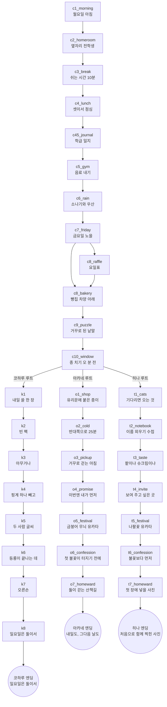

# 《내일도 같이 갈래?》 대본 — 검토용

> 이 문서는 `npm run export-script` 로 스토리 데이터(`src/story/scenes/*.ts`)에서 자동 생성된다. 직접 고치지 말고 장면 파일을 고친 뒤 다시 생성할 것.
> 이름·학교·날짜는 임시값(`src/story/config.ts`). 줄 끝의 `c1.010` 같은 값은 문장 고유 id(저장·읽음 기록용).
> 🖼 **[이벤트 CG]** 줄부터 그 CG 가 화면 가득 떠 있다. `〔이벤트 CG 걷기〕` 또는 배경 전환(자동으로 걷힘)에서 사라진다. CG 파일·표시 구간 목록은 `docs/ASSETS.md`.

## 등장인물(임시 이름)

- 주인공: 아오야마 소우타 — 2학년, 1인칭 화자(그림 없음)
- 소꿉친구: 미즈하라 아카네 — 츤데레, 유치원 때부터의 이웃
- 전학생: 사쿠라이 히나 — 세 번째 전학, 솔직하게 다가가는 성격
- 숨은 후배: 나루세 코하루 — 1학년, 상점가 문구점 집 딸. 금요일 하교 때 두 히로인 점수 차가 1 이하인 플레이에서만 등장
- 무대: 아사히가오카 고등학교 2학년 3반, 아사히가오카 동네 / 공통 7월 6일 월요일 ~ 7월 13일 월요일 점심, 루트 본편 7월 13일 월요일 ~ 7월 17일 금요일, 후일담 8월 8일 토요일 아사히 강 여름 축제(코하루 루트는 8월 4일 화요일 ~ 8월 9일 일요일)

## 분기 구조

### 공통 선택지와 루트 결정

| 선택지 | 상황(대사창) | 옵션 | 보이는 조건 | 점수 |
|---|---|---|---|---|
| `c3.ch` | 쉬는 시간은 10분. 누구에게 먼저 말을 걸까? | a: 뒤돌아본 아카네에게 먼저 대답한다 | 항상 | 아카네 +2 |
|  |  | b: 둘러싸인 사쿠라이에게 먼저 다가간다 | 항상 | 히나 +2 |
|  |  | c: 두 사람에게 같이 음악실에 가자고 한다 | 항상 | 아카네 +1, 히나 +1 (함께 · 동점 처리에서 건너뜀) |
| `c4.ch` | 히나에게 동네를 소개한다면? | a: 아카네와 다니던 막과자 가게를 추천한다 | 항상 | 아카네 +2 |
|  |  | b: 추천보다 먼저 히나의 취향을 묻는다 | 항상 | 히나 +2 |
|  |  | c: 셋이서 지도에 가 보고 싶은 곳을 하나씩 짚는다 | 항상 | 아카네 +1, 히나 +1 (함께 · 동점 처리에서 건너뜀) |
| `c6.ch` | 우산은 두 개, 사람은 셋. | a: 히나에게 우산을 빌려주고 아카네의 우산에 들어간다 | 항상 | 아카네 +2 |
|  |  | b: 같은 방향인 히나에게 같이 쓰자고 한다 | 항상 | 히나 +2 |
|  |  | c: 두 우산을 붙여 셋이 나란히 걷는다 | 항상 | 아카네 +1, 히나 +1 (함께 · 동점 처리에서 건너뜀) |
| `c7.ch` | 신경 쓰이는 건… | a: 평소와 다른 아카네의 표정 | 항상 | 아카네 +3 |
|  |  | b: 히나의 주말 탐험 계획 | 항상 | 히나 +3 |
|  |  | c: 두 사람과 함께 칠판을 지우며 잠깐 더 남는다 | 항상 | 아카네 +1, 히나 +1 (함께 · 동점 처리에서 건너뜀) |
| `c8.ch` |  | a: 아카네에게 힌트를 하나 달라고 한다 | 항상 | 아카네 +3 |
|  |  | b: 힌트를 찍어서 히나에게 퀴즈를 낸다 | 항상 | 히나 +3 |
|  |  | k: 나루세에게 상품 없는 퀴즈를 보낸다 | 코하루 등장 시 | 코하루 +3 |
|  |  | c: 단체 대화방에 같은 문제를 낸다 | 코하루 미등장 시 | 아카네 +1, 히나 +1 (함께 · 동점 처리에서 건너뜀) |
| `c9.ch` |  | a: 아카네에게 다 풀면 뭐가 좋은지 묻는다 | 항상 | 아카네 +3 |
|  |  | b: 히나에게 마음에 드는 답을 부탁한다 | 항상 | 히나 +3 |
|  |  | k: 나루세에게 한 칸씩 번갈아 풀자고 한다 | 코하루 등장 시 | 코하루 +3 |
|  |  | c: 셋이 한 글자씩 이어 붙인다 | 코하루 미등장 시 | 아카네 +1, 히나 +1 (함께 · 동점 처리에서 건너뜀) |
| `c10.ch` |  | a: 아카네 옆에서 잠깐 바람을 쐰다 | 항상 | 아카네 +3 |
|  |  | b: 히나가 짚은 그늘로 건너간다 | 항상 | 히나 +3 |
|  |  | k: 창 너머의 나루세 쪽으로 간다 | 코하루 등장 시 | 코하루 +3 |
|  |  | c: 창가에 세 사람이 설 자리를 만든다 | 코하루 미등장 시 | 아카네 +1, 히나 +1 (함께 · 동점 처리에서 건너뜀) |

숨은 등장 판정(`src/engine/runner.ts` applyUnlock, `c7.join` 종소리 직후 1회):
- 아카네·히나 점수 차가 1 이하면 플래그 `kh.met` = true, 코하루 시작 점수 = 두 점수의 평균(0.5 단위 그대로). 아니면 false.
- 플래그에 이미 값이 있으면(불러오기·다시 실행) 다시 판정하지 않는다. '함께' 횟수는 조건에 넣지 않는다.
- 해금되면 복도 첫 만남 → 노을길 → 토요일 오전 `c8_raffle`(통성명·추첨). 후반 선택지에 코하루 옵션(k)이 보이고 '함께'(c)는 숨는다. 미해금이면 그 반대.

루트 결정 규칙(`src/engine/runner.ts` pickRoute, `c10_window` 마지막):
1. 후보 = 아카네, 히나 (+ `kh.met` = true 면 코하루). 누적 점수가 가장 높은 후보의 루트
2. 공동 최고점이면 선택 순서 `c3.ch` → `c4.ch` → `c6.ch` → `c7.ch` → `c8.ch` → `c9.ch` → `c10.ch` 를 뒤에서부터 훑어, '함께'와 공동 최고점이 아닌 인물을 건너뛰고 처음 만나는 공동 최고점 인물
3. 루트 확정 후에는 점수가 바뀌지 않고 다른 루트 장면으로 넘어가지 않는다(검증기·테스트로 확인)

선택 조합 2,187개(보이는 옵션만) → 엔딩 아카네 999 / 히나 999 / 코하루 189. 초반 조합 81개 중 해금 25개 (해금 경로 675 / 미해금 경로 1512). 동점 처리 146회(해금 42 / 미해금 104).

초반 조합별 결과 (c3.ch / c4.ch / c6.ch / c7.ch → 판정 직전 점수 → 후반 조합의 엔딩 수):

| 초반 선택 | 아카네 : 히나 | 숨은 등장 | 코하루 시작 | 후반 조합 | 아카네 | 히나 | 코하루 |
|---|---|---|---|---|---|---|---|
| a a a a | 9 : 0 | - | - | 27 | 26 | 1 | - |
| a a a b | 6 : 3 | - | - | 27 | 18 | 9 | - |
| a a a c | 7 : 1 | - | - | 27 | 23 | 4 | - |
| a a b a | 7 : 2 | - | - | 27 | 23 | 4 | - |
| a a b b | 4 : 5 | 등장 | 4.5 | 27 | 7 | 13 | 7 |
| a a b c | 5 : 3 | - | - | 27 | 17 | 10 | - |
| a a c a | 8 : 1 | - | - | 27 | 26 | 1 | - |
| a a c b | 5 : 4 | 등장 | 4.5 | 27 | 13 | 7 | 7 |
| a a c c | 6 : 2 | - | - | 27 | 23 | 4 | - |
| a b a a | 7 : 2 | - | - | 27 | 23 | 4 | - |
| a b a b | 4 : 5 | 등장 | 4.5 | 27 | 7 | 13 | 7 |
| a b a c | 5 : 3 | - | - | 27 | 17 | 10 | - |
| a b b a | 5 : 4 | 등장 | 4.5 | 27 | 13 | 7 | 7 |
| a b b b | 2 : 7 | - | - | 27 | 4 | 23 | - |
| a b b c | 3 : 5 | - | - | 27 | 10 | 17 | - |
| a b c a | 6 : 3 | - | - | 27 | 18 | 9 | - |
| a b c b | 3 : 6 | - | - | 27 | 9 | 18 | - |
| a b c c | 4 : 4 | 등장 | 4 | 27 | 9 | 9 | 9 |
| a c a a | 8 : 1 | - | - | 27 | 26 | 1 | - |
| a c a b | 5 : 4 | 등장 | 4.5 | 27 | 13 | 7 | 7 |
| a c a c | 6 : 2 | - | - | 27 | 23 | 4 | - |
| a c b a | 6 : 3 | - | - | 27 | 18 | 9 | - |
| a c b b | 3 : 6 | - | - | 27 | 9 | 18 | - |
| a c b c | 4 : 4 | 등장 | 4 | 27 | 9 | 9 | 9 |
| a c c a | 7 : 2 | - | - | 27 | 23 | 4 | - |
| a c c b | 4 : 5 | 등장 | 4.5 | 27 | 7 | 13 | 7 |
| a c c c | 5 : 3 | - | - | 27 | 17 | 10 | - |
| b a a a | 7 : 2 | - | - | 27 | 23 | 4 | - |
| b a a b | 4 : 5 | 등장 | 4.5 | 27 | 7 | 13 | 7 |
| b a a c | 5 : 3 | - | - | 27 | 17 | 10 | - |
| b a b a | 5 : 4 | 등장 | 4.5 | 27 | 13 | 7 | 7 |
| b a b b | 2 : 7 | - | - | 27 | 4 | 23 | - |
| b a b c | 3 : 5 | - | - | 27 | 10 | 17 | - |
| b a c a | 6 : 3 | - | - | 27 | 18 | 9 | - |
| b a c b | 3 : 6 | - | - | 27 | 9 | 18 | - |
| b a c c | 4 : 4 | 등장 | 4 | 27 | 9 | 9 | 9 |
| b b a a | 5 : 4 | 등장 | 4.5 | 27 | 13 | 7 | 7 |
| b b a b | 2 : 7 | - | - | 27 | 4 | 23 | - |
| b b a c | 3 : 5 | - | - | 27 | 10 | 17 | - |
| b b b a | 3 : 6 | - | - | 27 | 9 | 18 | - |
| b b b b | 0 : 9 | - | - | 27 | 1 | 26 | - |
| b b b c | 1 : 7 | - | - | 27 | 4 | 23 | - |
| b b c a | 4 : 5 | 등장 | 4.5 | 27 | 7 | 13 | 7 |
| b b c b | 1 : 8 | - | - | 27 | 1 | 26 | - |
| b b c c | 2 : 6 | - | - | 27 | 4 | 23 | - |
| b c a a | 6 : 3 | - | - | 27 | 18 | 9 | - |
| b c a b | 3 : 6 | - | - | 27 | 9 | 18 | - |
| b c a c | 4 : 4 | 등장 | 4 | 27 | 9 | 9 | 9 |
| b c b a | 4 : 5 | 등장 | 4.5 | 27 | 7 | 13 | 7 |
| b c b b | 1 : 8 | - | - | 27 | 1 | 26 | - |
| b c b c | 2 : 6 | - | - | 27 | 4 | 23 | - |
| b c c a | 5 : 4 | 등장 | 4.5 | 27 | 13 | 7 | 7 |
| b c c b | 2 : 7 | - | - | 27 | 4 | 23 | - |
| b c c c | 3 : 5 | - | - | 27 | 10 | 17 | - |
| c a a a | 8 : 1 | - | - | 27 | 26 | 1 | - |
| c a a b | 5 : 4 | 등장 | 4.5 | 27 | 13 | 7 | 7 |
| c a a c | 6 : 2 | - | - | 27 | 23 | 4 | - |
| c a b a | 6 : 3 | - | - | 27 | 18 | 9 | - |
| c a b b | 3 : 6 | - | - | 27 | 9 | 18 | - |
| c a b c | 4 : 4 | 등장 | 4 | 27 | 9 | 9 | 9 |
| c a c a | 7 : 2 | - | - | 27 | 23 | 4 | - |
| c a c b | 4 : 5 | 등장 | 4.5 | 27 | 7 | 13 | 7 |
| c a c c | 5 : 3 | - | - | 27 | 17 | 10 | - |
| c b a a | 6 : 3 | - | - | 27 | 18 | 9 | - |
| c b a b | 3 : 6 | - | - | 27 | 9 | 18 | - |
| c b a c | 4 : 4 | 등장 | 4 | 27 | 9 | 9 | 9 |
| c b b a | 4 : 5 | 등장 | 4.5 | 27 | 7 | 13 | 7 |
| c b b b | 1 : 8 | - | - | 27 | 1 | 26 | - |
| c b b c | 2 : 6 | - | - | 27 | 4 | 23 | - |
| c b c a | 5 : 4 | 등장 | 4.5 | 27 | 13 | 7 | 7 |
| c b c b | 2 : 7 | - | - | 27 | 4 | 23 | - |
| c b c c | 3 : 5 | - | - | 27 | 10 | 17 | - |
| c c a a | 7 : 2 | - | - | 27 | 23 | 4 | - |
| c c a b | 4 : 5 | 등장 | 4.5 | 27 | 7 | 13 | 7 |
| c c a c | 5 : 3 | - | - | 27 | 17 | 10 | - |
| c c b a | 5 : 4 | 등장 | 4.5 | 27 | 13 | 7 | 7 |
| c c b b | 2 : 7 | - | - | 27 | 4 | 23 | - |
| c c b c | 3 : 5 | - | - | 27 | 10 | 17 | - |
| c c c a | 6 : 3 | - | - | 27 | 18 | 9 | - |
| c c c b | 3 : 6 | - | - | 27 | 9 | 18 | - |
| c c c c | 4 : 4 | 등장 | 4 | 27 | 9 | 9 | 9 |

- 아카네 루트: 본편 약 221문장·7152자(≈13.0~18.8분), 후일담 약 55문장·1711자(≈3.1~4.5분)
- 히나 루트: 본편 약 219문장·7176자(≈13.0~18.9분), 후일담 약 54문장·1908자(≈3.5~5.0분)
- 코하루 루트: 본편 약 246문장·7987자(≈14.5~21.0분), 후일담 약 102문장·3582자(≈6.5~9.4분)
- 추정 시간은 1분당 380~550자 읽기 기준(클릭·글자 표시 포함 대략치). 본편은 공통 구간 포함.

## 대본

---

## 공통

### `c1_morning` 월요일 아침

- 〔배경: 등굣길 주택가(아침) / 전환: black〕
- 〔음악: 일상: 경쾌하고 가벼운 학교생활〕
- 📍 7월 6일 월요일 · 등굣길
- *(독백)* 장마가 끝나고 매미가 울기 시작했다. 현관문을 열자 담장에 기대 선 익숙한 얼굴이 고개를 들었다. `c1.010`
- 〔아카네: 가운데, 교복, 기본 머리, 삐짐〕
- **아카네** (삐짐): 3분 늦었어. `c1.020`
- **소우타**: 약속한 적도 없는데 지각이 성립해? `c1.030`
- **아카네** (웃음): 약속은 안 했어도 지각은 지각이거든. 벌칙은 음료 하나. `c1.040`
- *(독백)* 유치원 때부터 옆집이던 미즈하라 아카네. 역 앞으로 이사 간 지 3년째, 오늘도 “어차피 가는 길”이라며 저기 서 있다. `c1.050`
- **아카네** (기본): 그보다 들었어? 오늘 우리 반에 전학생 온대. 여자래. `c1.060`
- **소우타**: 방학 직전에? 힘들겠다. 반에 금방 적응하면 좋을 텐데. `c1.070`
- *(독백)* 아카네는 잠깐 내 얼굴을 빤히 들여다보더니, 작게 웃었다. `c1.080`
- **아카네** (웃음): 너답네. 보통은 예쁘냐부터 물어보는데. `c1.090`
- **소우타**: 예쁜지 아닌지는 내가 도와줄 수 있는 게 아니잖아. `c1.100`
- *(독백)* 전학생이 와도 이 아침은 똑같을 거다. 10년 된 습관이고, 아카네가 옆에 있는 건 공기처럼 당연하니까. `c1.110`
- ⏭ 다음 장면: `c2_homeroom`

### `c2_homeroom` 옆자리 전학생

- 〔퇴장: 모두〕
- 〔배경: 2학년 3반 교실(낮, 창가)〕
- 〔효과음: 학교 차임벨〕
- 📍 7월 6일 월요일 · 2학년 3반 조례
- **오카다 선생님**: 소문은 다들 들었겠지. 길게 끌지 않겠다. 들어와라. `c2.010`
- 〔효과음: 교실 미닫이문〕
- 〔히나: 가운데, 교복, 기본 머리, 웃음〕
- *(독백)* 분홍빛 긴 웨이브 머리가 문턱을 넘자, 교실이 한 박자 늦게 술렁였다. `c2.020`
- **히나** (웃음): 사쿠라이 히나입니다. 아버지 일로 세 번째 전학인데, 이번엔 오래 있을 것 같아요. 잘 부탁드립니다! `c2.030`
- **오카다 선생님**: 자리는 창가 맨 뒤, 아오야마 옆이다. 아오야마, 교과서 좀 같이 보여 줘라. `c2.050`
- **히나** (웃음): 옆자리네. 이름 물어봐도 돼? `c2.060`
- **소우타**: 아오야마 소우타. 교과서는 반씩 보자. `c2.070`
- **히나** (기본): 아오야마 군. 아, 소우타 군이라고 불러도 돼? 이름으로 부르면 더 빨리 친해지잖아. `c2.080`
- **소우타**: 편한 대로 불러. `c2.090`
- **히나** (웃음): 그럼 소우타 군. 잘 부탁해, 옆자리 씨. `c2.100`
- *(독백)* 그 순간 앞자리 아카네의 어깨가 딱 굳었다. 에어컨 바로 앞자리라 추운가 보다. `c2.110`
- ⏭ 다음 장면: `c3_break`

### `c3_break` 쉬는 시간 10분

- 〔효과음: 학교 차임벨〕
- 📍 1교시 후 쉬는 시간
- 〔히나: 오른쪽, 웃음〕
- **반 아이들**: 전엔 어디 살았어? 동아리는? 그 머리, 매일 직접 하는 거야? `c3.010`
- *(독백)* 사쿠라이는 웃으며 받아넘겼다. 그런데 말이 끊길 때마다 짧게 숨을 고른다. 조금 지친 거다. `c3.020`
- 〔아카네: 왼쪽, 교복, 기본 머리, 기본〕
- **아카네** (기본): 소우타, 다음 시간 음악실이잖아. 사쿠라이는 별관 가는 길 모를 텐데. `c3.030`
- ❓ **선택지** `c3.ch` — 쉬는 시간은 10분. 누구에게 먼저 말을 걸까?
  - **a**: 뒤돌아본 아카네에게 먼저 대답한다 〔아카네 +2〕 → `c3.a`
  - **b**: 둘러싸인 사쿠라이에게 먼저 다가간다 〔히나 +2〕 → `c3.b`
  - **c**: 두 사람에게 같이 음악실에 가자고 한다 〔아카네 +1, 히나 +1 (함께 · 동점 처리에서 건너뜀)〕 → `c3.c`
- ⚑ `c3.a`
- **소우타**: 맞다, 음악실. 같이 데려가자. 너 길 설명 잘하잖아. `c3.a10`
- **아카네** (삐짐): 딱히 친절해서 그러는 거 아니야. 첫날부터 지각하면 불쌍하잖아. `c3.a20`
- **아카네** (기본): 사쿠라이, 음악실 같이 가자. 다들 질문은 점심때 마저 해. `c3.a30`
- **히나** (웃음): 살았다. 고마워, 둘 다! `c3.a40`
- ↪ `c3.join` 로 이동
- ⚑ `c3.b`
- **소우타**: 얘들아, 다음 시간 음악실이야. 질문은 점심때 마저 하자. `c3.b10`
- **히나** (웃음): 고마워. 누가 뭘 물어봤는지 슬슬 헷갈리던 참이었어. `c3.b20`
- **소우타**: 질문 서른 개면 누구라도 그래. 길은 아카네가 알려 줄 거야. `c3.b30`
- **아카네** (삐짐): 왜 내가. 뭐, 어차피 가는 길이니까. `c3.b40`
- ↪ `c3.join` 로 이동
- ⚑ `c3.c`
- **소우타**: 사쿠라이, 질문 하나만 더. 음악실이 어느 쪽인지는 알아? `c3.c10`
- **히나** (웃음): 전혀. 자신 있게 반대로 갈 수 있어. `c3.c20`
- **소우타**: 그럼 셋이 가자. 아카네가 앞장서고, 난 뒤에서 반대로 가는 사람 잡을게. `c3.c30`
- **아카네** (삐짐): 너부터 잡아. 음악책 두고 가잖아. `c3.c40`
- **소우타**: …출발하기도 전에 잡혔네. `c3.c50`
- **히나** (웃음): 아, 이런 반 좋다. 잠깐만, 내 것도 챙길게! `c3.c60`
- ⚑ `c3.join`
- 〔퇴장: 모두〕
- 〔배경: 복도와 자판기(낮)〕
- 〔아카네: 왼쪽, 기본〕
- 〔히나: 오른쪽, 기본 머리, 기본〕
- **히나** (기본): 저기, 두 사람 혹시 사귀어? `c3.j10`
- 〔효과음: 반짝(놀람·깨달음 강조)〕
- **아카네** (당황): 아, 아니거든! `c3.j20`
- **소우타**: 소꿉친구야. 가족 같은 거지. `c3.j30`
- **아카네** (쓸쓸): …가족 같은 거, 래. `c3.j40`
- 〔히나: 기본〕
- *(독백)* 작게 중얼거리는 걸 보니 남매 취급은 싫은가 보다. 사쿠라이는 알겠다는 듯 빙긋 웃었다. `c3.j50`
- **히나** (웃음): 그럼 나도 끼워 줘. 이 학교 첫 친구 두 명 확보! 이제 이름으로 불러 줘. `c3.j60`
- **아카네** (부끄러움): 내일부터. 갑자기는 입에 안 붙어. `c3.j70`
- ⏭ 다음 장면: `c4_lunch`

### `c4_lunch` 셋이서 점심

- 〔퇴장: 모두〕
- 〔배경: 중정 벤치(점심시간)〕
- 📍 7월 7일 화요일 · 점심시간 중정
- 〔아카네: 왼쪽, 교복, 기본 머리, 기본〕
- 〔히나: 오른쪽, 교복, 기본 머리, 웃음〕
- **소우타**: 히나, 이쪽 벤치가 그늘이야. `c4.010`
- **히나** (웃음): 앗, 이름. 진짜 불러 줬네! `c4.020`
- **아카네** (부끄러움): 어제 약속했잖아. …히나. `c4.025`
- **히나** (웃음): 두 배로 좋다! 아카네짱 도시락 예쁘다. 계란말이 반짝반짝해. 직접 싼 거야? `c4.030`
- **아카네** (당황): …대충. `c4.040`
- **소우타**: 아카네네 어머니가 요리를 잘하시거든. 옛날부터. `c4.050`
- **아카네** (당황): …그렇지 뭐. 자, 이거. 많이 만들어서… 아니, 엄마가 많이 싸 줘서. `c4.060`
- *(독백)* 뚜껑 위에 올라온 계란말이는 달았다. 어릴 때부터 내가 좋아하던 맛이다. `c4.070`
- 〔효과음: 반짝(놀람·깨달음 강조)〕
- *(독백)* 히나는 눈을 반짝이며 아카네와 계란말이를 번갈아 봤다. 그렇게 맛있어 보이나. `c4.080`
- **히나** (기본): 이 동네에 가 볼 만한 데 있어? 이사 가면 처음 간 곳을 사진으로 남기거든. `c4.090`
- ❓ **선택지** `c4.ch` — 히나에게 동네를 소개한다면?
  - **a**: 아카네와 다니던 막과자 가게를 추천한다 〔아카네 +2〕 → `c4.a`
  - **b**: 추천보다 먼저 히나의 취향을 묻는다 〔히나 +2〕 → `c4.b`
  - **c**: 셋이서 지도에 가 보고 싶은 곳을 하나씩 짚는다 〔아카네 +1, 히나 +1 (함께 · 동점 처리에서 건너뜀)〕 → `c4.c`
- ⚑ `c4.a`
- **소우타**: 상점가 끝 막과자 가게, 후루카와 상점. 아카네랑 초등학생 때부터 다닌 데야. `c4.a10`
- **아카네** (웃음): 할머니가 아직도 우리 이름을 기억하셔. 제일 싼 과자만 사도 덤을 주시고. `c4.a20`
- **히나** (웃음): 막과자 가게! 드라마에서만 봤어. 꼭 가 볼래. `c4.a30`
- **아카네** (웃음): 가게 앞 평상엔 삼색 고양이도 와. 모찌라고, 얘가 붙인 이름이야. `c4.a40`
- ↪ `c4.join` 로 이동
- ⚑ `c4.b`
- **소우타**: 추천하기 전에, 히나는 뭘 좋아해? 그걸 알아야 고르지. `c4.b10`
- **히나** (부끄러움): 어, 나? 음, 고양이! 그리고 동네가 한눈에 내려다보이는 높은 데. `c4.b20`
- **소우타**: 그럼 언덕 위 히다마리 신사. 돌계단에 고양이들이 모여. 대장은 통통한 흰 고양이 다이후쿠. `c4.b30`
- **아카네** (기본): 이 동네 고양이 이름은 거의 다 얘가 지었어. 반에서도 고양이 박사라고 불려. `c4.b40`
- ↪ `c4.join` 로 이동
- ⚑ `c4.c`
- **소우타**: 내가 정하면 맨날 가던 데만 나올걸. 하나씩 골라 볼래? `c4.c10`
- *(독백)* 내 휴대폰으로 동네 지도를 띄워서 빈 도시락 뚜껑 옆에 놓았다. `c4.c20`
- **아카네** (웃음): 그럼 난 여기. 저녁에 가면 갓 구운 전병 냄새가 골목 끝까지 나. `c4.c30`
- **히나** (웃음): 난 파란 지붕! 아침마다 보이는데 뭘 파는지 아직도 모르겠어. `c4.c40`
- **소우타**: 거기 세탁소야. 그럼 나는…… 여기 있는 벤치. 두 군데 다 걸으면 쉴 데가 필요해. `c4.c50`
- **히나** (웃음): 냄새 맡고, 세탁하고, 쉬기. 첫 동네 여행치곤 알차네. `c4.c60`
- **아카네** (삐짐): 잠깐, 누가 세탁물을 들고 가는데. `c4.c70`
- ⚑ `c4.join`
- *(독백)* 히나는 늘 안고 다니던 분홍 수첩에 무언가를 적었다. 칸마다 글씨가 빽빽했다. `c4.j10`
- ⏭ 다음 장면: `c45_journal`

### `c45_journal` 학급 일지

- 〔퇴장: 모두〕
- 〔배경: 2학년 3반 교실(낮, 창가)〕
- 📍 7월 8일 수요일 · 2학년 3반 종례 후
- 〔아카네: 왼쪽, 교복, 기본 머리, 기본〕
- 〔히나: 오른쪽, 교복, 포니테일, 기본〕
- *(독백)* 학급 일지 제일 아래에 한 칸이 남았다. ‘오늘 우리 반에서 있었던 일.’ 특이 사항 없…… 거기까지 썼는데 옆에서 히나가 읽었다. `c45.010`
- **히나** (삐짐): 벌써 없어? 나한텐 여기 온 지 겨우 사흘째인데? `c45.020`
- *(독백)* 앞자리에서 하얀 지우개가 굴러왔다. 아카네가 내 연필 끝을 톡 쳤다. `c45.030`
- **아카네** (기본): 체육 때 긴 줄넘기 했잖아. 우리 반 연속 세 번. 그거 써. `c45.040`
- **소우타**: 네 번 아니야? 마지막에 나 분명히 뛰었는데. `c45.050`
- **히나** (웃음): 맞아. 줄은 멈췄고 소우타 군 혼자 한 번 더 뛰었어. `c45.060`
- *(독백)* 히나가 발뒤꿈치를 살짝 들었다 놓자 아카네가 책상에 이마를 묻었다. 어깨가 들썩였다. `c45.070`
- **아카네** (웃음): 그럼 ‘다 같이 세 번, 아오야마 혼자 한 번’. `c45.080`
- **히나** (웃음): 쉼표 뒤까지 꼭 써 줘. 내가 제일 좋아하는 데야. `c45.090`
- *(독백)* 일지에 그대로 적었다. 빈칸 하나 채웠을 뿐인데 내일 선생님이 읽을 때 슬쩍 뒤에 서 있고 싶어졌다. `c45.100`
- ⏭ 다음 장면: `c5_gym`

### `c5_gym` 음료 내기

- 🎬 **[암전 카드]** 7월 9일 목요일 — 체육이 있는 날 `c5.010`
- 〔퇴장: 모두〕
- 〔배경: 복도와 자판기(낮)〕
- 📍 체육 후 쉬는 시간 · 복도 자판기 앞
- 〔아카네: 왼쪽, 교복, 기본 머리, 웃음〕
- 〔히나: 오른쪽, 교복, 포니테일, 웃음〕
- **아카네** (웃음): 목마르다. 음료 내기 하자. 통산 412전 209승 203패, 내가 여섯 판 앞서. `c5.020`
- **히나** (웃음): 나도 낄래! 가위바위보라면 자신 있어. `c5.025`
- 〔아카네: 당황〕
- *(독백)* 첫 판도, 둘째 판도, 셋째 판도 히나 혼자 이겼다. 아카네는 허리에 손을 짚은 채 굳었다. `c5.030`
- **히나** (웃음): 전학 첫날 친구 만들기엔 이게 최고거든. 그리고 아카네짱, 지기 싫으면 꼭 주먹 내더라. `c5.040`
- **아카네** (삐짐): 한 판 더! 방금 건 몸풀기였어. `c5.050`
- *(독백)* 아카네는 정말로 주먹을 냈다. 히나는 보. 덩달아 주먹을 낸 나는, 그 뒤로도 꼬박꼬박 졌다. `c5.060`
- **소우타**: 자, 패자의 공물이다. 그러고 보니 히나, 묶은 머리 잘 어울린다. 활발해 보여. `c5.070`
- **히나** (당황): 에? 소우타 군은 칭찬을 그냥 하는구나. `c5.080`
- **히나** (웃음): 고마워. 체육 있는 날만 묶거든. 덕분에 오늘 하루 기분 좋겠다. `c5.090`
- 〔아카네: 부끄러움〕
- **소우타**: 아카네, 방금 리본 만지던데. 풀렸어? 다시 묶어 줄까? `c5.100`
- **아카네** (삐짐): 안 풀렸거든. `c5.110`
- **히나** (웃음): 후훗. 소우타 군, 그건 좀 아닌 것 같아. `c5.120`
- ⏭ 다음 장면: `c6_rain`

### `c6_rain` 소나기와 우산

- 〔퇴장: 모두〕
- 〔배경: 현관 신발장(밖은 소나기)〕
- 〔음악: 정지〕
- 〔효과음: 소나기 소리(수 초)〕
- 📍 7월 9일 목요일 · 방과 후 신발장
- 〔아카네: 왼쪽, 교복, 기본 머리, 기본〕
- 〔히나: 오른쪽, 교복, 포니테일, 기본〕
- *(독백)* 신발을 갈아 신는 사이, 굵은 소나기가 쏟아졌다. `c6.010`
- **아카네** (삐짐): 아침에 네 가방에 접이식 우산 넣어 놨어. 너 일기예보 안 보지? `c6.020`
- **소우타**: 어, 진짜 있네. 고마워. 아카네는 옛날부터 이런 건 꼭 챙기더라. `c6.030`
- **아카네** (부끄러움): 네가 안 챙기니까 그렇지. `c6.040`
- **히나** (당황): 아하하, 난 우산이 없네. 집이 편의점 앞 갈림길 근처라 뛰면 금방이긴 한데. `c6.050`
- ❓ **선택지** `c6.ch` — 우산은 두 개, 사람은 셋.
  - **a**: 히나에게 우산을 빌려주고 아카네의 우산에 들어간다 〔아카네 +2〕 → `c6.a`
  - **b**: 같은 방향인 히나에게 같이 쓰자고 한다 〔히나 +2〕 → `c6.b`
  - **c**: 두 우산을 붙여 셋이 나란히 걷는다 〔아카네 +1, 히나 +1 (함께 · 동점 처리에서 건너뜀)〕 → `c6.c`
- ⚑ `c6.a`
- **소우타**: 히나, 이거 써. 나는 아카네 우산에 들어가면 돼. `c6.a10`
- 〔퇴장: 모두〕
- 〔배경: 하굣길 주택가(소나기)〕
- 〔음악: 설렘: 느리고 따뜻한 두근거림〕
- 〔아카네: 왼쪽, 교복, 기본 머리, 기본〕
- 〔히나: 오른쪽, 교복, 포니테일, 웃음〕
- 🖼 **[이벤트 CG `rain_osana`: 「작은 우산」]** 공통 c6 소나기 — 소꿉친구의 우산을 함께 쓴 하굣길
- *(독백)* 아카네의 우산은 둘이 쓰기엔 작았다. 우산대는 내가 들었는데, 아카네가 자꾸 그걸 슬그머니 내 쪽으로 밀었다. `c6.a20`
- **소우타**: 너 어깨 젖는다. 내 쪽으로 밀지 마. `c6.a30`
- **아카네** (부끄러움): …네가 감기 걸리면 아침에 기다리는 내가 곤란하거든. `c6.a40`
- ↪ `c6.join` 로 이동
- ⚑ `c6.b`
- **소우타**: 히나, 같은 방향이니까 내 우산 같이 쓰자. `c6.b10`
- **아카네** (기본): 응. 그게 제일 합리적이네. 난 내 거 쓰면 되고. `c6.b20`
- 〔퇴장: 모두〕
- 〔배경: 하굣길 주택가(소나기)〕
- 〔음악: 설렘: 느리고 따뜻한 두근거림〕
- 〔아카네: 왼쪽, 교복, 기본 머리, 기본〕
- 〔히나: 오른쪽, 교복, 포니테일, 기본〕
- 🖼 **[이벤트 CG `rain_tenko`: 「기울어진 우산」]** 공통 c6 소나기 — 전학생과 우산을 함께 쓴 하굣길
- **히나** (당황): 소우타 군, 어깨 다 젖었어. 우산이 너무 내 쪽이야. `c6.b30`
- **소우타**: 묶은 머리가 젖으면 말리기 번거로울 테니까. 나는 금방 말라. `c6.b40`
- **히나** (부끄러움): 그런 것까지 보고 있었어? `c6.b50`
- ↪ `c6.join` 로 이동
- ⚑ `c6.c`
- **소우타**: 갈림길까진 길 넓잖아. 아카네가 왼쪽, 내가 오른쪽. 히나는 가운데 서 봐. `c6.c10`
- 〔퇴장: 모두〕
- 〔배경: 하굣길 주택가(소나기)〕
- 〔음악: 일상: 경쾌하고 가벼운 학교생활〕
- 〔아카네: 왼쪽, 교복, 기본 머리, 기본〕
- 〔히나: 오른쪽, 교복, 포니테일, 웃음〕
- **히나** (당황): 우산이 이어진 긴 지붕이다. 잠깐, 내 머리. `c6.c20`
- *(독백)* 내가 우산을 손가락 두 마디쯤 들자 닿았던 머리끈이 쏙 빠졌다. `c6.c30`
- **아카네** (기본): 소우타, 보도블록 한 칸만 천천히. 긴 지붕 반쪽이 혼자 가고 있거든. `c6.c40`
- **소우타**: 이 속도? `c6.c50`
- **히나** (웃음): 응, 지금 셋이 딱 맞아. 비 그쳐도 이대로 좀 걷자. `c6.c60`
- ⚑ `c6.join`
- 〔이벤트 CG 걷기〕
- *(독백)* 편의점 앞 갈림길에 닿을 즈음, 빗줄기가 조금 가늘어졌다. `c6.j10`
- ↪ 선택지 c6.ch 에서 'b' 를 골랐다면 → `c6.jb`
- ↪ 선택지 c6.ch 에서 'c' 를 골랐다면 → `c6.jc`
- **히나** (웃음): 우산은 내일 아침에 돌려줄게. 아카네짱이 챙겨 준 거잖아. `c6.j20`
- ↪ `c6.ask` 로 이동
- ⚑ `c6.jb`
- *(독백)* 집 앞까지 씌워 주겠다고 했지만, 히나는 바로 저 골목이라며 웃었다. `c6.j25`
- ↪ `c6.ask` 로 이동
- ⚑ `c6.jc`
- **히나** (웃음): 우리 집은 저기 흰 처마 뒤야. 저기까진 뛰어가도 돼. `c6.c70`
- ⚑ `c6.ask`
- **히나** (웃음): 있잖아, 내일도 같이 가도 돼? `c6.j30`
- **소우타**: 물론. `c6.j40`
- *(독백)* 첫날 이름을 물을 때처럼 히나는 늘 먼저 묻는다. 전학을 세 번 다니면 저런 친화력이 생기나 보다. `c6.j45`
- **아카네** (삐짐): …방향 같으면 어쩔 수 없지. `c6.j50`
- 〔퇴장: 히나〕
- *(독백)* 히나가 뛰어간 뒤로 아카네는 한참 말이 없었다. 비 오는 날의 아카네는 늘 조금 조용하다. `c6.j60`
- ⏭ 다음 장면: `c7_friday`

### `c7_friday` 금요일 노을

- 〔퇴장: 모두〕
- 〔배경: 교실(방과 후 노을)〕
- 〔음악: 노을: 그리움이 섞인 하굣길〕
- 📍 7월 10일 금요일 · 방과 후 교실
- 〔아카네: 왼쪽, 교복, 기본 머리, 기본〕
- 〔히나: 오른쪽, 교복, 기본 머리, 웃음〕
- *(독백)* 오늘 아침엔 갈림길에서 히나가 손을 흔들었다. 아카네의 전적 수첩엔 히나의 칸도 생겼다. `c7.010`
- **히나** (웃음): 소우타 군, 주말에 카메라 들고 동네 돌아볼 건데 어디가 좋을까? 지도에 별표만 잔뜩 쳐 놨어. `c7.020`
- 〔효과음: 휴대폰 메시지 알림〕
- 〔아카네: 쓸쓸〕
- *(독백)* 대답하려는데 아카네의 휴대폰이 울렸다. 화면을 본 얼굴이 굳는다. 귀찮은 공지를 볼 때와는 달랐다. `c7.030`
- ❓ **선택지** `c7.ch` — 신경 쓰이는 건…
  - **a**: 평소와 다른 아카네의 표정 〔아카네 +3〕 → `c7.a`
  - **b**: 히나의 주말 탐험 계획 〔히나 +3〕 → `c7.b`
  - **c**: 두 사람과 함께 칠판을 지우며 잠깐 더 남는다 〔아카네 +1, 히나 +1 (함께 · 동점 처리에서 건너뜀)〕 → `c7.c`
- ⚑ `c7.a`
- **소우타**: 아카네, 무슨 일 있어? 표정이 안 좋은데. `c7.a10`
- **아카네** (당황): 어? 아, 아무것도 아니야. 그보다 너, 수학 숙제는 했어? 월요일까지잖아. `c7.a20`
- *(독백)* 아무것도 아닌 얼굴이 아니었다. 캐물으면 더 숨길 테니, 말해 줄 때까지 기다리기로 했다. `c7.a40`
- **히나** (웃음): 아카네짱, 고민 있으면 나한테도 말해 줘. 듣는 건 자신 있어. `c7.a50`
- **소우타**: 히나, 사진 찍기 좋은 데는 다음에 지도 펴 놓고 같이 고르자. `c7.a60`
- ↪ `c7.join` 로 이동
- ⚑ `c7.b`
- **소우타**: 사진이면 학교 뒤 언덕길 끝. 동네가 한눈에 보이고, 담장 위에서 고양이가 낮잠도 자. `c7.b10`
- **히나** (웃음): 반 애들이 고양이 박사라더니 진짜네. 별표 추가! 언젠가 안내해 줘. `c7.b20`
- **아카네** (기본): 그 언덕길, 여름엔 모기 엄청 많아. 갈 거면 모기약 챙겨. `c7.b30`
- *(독백)* 아카네는 휴대폰을 주머니에 넣었다. 그 뒤로는 평소와 다름없어 보였다. `c7.b40`
- ↪ `c7.join` 로 이동
- ⚑ `c7.c`
- **소우타**: 나 오늘 칠판 당번인데, 저 끝에 닿는 사람? `c7.c10`
- **히나** (당황): 발꿈치 들면…… 안 닿네. 열심히 들었는데. `c7.c20`
- **아카네** (기본): 너희 둘 다 지우개 긴 쪽을 위로 해 봐. `c7.c30`
- *(독백)* 나란히 남은 세 줄이 순서대로 지워졌다. 아카네는 휴대폰을 뒤집어 책상에 놓았다. `c7.c40`
- **소우타**: 이런, 다 지워 버렸다. 히나, 동네 지도 그릴 자리 필요했는데. `c7.c50`
- **히나** (웃음): 깨끗한 칠판 두고? 월요일에도 여기 있잖아. `c7.c60`
- **아카네** (웃음): 응. 월요일에 보자, 둘 다. `c7.c70`
- ⚑ `c7.join`
- 〔효과음: 학교 차임벨〕
- 🔑 **숨은 등장 판정** 아카네·히나 점수 차 ≤ 1 이면 `kh.met` = true, 코하루 시작 점수 = 두 점수의 평균 (이미 판정했으면 그대로)
- ↪ 다음이 아니면: 플래그 kh.met = true 이면 → `c7.road`
- 〔퇴장: 모두〕
- 〔배경: 복도와 자판기(낮)〕
- 〔아카네: 왼쪽, 교복, 기본 머리, 기본〕
- 〔히나: 오른쪽, 교복, 기본 머리, 기본〕
- *(독백)* 우리 셋이 계단 쪽으로 꺾는데, 맞은편에서 걷던 여학생이 옆의 친구를 돌아봤다. 두 볼이 바람을 넣은 것처럼 동그래졌다. `c7.m10`
- **여학생**: 아까 네 얼굴이 딱 이랬다니까. 이렇게, 음— `c7.m20`
- 🖼 **[이벤트 CG `kh_meet`: 「금요일의 모퉁이」]** 공통 c7 금요일 하교(해금 시) — 복도 모퉁이에서 어깨가 부딪친 직후
- *(독백)* 콩. 앞을 안 보고 한 발 더 온 여학생의 어깨가 내 어깨에 닿았다. `c7.m30`
- **여학생**: 앗. 죄송해요, 선배! 어디 안 부딪히셨어요? `c7.m40`
- **소우타**: 방금 어깨에. 난 괜찮아. 너는? `c7.m50`
- **여학생**: 저도요. 친구 얼굴 보여 주다가 앞을 못 봤어요. `c7.m60`
- **여학생의 친구**: 저 진짜 그런 표정 안 했어요. `c7.m70`
- **히나** (웃음): 응. 어느 쪽 말이 맞는지는 우리 셋 다 평생 모르겠다. `c7.m80`
- **아카네** (웃음): 그 와중에 그게 제일 억울했구나. `c7.m90`
- *(독백)* 친구가 자기 볼을 만져 보자 여학생이 먼저 웃었다. 나도, 옆에 선 두 사람도 따라 웃었다. `c7.m95`
- 〔이벤트 CG 걷기〕
- ⚑ `c7.road`
- 〔퇴장: 모두〕
- 〔배경: 하굣길 주택가(노을)〕
- 〔아카네: 왼쪽, 교복, 기본 머리, 기본〕
- 〔히나: 오른쪽, 교복, 기본 머리, 웃음〕
- **히나** (웃음): 다음 주도 잘 부탁해, 두 사람. `c7.j20`
- **아카네** (웃음): 새삼스럽게. `c7.j30`
- *(독백)* 낯설던 일주일이 어느새 익숙해져 있었다. 다음 주도 이렇게 흘러갈 거라고, 그때는 의심하지 않았다. `c7.j40`
- ↪ 플래그 kh.met = true 이면 → `c7.met`
- ⏭ 다음 장면: `c8_bakery`
- ⚑ `c7.met`
- ⏭ 다음 장면: `c8_raffle`

### `c8_raffle` 요일표

- 〔퇴장: 모두〕
- 〔배경: 동네 상점가와 오래된 막과자 가게(늦은 오후) / 전환: black〕
- 〔음악: 일상: 경쾌하고 가벼운 학교생활〕
- 📍 7월 11일 토요일 오전 · 상점가 문구점 앞
- *(독백)* 토요일 오전, 문구점에서 샤프심과 노트를 샀다. 잔돈 밑에 추첨 보조권 두 장이 딸려 나왔다. `c8r.010`
- *(독백)* 가게 앞 추첨대에는 ‘다섯 장에 한 번’이라고 쓰여 있었다. `c8r.015`
- 〔효과음: 달려오는 발소리〕
- 〔코하루: 가운데, 사복, 기본 머리, 웃음〕
- **여학생** (웃음): 아, 복도 선배! 오늘은 앞 보고 왔어요. `c8r.020`
- **소우타**: 다행이다. 어깨는 오늘 쉬는 날이라. `c8r.030`
- **여학생** (기본): 그거 두 장이에요? 저 세 장 있어요. `c8r.040`
- **소우타**: 합치면 딱 다섯 장이네. 한 번 같이 돌릴래? `c8r.050`
- **여학생** (웃음): 네! 근데 우리 순서 오기 전에 한 가지 정해야 해요. `c8r.060`
- *(독백)* 여학생이 일등 상품을 가리켰다. 앞바구니에 노란 리본을 단 자전거였다. `c8r.070`
- **여학생** (기본): 저거 뽑으면 선배는 무슨 요일에 타실래요? `c8r.080`
- **소우타**: 벌써 주인처럼 묻네. 음, 화·목·토. `c8r.090`
- **여학생** (웃음): 그럼 저는 월·수·금. 일요일은요? `c8r.100`
- **소우타**: 타고 싶은 사람이 먼저 말하기. `c8r.110`
- **여학생** (웃음): 좋아요. 일요일이라고 연락해도 모르는 사람이라고 하시면 안 돼요. 전 1학년 나루세 코하루예요. `c8r.120`
- **소우타**: 2학년 아오야마 소우타. 화·목·토 담당이야. `c8r.130`
- **코하루** (웃음): 잘 부탁해요, 아오야마 선배. `c8r.140`
- **상점회 추첨 담당**: 다섯 장 받았습니다. 한 분이 손잡이 잡고 한 바퀴요. `c8r.150`
- **소우타**: 나루세가 돌려. 내가 받을게. `c8r.160`
- *(독백)* 달각. 흰 구슬 하나가 굴러 나와 내 손바닥에 얌전히 멈췄다. `c8r.170`
- 🖼 **[이벤트 CG `kh_draw`: 「요일을 나눠 가진 자전거」]** 공통 c8 토요일 상점가 추첨(해금 시) — 결과를 듣고 휴지 한 팩을 받는 순간
- **상점회 추첨 담당**: 참가상! 휴대용 휴지 한 팩입니다. `c8r.180`
- **코하루**: ……선배. 이거 타고 학교 가기엔 좀 작아요. `c8r.190`
- **소우타**: 앞바구니도 없네. `c8r.200`
- *(독백)* 누가 먼저였는지 모르겠다. 둘이 동시에 웃는 바람에 뒤에 줄 선 아저씨가 당첨된 줄 알고 박수를 쳤다. `c8r.210`
- 〔이벤트 CG 걷기〕
- 〔코하루: 웃음〕
- **소우타**: 오늘 내 몫은 박수로 받았어. 휴지는 나루세가 가져. `c8r.220`
- **코하루** (웃음): 그럼 휴지도 요일제로 해요. 월요일까지는 제가 맡아 둘게요. `c8r.230`
- *(독백)* 조그만 휴지 한 팩이 조그만 가방 안에 쏙 들어갔다. `c8r.240`
- **코하루** (기본): 선배, 번호 바꿀래요? 일요일에 진짜 말 걸면 어떡해요. `c8r.250`
- **소우타**: 그럼 받지. 번호 찍어 줘. `c8r.260`
- **코하루** (웃음): ‘아오야마 선배’. 저장했어요. `c8r.270`
- **소우타**: 난 ‘나루세’. 이제 복도에서 만나면 이름 부를 수 있겠다. `c8r.280`
- **코하루** (웃음): 네. 뒤돌아봐도 되는지는 먼저 확인할게요. `c8r.290`
- ⏭ 다음 장면: `c8_bakery`

### `c8_bakery` 빵집 차양 아래

- 〔퇴장: 모두〕
- 〔배경: 동네 상점가와 오래된 막과자 가게(늦은 오후)〕
- 〔음악: 일상: 경쾌하고 가벼운 학교생활〕
- 📍 7월 11일 토요일 오후 · 상점가 빵집 차양 아래
- *(독백)* 오후엔 빵 사러 옆 블록에 나갔다. 막 구운 빵이 나온 참이었다. 열 식힐 겸 차양 밑에 서서 휴대폰을 꺼냈다. `c8.010`
- *(독백)* 빵 봉지에 여름 한정 맛을 맞히는 퀴즈가 있다. 맞혀도 상품은 없고, 정답은 봉지 밑바닥. 이걸 혼자 보면 또 밑부터 열 텐데. `c8.020`
- ❓ **선택지** `c8.ch`
  - **a**: 아카네에게 힌트를 하나 달라고 한다 〔아카네 +3〕 → `c8.a`
  - **b**: 힌트를 찍어서 히나에게 퀴즈를 낸다 〔히나 +3〕 → `c8.b`
  - **k**: 나루세에게 상품 없는 퀴즈를 보낸다 〔코하루 +3〕 《코하루 등장 시만 보임》 → `c8.k`
  - **c**: 단체 대화방에 같은 문제를 낸다 〔아카네 +1, 히나 +1 (함께 · 동점 처리에서 건너뜀)〕 《코하루 미등장 시만 보임》 → `c8.c`
- ⚑ `c8.a`
- 〔효과음: 휴대폰 메시지 알림〕
- **소우타 · 문자**: 여름 한정 크림. ‘노랗고 차갑다.’ 넌 뭔지 알겠어? `c8.a10`
- **아카네 · 문자**: 옥수수. `c8.a20`
- **소우타 · 문자**: 왜 그렇게 단호해. `c8.a30`
- **아카네 · 문자**: 우리 엄마도 하나 사 왔어. 난 먹어 보고도 틀렸으니까 너한테는 기회를 주는 거야. `c8.a40`
- *(독백)* 빵 가운데 씨눈 같은 게 씹혔다. 다음 한 입은 그걸 찾느라 조금 더 천천히 먹었다. `c8.a50`
- ↪ `c8.join` 로 이동
- ⚑ `c8.b`
- 〔효과음: 휴대폰 메시지 알림〕
- **히나 · 문자**: 노랗고 차갑다? 파인애플. 내가 좋아하니까! `c8.b10`
- **소우타 · 문자**: 옥수수래. 근데 파인애플이었으면 나도 사 먹었을 것 같아. `c8.b20`
- **히나 · 문자**: 좋아. 다음에 그 빵집에서 같은 말 하자. 둘이 말하면 진짜 만들어 줄지도 몰라. `c8.b30`
- *(독백)* 다음엔 빵 하나를 살 때도 메뉴판을 유심히 보게 될 것 같았다. `c8.b40`
- ↪ `c8.join` 로 이동
- ⚑ `c8.k`
- 〔효과음: 휴대폰 메시지 알림〕
- **소우타 · 문자**: 이번엔 상품 없어. 그래도 할래? ‘노랗고 차가운 크림.’ `c8.k10`
- **코하루 · 문자**: 옥수수요! 저 아침에 그거 먹었거든요. 정답을 알고 참가했는데 실격이에요? `c8.k20`
- **소우타 · 문자**: 실격. 상품은 없어. `c8.k30`
- **코하루 · 문자**: 상품이 똑같네. 선배, 다음 문제도 보내 주세요. 이번엔 아는 척 안 할게요. `c8.k40`
- ↪ `c8.join` 로 이동
- ⚑ `c8.c`
- 〔효과음: 휴대폰 메시지 알림〕
- **히나 · 문자**: 레몬! 아, 파인애플! 대답 두 번 하면 안 돼? `c8.c10`
- **아카네 · 문자**: 먼저 말한 걸로 해. 난 옥수수. `c8.c20`
- **소우타 · 문자**: 정답. 아카네한테 상품 없는 우승을 드립니다. `c8.c30`
- **아카네 · 문자**: 그럼 반 나눠서 히나 줘. `c8.c40`
- **히나 · 문자**: 없던 상품 반 개 획득! `c8.c50`
- ⚑ `c8.join`
- ⏭ 다음 장면: `c9_puzzle`

### `c9_puzzle` 거꾸로 된 낱말

- 〔퇴장: 모두〕
- 〔배경: 검은 화면(파일 없음) / 전환: black〕
- 〔음악: 일상: 경쾌하고 가벼운 학교생활〕
- 📍 7월 12일 일요일 점심 · 집
- *(독백)* 일요일 점심엔 선풍기가 식탁 위 신문을 한 장씩 넘겼다. 낱말풀이 마지막 세 칸만 비어 있었다. `c9.010`
- *(독백)* ‘더우면 펴고, 바람 불면 접는다.’ 생각나는 사람한테 단서를 보냈다. `c9.020`
- ❓ **선택지** `c9.ch`
  - **a**: 아카네에게 다 풀면 뭐가 좋은지 묻는다 〔아카네 +3〕 → `c9.a`
  - **b**: 히나에게 마음에 드는 답을 부탁한다 〔히나 +3〕 → `c9.b`
  - **k**: 나루세에게 한 칸씩 번갈아 풀자고 한다 〔코하루 +3〕 《코하루 등장 시만 보임》 → `c9.k`
  - **c**: 셋이 한 글자씩 이어 붙인다 〔아카네 +1, 히나 +1 (함께 · 동점 처리에서 건너뜀)〕 《코하루 미등장 시만 보임》 → `c9.c`
- ⚑ `c9.a`
- 〔효과음: 휴대폰 메시지 알림〕
- **아카네 · 문자**: 다 풀면 뒷면 답을 떳떳하게 볼 수 있어. `c9.a10`
- **소우타 · 문자**: 그것뿐이야? `c9.a20`
- **아카네 · 문자**: 응. 대신 틀린 칸 하나만 있어도 일요일 종일 신경 쓰여. 사진 보내 봐. `c9.a30`
- *(독백)* 답보다 먼저 곳곳에 동그라미가 쳐진 사진이 돌아왔다. 빈칸 옆에 ‘여기 네 글씨 좀 사람답게’라고 쓰여 있었다. `c9.a40`
- ↪ `c9.join` 로 이동
- ⚑ `c9.b`
- 〔효과음: 휴대폰 메시지 알림〕
- **히나 · 문자**: ‘부채꽃’. 지금 만든 꽃 이름이야. 더우면 활짝 피고 바람 불면 쉰다. `c9.b10`
- **소우타 · 문자**: 칸 수까지 맞네. `c9.b20`
- **히나 · 문자**: 맞혔어? `c9.b30`
- **소우타 · 문자**: 아니. 근데 이건 지우기 아깝다. `c9.b40`
- *(독백)* 정답란엔 연필로, 부채꽃은 옆에 볼펜으로 적었다. `c9.b50`
- ↪ `c9.join` 로 이동
- ⚑ `c9.k`
- 〔효과음: 휴대폰 메시지 알림〕
- **코하루 · 문자**: 첫 글자 ‘양’. 선배 차례예요. `c9.k10`
- **소우타 · 문자**: ‘산’. 벌써 양산인데 한 칸 남았어. `c9.k20`
- **코하루 · 문자**: ‘들’. 양산들. `c9.k30`
- **소우타 · 문자**: 하나로도 더운데 여러 개나? `c9.k40`
- **코하루 · 문자**: 그럼 ‘끝’이라고 쓰죠. 양산, 끝! 선배랑 하니까 칸이 남아도 재밌네요. `c9.k50`
- ↪ `c9.join` 로 이동
- ⚑ `c9.c`
- 〔효과음: 휴대폰 메시지 알림〕
- **아카네 · 문자**: 차. `c9.c10`
- **히나 · 문자**: 양. `c9.c20`
- **소우타 · 문자**: 막. ……차양막? 우리 정말 맞힌 것 같은데. `c9.c30`
- **히나 · 문자**: 그럼 앞으로 숙제도 한 글자씩 하자. `c9.c40`
- **아카네 · 문자**: 이름 쓰다 끝나겠다. `c9.c50`
- ⚑ `c9.join`
- *(독백)* 선풍기를 한 칸 약하게 했다. 신문이 그제야 가만있었다. `c9.j10`
- ⏭ 다음 장면: `c10_window`

### `c10_window` 종 치기 오 분 전

- 〔퇴장: 모두〕
- 〔배경: 복도와 자판기(낮) / 전환: black〕
- 〔음악: 일상: 경쾌하고 가벼운 학교생활〕
- 📍 7월 13일 월요일 점심 · 복도 끝 창가
- 〔아카네: 왼쪽, 교복, 기본 머리, 기본〕
- 〔히나: 오른쪽, 교복, 기본 머리, 웃음〕
- *(독백)* 점심 먹은 그릇을 치우고 보니 오 분 남았다. 복도 끝 열린 창으로 바람이 들어왔다. `c10.010`
- **아카네** (기본): 저기 창가, 지금만 햇빛 안 들어. `c10.020`
- **히나** (웃음): 그러네. 난 저기 끝까지 그늘 밟고 갈 수 있을 것 같아. `c10.030`
- ↪ 다음이 아니면: 플래그 kh.met = true 이면 → `c10.ask`
- *(독백)* 1학년 교실로 돌아가던 나루세가 창 너머로 손을 들어 보였다. `c10.040`
- ⚑ `c10.ask`
- ❓ **선택지** `c10.ch`
  - **a**: 아카네 옆에서 잠깐 바람을 쐰다 〔아카네 +3〕 → `c10.a`
  - **b**: 히나가 짚은 그늘로 건너간다 〔히나 +3〕 → `c10.b`
  - **k**: 창 너머의 나루세 쪽으로 간다 〔코하루 +3〕 《코하루 등장 시만 보임》 → `c10.k`
  - **c**: 창가에 세 사람이 설 자리를 만든다 〔아카네 +1, 히나 +1 (함께 · 동점 처리에서 건너뜀)〕 《코하루 미등장 시만 보임》 → `c10.c`
- ⚑ `c10.a`
- **소우타**: 말없이 바람만 쐬는 거 오랜만이다. `c10.a10`
- **아카네** (웃음): 그러게. 너 지금 두 마디째야. `c10.a20`
- **소우타**: 첫마디는 뭔데? `c10.a30`
- **아카네** (웃음): 아까 ‘후아’ 한 거. `c10.a40`
- *(독백)* 세 번째는 안 했다. 옆에서 아카네가 먼저 작게 웃었다. `c10.a50`
- ↪ `c10.join` 로 이동
- ⚑ `c10.b`
- **히나** (웃음): 창틀 그림자가 섬이고 여긴 바다야. 소우타 군, 이미 한 발 빠졌어. `c10.b10`
- **소우타**: 그럼 나 여기서 뭐 먹고 살아? `c10.b20`
- **히나** (웃음): 아, 그걸 생각 못 했네. 구조선 갑니다. `c10.b30`
- *(독백)* 히나가 실내화 끝을 내 쪽으로 내밀었다. 겨우 신발코 하나 건너가고 둘 다 종 칠 때까지 웃었다. `c10.b40`
- ↪ `c10.join` 로 이동
- ⚑ `c10.k`
- 〔퇴장: 모두〕
- 〔코하루: 가운데, 교복, 기본 머리, 웃음〕
- **코하루** (삐짐): 선배, 저 저쪽 창에서도 한 번 인사했는데. `c10.k10`
- **소우타**: 못 봤어. 덜 억울하게 지금 두 번 해도 돼. `c10.k20`
- 〔코하루: 기본〕
- *(독백)* 나루세가 아주 점잖게 고개를 두 번 숙였다. 나도 두 번 숙였다. `c10.k30`
- **코하루** (웃음): 이럴 줄 알았으면 세 번 했다고 할걸. `c10.k40`
- **소우타**: 내일까지 그렇게 서 있게? 이제 교실 가. `c10.k50`
- *(독백)* 복도 끝에서 작게 세 번째 인사가 날아왔다. 이번엔 나도 놓치지 않았다. `c10.k60`
- ↪ `c10.join` 로 이동
- ⚑ `c10.c`
- **소우타**: 저쪽 한 칸 더 열면 우리 셋 다 그늘이겠다. `c10.c10`
- **히나** (기본): 진짜네. 근데 이러면 햇빛 안 드는 자리랑 바람 잘 부는 자리가 다른데? `c10.c20`
- **아카네** (웃음): 그럼 바람 한 번 불 때마다 교대. `c10.c30`
- *(독백)* 종 치기 전까지 딱 두 번 불었다. 셋 다 한 번씩 좋은 자리에 섰다. `c10.c40`
- ⚑ `c10.join`
- 〔퇴장: 모두〕
- 〔배경: 2학년 3반 교실(낮, 창가)〕
- 〔효과음: 학교 차임벨〕
- *(독백)* 오후 수업이 끝나고 의자 끄는 소리가 교실을 채웠다. `c10.j10`
- ⚖ **루트 결정** (누적 점수, 동점이면 `c3.ch`·`c4.ch`·`c6.ch`·`c7.ch`·`c8.ch`·`c9.ch`·`c10.ch` 를 뒤에서부터; 코하루는 `kh.met` = true 일 때만 후보)
- ⏭ 아카네 루트 → `o1_shop` / 히나 루트 → `t1_cats` / 코하루 루트 → `k1`

---

## 아카네(소꿉친구) 루트 — 본편

### `o1_shop` 유리문에 붙은 종이

- 〔퇴장: 모두〕
- 〔배경: 동네 상점가와 오래된 막과자 가게(늦은 오후) / 전환: black〕
- 〔음악: 정지〕
- 🎬 **[암전 카드]** 7월 13일 월요일 — 방과 후 · 상점가 `o1.010`
- *(독백)* 아카네는 도서위원 회의, 히나는 동아리 견학. 혼자 지나던 상점가, 아카네와 다니던 막과자 가게 유리문에 종이가 붙어 있었다. `o1.020`
- *(독백)* 『그동안 고마웠습니다. 7월 17일 금요일을 끝으로 가게를 닫습니다.』 `o1.040`
- ↪ 선택지 c7.ch 에서 'a' 를 골랐다면 → `o1.c7a`
- *(독백)* 금요일에 휴대폰을 보다 굳던 아카네의 얼굴이 떠올랐다. 그게 이거였나. `o1.050`
- ↪ `o1.c7j` 로 이동
- ⚑ `o1.c7a`
- *(독백)* “아무것도 아니야”라던 금요일의 굳은 얼굴. 기다리던 대답이 이거였구나. `o1.060`
- ⚑ `o1.c7j`
- 〔효과음: 휴대폰 메시지 알림〕
- *(독백)* 『지금 후루카와 상점 앞인데, 올래?』 메시지를 보내자 10초도 안 돼서 답장이 왔다. 『5분.』 `o1.070`
- 〔효과음: 달려오는 발소리〕
- 〔아카네: 가운데, 교복, 기본 머리, 기본〕
- **아카네** (쓸쓸): 봤구나, 그 종이. `o1.090`
- **소우타**: 5분이라더니 3분 걸렸네. `o1.100`
- **아카네** (삐짐): 회의가 마침 끝났을 뿐이야. 뛰어온 거 아니거든. `o1.110`
- *(독백)* 그렇게 말하는 아카네의 앞머리는 땀에 젖어 있었다. `o1.120`
- 〔효과음: 교실 미닫이문〕
- 〔음악: 일상: 경쾌하고 가벼운 학교생활〕
- *(독백)* 가게 안은 예전 그대로 달큰했다. 진열대를 훑기도 전에 아카네가 한입 팥양갱을 내밀었다. `o1.130`
- **아카네** (웃음): 너 이거잖아. 맨날 고민하는 척만 하다가 결국 이거 집으면서. `o1.140`
- **후루카와 할머니**: 어머나, 둘이 같이 오는 건 몇 년 만이니. 아카네짱은 여전히 저 애 것부터 고르는구나. `o1.150`
- **아카네** (당황): 할머니! 그건 얘가 너무 느려서 그런 거예요. `o1.160`
- 〔퇴장: 모두〕
- 〔배경: 강변 둑길(노을)〕
- 〔음악: 노을: 그리움이 섞인 하굣길〕
- 📍 강변 둑
- 〔아카네: 가운데, 기본〕
- *(독백)* 둑에 앉아 라무네 구슬을 눌러 넣었다. 탁, 하고 거품이 올라왔다. `o1.170`
- **아카네** (웃음): 어릴 때 축제 끝나면 여기서 이거 마셨잖아. 할머니가 그날만 늦게까지 가게를 열어 줘서. `o1.180`
- **아카네** (쓸쓸): 할머니 가게, 없어지는 거 싫다. `o1.190`
- **아카네**: 금요일에 알았는데 말을 못 꺼냈어. 입 밖에 내면 진짜가 될 것 같아서. `o1.200`
- **소우타**: 그럼 마지막 날에 또 오자. 금요일에. `o1.210`
- **아카네** (웃음): 응. 약속이야. 늦으면 안 된다, 너. `o1.220`
- *(독백)* 주머니 속 팥양갱을 만지작거렸다. 10년이면 취향쯤은 외우나 보다. 그때는 그 정도로만 생각했다. `o1.230`
- ⏭ 다음 장면: `o2_cold`

### `o2_cold` 반대쪽으로 25분

- 〔퇴장: 모두〕
- 〔배경: 등굣길 주택가(아침) / 전환: black〕
- 〔음악: 정지〕
- 📍 7월 14일 화요일 · 아침
- *(독백)* 현관을 나섰는데 담 앞에 아무도 없었다. 기억나는 한, 처음 있는 일이었다. `o2.010`
- 〔효과음: 휴대폰 메시지 알림〕
- *(독백)* 『감기. 먼저 가.』 이모티콘 하나 없는 메시지. 혼자 걷는 길은 이상하게 길었다. `o2.020`
- 〔음악: 일상: 경쾌하고 가벼운 학교생활〕
- 📍 갈림길 · 편의점 앞
- 〔히나: 가운데, 교복, 기본 머리, 웃음〕
- **히나**: 좋은 아침, 소우타 군. 어라, 아카네짱은? `o2.030`
- **소우타**: 감기래. 오늘은 쉰대. `o2.040`
- **히나** (쓸쓸): 그래서 걸어오는 내내 왼쪽을 봤구나. 괜찮으려나, 아카네짱. `o2.050`
- *(독백)* 왼쪽은 아카네가 걷는 자리다. 너무 당연해서, 비기 전엔 의식한 적도 없었다. `o2.060`
- **히나** (기본): 방과 후에 노트 챙겨서 문병 가 줘. 난 다음에 갈게. 여럿이 가면 못 쉬니까. `o2.070`
- 〔퇴장: 모두〕
- 〔배경: 하굣길 주택가(노을)〕
- 〔음악: 노을: 그리움이 섞인 하굣길〕
- 📍 방과 후 · 역 쪽으로
- *(독백)* 교문을 지나 반대쪽으로 걸었다. 지도 앱으로 재 보니 우리 집에서 아카네네 맨션까지 25분. `o2.080`
- *(독백)* “어차피 가는 길이야.” 아침에도 하굣길에도 3년 동안 들은 말. 우리 집은 어디로 보나 아카네가 가는 길이 아니었다. `o2.090`
- *(독백)* 소나기가 온 날 가방에 들어 있던 우산. 일기예보는 내가 아니라 아카네가 보고 있었다. `o2.100`
- *(독백)* 아카네네 아줌마 계란말이는 짭짤했다. 그런데 “엄마가 싸 줬다”는 계란말이는 늘 달았다. 내 입맛대로. `o2.110`
- 〔효과음: 반짝(놀람·깨달음 강조)〕
- *(독백)* 따로따로 알던 일들이, 처음으로 한 줄로 이어졌다. `o2.120`
- 〔퇴장: 모두〕
- 〔배경: 맨션 복도의 현관문 앞(저녁)〕
- 📍 역 앞 · 맨션 복도
- 〔효과음: 교실 미닫이문〕
- 🖼 **[이벤트 CG `door_osana`: 「체인 너머」]** 소꿉친구 루트 o2 — 감기 문병, 체인 걸린 현관문
- *(독백)* 초인종을 누르자 문이 체인 길이만큼 열렸다. 틈으로 마스크에 카디건을 걸친 아카네가 보였다. `o2.130`
- **아카네**: 진짜 왔네. 노트만 주고 얼른 가. 옮으면 어쩌려고. `o2.140`
- **소우타**: 하나만 묻자. 너, 매일 아침 이 길 걸어왔어? `o2.150`
- **아카네**: …산책이야. 건강에 좋잖아. `o2.160`
- **소우타**: 25분짜리 산책을, 매일? `o2.170`
- *(독백)* 대답은 없었다. 아카네는 마스크를 코 위까지 끌어올리고 눈을 돌렸다. `o2.175`
- **소우타**: 고마워. 3년 동안. `o2.180`
- **아카네**: 노트 글씨 엉망이네. 이거 무슨 글자야? `o2.190`
- **소우타**: 적분. `o2.200`
- **아카네**: 내일은 갈 거야. 열도 내렸으니까. 너나 늦잠 자지 마. `o2.210`
- 〔효과음: 교실 미닫이문〕
- 〔이벤트 CG 걷기〕
- *(독백)* 닫힌 문 앞에서 정했다. 내일 아침엔 내가 이 길을 걸어오기로. `o2.220`
- ⏭ 다음 장면: `o3_pickup`

### `o3_pickup` 거꾸로 걷는 아침

- 〔퇴장: 모두〕
- 〔배경: 역 앞 맨션가(아침) / 전환: black〕
- 〔음악: 일상: 경쾌하고 가벼운 학교생활〕
- 📍 7월 15일 수요일 · 아침, 역 앞
- *(독백)* 알람을 30분 앞당겼다. 25분을 걸어 도착한 역 앞은 출근길로 붐볐다. `o3.010`
- 〔아카네: 가운데, 교복, 기본 머리, 당황〕
- **아카네**: 너, 너 왜 여기 있어? `o3.020`
- **소우타**: 산책. 건강에 좋다며. `o3.030`
- **아카네** (삐짐): 그건 내 핑계거든. 따라 하지 마. 자, 목 사탕. 어제 복도에 한참 서 있었잖아. `o3.040`
- **아카네** (웃음): 이 골목, 아침엔 빵 굽는 냄새 나. 가끔 고등어 무늬 고양이도 나오고. `o3.060`
- **소우타**: 고등어 무늬? 처음 듣는데. 이름은 아직 없겠네. `o3.065`
- **아카네**: 너한테 말하면 이름 붙인다고 지각할까 봐, 지금까지 비밀이었어. `o3.070`
- 〔퇴장: 모두〕
- 〔배경: 등굣길 주택가(아침)〕
- 📍 교문 앞
- *(독백)* 3년 동안 아카네가 혼자 걸었을 길이다. 같이 걸으니 처음 보는 길 같았다. `o3.075`
- 〔아카네: 왼쪽, 교복, 기본 머리, 기본〕
- 〔히나: 오른쪽, 교복, 포니테일, 웃음〕
- **히나**: 어라? 오늘은 둘이 역 쪽에서 오네? 어젯밤에 먼저 가 달라던 게 이거였구나. `o3.080`
- **히나**: 아카네짱, 다 나았어? 얼굴 빨간데, 아직 열 있어? `o3.090`
- **아카네** (당황): 없어! 다 나았다니까. 빨리 걸어서 그래. `o3.100`
- *(독백)* 히나는 나를 보고 한쪽 눈을 찡긋했다. 무슨 뜻인지 알 것 같아서, 못 본 척했다. `o3.110`
- 〔퇴장: 모두〕
- 〔배경: 중정 벤치(점심시간)〕
- 〔효과음: 학교 차임벨〕
- 📍 점심시간 · 중정
- 〔히나: 가운데, 교복, 포니테일, 기본〕
- *(독백)* 점심시간, 아카네가 결석계를 내러 간 사이 벤치엔 히나와 나만 남았다. `o3.120`
- **히나**: 있잖아, 소우타 군. 오늘 아카네짱 볼 때 표정이 달라졌어. `o3.130`
- **히나** (웃음): 전에는 “옆에 있네” 하는 얼굴이었는데, 지금은 “옆에 있어 주네” 하는 얼굴. `o3.140`
- **히나**: 나, 아카네짱도 소우타 군도 좋아해. 그러니까 둘 다 웃는 쪽이 좋아. `o3.150`
- *(독백)* 히나는 도시락 뚜껑을 닫으며 가볍게 말했다. 내가 부담스럽지 않게, 일부러. `o3.160`
- 〔히나: 오른쪽〕
- 〔아카네: 왼쪽, 교복, 기본 머리, 기본〕
- *(독백)* 돌아온 아카네가 “많이 싸 줘서”라며 계란말이를 덜어 줬다. 감기가 막 나은 몸으로 만든 것도, 달았다. `o3.170`
- **소우타**: 오늘도 맛있다. `o3.180`
- **아카네** (부끄러움): 엄마한테 전해 둘게. `o3.190`
- *(독백)* 누가 만든 건지 안다는 말은 하지 않았다. 고맙다는 말만으로는 모자랄 것 같아서. `o3.200`
- ⏭ 다음 장면: `o4_promise`

### `o4_promise` 이번엔 내가 먼저

- 〔퇴장: 모두〕
- 〔배경: 현관 신발장(방과 후) / 전환: black〕
- 〔음악: 노을: 그리움이 섞인 하굣길〕
- 📍 7월 17일 금요일 · 방과 후, 신발장
- *(독백)* 어제도 오늘도 아침엔 내가 맨션 앞으로 갔다. 아카네는 매번 먼저 나와 입구에 서 있었다. `o4.010`
- *(독백)* 히나는 “난 어제 다녀왔어. 마지막 날은 둘이 가” 하며 먼저 갔다. 당번 끝나고 가게 앞에서 보자던 아카네를, 신발장에서 기다렸다. `o4.020`
- *(독백)* 늘 기다려 준 쪽은 아카네였다. 기다리는 내내 아카네 생각뿐이었다. 고마워서가 아니라, 그냥 보고 싶었다. `o4.030`
- 〔효과음: 달려오는 발소리〕
- 〔아카네: 가운데, 교복, 기본 머리, 당황〕
- **아카네**: 왜 기다렸어? 가게 앞에서 보자고 했잖아. `o4.050`
- **소우타**: 기다리고 싶어서. `o4.060`
- **아카네** (부끄러움): 그런 말을 왜 아무렇지 않게 하는데. 가자, 할머니 가게 닫기 전에. `o4.070`
- 〔퇴장: 모두〕
- 〔배경: 동네 상점가와 오래된 막과자 가게(늦은 오후)〕
- 📍 후루카와 상점 · 마지막 영업일
- 〔아카네: 가운데, 교복, 기본 머리, 쓸쓸〕
- **아카네**: 할머니, 그동안 정말 감사했습니다. `o4.080`
- **소우타**: 오래 고마웠어요. 여기 팥양갱 맛은 안 잊을게요. `o4.085`
- **후루카와 할머니**: 고맙긴. 둘이 나란히 오는 걸 또 봐서 좋구나. 가끔 엽서라도 보내 주렴. 자, 마지막 덤이다. `o4.090`
- 〔퇴장: 모두〕
- 〔배경: 강변 둑길(노을)〕
- 〔음악: 설렘: 느리고 따뜻한 두근거림〕
- 📍 강변 둑
- 〔아카네: 가운데, 교복, 기본 머리, 기본〕
- *(독백)* 월요일과 같은 자리, 덤으로 받은 라무네. 다른 건 내가 꺼내려는 말뿐이었다. `o4.100`
- **소우타**: 아카네. 다음 달 축제, 같이 가자. `o4.110`
- **아카네** (웃음): 응? 당연히 가지. 히나도 불러야지. `o4.120`
- **소우타**: 아니. 셋이서가 아니라, 둘이서. `o4.130`
- **아카네** (당황): 두, 둘이서? `o4.140`
- **소우타**: 그리고 하나 더. 내일도 같이 갈래? 앞으로도 계속, 내가 데리러 갈게. `o4.150`
- **아카네** (기본): …내일 토요일이거든. `o4.160`
- 🖼 **[이벤트 CG `ramune_osana`: 「토요일이거든」]** 소꿉친구 루트 o4 — 노을 강변의 라무네
- *(독백)* 아, 하는 소리가 먼저 나왔다. 서로 쳐다보다가 동시에 웃음이 터졌다. `o4.170`
- **아카네** (웃음): 월요일. 월요일에 데리러 와. 늦으면 3분마다 음료 하나야. `o4.180`
- 〔이벤트 CG 걷기〕
- **소우타**: 축제는? `o4.190`
- **아카네** (부끄러움): …응. `o4.200`
- *(독백)* 노을에 묻힐 만큼 작은 대답이었지만, 분명히 들었다. `o4.210`
- ⏭ 다음 장면: `o5_festival`

---

## 아카네(소꿉친구) 루트 — 여름 축제 후일담

### `o5_festival` 금붕어 무늬 유카타

- 〔퇴장: 모두〕
- 〔배경: 검은 화면(파일 없음) / 전환: black〕
- 〔음악: 정지〕
- 🎬 **[암전 카드]** 몇 주 뒤, 여름방학 — 8월 8일 토요일 · 아사히 강 여름 축제 `o5.010`
- 〔배경: 여름 축제 노점 거리(밤, 제등)〕
- 〔음악: 축제: 피리·북 느낌의 들뜬 축제〕
- 📍 저녁 · 축제 거리 입구
- *(독백)* 약속 시간 20분 전. 그 금요일 이후로, 내가 먼저 도착하는 게 버릇이 됐다. `o5.020`
- 〔효과음: 달려오는 발소리〕
- 〔아카네: 가운데, 유카타, 기본 머리, 삐짐〕
- *(독백)* 나막신 소리와 함께 아카네가 나타났다. 남색 바탕에 빨간 금붕어가 헤엄치는 유카타, 붉은 오비. 머리는 오늘따라 틀어 올렸다. `o5.030`
- **소우타**: 3분 늦었어. `o5.033`
- **아카네** (삐짐): 약속 시간 10분 전이야. 너, 그 말 하고 싶어서 일찍 왔지? `o5.036`
- **아카네** (당황): 뭐야, 빤히 보지 마. `o5.040`
- *(독백)* 늘 달고 다니던 리본도 오늘은 없었다. 10년을 본 얼굴인데, 처음 보는 사람 같았다. `o5.045`
- **소우타**: 예쁘다. `o5.050`
- **아카네** (당황): 그, 금붕어 건지기 하러 가자! 저기 자리 비었어! `o5.060`
- **가게 아저씨**: 어서 와! 학생, 여자친구한테 한 마리 건져 줘야지? `o5.070`
- **아카네** (당황): 아직 그런 거 아니거든요! `o5.080`
- *(독백)* 아직, 이라는 말이 귀에 걸렸다. 그사이 내 종이 뜰채는 금붕어가 닿기도 전에 찢어졌다. `o5.090`
- **아카네** (웃음): 축제 금붕어 전적, 0승 8패. 수첩에 적어 둘게. `o5.100`
- **아카네**: 초등학교 1학년 때 기억나? 너 여기서 미아 됐잖아. `o5.110`
- **소우타**: 미아 된 건 너였어. 금붕어 봉지 꼭 쥐고 울면서. `o5.120`
- **아카네** (부끄러움): 그때 땀범벅으로 찾으러 와 준 건, 지금도 기억하고 있어. `o5.130`
- 〔효과음: 휴대폰 메시지 알림〕
- *(독백)* 셋이 쓰는 단체 대화방에 메시지가 왔다. 『아카네짱 유카타 어때? 사진은 안 보내도 돼. 오늘은 둘이서 실컷 놀아!』 `o5.140`
- **아카네** (삐짐): 히나 진짜. 다 알고 보낸 거지, 이거. `o5.150`
- 〔아카네: 부끄러움〕
- *(독백)* 사람들이 밀려와 손등이 스쳤다. 수백 번은 스쳤을 손인데, 처음으로 그게 신경 쓰였다. `o5.160`
- *(독백)* 아카네가 말없이 내 소매 끝을 쥐었다. 미아가 되면 곤란하다는 듯이. `o5.170`
- **소우타**: 불꽃 시작하기 전에 둑으로 가자. 옛날에 둘이서 보던 그 자리. `o5.180`
- ⏭ 다음 장면: `o6_confession`

### `o6_confession` 첫 불꽃이 터지기 전에

- 〔퇴장: 모두〕
- 〔배경: 불꽃놀이를 보는 강변 둑(밤)〕
- 〔음악: 정지〕
- 📍 같은 밤 · 강변 둑
- *(독백)* 불꽃까지 10분. 사람들은 다리 쪽으로 몰려가서, 둑 위에는 풀벌레 소리뿐이었다. `o6.010`
- 〔아카네: 가운데, 유카타, 기본 머리, 웃음〕
- **아카네**: 여기 그대로네. 어릴 땐 이 둑이 엄청 높아 보였는데. 너, 불꽃 끝나기도 전에 맨날 졸았잖아. `o6.020`
- 〔음악: 고백: 조용하고 맑은 피아노풍〕
- **소우타**: 아카네, 할 말이 있어. `o6.030`
- **아카네** (기본): 뭔데, 갑자기 진지하게. `o6.040`
- **소우타**: 매일 아침 반대쪽에서 25분을 걸어와 준 거. 일기예보 보고 내 가방에 넣어 둔 우산. `o6.050`
- **소우타**: 그리고 계란말이. 아줌마 계란말이는 짭짤하잖아. 그 단 거, 네가 만든 거지? `o6.060`
- **아카네** (당황): 언, 언제부터 알았어? `o6.070`
- 〔아카네: 부끄러움〕
- **소우타**: 네가 감기 걸린 날. 3년이나 걸렸어, 미안. 습관인 줄만 알았는데, 하나하나 네가 나를 생각해서 해 준 거였지. `o6.080`
- **소우타**: 좋아해, 아카네. 가족 같은 거 말고, 너라서 좋아. `o6.100`
- 〔아카네: 쓸쓸〕
- *(독백)* 아카네가 유카타 소매를 꼭 쥐었다. 풀벌레 소리가 한 걸음 멀어진 것 같았다. `o6.110`
- **아카네** (쓸쓸): …늦었어. 10년이나. `o6.120`
- **아카네**: 좋아한다고 하면 친구로도 못 지내게 될까 봐 무서웠어. 그래서 계속 산책이라고 했어. `o6.130`
- **아카네** (부끄러움): 나도 좋아해. 계속, 계속 좋아했어. `o6.140`
- **소우타**: 그럼 우리, 오늘부터 사귀자. `o6.150`
- **아카네** (삐짐): 사귀어 줄게. `o6.160`
- **아카네** (부끄러움): 아니, 그게 아니라. 나도 너랑 사귀고 싶어. `o6.170`
- 〔효과음: 불꽃 터지는 소리〕
- 〔화면 효과: 번쩍임〕
- 🖼 **[이벤트 CG `fireworks_osana`: 「첫 불꽃」]** 소꿉친구 루트 o6 — 고백 뒤 첫 불꽃
- *(독백)* 그 대답이 끝나기를 기다렸다는 듯, 첫 불꽃이 터졌다. `o6.180`
- **아카네** (웃음): 아까 금붕어 아저씨한테 한 말, 취소할게. 이제 그런 거 맞으니까. `o6.190`
- 〔효과음: 불꽃 터지는 소리〕
- *(독백)* 불꽃 빛에 비친 아카네는 웃고 있었다. 내가 아는 어느 여름보다 환하게. `o6.200`
- ⏭ 다음 장면: `o7_homeward`

### `o7_homeward` 둘이 걷는 산책길

- 〔퇴장: 모두〕
- 〔배경: 밤 귀갓길(가로등, 여름밤)〕 — 이벤트 CG 자동으로 걷힘
- 〔음악: 설렘: 느리고 따뜻한 두근거림〕
- 📍 같은 밤 · 역 앞으로 가는 길
- *(독백)* 마지막 불꽃이 지고, 처음으로 아카네를 역 앞까지 바래다주는 길. 이번엔 내가 먼저, 소매 대신 손을 잡았다. `o7.010`
- 〔아카네: 가운데, 유카타, 기본 머리, 부끄러움〕
- **아카네**: 미아 될까 봐? `o7.030`
- **소우타**: 아니. 이제는 이유 없이 잡아도 되니까. `o7.040`
- **아카네** (부끄러움): 바보. …그럼 놓지 마. `o7.050`
- 🖼 **[이벤트 CG `homeward_osana`: 「처음 바래다주는 길」]** 소꿉친구 루트 o7 — 손잡고 걷는 귀갓길
- *(독백)* 아카네는 잡히지 않은 쪽 손으로 수첩을 꺼내더니, 새 페이지를 펼쳤다. `o7.060`
- **아카네** (웃음): 오늘 건 네 승으로 적어 둘게. 먼저 말한 사람이 이긴 거니까. `o7.070`
- *(독백)* 가로등 아래, 새 페이지 첫 줄에 삐뚤빼뚤한 글씨가 적혔다. 『소우타, 1승.』 `o7.080`
- **아카네**: 히나는 이미 다 알고 있었겠지. 내일 단체방, 엄청 시끄럽겠다. `o7.090`
- **아카네**: 할머니한테도 엽서 쓰자. 우리 사귄다고 하면 “이제야?” 하실걸. `o7.100`
- **소우타**: 가게는 닫았어도, 답장엔 덤이 붙어 올 것 같은데. `o7.110`
- 〔이벤트 CG 걷기〕
- *(독백)* 역 앞 맨션의 불빛이 보였다. 아카네가 매일 아침 나를 데리러 나서던 곳. 오늘 내 산책길은 여기까지다. `o7.120`
- **소우타**: 아카네. 내일도 같이 갈래? `o7.130`
- **아카네** (기본): …내일은 일요일이거든. 방학이기도 하고. `o7.140`
- **소우타**: 그래도. `o7.150`
- **아카네** (웃음): 응. 갈래. 내일도, 그다음 날도. `o7.160`
- 🏁 **엔딩: 아카네 — 「내일도, 그다음 날도」** `o7.end`

---

## 히나(전학생) 루트 — 본편

### `t1_cats` 기다리면 오는 것

- 〔퇴장: 모두〕
- 〔배경: 2학년 3반 교실(낮, 창가) / 전환: black〕
- 〔음악: 일상: 경쾌하고 가벼운 학교생활〕
- 🎬 **[암전 카드]** 7월 13일 월요일 — 방과 후 · 교실 `t1.010`
- 〔아카네: 왼쪽, 교복, 기본 머리, 기본〕
- 〔히나: 오른쪽, 교복, 기본 머리, 삐짐〕
- ↪ 선택지 c7.ch 에서 'b' 를 골랐다면 → `t1.c7b`
- **히나** (삐짐): 주말에 동네를 돌았는데, 고양이들이 나만 보면 다 도망가더라. `t1.020`
- ↪ `t1.c7j` 로 이동
- ⚑ `t1.c7b`
- **히나** (삐짐): 알려 준 언덕길, 가 봤어. 담장 위 고양이가 나 보자마자 도망가더라. `t1.030`
- ⚑ `t1.c7j`
- **히나** (웃음): 고양이 박사님, 오늘 고양이 스팟 안내해 줄래? 아카네짱도 같이 가자! `t1.040`
- **아카네** (쓸쓸): 다녀와. 난 도서위원 회의야. 그리고 너, 금요일 일 신경 썼지? 후루카와 상점, 곧 문 닫는대. `t1.050`
- **소우타**: 그랬구나. 말해 줘서 고마워. 문 닫기 전에 셋이서 인사하러 가자. `t1.060`
- **아카네** (웃음): …응. 할머니 좋아하시겠다. 고양이 간식은 적당히 줘. `t1.066`
- 〔퇴장: 모두〕
- 〔배경: 언덕 위 작은 신사 돌계단(노을, 고양이 자리)〕
- 📍 히다마리 신사 · 돌계단
- *(독백)* 언덕길 끝 골목을 꺾으면 이끼 낀 돌계단. 계단마다 고양이가 늘어져 있었다. `t1.070`
- 〔효과음: 고양이 울음(합성 임시음)〕
- 〔히나: 가운데, 교복, 기본 머리, 웃음〕
- ↪ 선택지 c4.ch 에서 'b' 를 골랐다면 → `t1.c4b`
- **소우타**: 맨 위 통통한 흰 애가 대장 다이후쿠. 까만 애는 양갱, 줄무늬는 당고. `t1.080`
- ↪ `t1.c4j` 로 이동
- ⚑ `t1.c4b`
- **소우타**: 저번에 말한 대장이 맨 위 흰 애, 다이후쿠. 까만 애는 양갱, 줄무늬는 당고. `t1.085`
- ⚑ `t1.c4j`
- **히나** (웃음): 전부 화과자 이름이네. 다이후쿠, 안녕! 나는 히나라고 해! `t1.090`
- *(독백)* 히나가 계단을 두 칸씩 뛰어오르자 고양이들이 흩어졌다. 다이후쿠마저 사당 뒤로 숨었다. `t1.100`
- **히나** (쓸쓸): 또야. 나, 고양이한테 미움받나 봐. `t1.110`
- **소우타**: 네가 너무 빨라서 그래. 먼저 다가가면 도망가. 가만히 기다리면 저쪽에서 와. `t1.120`
- *(독백)* 히나는 “그게 제일 어려운데” 하면서도 계단에 앉았다. `t1.130`
- 〔효과음: 고양이 울음(합성 임시음)〕
- 🖼 **[이벤트 CG `cats_tenko`: 「기다리면 오는 것」]** 전학생 루트 t1 — 신사 돌계단의 다이후쿠
- *(독백)* 바람이 두어 번 지나가자 다이후쿠가 어슬렁 돌아와 히나 옆에 털썩 앉았다. `t1.140`
- 〔음악: 설렘: 느리고 따뜻한 두근거림〕
- **히나** (웃음): 왔어. 진짜 왔어, 소우타 군! 따뜻하고, 생각보다 엄청 무거워. `t1.150`
- *(독백)* 교실에서 보던 웃음과는 달랐다. 보여 주려는 게 아니라 저절로 새어 나온 웃음이었다. `t1.160`
- 〔효과음: 즉석카메라 셔터〕
- **히나** (기본): 이건 앨범에 넣을 거야. 이 동네에서 처음 가 본 곳. `t1.170`
- 〔이벤트 CG 걷기〕
- *(독백)* 히나가 가방에서 꺼낸 앨범엔 바닷가 방파제, 눈 덮인 정류장, 고양이들뿐. 히나의 얼굴은 없었다. `t1.180`
- **소우타**: 네가 찍힌 사진은 한 장도 없네. `t1.190`
- **히나** (쓸쓸): 응, 일부러. 찍히면 떠날 때 더 아쉬우니까. `t1.200`
- **히나** (웃음): 기다리다 보면 친해지기도 전에 이삿짐을 싸게 돼. 그래서 이름도, 같이 가자는 말도 먼저 해. 고양이한테도 그랬나 봐. `t1.210`
- **소우타**: 여기선 서두르지 않아도 돼. 이번엔 오래 있을 거라며. `t1.230`
- **히나** (부끄러움): 소우타 군은 가끔, 너무 정확하게 말해. `t1.240`
- *(독백)* 히나는 다이후쿠 사진을 이 동네 첫 장으로 삼았다. 정확하다는 게 칭찬인지는 묻지 못했다. `t1.250`
- ⏭ 다음 장면: `t2_notebook`

### `t2_notebook` 이름 외우기 수첩

- 〔퇴장: 모두〕
- 〔배경: 복도와 자판기(낮) / 전환: black〕
- 〔음악: 일상: 경쾌하고 가벼운 학교생활〕
- 🎬 **[암전 카드]** 7월 15일 수요일 — 체육이 있는 날 `t2.010`
- 📍 체육 후 · 복도
- *(독백)* 피구 뒤 교무실로 뛰어가던 히나가, 수첩에 끼워 둔 종이 한 장을 떨어뜨렸다. `t2.020`
- *(독백)* 주워 들자 종이가 펼쳐졌다. 다시 접기도 전에 제목이 눈에 들어왔다. `t2.040`
- *(독백)* 『2학년 3반 이름 외우기』 이름마다 짧은 메모가 붙어 있었다. `t2.050`
- *(독백)* 『아카네짱: 말투는 퉁명, 챙기는 건 1등』 『소우타 군: 옆자리. 고양이 박사. 칭찬을 그냥 함』 `t2.060`
- *(독백)* 그 아래 한 줄만 잉크 색이 달랐다. 『기다리면 온다고 알려 줌』 `t2.070`
- 〔효과음: 달려오는 발소리〕
- 〔히나: 가운데, 교복, 포니테일, 당황〕
- **히나** (당황): 소우타 군, 그거 내 수첩에서 빠진 거! 어디까지 봤어? `t2.080`
- **소우타**: 미안. 주울 때 펼쳐져서, 아카네 칸이랑 내 칸까지 봐 버렸어. `t2.090`
- 〔음악: 설렘: 느리고 따뜻한 두근거림〕
- 〔히나: 부끄러움〕
- *(독백)* 히나는 돌려받은 종이를 수첩에 끼우고 꼭 끌어안았다. 늘 먼저 눈을 맞추던 애가 처음으로 시선을 피했다. `t2.100`
- **히나** (쓸쓸): 전학생은 첫 주가 승부거든. 첫날 밤에 명부를 다 외웠어. 이름 불러 주면 다들 좋아해. `t2.110`
- **히나** (쓸쓸): 나, 원래 친화력 좋은 애 아니야. 전부 노력한 거야. 실망했어? `t2.120`
- **소우타**: 아니. 더 좋아졌어. `t2.130`
- **히나** (당황): 에, 에? `t2.140`
- **소우타**: 대단하다는 뜻으로. 서른 명을 하룻밤에 외우는 거, 나는 못 해. `t2.150`
- *(독백)* 히나의 귀 끝이 새빨개졌다. 피구 열기겠지 싶은데, 내 귀까지 뜨거운 건 설명이 안 됐다. `t2.160`
- **히나** (부끄러움): 수첩 얘기는 둘만의 비밀이야. 알았지? 나 서류 내고 올게! `t2.170`
- 〔퇴장: 히나〕
- 〔음악: 일상: 경쾌하고 가벼운 학교생활〕
- 〔아카네: 가운데, 교복, 기본 머리, 기본〕
- **아카네** (기본): 복도 끝에서 봤어. 너, 히나 앞에서 표정 다르더라. `t2.180`
- **소우타**: 그래? 어떻게 다른데? `t2.190`
- 〔효과음: 학교 차임벨〕
- **아카네** (웃음): 글쎄. 그건 네가 알아내. 종 친다, 들어와. `t2.200`
- ⏭ 다음 장면: `t3_taste`

### `t3_taste` 팥이냐 슈크림이냐

- 〔퇴장: 모두〕
- 〔배경: 동네 상점가와 오래된 막과자 가게(늦은 오후) / 전환: black〕
- 〔음악: 일상: 경쾌하고 가벼운 학교생활〕
- 📍 7월 16일 목요일 · 방과 후, 상점가
- *(독백)* 셋이서 후루카와 상점에 들러 할머니께 인사를 드렸다. 아카네가 역 쪽으로 가자, 히나가 붕어빵 가게를 가리켰다. `t3.010`
- 〔히나: 가운데, 교복, 포니테일, 웃음〕
- **히나** (웃음): 반장이 그러는데 여기 붕어빵이 제일 맛있대. 난 슈크림. 소우타 군은? `t3.020`
- **소우타**: 팥. 붕어빵은 팥이지. `t3.030`
- **히나** (삐짐): 에이, 너무 정석이다. 슈크림이 얼마나 부드러운데. `t3.040`
- **소우타**: 붕어빵 반죽은 팥을 위해 태어났어. 슈크림은 거기 얹혀사는 거고. `t3.050`
- **히나** (웃음): 얹혀산다니! 좋아, 반씩 바꿔 먹고 판정하자. `t3.060`
- **소우타**: 슈크림도 나쁘지 않네. 얹혀산다는 말은 취소할게. `t3.070`
- **히나** (기본): 팥도 꽤 맛있네. 무승부! 대신 서로 모르는 거 하나씩 묻기. `t3.080`
- **히나** (웃음): 빙수는 팥빙수지? 얼굴에 쓰여 있어. 난 블루 하와이. `t3.090`
- **소우타**: 운동은 다 잘하던데, 못하는 건 없어? `t3.100`
- **히나** (당황): 공포 영화. 포스터만 봐도 그날 밤은 불 켜고 자. 웃지 마! `t3.110`
- **히나** (삐짐): 웃지 말랬지! 벌로 하나 더. 고양이 이름은 언제 지어? `t3.120`
- **소우타**: 세 번째 만났을 때. 한 번은 우연, 두 번은 길이 겹친 거, 세 번째면 아는 사이니까. `t3.130`
- **소우타**: 대신 이름을 붙이면, 안 보이는 날엔 신경 쓰여. `t3.140`
- **히나** (웃음): 그럼 나는 벌써 아는 사이네. 나 안 보이면 신경 쓰여? `t3.150`
- **소우타**: 당연하지. 옆자리가 비면 허전하잖아. `t3.160`
- **히나** (부끄러움): 에, 바로 대답하는 거야? 그, 그렇구나. `t3.163`
- **소우타**: 오늘은 내가 찍어 줄게. 간판 앞에 서 봐. `t3.166`
- **히나** (당황): 어? 아, 나는 됐어. 찍히는 건 좀. `t3.170`
- 〔음악: 노을: 그리움이 섞인 하굣길〕
- 〔효과음: 즉석카메라 셔터〕
- 〔히나: 기본〕
- *(독백)* 히나는 웃으며 내가 든 카메라를 간판 쪽으로 돌렸다. 이번에도 찍힌 건 간판뿐이었다. `t3.180`
- *(독백)* ‘찍히면 떠날 때 더 아쉬우니까.’ 그 말이 목에 걸렸다. 히나가 없는 옆자리는, 허전하다는 말로는 한참 모자랐다. `t3.190`
- ⏭ 다음 장면: `t4_invite`

### `t4_invite` 보여 주고 싶은 곳

- 〔퇴장: 모두〕
- 〔배경: 교실(방과 후 노을) / 전환: black〕
- 〔음악: 노을: 그리움이 섞인 하굣길〕
- 📍 7월 17일 금요일 · 방과 후 교실
- 〔아카네: 왼쪽, 교복, 기본 머리, 기본〕
- 〔히나: 오른쪽, 교복, 기본 머리, 웃음〕
- *(독백)* 어젯밤부터 정해 두었다. 히나가 ‘오늘도 같이 가도 돼?’ 하고 묻기 전에, 먼저 입을 열었다. `t4.010`
- **소우타**: 히나, 오늘 같이 가자. 보여 주고 싶은 데가 있어. `t4.020`
- **히나** (당황): 에? 소우타 군이 먼저 말하는 거, 처음이야. `t4.030`
- **아카네** (기본): 자, 모기약. 신사 가는 거지? 말 안 해도 알거든. `t4.040`
- 〔퇴장: 아카네〕
- *(독백)* 서점에 간다는 아카네는 문 앞에서 잠깐 멈칫하더니, 돌아보지 않고 손만 흔들었다. `t4.050`
- 〔퇴장: 모두〕
- 〔배경: 언덕 위 작은 신사 돌계단(노을, 고양이 자리)〕
- 📍 히다마리 신사 · 사당 뒤
- 〔히나: 가운데, 교복, 기본 머리, 기본〕
- *(독백)* 사당 뒤 덤불 사이 좁은 길 끝. 낡은 벤치 너머로 노을 진 동네와 강이 보인다. `t4.060`
- **히나** (웃음): 우와, 여기 뭐야? 강까지 다 보여! `t4.070`
- **소우타**: 작년에 다이후쿠 따라왔다가 찾은 데야. 불꽃이 제일 잘 보이는데, 아무한테도 안 알려 줬어. `t4.080`
- **히나** (부끄러움): 아카네짱한테도 안 알려 준 데를, 나한테? `t4.090`
- 〔음악: 설렘: 느리고 따뜻한 두근거림〕
- **소우타**: 응. 너한테 제일 먼저 보여 주고 싶었어. 다음 달 축제, 여기서 같이 불꽃 보자. `t4.100`
- **소우타**: 그리고 네 앨범에 넣을 사진, 이번엔 너도 찍힌 걸로 하자. `t4.110`
- **히나** (쓸쓸): 찍히면 떠날 때 아쉽다고 했잖아. `t4.120`
- **소우타**: 아쉬우면 아쉬워하면 돼. 그만큼 여기가 좋았다는 거니까. `t4.130`
- **히나** (웃음): 응, 약속. 축제 날, 여기서. 사진은 소우타 군이 찍어 줘. `t4.140`
- **소우타**: 별표 쳐 둔 데, 아직 많이 남았지? 마침 내일은 토요일이고. `t4.150`
- **소우타**: 히나. 내일도 같이 갈래? `t4.160`
- **히나** (당황): 그거, 내 대사인데. `t4.170`
- **소우타**: 응. 이번엔 내가 먼저 하고 싶었어. `t4.180`
- 🖼 **[이벤트 CG `bench_tenko`: 「그거, 내 대사인데」]** 전학생 루트 t4 — 노을 언덕 벤치
- **히나** (부끄러움): 갈래. `t4.190`
- *(독백)* 히나는 두 손으로 얼굴을 가렸지만 빨개진 귀는 다 보였다. 내려가는 길, 한 번도 앞서 뛰지 않았다. `t4.200`
- ⏭ 다음 장면: `t5_festival`

---

## 히나(전학생) 루트 — 여름 축제 후일담

### `t5_festival` 나팔꽃 유카타

- 〔퇴장: 모두〕
- 〔배경: 검은 화면(파일 없음) / 전환: black〕 — 이벤트 CG 자동으로 걷힘
- 〔음악: 정지〕
- 🎬 **[암전 카드]** 몇 주 뒤, 여름방학 — 8월 8일 토요일 · 아사히 강 여름 축제 `t5.010`
- 〔배경: 여름 축제 노점 거리(밤, 제등)〕
- 〔음악: 축제: 피리·북 느낌의 들뜬 축제〕
- 📍 저녁 · 축제 거리
- *(독백)* 방학 동안 둘이서 히나의 지도 속 별표를 거의 다 지웠다. 남은 건 내가 그려 넣은 별 하나, 신사 언덕의 불꽃. `t5.020`
- 〔효과음: 달려오는 발소리〕
- 〔히나: 가운데, 유카타, 포니테일, 웃음〕
- **히나** (웃음): 소우타 군, 여기! 오래 기다렸어? 자, 어때? `t5.030`
- *(독백)* 연하늘 바탕에 흰 나팔꽃이 핀 유카타, 남색 오비. 높이 묶은 머리에서 하늘색 리본이 흔들렸다. `t5.040`
- **소우타**: 잘 어울려. 예뻐서 잠깐 말이 안 나왔어. `t5.050`
- **히나** (당황): 그, 그렇게 진지하게 말하면 어떡해. `t5.060`
- **히나** (부끄러움): 먼저 물어본 건 난데, 왜 내가 더 부끄럽지. `t5.070`
- 📍 빙수 가게 앞
- **히나** (웃음): 블루 하와이는 역시 이 맛이야. 봐, 혀 파래졌지? 여름의 증거. `t5.080`
- *(독백)* 사격 게임 앞에서 히나는 소매를 걷어붙였다. 코르크 탄 다섯 발에, 쓰러뜨린 경품이 벌써 네 개. `t5.090`
- **히나** (웃음): 마지막은 저 흰 고양이 인형! 다이후쿠 닮았잖아. `t5.100`
- 〔효과음: 반짝(놀람·깨달음 강조)〕
- **가게 아저씨**: 아이고, 그것까지! 아가씨, 이러다 아저씨 오늘 장사 접겠어. `t5.110`
- **소우타**: 카메라 줘 봐. 오늘은 내가 찍을게. `t5.120`
- **히나** (당황): 어? 나, 나를? 지금? `t5.130`
- **소우타**: 약속했잖아. 인형 안고, 거기 서 봐. `t5.140`
- *(독백)* 히나는 인형을 안고 어색하게 브이를 했다. 찍기만 하던 쪽이라 렌즈를 어떻게 봐야 할지 모르는 얼굴이었다. `t5.150`
- 〔효과음: 즉석카메라 셔터〕
- **히나** (부끄러움): 찍히는 거, 생각보다 훨씬 부끄럽다. 고양이들이 도망간 이유를 알겠어. `t5.160`
- *(독백)* 아까부터 히나의 걸음이 반 박자 느렸다. 나막신 끈이 닿는 발가락 사이가 빨갰다. `t5.170`
- **소우타**: 잠깐 저기 앉자. 발 쓸렸지? 새 나막신은 꼭 그러더라. 그래서 아까 반창고 사 뒀어. `t5.180`
- **히나** (당황): …반창고까지. 오늘은 내가 다 챙기려고 작전까지 짜 왔는데. `t5.190`
- ⏭ 다음 장면: `t6_confession`

### `t6_confession` 불꽃보다 먼저

- 〔퇴장: 모두〕
- 〔배경: 불꽃놀이가 보이는 신사 언덕(밤)〕
- 〔음악: 정지〕
- 📍 같은 밤 · 히다마리 신사 뒤 언덕
- *(독백)* 반창고를 붙이고 천천히 오른 언덕. 축제 소리는 발밑 멀리서 울렸고, 벤치엔 우리 둘뿐이었다. `t6.010`
- 〔히나: 가운데, 유카타, 포니테일, 웃음〕
- **히나** (웃음): 불꽃까지 15분 남았대. 밤 신사는 좀 무섭다. 지금 공포 영화 얘기 꺼내면 화낼 거야. `t6.020`
- *(독백)* 기다리면 온다고 가르쳐 준 건 나였다. 그래도 오늘만큼은, 기다리고 싶지 않았다. `t6.030`
- 〔음악: 고백: 조용하고 맑은 피아노풍〕
- **소우타**: 히나, 내 얘기 좀 들어 줄래? `t6.040`
- **히나** (웃음): 응, 들을게. 다이후쿠처럼 얌전히. `t6.045`
- 〔히나: 기본〕
- **소우타**: 처음엔 늘 네가 먼저 와 줬지. 이름을 묻는 것도, 같이 가자는 말도. `t6.050`
- **소우타**: 그냥 친화력인 줄 알았어. 수첩을 보고서야, 네가 얼마나 애써서 와 준 건지 알았어. `t6.060`
- **소우타**: 언젠가 네가 또 이삿짐을 쌀지도 모른다고 생각하면, 그게 제일 싫었어. 친구한테 드는 마음이랑은 달랐어. `t6.070`
- 〔히나: 부끄러움〕
- **소우타**: 그래서 이번엔 내가 먼저 말할게. 좋아해, 히나. `t6.080`
- 〔히나: 당황〕
- *(독백)* 카메라 끈을 놓칠 뻔했던 히나의 손이, 다시 끈을 꼭 쥐었다. `t6.090`
- **히나** (당황): 반칙이야. `t6.100`
- **히나** (부끄러움): 오늘은 내가 먼저 말하려고 했단 말이야. 거울 앞에서 연습까지 했는데. `t6.110`
- **히나** (기본): 처음엔 그냥 옆자리라서 말 건 거였어. 근데 고양이 앞에서 기다릴 줄 알고, 나한테도 서두르지 말라고 해 준 사람이었어. `t6.120`
- **히나** (웃음): 그래서 다이후쿠 때처럼 기다려 보기로 했어. 오늘도 안 오면 내가 가려고 했는데, 와 줬네. `t6.140`
- **히나** (부끄러움): 나도 좋아해. 소우타 군이 좋아. `t6.150`
- **소우타**: 그럼, 나랑 사귀어 줄래? `t6.160`
- **히나** (웃음): 응. 사귀자. 잘 부탁해, 남자친구 씨. `t6.170`
- *(독백)* 첫날 들은 ‘옆자리 씨’가 떠올라 웃음이 났다. 히나도 같은 생각이었는지 어깨를 들썩였다. `t6.180`
- 〔효과음: 불꽃 터지는 소리〕
- 〔화면 효과: 번쩍임〕
- *(독백)* 머리 위에서 첫 불꽃이 피었다. 웃고 있는 히나의 옆얼굴이 파랗게, 또 빨갛게 물들었다. `t6.190`
- **히나** (웃음): 지금이야! 소우타 군, 카메라. 이번엔 둘이 같이. `t6.200`
- 🖼 **[이벤트 CG `selfie_tenko`: 「이번엔 둘이 같이」]** 전학생 루트 t6 — 불꽃 아래 셀카
- *(독백)* 카메라를 받아 팔을 한껏 뻗었다. 잘리지 않게, 히나가 내 어깨에 살며시 머리를 기댔다. `t6.210`
- 〔효과음: 즉석카메라 셔터〕
- 〔효과음: 불꽃 터지는 소리〕
- 🖼 **[이벤트 CG `shutter_tenko`: 「셔터가 눌린 순간」]** 전학생 루트 t6 — 사진에 담긴 순간
- *(독백)* 셔터 소리와 두 번째 불꽃이 겹쳤다. 카메라에서 하얀 사진 한 장이 천천히 밀려 나왔다. `t6.220`
- ⏭ 다음 장면: `t7_homeward`

### `t7_homeward` 첫 장에 넣을 사진

- 〔퇴장: 모두〕
- 〔배경: 밤 귀갓길(가로등, 여름밤)〕 — 이벤트 CG 자동으로 걷힘
- 〔음악: 설렘: 느리고 따뜻한 두근거림〕
- 📍 같은 밤 · 갈림길로 가는 길
- *(독백)* 돌아가는 길, 내가 먼저 손을 내밀자 히나는 잠깐 굳었다가 손가락 끝부터 천천히 잡아 왔다. `t7.010`
- 〔히나: 가운데, 유카타, 포니테일, 부끄러움〕
- **히나** (삐짐): 손까지 선수 치기야? 오늘 나, 하나도 못 이겼어. `t7.020`
- **소우타**: 사격이랑 가위바위보는 네가 다 이기잖아. `t7.030`
- 🖼 **[이벤트 CG `polaroid_tenko`: 「첫 장에 넣을 사진」]** 전학생 루트 t7 — 현상된 즉석사진
- *(독백)* 가로등 아래, 잡은 손은 그대로 두고 남은 손으로 사진 양 끝을 하나씩 나눠 잡았다. 하얗던 종이에 불꽃과 우리 둘이 떠올라 있었다. `t7.040`
- **히나** (웃음): 봐, 나왔어. 눈 감은 줄 알았는데, 나 엄청 웃고 있네. `t7.050`
- **히나** (웃음): 다이후쿠한테는 미안하지만, 이 동네 첫 장은 이걸로 바꿀래. `t7.060`
- 〔이벤트 CG 걷기〕
- **히나** (기본): 아카네짱한테는 둘이 같이 말하자. 제일 먼저. `t7.070`
- **소우타**: 응. 아마 “이제야 알았어?” 소리부터 듣겠지만. `t7.080`
- *(독백)* 편의점 불빛이 보였다. 소나기가 오던 날부터 매일 손을 흔들며 헤어지던 갈림길이다. `t7.090`
- **히나** (웃음): 있잖아. 내일도 같이 가도 돼? `t7.100`
- **소우타**: 내일은 내가 데리러 갈게. `t7.110`
- **히나** (부끄러움): 그것도 반칙. `t7.120`
- *(독백)* 그렇게 말하면서도 히나는 손을 놓지 않았다. 그날 밤, 갈림길에서 헤어지는 데는 꽤 오래 걸렸다. `t7.130`
- 🏁 **엔딩: 히나 — 「처음으로 함께 찍힌 사진」** `t7.end`

---

## 코하루(숨은 후배) 루트 — 본편

### `k1` 내일 쓸 한 장

- 〔퇴장: 모두〕
- 〔배경: 현관 신발장(방과 후) / 전환: black〕
- 〔음악: 일상: 경쾌하고 가벼운 학교생활〕
- 📍 7월 13일 월요일 방과 후 · 학교 신발장
- *(독백)* 실내화를 넣고 고개를 들었더니 나루세가 막 내 앞을 지나쳤다. 부르기도 전에 두 걸음 뒷걸음질해 돌아왔다. `k1.010`
- 〔효과음: 달려오는 발소리〕
- 〔코하루: 가운데, 교복, 기본 머리, 웃음〕
- **코하루**: 아, 선배 맞네요. 가방만 보여서 긴가민가했어요. `k1.020`
- **소우타**: 가방 주인은 왜 찾아? `k1.030`
- **코하루**: 내일 화요일이잖아요. 자전거 점검이요. `k1.040`
- *(독백)* 나루세가 주머니 휴지를 손바닥에 올려놓았다. 토요일에 그걸 뽑고 한참 웃더니 아직도 하나도 안 썼다. `k1.050`
- **소우타**: 바퀴가 원래 이렇게 얇았나. `k1.060`
- **코하루**: 접이식이라서요. `k1.070`
- *(독백)* 말해 놓고 자기 쪽이 먼저 웃어 버렸다. 마침 신발장 문에 손을 짚은 나루세의 손바닥 한복판에 먼지가 검게 묻었다. `k1.080`
- **소우타**: 마침 월요일이네. 오늘은 네 거니까 한 장 써. `k1.090`
- **코하루** (삐짐): 첫 장인데 이렇게 시시한 데 써요? `k1.100`
- **소우타**: 신발장에 손바닥 도장 하나 더 찍고, 역사적인 순간으로 만들까? `k1.110`
- *(독백)* 나루세가 결국 한 장을 뽑아 손을 닦았다. 남은 팩을 도로 주머니에 넣으려다 내 쪽으로 기울였다. `k1.120`
- **코하루**: 미리 드릴까요? 내일 또 찾으러 오면 선배 귀찮잖아요. `k1.130`
- **소우타**: 내가 가지 뭐. 1학년 신발장, 저쪽 끝이지? `k1.140`
- **코하루** (기본): 네. 근데 진짜 와요? 휴지 가지러? `k1.150`
- **소우타**: 자전거 받으러. `k1.160`
- 〔코하루: 웃음〕
- *(독백)* 그 애가 저쪽 끝까지 웃으며 걸어갔다. 토요일에 시작한 장난을, 내 입으로 하루 더 늘려 놓았다. `k1.170`
- ⏭ 다음 장면: `k2`

### `k2` 빈 팩

- 〔퇴장: 모두〕
- 〔배경: 복도와 자판기(낮) / 전환: black〕
- 〔음악: 일상: 경쾌하고 가벼운 학교생활〕
- 📍 7월 14일 화요일 방과 후 · 복도
- *(독백)* 일부러 천천히 내려갔는데도 1학년 쪽 신발장은 텅 비어 있었다. 조금 뒤 복도에서 실내화가 두 번 끽끽 울었다. `k2.010`
- 〔효과음: 달려오는 발소리〕
- 〔코하루: 가운데, 교복, 기본 머리, 웃음〕
- **코하루**: 선배! 저 안 늦었죠? `k2.020`
- **소우타**: 시간은 안 정했는데? `k2.030`
- **코하루**: 그럼 저도 일찍 왔네요. 이거, 오늘 선배 거. `k2.040`
- *(독백)* 손에 쥐여 준 건 어제 본 비닐이었다. 엄지로 눌렀더니 뒷면에 바로 닿았다. `k2.050`
- **소우타**: 가볍네. 바람 빠졌나? `k2.060`
- **코하루** (당황): 점심에 책상 두 개에 딸기우유를 엎었어요. 한 장이면 되겠지 했는데 우유가 생각보다 되게 멀리 가더라고요. `k2.070`
- **소우타**: 자전거로 치면 두 정거장은 갔겠는데. `k2.080`
- **코하루**: 새거 사 올게요. 책상이 진짜 끈적해서……. `k2.090`
- **소우타**: 잘 썼네. 새거면 그건 우리가 뽑은 것도 아니잖아. `k2.100`
- *(독백)* 나루세가 비닐을 버리려다 멈췄다. “아, 이거 보여 드리려고 그렸는데.” `k2.110`
- *(독백)* 뒷면에 파란 자전거가 있었다. 우유에 젖어 뒷부분이 번지고 앞바퀴만 동그랗게 남았다. `k2.115`
- **소우타**: 찾았다, 내 몫. 이거 가져갈게. `k2.120`
- **코하루** (웃음): 앞바퀴만 타실 수 있겠어요? `k2.130`
- **소우타**: 내일까지 연습해 볼게. `k2.140`
- 〔퇴장: 모두〕
- 〔배경: 현관 신발장(방과 후)〕
- 〔음악: 노을: 그리움이 섞인 하굣길〕
- 📍 신발장
- 〔코하루: 가운데, 교복, 기본 머리, 웃음〕
- *(독백)* 먼저 신발을 갈아 신은 나루세가 문을 잡아 줬다. 아까랑 달리 둘 다 아무 말이 없어서 나도 모르게 자전거 뒷바퀴 얘기를 궁리했다. `k2.150`
- **코하루**: 선배, 지금 뒷바퀴는 어디 있나 생각했죠? `k2.160`
- **소우타**: ……나 그렇게 얼굴에 다 써 있냐? `k2.170`
- *(독백)* 나루세가 문을 활짝 열고 웃었다. 천천히 걷다 보니 어느새 집으로 가는 갈림길이었다. `k2.180`
- *(독백)* 가방 주머니에 손을 넣자 작은 앞바퀴가 바스락거렸다. `k2.185`
- ⏭ 다음 장면: `k3`

### `k3` 아무거나

- 〔퇴장: 모두〕
- 〔배경: 상점가 문구점 앞(민트색 차양, 유리 미닫이문, 나무 견본 테이블) / 전환: black〕
- 〔음악: 일상: 경쾌하고 가벼운 학교생활〕
- 📍 7월 16일 목요일 방과 후 · 상점가 문구점 앞
- *(독백)* 수학 공책을 사러 문구점에 갔다. 매대 끝에서 초등학생 하나가 포장된 분홍색 펜을 내려놓았다. `k3.010`
- 〔효과음: 교실 미닫이문〕
- 〔코하루: 가운데, 교복, 기본 머리, 웃음〕
- *(독백)* 나루세가 유리문을 밀고 나가 바구니에 따로 꽂힌 펜을 보여 줬다. `k3.020`
- **코하루**: 이쪽에 끈 달린 게 써 보는 거야. 여기다 써도 돼. 응, 잘 가! `k3.030`
- **소우타**: 안녕. 엄청 망설이다 그냥 갔네. `k3.040`
- **코하루** (기본): 오늘만 세 번째예요. 엄마, 나중에 앞에 뭐 하나 써 붙여요! ……어때요, 선배? 이 종이가 너무 깨끗해서 긋기 미안한가? `k3.050`
- *(독백)* 고개를 끄덕이니 나루세가 분홍색 견본 펜의 뚜껑을 열어 내밀었다. `k3.060`
- **코하루**: 그럼 선배부터 아무거나 써 보세요. `k3.070`
- *(독백)* 분홍색으로 네 글자를 썼다. ‘아무거나.’ `k3.080`
- **코하루**: ……시키는 건 진짜 잘하시네요. `k3.090`
- **소우타**: 나 지금 꽤 고민했어. 얼마나 크게 쓰면 네가 웃을까 하고. `k3.100`
- **코하루**: 작게 쓰면 안 웃었을 거 같아요? `k3.110`
- 〔코하루: 웃음〕
- *(독백)* 나루세가 허리를 접고 웃다가 아래에 더 가늘고 작은 글씨로 ‘아무거나’를 하나 더 썼다. 이번엔 내가 웃었다. `k3.120`
- *(독백)* 나루세네 어머니가 매대 폭을 재러 나오셨다. 방학이면 새 시필대가 들어올 테니 안내판을 거기 놓으면 되겠다고 하셨다. `k3.130`
- **코하루**: 그럼 내가 쓸래. 엄마, 종이 제일 큰 걸로 줘요. 공책 제목도 세 줄씩 쓰는 딸이잖아. `k3.140`
- *(독백)* 어머니가 딸의 머리 위로 자를 죽 올려 보였다. 그 정도로 크면 건너편에서도 읽겠다. 나루세가 두 손을 마주쳐 소리 없이 기뻐했다. `k3.150`
- **소우타**: 그럼 옆에 내가 조금 써도 돼? `k3.160`
- **코하루**: 아까보다 더 작게요? `k3.170`
- **소우타**: 바짝 다가가야 읽을 만큼. `k3.180`
- **코하루**: 그럼 꼭 붙어 계세요. 제 글씨부터 커다랗게 써 버릴 거니까. `k3.190`
- *(독백)* 가게를 나서는데 나루세가 등 뒤에서 “선배! 근데 뭐 사러 왔어요?” 하고 불렀다. `k3.200`
- *(독백)* 빈손을 보고서야 수학 공책 생각이 났다. 손님이 다 그냥 간다는 말이 내 얘기도 될 뻔했다. `k3.210`
- ⏭ 다음 장면: `k4`

### `k4` 핑계 하나 빼고

- 〔퇴장: 모두〕
- 〔배경: 복도와 자판기(낮) / 전환: black〕
- 〔음악: 일상: 경쾌하고 가벼운 학교생활〕
- 📍 7월 17일 금요일 방과 후 · 교실 앞 복도
- 〔코하루: 가운데, 교복, 기본 머리, 웃음〕
- *(독백)* 나루세는 저쪽 복도에서 친구와 딱 붙어 걸어왔다. 나를 보자 번쩍 손을 들고 입만 움직였다. `k4.010`
- *(독백)* ‘안, 녕, 하, 세, 요.’ 친구에게 하던 얘기를 끊기 싫었던 모양이다. `k4.020`
- *(독백)* 나도 입만 움직여 봤다. ‘잠깐 얘기할 수 있어?’ 길어서 반도 전해지지 않았다. 나루세가 고개를 기울이자 그냥 소리 내 불렀다. `k4.030`
- **소우타**: 나루세. 내려갈 때 신발장에서 잠깐 봐. `k4.040`
- 〔퇴장: 모두〕
- 〔배경: 현관 신발장(방과 후)〕
- 📍 신발장
- *(독백)* 잠시 뒤 신발을 갈아 신고 있으니 이번엔 문을 열기도 전에 바로 앞에서 대답이 왔다. `k4.050`
- 〔코하루: 가운데, 교복, 기본 머리, 웃음〕
- **코하루**: 저 왔어요. 근데 오늘 선배가 먼저 부른 거 조금 놀랐어요. `k4.060`
- 〔음악: 설렘: 느리고 따뜻한 두근거림〕
- **소우타**: 문구점, 방학하면 몇 시쯤 갈래? 가기 전에 빵이라도 사 먹고 가자. `k4.070`
- **코하루** (기본): 저랑요? 안내판 쓰는 건 금방인데. `k4.080`
- **소우타**: 그래서. 글씨만 쓰고 집에 가긴 아까워. `k4.090`
- *(독백)* 가방을 메던 나루세가 어깨끈에서 손을 뗐다. 나 대신 그 뜻을 짐작해 줄 때까지 기다리는 게 싫어서 말을 이었다. `k4.100`
- **소우타**: 너하고 놀고 싶은데. 방학하고도. `k4.110`
- **코하루**: 그럼 ‘안내판 때문에’는 빼도 돼요? `k4.120`
- **소우타**: 응. 빵은 안 빼고. `k4.130`
- **코하루** (부끄러움): 저도 선배랑 놀고 싶어요. 아, 이건 똑바로 보고 말하려고 했는데. `k4.140`
- *(독백)* 나루세는 내 운동화 끝을 보며 말했다. 그렇다고 다시 해 달라는 건 아무래도 욕심 같아서 나도 신발만 내려다봤다. `k4.150`
- **코하루**: 8월 4일이요. 화요일 오전. 그날은 저 시간 많아요. `k4.160`
- **소우타**: 문구점 문 열 때 보자. 먼저 오는 사람이 빵 고르기. `k4.170`
- **코하루** (웃음): 그럼 먼저 갈래요. 선배가 고르면 ‘아무거나 빵’ 사 올 거 같아요. `k4.180`
- *(독백)* 나루세가 저쪽에서 기다려 준 친구한테 뛰어갔다. 손을 흔드는 내 쪽으로도 한 번 돌아봤다. `k4.190`
- 〔퇴장: 코하루〕
- *(독백)* 방학이 되면 학교에 안 와도 된다는 것만 좋았는데, 올해는 8월 4일이 조금 빨리 왔으면 했다. `k4.200`
- ⏭ 다음 장면: `k5`

---

## 코하루(숨은 후배) 루트 — 8월 후일담(문구점·여름 축제·첫 데이트)

### `k5` 두 사람 글씨

- 〔퇴장: 모두〕
- 〔배경: 상점가 문구점 앞(민트색 차양, 유리 미닫이문, 나무 견본 테이블) / 전환: black〕
- 〔음악: 일상: 경쾌하고 가벼운 학교생활〕
- 📍 8월 4일 화요일 오전 · 상점가 문구점 앞
- 〔코하루: 가운데, 사복, 기본 머리, 웃음〕
- *(독백)* 문구점 유리문이 반쯤 열려 있었다. 나루세가 민트색 차양 아래서 빵 봉지를 흔들었다. `k5.010`
- *(독백)* 둥근 흰 칼라 아래로 길게 늘어진 은색 머리를 보니 인사가 조금 늦었다. `k5.015`
- **코하루**: 선배, 저 맞아요. 빵 두 개 들고 아침부터 가게 앞에 앉아 있을 사람이 또 누가 있어요. `k5.020`
- **소우타**: 내가 조금만 일찍 왔으면 나였는데. `k5.030`
- *(독백)* 남은 빵가루를 털어 내자 나루세네 어머니가 새 시필대에 놓을 두꺼운 종이와 펜 몇 자루를 건넸다. `k5.040`
- *(독백)* 우리는 나무 테이블 앞에 나란히 붙어 앉았다. `k5.045`
- **코하루**: ‘시필용.’ 세 글자니까 크게 쓰기 좋긴 한데, 재미없죠. `k5.050`
- **소우타**: 네가 나한테 했던 말 좋던데. ‘아무거나 써 보세요.’ `k5.060`
- **코하루**: 선배는 보나 마나 밑에다 ‘아무거나’ 또 쓰실 거잖아요. `k5.070`
- **소우타**: 그거 말고 다른 거 쓸까? `k5.080`
- **코하루**: 아뇨. 꼭 그거 써 주세요. 저 그거 생각나서 혼자서도 한 번 웃었단 말이에요. `k5.090`
- *(독백)* 바람에 종이 귀퉁이가 팔랑 들렸다. `k5.100`
- *(독백)* 내가 반대쪽 모서리를 눌러 주자 나루세가 한 손으로 종이를 펴고 펜 끝으로 첫 글자가 들어갈 곳을 짚었다. `k5.105`
- 🖼 **[이벤트 CG `kh_relay`: 「두 사람 글씨」]** 후배 루트 k5 — 문구점 앞, 두 사람의 손글씨 안내판
- 〔음악: 설렘: 느리고 따뜻한 두근거림〕
- **코하루**: 우리 글씨 옆에 누가 처음으로 뭘 쓸까요? `k5.110`
- **소우타**: 동그라미. `k5.120`
- **코하루**: 너무 쉬운 데 거셨다. 전 별이요. `k5.130`
- 〔이벤트 CG 걷기〕
- 〔코하루: 당황〕
- *(독백)* 나루세가 굵은 펜으로 크게 썼다. 마지막 ‘요’가 종이 끝에 몰려 콩알만 해졌다. 새로 쓰려고 종이를 뒤집는데 내가 귀퉁이를 눌렀다. `k5.140`
- **소우타**: 이대로 하자. 멀리서 보니까 진짜 네 목소리 같아. ‘아무거나 써 보세…… 요.’ `k5.150`
- **코하루** (웃음): 아무거나 써 보세…… 요. 어, 진짜 제가 말하는 것 같아요. `k5.160`
- **소우타**: 맞지? 난 바로 알아들었어. `k5.170`
- *(독백)* 나는 아래쪽 빈자리에 조그맣게 ‘아무거나’라고 적었다. 널찍한 글씨 아래 꼭 붙은 글씨. `k5.180`
- *(독백)* 둘이 앉았던 자리랑 닮아서 가게 앞에 세울 때도 웃음이 났다. `k5.185`
- *(독백)* 우리가 돌아앉자마자 어떤 꼬마가 펜을 쥐었다. ‘엄마 이거 사 줘.’ `k5.190`
- *(독백)* 종이를 뜯어 엄마에게 건네니 엄마가 그 펜을 받아 밑에 ‘집에 세 자루 있어’ 하고 돌려줬다. `k5.200`
- *(독백)* 둘이 동시에 틀렸다. 들킬까 봐 옆 골목까지 가서 웃었다. `k5.205`
- **코하루**: 맞힌 사람한테 빵 사 주려고 했는데. `k5.210`
- **소우타**: 그럼 토요일에 각자 하나씩 사자. 축제 갈래? 우리 둘이. `k5.220`
- **코하루** (부끄러움): 갈래요. 토요일 저녁은 빵만 먹고 끝내기엔 너무 긴데. `k5.230`
- **소우타**: 그럼 천천히 다니자. 불꽃도 보고. `k5.240`
- *(독백)* 그날 한 일은 안내판 하나 써서 가게 앞에 내놓은 게 전부였다. 그런데 집에 돌아가선 시간 가는 줄 몰랐다고 말했고, 정말 그랬다. `k5.250`
- ⏭ 다음 장면: `k6`

### `k6` 등롱이 끝나는 데

- 〔퇴장: 모두〕
- 〔배경: 여름 축제 노점 거리(밤, 제등) / 전환: black〕
- 〔음악: 축제: 피리·북 느낌의 들뜬 축제〕
- 📍 8월 8일 토요일 저녁 · 아사히 강 여름 축제
- 〔코하루: 가운데, 유카타, 기본 머리, 웃음〕
- *(독백)* 마지막 등롱 아래에 나루세가 서 있었다. 살구빛 소매 위로 작은 바람개비가 줄지어 있었다. `k6.010`
- *(독백)* 나루세가 한 팔을 들자 소매 끝 바람개비 하나가 접혀 반쪽이 됐다. `k6.015`
- **코하루**: 빨리 왔죠? 또 빵부터 고를까 봐 뛰어오신 거예요? `k6.020`
- **소우타**: 오늘은 네가 먼저 와 줘서 좋다. 여기서 보니까 그 유카타 잘 보이네. 예뻐. `k6.030`
- **코하루** (부끄러움): ……저 이거 고른 보람 있네요. 그럼 선배가 잘 골랐는지도 봐야지. 한 바퀴 돌아 봐요. `k6.040`
- *(독백)* 시키는 대로 돌았더니 등 뒤에서 “남색 잘 어울려요” 하는 소리가 들렸다. 돌아보니 코끝이 조금 빨갰다. `k6.050`
- *(독백)* 둘이 옥수수를 사서 서툴게 반으로 갈랐다. `k6.060`
- *(독백)* 노점 아저씨가 불꽃 보기 좋은 자리를 알려 줬는데, 어느새 처음 만났던 거리 끝까지 되돌아왔다. `k6.065`
- *(독백)* 마지막 등롱을 지난 곳엔 둘이 멈춰 설 만큼 자리가 남아 있었다. `k6.070`
- 〔퇴장: 모두〕
- 〔배경: 축제 거리 끝 마지막 등롱길(밤)〕
- 📍 축제 거리 끝
- 〔코하루: 가운데, 유카타, 기본 머리, 부끄러움〕
- **코하루**: 선배, 저 옥수수 이에 꼈어요? 아까부터 자꾸 봐요. `k6.080`
- 〔음악: 고백: 조용하고 맑은 피아노풍〕
- **소우타**: 그거 때문이면 벌써 얘기했지. 있잖아, 나루세. `k6.090`
- **코하루**: 네. `k6.100`
- **소우타**: 나 이름으로 불러 봐도 돼? `k6.110`
- **코하루**: ……네. 한 번 들어 보고 싶어요. `k6.120`
- 〔코하루: 기본〕
- **소우타**: 코하루. `k6.130`
- *(독백)* 내 쪽에서 이름 한 번 불렀을 뿐인데, 그 애가 웃지 않고 기다려 줬다. `k6.140`
- *(독백)* 연습한 말이 있었지만 막상 입을 여니 화요일 신발장 얘기부터 나왔다. `k6.145`
- **소우타**: 휴지 하나 가지러 1학년 신발장까지 내려갔잖아. 빈 팩을 줬는데도 좋았어. 그날 내가 가지러 간 게 뭔지 한참 지나서야 알겠더라. `k6.150`
- **소우타**: 너 보러 간 거였어. 지금도 잠깐 떨어져 있으면 네가 뭐 보고 웃나부터 궁금해. 코하루, 나 너 좋아해. 나랑 사귀어 줄래? `k6.160`
- 🖼 **[이벤트 CG `kh_confession`: 「마지막 등롱 아래」]** 후배 루트 k6 — 고백에 대답하는 순간(첫 불꽃 전)
- **코하루**: 네. 저도 소우타 선배 좋아해요. 사귀고 싶어요. `k6.170`
- *(독백)* 시끌벅적한 노점 소리 사이에서도 ‘사귀고 싶어요’는 한 글자도 안 놓쳤다. 내가 고개를 끄덕이자 코하루가 그제야 숨을 길게 뱉었다. `k6.180`
- 〔효과음: 불꽃 터지는 소리〕
- 〔화면 효과: 번쩍임〕
- 〔이벤트 CG 걷기〕
- **코하루** (부끄러움): 와, 깜짝이야. 저 방금 선배 이름까지 말한 거 들었어요? `k6.190`
- **소우타**: 응. 한 번 더 듣고 싶기는 해. `k6.200`
- **코하루**: 소우타 선배. ……아직은 되게 간지럽다. `k6.210`
- 〔효과음: 불꽃 터지는 소리〕
- *(독백)* 나는 조금 전까지 옥수수가 끼었냐고 물었던 그 애가 좋아서, 또 그 앨 빤히 봤다. 두 번째 불꽃은 둘 다 절반밖에 못 봤다. `k6.220`
- ⏭ 다음 장면: `k7`

### `k7` 오른손

- 〔퇴장: 모두〕
- 〔배경: 밤 귀갓길(가로등, 여름밤) / 전환: black〕
- 〔음악: 설렘: 느리고 따뜻한 두근거림〕
- 📍 8월 8일 토요일 밤 · 주택가 갈림길로 돌아가는 길
- 〔코하루: 가운데, 유카타, 기본 머리, 기본〕
- *(독백)* 노점 불빛이 등 뒤로 멀어졌다. 코하루는 처음 얼마간 입술을 꼭 다물고 걸었다. 오늘치 말을 축제에 다 쓰고 온 줄 알았다. `k7.010`
- **코하루**: 저, 아까 고백받으면 하고 싶은 말 하나 더 있었는데요. `k7.020`
- **소우타**: 지금 해. 집까지 아직 멀었어. `k7.030`
- **코하루**: 지금 말하면 되게 이상해요. ‘저 손 잡아 봐도 돼요?’ 하려고 했는데. `k7.040`
- **소우타**: 왜 이상해? `k7.050`
- **코하루** (당황): 이거 봐요. 아까 사람들 지나갈 때부터 벌써 잡고 왔어요, 선배 소매. `k7.060`
- *(독백)* 코하루가 쥔 천에서 손을 떼자 남색 소매에 손가락 폭만큼 주름이 세 개 남았다. 그 손이 내려가기 전에 내 오른손을 폈다. `k7.070`
- **소우타**: 손은 아직 비었어. `k7.080`
- **코하루** (부끄러움): 그럼 저 잡을래요. `k7.090`
- 🖼 **[이벤트 CG `kh_home`: 「오른손」]** 후배 루트 k7 — 귀갓길에 손을 잡은 뒤
- *(독백)* 코하루가 한 발 앞서다가 돌아봤다. 그 애 걸음에 맞춰 따라가니 가로등 아래로 나란한 그림자가 생겼다. `k7.100`
- *(독백)* 가로등을 하나씩 지날 때마다 그림자 속 두 손이 한 번 더 높게 올라갔다. `k7.110`
- **소우타**: 그거 일부러 흔들지? `k7.120`
- **코하루**: 두 번 전부터요. 선배는 언제부터 같이 흔들었어요? `k7.130`
- **소우타**: 한 번 전부터. `k7.140`
- 〔이벤트 CG 걷기〕
- 📍 갈림길 앞 주택가
- *(독백)* 갈림길이 나왔다. 이대로 놓으면 집에 도착할 때까지 내내 손만 생각할 것 같았다. `k7.150`
- **소우타**: 내일도 같이 갈래? 오전에 문구점 앞에서 만나서, 둘이 데이트하자. `k7.160`
- **코하루** (웃음): 일요일인데 선배가 먼저 말했네요. `k7.170`
- **소우타**: 그러게. 네 대답은? `k7.180`
- **코하루**: 갈래요. 내일 아침엔 소매부터 안 잡을 거예요. `k7.190`
- *(독백)* 코하루가 한 번만 더 팔을 크게 흔들고 나서 손을 놓았다. 내일은 어디로 가면 좋을지, 그제야 생각이 시작됐다. `k7.200`
- ⏭ 다음 장면: `k8`

### `k8` 일요일은 둘이서

- 〔퇴장: 모두〕
- 〔배경: 상점가 문구점 앞(민트색 차양, 유리 미닫이문, 나무 견본 테이블) / 전환: black〕
- 〔음악: 일상: 경쾌하고 가벼운 학교생활〕
- 📍 8월 9일 일요일 오전 · 문구점 앞
- *(독백)* 문구점 문이 열리기도 전에 도착했다. 앞에 서서 계획을 짜 봤다. 빵집은 저쪽 끝. `k8.010`
- *(독백)* 걷다가 더우면 과일가게 옆 평상. 그 사이에 설 곳을 하나 더 생각하는데, 가게 유리창에 연민트색 어깨가 비쳤다. `k8.020`
- 〔효과음: 달려오는 발소리〕
- 〔코하루: 가운데, 사복, 기본 머리, 웃음〕
- **코하루**: 선배, 오늘 진짜 빠르네요. `k8.030`
- 🖼 **[이벤트 CG `kh_date`: 「일요일은 둘이서」]** 후배 루트 k8 — 첫 데이트 장소(문구점)에 도착하며
- 〔음악: 설렘: 느리고 따뜻한 두근거림〕
- **소우타**: 빵 고를 차례니까. 그리고 오늘은, 늦게 오면 손해 같아서. `k8.040`
- **코하루**: 어제 소매부터 안 잡겠다고 했죠? `k8.050`
- 〔이벤트 CG 걷기〕
- *(독백)* 코하루는 가방을 반대쪽으로 넘겨 메고 바로 내 손을 잡았다. 어제보다 손가락 하나가 더 깊이 들어와 맞물렸다. `k8.060`
- **코하루**: ……아, 반대 손 잡을걸. 선배 빵 고를 손 남겨 줘야 되는데. `k8.070`
- **소우타**: 빵은 왼손으로도 가리킬 수 있어요, 나루세 씨. `k8.080`
- **코하루**: 어? 벌써 나루세 씨예요? `k8.090`
- 〔코하루: 부끄러움〕
- **소우타**: 코하루. 같이 가자. `k8.100`
- 〔퇴장: 모두〕
- 〔배경: 동네 상점가와 오래된 막과자 가게(늦은 오후)〕
- 📍 상점가
- 〔코하루: 가운데, 사복, 기본 머리, 부끄러움〕
- *(독백)* 빵집에선 설탕 도넛을 두 개 샀다. 코하루는 설탕이 덩어리진 곳부터 떼어 먹었다. `k8.110`
- *(독백)* 나는 제일 맛있는 데라 마지막까지 남겨 두는 쪽이었다. `k8.115`
- **코하루**: 전 저걸 남겨 놓으면 마지막 한 입을 너무 빨리 먹고 싶어져요. 그 앞에 먹은 게 무슨 맛인지 모르겠더라고요. `k8.120`
- **소우타**: 난 제일 좋아하는 게 남아 있으니까 천천히 먹게 되던데. 도넛 하나를 정반대로 먹네, 우리. `k8.130`
- *(독백)* 조금 더 걸을 때마다 그런 걸 하나씩 알았다. `k8.140`
- *(독백)* 코하루는 신호가 바뀌기 전에 파란불 앞소절을 먼저 흥얼거렸고, 나는 유리창이 나오면 우리 걸음이 맞는지 몰래 봤다. `k8.150`
- *(독백)* 두 번째 유리창에서 들켰다. `k8.155`
- **코하루**: 선배, 자꾸 옆을 그렇게 볼 거면 그냥 이쪽 보세요. `k8.160`
- *(독백)* 코하루 쪽으로 고개를 돌렸다. 눈이 마주치자마자 둘이 피식 웃었다. 다 먹은 도넛 봉지를 접어 버리고 아까 그 평상에 나란히 앉았다. `k8.170`
- **코하루**: 다음 일요일은 누가 먼저 물어볼까요? `k8.180`
- **소우타**: 묻고 싶은 쪽. `k8.190`
- **코하루**: 그럼 저요. 다음 일요일도 저랑 놀아요, 소우타 선배. `k8.200`
- **소우타**: 응. 지난번부터 궁금했던 게 있는데, 우리 진짜로 자전거 당첨됐으면 일요일엔 누가 탔을까? `k8.210`
- **코하루**: 글쎄요. 오늘처럼 같이 나왔을 테니까……. `k8.220`
- *(독백)* 코하루가 내 한쪽 손과 자기 한쪽 손을 잠깐 들어 보였다. `k8.230`
- **코하루** (웃음): 그날은 그냥 세워 놔요. `k8.240`
- *(독백)* 그것도 그렇네. 먼저 일어난 건 코하루였다. 내가 일어날 때까지 손은 잡은 채였다. 점심까지 아직 한참 남아 있었다. `k8.250`
- 🏁 **엔딩: 코하루 — 「일요일은 둘이서」** `k8.end`

---

엔딩 제목(임시): 아카네 「내일도, 그다음 날도」 / 히나 「처음으로 함께 찍힌 사진」 / 코하루 「일요일은 둘이서」
